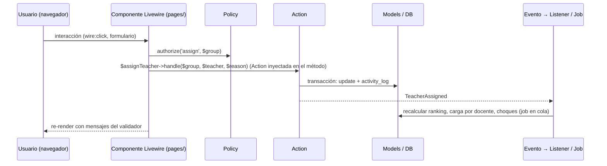

# Arquitectura

Nexus es un **monolito modular** en Laravel 13 + Livewire 4. No es hexagonal ni DDD: no hay capas Domain/Infrastructure ni repositorios abstractos. La modularidad se logra con carpetas por módulo, dependencias en una sola dirección y una convención fija para cada tipo de clase.

## Stack

| Capa | Tecnología | Notas |
|---|---|---|
| Runtime | PHP 8.5 sobre FrankenPHP + Laravel Octane (worker mode) | Ya configurado en `Dockerfile` y `compose.yaml`. Cuidado con estado estático entre peticiones. |
| Framework | Laravel 13 | |
| UI | Livewire 4 con componentes multi-archivo (MFC), MaryUI sobre daisyUI y Tailwind 4 | Sin SPA ni API REST para la UI. |
| Base de datos | PostgreSQL 18.6 | Única fuente de verdad. Tests también contra PostgreSQL. |
| Caché, sesiones, colas | Valkey 9 (driver `redis`) | Colas para importaciones, recálculos y corridas del motor. |
| Auth | Laravel Fortify (username + contraseña), spatie/laravel-permission | Sin registro público; los usuarios se crean desde importación o por un admin. |
| Bitácora | spatie/laravel-activitylog | Inmutable. |
| Pruebas | Pest 5 (unit, feature, browser) | Ver `docs/arquitectura/testing.md`. |
| Motor de horarios | Heurística en PHP (R2) y servicio Python con OR-Tools CP-SAT (R2) | Ver `docs/arquitectura/solver.md`. |
| Infraestructura | Docker Compose: nginx (solo dev), app, queue, postgres, valkey, vite (dev); en producción `caddy` (HTTPS) reemplaza a nginx y se suma `backup` ([ADR-0013](../decisiones/0013-despliegue-on-premise-itcj.md)); `solver` se añade en R2 | |

## Estructura de un módulo

```
app/Modules/<Modulo>/
├── <Modulo>ServiceProvider.php   extiende ModuleServiceProvider (ver "Registro de un módulo")
├── Models/                       Eloquent, relaciones, scopes y casts; sin lógica de proceso
├── Enums/                        enums PHP respaldados por string
├── Actions/                      una clase por caso de uso de escritura (Create…, Assign…, Close…, Publish…)
├── Queries/                      consultas de lectura reutilizables para pantallas, tableros y exportes
├── Rules/                        reglas de validación y validadores de dominio (p. ej. ConstraintValidator)
├── Livewire/
│   ├── pages/                    pantallas completas (MFC: carpeta con .php y .blade.php)
│   └── components/               piezas reutilizables del módulo
├── Policies/                     autorización por rol y alcance (role_scopes)
├── Jobs/  Events/  Listeners/  Notifications/   solo si el módulo los necesita
├── Http/                         middleware y respuestas HTTP propias (p. ej. las de Fortify), solo si hacen falta
├── Providers/                    providers adicionales del módulo, registrados en bootstrap/providers.php junto al suyo
├── Routes/web.php                rutas del módulo, con middleware de auth y prefijo propio
├── Database/
│   ├── Migrations/
│   ├── Factories/
│   └── Seeders/
├── Views/                        vistas Blade que no son Livewire (PDF, correos), si hacen falta
└── Lang/es/                      textos del módulo (opcional; la app corre en español)
```

### Registro de un módulo

La clase base abstracta `App\Modules\Core\ModuleServiceProvider` vive en `Core` porque todos los módulos pueden depender de `Core`. Cada `<Modulo>ServiceProvider` la extiende, vive en la raíz de su carpeta y se agrega a `bootstrap/providers.php` en el orden del mapa. Al arrancar registra, a partir de la carpeta del módulo y **solo lo que existe**:

| Carpeta | Qué registra | Cómo se usa |
|---|---|---|
| `Routes/web.php` | Rutas con middleware `web`; el prefijo y `auth` los pone el archivo del módulo | `Route::livewire('/campus', 'core::pages.campuses')` |
| `Database/Migrations/` | Migraciones | `php artisan migrate` |
| `Views/` | Vistas Blade | `view('core::pdf.horario')` |
| `Livewire/` | Namespace Livewire para MFC: `pages/<nombre>/<nombre>.php` + `.blade.php` | `core::pages.<nombre>`, `core::components.<nombre>` |
| `Lang/` | Traducciones | `__('core::campus.title')` |
| `Policies/` | `Policies/<Modelo>Policy` ↔ `Models/<Modelo>` lo resuelve el auto-descubrimiento de Laravel. Las que no siguen la convención (p. ej. modelos de un paquete) se declaran en `protected array $policies` del provider | `$this->authorize('update', $campus)` |

El alias del módulo es el nombre de su carpeta en kebab-case (`Core` → `core`, `AcademicLoad` → `academic-load`). El namespace Livewire se registra aunque `Livewire/` todavía no exista, para que el primer componente se pueda generar con:

```bash
docker compose exec app php artisan make:livewire core::pages.campuses      # app/Modules/Core/Livewire/pages/campuses/
docker compose exec app php artisan make:livewire core::components.campus-badge
```

Un provider que sobrescriba `boot()` debe llamar a `parent::boot()`. La base no guarda estado estático (Octane). Las factories no se descubren por convención: el modelo las declara con `#[UseFactory(...)]`.

Las entradas del menú del módulo se declaran en el método `navigation()` de su provider (ver "Navegación").

Reglas:

- **Actions** son la única puerta de escritura. Reciben datos ya validados, abren la transacción, escriben, registran bitácora y disparan eventos. Los componentes Livewire nunca escriben en modelos directamente.
- **Queries** devuelven builders o DTOs simples para listados; evitan que las pantallas armen consultas complejas.
- **Models** solo tienen relaciones, casts, scopes y accessors. Nada de "si el estado es X entonces…" dentro del modelo; eso va en Actions o Rules.
- **Livewire** valida entrada, llama Actions o Queries y renderiza. Sin consultas en Blade.
- Un módulo **no importa clases** de un módulo a su derecha en el mapa de dependencias (ver `docs/dominio/modelo-de-datos.md`). La comunicación en sentido contrario se hace con **eventos**: el módulo de la izquierda dispara el suyo y el de la derecha lo escucha (por ejemplo, Core dispara `CampusUpdated` y un módulo de su derecha lo escucha para revalidar con el perfil nuevo). Escuchar el evento de un módulo de la derecha también es importar su clase, y la prueba de arquitectura lo rechaza.
- Pruebas de arquitectura en `tests/Arch/ModulesTest.php` hacen cumplir estas reglas: cada carpeta de `app/Modules` está en el mapa y tiene su provider registrado; dependencias solo hacia la izquierda del mapa, con `arch()` para las clases y una revisión de texto de toda la carpeta del módulo para lo que `arch()` no ve (rutas, migraciones y componentes MFC, que son clases anónimas, y Blade), que detecta namespaces, imports agrupados y alias (`scheduling::…`); modelos sin request, sesión ni auth (fachadas, alias globales como `\Auth`, helpers y los contratos `Guard`, `StatefulGuard` y `Factory`); Actions `final`; enums respaldados por string; policies con el trait `UsesScopedContext`. El mapa está copiado en la prueba y otra prueba lo compara con el diagrama de `docs/dominio/modelo-de-datos.md`: si cambia uno, cambia el otro en el mismo PR.

## Módulo de referencia: Campus

El CRUD de Campus de `Core` es la plantilla de todo módulo: cada archivo es el ejemplo de un tipo de clase. Un módulo nuevo copia su forma, no la reinventa (skill `nexus-module`). Rutas relativas a `app/Modules/Core/`.

| Tipo | Archivo | Qué muestra |
|---|---|---|
| Policy | `Policies/CampusPolicy.php` | `final`, trait `UsesScopedContext`. Una ability por permiso de `docs/dominio/reglas-de-negocio.md` ("Aprobaciones y permisos"), citado en el docblock: `viewAny` y `create` por rol; `view`, `update` y `updateProfile` por campus con `covers()`, que ya incluye al admin. Sin `delete`: un catálogo se desactiva. |
| Reglas | `Rules/CampusRules.php` | Las reglas del modelo en un solo lugar, compartidas por las dos Actions, cada una como `ValidationException` sobre su campo (Livewire la muestra junto a él): código UTF-8 válido, en mayúsculas, sin espacios (también NBSP) y no vacío; único también entre borrados (`ensureCodeIsFree`, `codeTaken`); perfil aceptado por `CampusProfile`, completo y normalizado. |
| Action de alta | `Actions/CreateCampus.php` | `final`, recibe `CampusRules` por constructor y `handle(array $data)` con datos ya validados en forma. En una transacción revisa el código, escribe, registra en la bitácora (`created`, `withChanges(['attributes' => …])`) y dispara `CampusCreated`. Si otra sesión gana la carrera del código, convierte la `UniqueConstraintViolationException` de la base en el mismo error de `code`. |
| Action de cambio | `Actions/UpdateCampus.php` | Cambia solo las claves que recibe. Dentro de la transacción relee el campus con `lockForUpdate()`, y contra ese estado calcula el valor anterior. Sin cambios no escribe, no registra ni avisa (compara el perfil normalizado: PostgreSQL reordena el jsonb). Un perfil guardado inválido no da error: lo demás se guarda igual y un perfil válido lo repara. Bitácora `updated` con `attributes` y `old` de lo que cambió, y `CampusUpdated`. No sabe de roles: qué claves le llegan lo decide la página con la policy. |
| Eventos | `Events/CampusCreated.php`, `Events/CampusUpdated.php` | `ShouldDispatchAfterCommit`: salen después del commit (el de cambio, con las columnas que cambiaron). Toda Action que da de alta o cambia un registro del dominio dispara el suyo, aunque todavía no lo escuche nadie: es como Core avisa a los módulos de la derecha. Las de acceso (`RecordLogin`, `UpdateUserPassword`) no lo disparan. |
| Query | `Queries/CampusQuery.php` | `forTable(ScopedContext, $search, $active, $perPage)`: al admin, todo; a los demás, `ScopedContext::campuses()` filtrado por la ability `view` de la policy, sin repetir el alcance. Busca con `TextSearch`, filtra por estado, ordena y pagina. `findOrFail($id)` carga lo que se edita: el componente no lee con Eloquent. |
| Búsqueda | `Queries/TextSearch.php` | `TextSearch::apply($query, ['code', 'name'], $search)`, para todos los listados: "contiene", sin distinguir mayúsculas, con `%`, `_` y `\` literales; un término vacío no filtra. |
| Página MFC | `Livewire/pages/campuses/campuses.{php,blade.php}` | `mount()` autoriza `viewAny`; cada acción carga con la Query y vuelve a autorizar (una petición puede traer una página que abrió otra sesión). Valida la forma con mensajes y atributos en español, convierte tipos (números, días como lista) y llama la Action. `#[Locked]` en lo que el navegador no debe cambiar, `#[Session]` en los filtros, toast de MaryUI con texto escapado. `x-table` con paginación y el estado con la insignia de Core (`<x-core::status-badge>`, DESIGN.md), `x-modal` con `x-form`; lo que el rol no permite (alta, datos, estado, filtro de inactivos) se muestra deshabilitado con su motivo, y un perfil guardado inválido se marca en la tabla y se edita desde los valores por omisión con un aviso. |
| Ruta y menú | `Routes/web.php`, `CoreServiceProvider::navigation()` | `Route::livewire('/campus', 'core::pages.campuses')->name('core.campuses')` bajo `auth`; `NavigationItem` en el área `NavigationArea::Academico`, con `ability: 'viewAny'` y `arguments: [Campus::class]`. |
| Factory | `Database/Factories/CampusFactory.php` | Estado con nombre del dominio: `inactive()`. |
| Pruebas | `tests/Feature/Core/CampusPolicyTest.php`, `CampusRulesTest.php`, `CreateCampusTest.php`, `UpdateCampusTest.php`, `CampusQueryTest.php`, `CampusesPageTest.php`; `tests/Unit/Core/TextSearchTest.php`; `tests/Browser/Core/CampusesTest.php` | Policy por rol y por campus. Reglas y Actions con bitácora, evento después del commit, carrera del código (un duplicado insertado entre la revisión y la escritura) y bloqueo (feature, porque necesitan la base o el contenedor; lo puro, como `CampusProfile` o `TextSearch::escape`, va en unit). Query por rol. Página: lo que hace cada rol, errores en español, negativas por rol y por campus llamando cada método de Livewire directo, y quién ve la entrada del menú. Un flujo de navegador: el admin da de alta y edita; el coordinador no ve la opción. |

Para crear un módulo o agregarle una pantalla de catálogo, una Action, una Query o una Policy, sigue los pasos de `.claude/skills/nexus-module/SKILL.md`, que remite a estos archivos y reúne los errores que ya atraparon las revisiones.

## Plantillas de importación

Cada catálogo que llega del SII se importa con una plantilla: una clase en `app/Modules/Imports/Templates/` que extiende `ImportTemplate` y se agrega a la lista `TEMPLATES` de `ImportsServiceProvider`. Todas viven en Imports, también las de Academic, Faculty, Facilities y Students, porque Imports depende de los catálogos y no al revés (tarea 1.1). El ejemplo para copiar es `tests/Fixtures/ImportTemplates/CampusesTemplate.php`.

| Método | Qué decide |
|---|---|
| `key()`, `label()` | Clave (`import_batches.template`) y nombre en la interfaz |
| `fields()` | Campos que espera, en orden, con su etiqueta en español: a ellos se mapean las columnas del archivo y con ellas se escriben los mensajes de error |
| `naturalKey()`, `requiresCampus()` | Clave natural de `reglas-de-negocio.md` ("Reglas de datos"); si es por campus, `requiresCampus()` agrega `campus_id` del campus del lote |
| `model()` | El modelo que escribe |
| `normalize()` | Recorta, junta espacios y convierte vacíos en null; la plantilla la extiende (claves en mayúsculas, fechas del SII) |
| `rules()`, `messages()` | Reglas de Laravel por campo sobre la fila normalizada |
| `check()` | Lo que lee la base (claves cruzadas). La de la base ya marca como error un registro borrado con la misma clave y como advertencia uno inactivo; la plantilla la extiende |
| `attributes()`, `defaults()` | Lo que se escribe en altas y cambios, y lo que solo se escribe al dar de alta |
| `recordKey()` | La clave con que se busca el registro en la base; por omisión la de `keyFor()`. La traduce una plantilla cuyo archivo identifica el registro con claves de otros catálogos (el kardex trae el número de control y la clave de materia; la tabla guarda `student_id` y `subject_id`, tarea 1.4). Devuelve null si la fila apunta a algo que no existe, y `check()` lo reporta |
| `apply()` | Alta o cambio por clave natural. En un cambio no pisa con null lo que el archivo trae vacío y nunca cambia `is_active`; un borrado no se restaura. La plantilla lo sobrescribe solo si su escritura no es un registro por fila |
| `afterApply()` | Lo que corre una vez al terminar el lote, como el job de recálculo de progreso de Students (tarea 1.4) |

`validate()` y `keyFor()` son `final`: el motor depende de que se comporten igual en toda plantilla. `keyFor()` da la clave tal como viene en el archivo, con la que el motor encuentra filas repetidas; `apply()` y `check()` buscan el registro con `recordKey()`. `validate()` también rechaza el texto que no es UTF-8 válido.

La plantilla `rooms` (tarea 1.15) es la primera de un campus (`requiresCampus()`): la clave natural es `code` más el campus del lote, y «desactivar faltantes» solo mira los salones activos de ese campus. Crea el edificio que el campus no tiene con su clave como nombre y avisa (S11, igual que `SubjectsTemplate` con las especialidades), y usa `RoomRules` y `BuildingRules` de Facilities para normalizar las claves como las capturadas a mano.

`TemplateRegistry` se arma al arrancar, como `Navigation`. Ahí rechaza claves repetidas, una clave natural fuera de los campos y los campos que pone el sistema (`id`, `deleted_at`, marcas de tiempo). Guarda clases y pide una plantilla nueva al contenedor en cada `get()`, por eso es un singleton seguro con Octane. Una plantilla no guarda estado del lote: quién lo aplica y el campus llegan en `ImportContext`.

`apply()` escribe sin pasar por las Actions del catálogo porque corre dentro de la Action que aplica el lote. Por eso no deja bitácora por registro: el lote deja una entrada y el detalle queda en `import_rows`. Si el catálogo tiene reglas propias (como `CampusRules`), la plantilla las usa en `normalize()` y `check()`, para que un registro importado cumpla lo mismo que uno capturado.

El motor lee el archivo con `Imports/Readers/SpreadsheetReader`, en streaming con openspout. Toma la primera hoja de un CSV o XLSX y usa la primera fila que no está vacía como encabezado. En un CSV detecta el separador (coma, punto y coma o tabulador) y la codificación: UTF-16 por su BOM, que es el "Texto Unicode" de Excel; si no, UTF-8 o Windows-1252, revisando el archivo completo por bloques. Las filas se numeran como en el archivo, para que los errores digan "fila 12". Un archivo que no se puede importar tal cual (`.xls` antiguo, sin encabezado, columna repetida) lanza `UnreadableFile` con el mensaje que ve el admin.

`ValidateImportBatch` toma un lote `uploaded` y no escribe en el catálogo:
1. Mapea las columnas con `Templates/ColumnMatcher`: con el mapeo del lote o, sin él, por nombre de campo o por etiqueta, sin importar mayúsculas, acentos ni espacios. Sin la columna de la clave natural, el lote queda `failed`. El asistente usa el mismo `ColumnMatcher` para proponer el mapeo antes de validar.
2. Por cada fila llama a `normalize()`, `validate()` y `keyFor()`.
3. Guarda las filas en `import_rows` de 500 en 500.
4. Marca en SQL, por `key_hash`, las filas que repiten la clave de una anterior.

El lote queda `validated` con sus cuentas, con bitácora y `BatchValidated`. Como la fila normalizada se guarda en JSON y `apply()` la lee de ahí, `normalize()` pasa las fechas a texto ISO.

`ApplyImportBatch` toma un lote `validated`. Escribe con `apply()` las filas válidas y con advertencia, en el orden del archivo y de 500 en 500, una transacción por bloque, y salta las filas con error. Antes de escribir cada fila la vuelve a validar, porque el catálogo pudo cambiar desde la validación: la que ya no pasa queda como error y se salta. Pagina por `row_number` y no por offset, porque cada fila sale del filtro al pasar a `applied`. Al terminar corre `afterApply()` y deja **una** entrada de bitácora para el lote, con altas, cambios, filas sin cambios y filas saltadas, más `BatchApplied`. Si una fila no se puede escribir, su bloque se revierte y el lote queda `failed` con la fila y el motivo. Los bloques anteriores se quedan: la bitácora del fallo y `BatchApplied` llevan lo que sí se escribió, y volver a importar es seguro por el upsert.

Un mapeo de columnas se guarda con `CreateImportMapping`, para reutilizarlo con cada archivo del mismo layout del SII (ADR-0005): el nombre no se repite dentro de la plantilla (sin importar mayúsculas), cada campo recibe a lo más una columna y la clave natural tiene que tener la suya. Lo que decide si un mapeo cabe en una plantilla vive en `ColumnMatcher` (`unknownFields()`, `describeMissingKey()`), que también dice qué columnas de un mapeo guardado no vienen en el archivo (`absentColumns()`), para que el asistente lo avise antes de validar. Un mapeo no se edita ni se borra: el que ya no sirve se desactiva, porque los lotes que lo usaron lo siguen citando.

El asistente lee el lote con `Queries/ImportBatchQuery`: los lotes recientes para retomarlos, las filas con error o con advertencia por número de fila (`Enums/RowIssue`), el avance y lo escrito. El CSV con las filas con error lo escribe la cola con `Actions/ExportBatchErrors` al terminar de validar y otra vez al terminar de aplicar, porque al aplicar pueden aparecer filas nuevas con error. Queda en el disco `imports` junto al archivo subido (`$batch->errors_path`), y el lote anota cuándo quedó listo (`errors_exported_at`, que vuelve a null al empezar a aplicar), para que nadie descargue el de la validación mientras se rehace; la marca no depende del reloj del sistema de archivos. Cada fila sale tal como vino en el archivo, con su número al principio y sus errores al final, para corregirla y volver a subir el archivo; un texto que Excel tomaría por fórmula sale con un apóstrofo. La página solo lo descarga, desde `GET /imports/batches/{id}/errors` (`Http/Controllers/DownloadBatchErrors`). Armarlo en la petición pasaría del segundo que se permite con un kardex mal mapeado, que puede traer cientos de miles de filas con error.

La pantalla es `imports::pages.import-wizard` (`/imports`, entrada "Importaciones" del menú, solo para el admin), un asistente en cuatro pasos: archivo, columnas, validación y aplicación. Lee el encabezado del archivo y propone las columnas con `ColumnMatcher`, por nombre o con un mapeo guardado. Si el admin cambia la propuesta, la guarda como mapeo nuevo con nombre. Después sube el lote y lo manda a validar a la cola. El lote abierto va en la URL (`?lote=`), así que se retoma al volver o desde los lotes recientes. Con el lote validado, la página muestra sus cuentas y las filas con error o con advertencia, con sus mensajes, y ofrece el CSV de errores en cuanto la cola lo termina. "Aplicar" encola `ApplyQueuedBatch` solo si el lote sigue validado y tiene filas válidas. Al terminar, muestra altas, cambios, filas sin cambios y filas con error que no se aplicaron. Mientras la cola trabaja, o prepara el archivo de errores, la tarjeta del lote se refresca con `wire:poll`. La copia temporal que Livewire guarda al subir vive en el mismo disco `imports` (`tmp/`, `config/livewire.php`), porque trae datos personales. Se borra al subir el lote, al cambiar de archivo y al empezar de nuevo; si el admin cierra la pestaña, la borra la limpieza de Livewire a las 24 horas. Si la cola no responde al subir, el lote ya quedó abierto y "Validar de nuevo" lo vuelve a encolar (un job de más no lo toca). Livewire acepta hasta 19 MB para que, con el resto de la petición, quepa en los 20 MB de PHP (`docker/php/prod.ini` y, en desarrollo, `docker/php/dev.ini`), Caddy y nginx.

Las Actions de lote y de mapeo (`StoreImportBatch`, `ValidateImportBatch`, `ApplyImportBatch`, `CreateImportMapping`) no autorizan: lo hace la página con `ImportBatchPolicy`, que solo deja al admin; guardar un mapeo es parte de importar.

Validar y aplicar corren en la cola con `Jobs/ValidateQueuedBatch` y `Jobs/ApplyQueuedBatch`. Cada bloque de 500 filas suma al lote su avance (`processed_rows`: filas leídas al validar, revisadas al aplicar) y, al aplicar, las altas, cambios y filas sin cambios ya escritas; la pantalla lo lee con `wire:poll`, y la bitácora y `BatchApplied` toman las cuentas de ahí (`ImportBatchQuery::appliedCounts()`). Cada job hace un solo intento con 30 minutos de tiempo máximo y lleva su corrida (`run`), que queda en el lote (`run_id`) al empezar. Si la Action encuentra el lote en otro estado (`BatchNotReady`: otra corrida lo tomó, como dos clics en "aplicar", o ya terminó), el job termina sin tocarlo. Si el job falla, su `failed()` llama a `InterruptImportBatch`, que deja fallido el lote solo si sigue "validando" o "aplicando" por esa misma corrida: el proceso murió o pasó del tiempo máximo. Así el fallo de un job duplicado no tumba la corrida que sigue viva. Cuando el job pasa del tiempo, Laravel revierte la transacción que quedó abierta antes de llamar a `failed()`, porque los jobs fallidos se guardan en la misma base (`queue.failed`). Todo lote fallido pasa por `FailImportBatch`: una validación fallida se queda sin filas ni avance; una aplicación fallida conserva lo escrito y lo dice en su bitácora y en `BatchApplied`.

Pruebas de una plantilla: unit para `normalize()` y lo puro; feature para `validate()` (cada regla con su mensaje y cada clave cruzada) y `apply()` (alta, cambio, aplicar dos veces sin cambios). Copia `tests/Unit/Imports/ImportTemplateTest.php` y `tests/Feature/Imports/ImportTemplateTest.php`.

## Módulos

| Módulo | Responsabilidad | Entrega |
|---|---|---|
| `Core` | Auth (Fortify, username), usuarios, roles y alcances, campus y modalidad, periodos y etapas, parámetros, bitácora, notificaciones, layout y navegación | R1 |
| `Academic` | Departamentos, jefes, carreras, planes de estudio, materias, seriación, especialidades | R1 |
| `Facilities` | Edificios, salones, bloqueos, salones por defecto | R1 |
| `Faculty` | Docentes, plazas, disponibilidad, horas externas, historial, perfil, evaluaciones | R1 |
| `Students` | Alumnos, kardex, avance reticular | R1 |
| `Imports` | Importador por archivos: plantillas, mapeos, staging, validación, aplicación | R1 |
| `CatalogValidation` | Revisión y validación de catálogos por jefes de departamento cada periodo | R1 |
| `AcademicLoad` | Orquestación del flujo: propuestas, estados, acuerdos, solicitudes de cambio, cierre, aprobación, publicación, snapshots, re-análisis | R1 (base), R2 (re-análisis e impacto) |
| `Scheduling` | Grupos, sesiones, cupos por carrera, salones, validador de restricciones, editor de horarios, tablero de choques | R1 (manual + validador), R2 (heurística) |
| `Staffing` | Ranking docente, asignación, historial, carga por docente | R1 |
| `Demand` | Proyección de demanda y grupos sugeridos | R2 |
| `Solver` | Cliente del motor, corridas, contrato; servicio Python en `services/solver/` | R2 |
| `Enrollment` | Orden de inscripción, citas, auto-inscripción, listas de espera | R3 |

## Flujo de una petición típica



## Llaves

Todo modelo de Nexus usa UUIDv7 como llave primaria ([ADR-0014](../decisiones/0014-uuidv7-como-llave-primaria.md)); `tests/Arch/ModulesTest.php` y `tests/Feature/Core/PrimaryKeysTest.php` lo exigen.

- **Migración:** `$table->uuid('id')->primary()->default(DB::raw('uuidv7()'));`, `foreignUuid()` para las llaves foráneas y `nullableUuidMorphs()` para las polimórficas. El default cubre los inserts que no pasan por el modelo, como las importaciones en bloque.
- **Modelo:** `use HasUuids;`, que genera el UUIDv7 en la app antes de insertar.
- **Ids que llegan del cliente:** una propiedad de Livewire, un argumento de `wire:click` o un segmento de ruta pueden traer algo que no es uuid, y PostgreSQL lo rechaza con un error. Las Queries buscan con `KeyLookup::findOrFail($query, $id)` (`Core/Queries`), que lo trata como un registro que no existe (`ModelNotFoundException`), o con `KeyLookup::find()`, que devuelve `null` (así lee `ScopedContext` el periodo guardado en la sesión). Una prueba de texto prohíbe `find()` y `findOrFail()` del modelo en Queries y componentes. Las propiedades de id son `?string`; un select vacío llega como `''`, así que se pregunta con `blank()`.
- **Blade:** el id va entre comillas en las expresiones que Livewire evalúa: `wire:click="edit('{{ $campus->id }}')"` y `spinner="edit('{{ $campus->id }}')"`.
- **Orden:** los listados ordenan por una columna del dominio (código, nombre, fecha), no por `id`.
- **Infraestructura:** `jobs`, `failed_jobs`, `roles`, `permissions` y `activity_log` conservan su llave bigint; no son entidades de Nexus. Por eso el sujeto de la bitácora es siempre un modelo de Nexus: un cambio de rol se registra sobre el usuario, no sobre el `Role` de spatie.

## Autorización y alcance

- Los **roles** (spatie, enum `Role`) dicen qué puede hacer alguien; los **alcances** (`role_scopes`, modelo `RoleScope`) dicen sobre qué campus, departamento o carrera. Un rol cuenta solo con el rol de spatie **y** un alcance vigente hoy en Ciudad Juárez (`RoleScope::current()`), en un campus activo y no borrado, que llene lo que exige `Role::scopeColumns()`: campus para `subdireccion` y `docente`, departamento en un campus para los dos jefes, carrera en un campus para `coordinador`. Un usuario inactivo no tiene ningún rol.
- `admin` tiene todos los roles y lo cubre todo sin alcance, también los campus desactivados o borrados (reactiva los desactivados en el CRUD de Campus), pero sus acciones quedan en bitácora como las de cualquiera.
- `docente` nunca cubre por `covers()`, ni pasando `Role::Docente`: su acceso a su propia carga lo deciden las policies de Staffing y Scheduling por asignación. `has(Role::Docente)` y `canAccessCampus()` sí lo cuentan.
- Un alcance cubre un objetivo de su campus si no fija departamento o carrera, o si fija los del objetivo: el jefe de D cubre lo de D en cualquier carrera; el coordinador de X, lo de X en cualquier departamento.
- `ScopedContext` (`Core/Queries`) es la única puerta para preguntar por rol y alcance; el contenedor la registra con `scoped` (una instancia por petición, por Octane) para el usuario autenticado:

| Método | Responde |
|---|---|
| `has(Role $role): bool` | ejerce el rol en algún lugar |
| `roles(): list<Role>` | los roles que ejerce, en el orden del enum; el admin, solo `Admin` (la credencial muestra el primero y la página de inicio, uno por bloque) |
| `covers(Role\|array $roles, Campus\|string $campus, ?string $department = null, ?string $career = null): bool` | con alguno de los roles cubre el campus completo, o el departamento o la carrera dentro de él |
| `canAccessCampus(Campus\|string $campus): bool` | trabaja en el campus con algún rol, aunque sea sobre una parte |
| `isAdmin()`, `user()`, `scopes(?Role $role = null)` | admin, usuario activo, alcances vigentes y completos |
| `campuses()`, `activeCampus()`, `activeTerm()` | campus activos donde trabaja (selector de la credencial), y el campus y periodo activos |
| `forUser(User $user)` | el contexto de otro usuario, sin su elección de sesión; se recuerda por id en la instancia y no carga los roles del autenticado para compararlo |
| `refresh(): void` | vuelve a cargar roles y alcances en la misma petición; la llama la Action que los cambie |

- **Policies:** usan el trait `Core\Policies\Concerns\UsesScopedContext` (una prueba arch lo exige) y preguntan con `$this->scope($user)`, que decide por el usuario que recibe la policy aunque no sea el autenticado (`Gate::forUser()`). Ejemplo: `$this->scope($user)->covers([Role::JefeDepartamento, Role::Coordinador], $group->campus_id, department: $group->department_id, career: $group->career_id)`.
- **Contexto activo:** la Action `SetActiveContext::handle(?Campus $campus, ?Term $term)` lo guarda en la sesión (`ScopedContext::ACTIVE_CAMPUS` y `ACTIVE_TERM`); rechaza con `AuthorizationException` un campus que no esté en `campuses()` y `null` vuelve al de omisión. Por omisión, el campus es el único de `campuses()` (si hay varios, ninguno) y el periodo, el `is_current`. Cada lectura revalida el campus guardado contra el alcance vigente; `campuses()` y `activeTerm()` se recuerdan en la petición.
- **Catálogos de un campus** (salones, carrera-campus, todo lo que tenga `campus_id`): el listado filtra por `activeCampus()` y el alta usa ese campus; los formularios no llevan un select de campus. Sin campus activo, la pantalla pide elegir uno en la credencial.
- La navegación y los tableros se filtran por alcance con `ScopedContext`, para que ninguna pantalla repita la lógica. Las pruebas usan `User::factory()->admin()` y `User::factory()->withRole(Role::Coordinador, ['campus_id' => …, 'career_id' => …])`, que lanza `InvalidArgumentException` si el alcance no llena lo que exige el rol.

## Navegación

El menú del layout (`resources/views/layouts/app.blade.php`) lo arma Core, pero las entradas las declara cada módulo, así que Core no conoce a los módulos de su derecha:

```php
// app/Modules/Core/CoreServiceProvider.php
public function navigation(): array
{
    return [
        new NavigationItem('Inicio', 'home', 'o-home', NavigationArea::Academico),
        new NavigationItem('Campus', 'core.campuses', 'o-building-office-2', NavigationArea::Academico,
            ability: 'viewAny', arguments: [Campus::class]),
    ];
}

// app/Modules/AcademicLoad/AcademicLoadServiceProvider.php (ejemplo)
public function navigation(): array
{
    return [
        new NavigationItem('Propuestas', 'academic-load.proposals', 'o-document-text', NavigationArea::Academico,
            visible: static fn (ScopedContext $context): bool => $context->has(Role::Coordinador)),
    ];
}
```

- `NavigationItem` (`Core/Navigation`): etiqueta en español, **nombre** de una ruta del módulo, icono Heroicon de MaryUI, **área** del menú (cuarto argumento, obligatorio) y quién la ve. "Quién" es `visible` (una función que recibe `ScopedContext`), una ability de Gate con su argumento (`ability` y `arguments`, que reutilizan la policy del módulo) o ambas, y entonces debe cumplir las dos; sin ninguna, la ve cualquier usuario activo. Nunca se decide por el código del campus.
- `NavigationArea` (`Core/Enums`, ADR-0015) son las áreas del menú, cada una con `label()` e `icon()`: Académico, Servicios escolares, Recursos humanos, Recursos financieros y Datos. **El orden de sus casos es el del menú**; toda entrada declara la suya. Un área nueva es un caso nuevo del enum, en el lugar donde debe aparecer, y cambia ADR-0015: se acuerda antes. Hoy Inicio y Campus van en Académico, e Importaciones en Datos.
- `Navigation` (`Core/Navigation`) es el registro: junta las entradas de todos los `ModuleServiceProvider` en el orden de `bootstrap/providers.php` y, dentro de un módulo, en el que las declara. Es un singleton **inmutable** (clases `final readonly`, lo exige `tests/Arch/NavigationTest.php`) que Core arma en `booted`, cuando ya arrancaron todos los módulos: con Octane se crea una vez por worker. Lo que depende del usuario se calcula en cada petición, sin guardarlo: `visibleTo(ScopedContext)` da la lista plana y `visibleByArea(ScopedContext)` la agrupa (`list<array{area: NavigationArea, items: non-empty-list<NavigationItem>}>`), con las áreas en el orden del enum, solo las que tienen alguna entrada visible y, dentro de cada una, las entradas en el orden del registro. `forRoute(string $route)` da la entrada declarada para una ruta, la vea o no el usuario (la primera si varias la declaran; `null` si ninguna), para mostrar «área › pantalla».
- `core::components.navigation` es el menú que se transforma (DESIGN.md): muestra `visibleByArea()` del usuario, cada área como un grupo con su nombre (`aria-label`), su icono y sus entradas. El **área actual** es la de la entrada de la pantalla (`forRoute()` con el nombre de la ruta) si el usuario la ve; si no, la primera que ve. La **entrada activa** es esa misma entrada y lleva `aria-current="page"`. Cada elemento lleva su lugar en la retícula del menú abierto como variables CSS (`--c`, `--i`, `--col-t`, `--base-t`), que calcula el componente. El icono de cada área es un enlace (`wire:navigate`): el del área actual lleva a su primera entrada visible; el de las demás, a la última página que el usuario visitó de esa área o, si no hay, a su primera entrada. Ninguna entrada puede apuntar a una ruta inexistente: `tests/Feature/Core/NavigationTest.php` lo verifica para todas las declaradas. Una entrada se agrega en el mismo PR que su pantalla, con una prueba de quién la ve y quién no.
- `RecentPages` (`Core/Navigation`) guarda en la sesión esa última página por área (`core.recent_pages.<área>`), como la ruta relativa de la petición con su consulta (`getRequestUri()`). La anota el menú al montarse en una página completa, solo si la ruta es de una entrada, o de una pantalla hija (`childRoutes`), que el usuario ve. `SetActiveContext` la olvida al cambiar el campus o el periodo. No se registra en el contenedor: cada uso arma la suya con la sesión y el `ScopedContext` de su petición, así que no guarda nada entre peticiones con Octane.

### Layout (shell)

`resources/views/layouts/app.blade.php` es el layout de toda página MFC. Con sesión pinta, en este orden:

1. `core::components.band`: la banda con la liebre (el botón del menú completo), «Nexus», la ruta (el área de `forRoute()` y el `#[Title]` de la página, que el layout le pasa), «Buscar o ir a… Ctrl K» y la credencial. La credencial muestra el nombre, las iniciales, el primer rol de `ScopedContext::roles()` con `Role::label()`, y el campus y el periodo activos; se abre como tarjeta con `core::components.context-switcher`, el tema (el `x-theme-toggle` de MaryUI, que lo aplica y lo recuerda en `localStorage`; los botones Claro y Oscuro solo le piden cambiarlo), «Cambiar contraseña» y «Cerrar sesión».
2. `core::components.navigation`: el menú.
3. `<main id="nexus-content">`, el contenido, y los toasts de MaryUI (`<x-toast />`).

Sin sesión, solo el contenido. El layout ya no usa `x-nav` ni el cajón de `x-main` de MaryUI.

El estado y el movimiento los lleva el componente Alpine `nexusShell` (`resources/js/app.js`, registrado en `alpine:init`; Alpine viene con Livewire), puesto en `<body>`. El menú abierto o cerrado vive en `<body data-menu="open|closed">` y las utilidades de la banda y del menú lo leen con la variante `in-data-[menu=open]:`; la geometría por ancho (`--shell-top`, `--menu-w`, `--panel-w`, `--panel-clip`) la declara `<body>` con `max-desktop:` y `max-md:`. El breakpoint `desktop` (1200 px) es un token de `resources/css/app.css`. La única regla del shell escrita a mano en ese archivo bloquea el desplazamiento de la página con el menú abierto, con el candado de daisyUI que usan los modales, porque vive en `:root` y una utilidad no llega ahí. Antes de que Livewire cambie de página (`livewire:navigating`), `nexusShell` cierra todo sin animar, así la página que guarda para el botón de atrás queda cerrada; la página nueva llega cerrada del servidor.

La tarjeta de la credencial lleva `core::components.context-switcher`: ofrece `ScopedContext::campuses()` (fijo si solo hay uno) y los periodos de `TermQuery::selectable()`, y guarda la elección con `SetActiveContext`, que además olvida las páginas que el menú recuerda por área; elegir el periodo actual deja el de omisión para seguirlo cuando cambie, y sin periodo activo muestra "Sin periodo". Si el campus o el periodo no existen o no se permiten, avisa con un toast de error y regresa la selección al contexto vigente, sin el error de Livewire. No hace falta middleware: `ScopedContext` lee la sesión en cada petición. El middleware `NormalizeSidebarState` (grupo `web`) reescribe a `'false'` cualquier valor de `mary-sidebar-collapsed` que no sea `'true'` o `'false'`, porque `<x-main>` de MaryUI lo imprime dentro de `x-data`; el shell ya no usa `<x-main>`, pero la ruta de MaryUI que guarda ese valor sigue registrada. La página de inicio (`/`, `core::pages.home`) muestra un bloque por cada rol de `ScopedContext::roles()`, con su `Role::label()`; el admin, solo el suyo.

## Acceso

- **Login** con Fortify por `username` (ADR-0004), configurado en `config/fortify.php` y en `App\Modules\Core\Providers\FortifyServiceProvider`: `authenticateUsing` busca el username tal como viene del SII y rechaza a los inactivos con el mismo mensaje genérico que una credencial incorrecta. Para que el tiempo no delate si el usuario existe, la contraseña se compara siempre (contra un hash señuelo del mismo costo, calculado una vez por proceso, si el username no existe) y el intento fallido dura al menos lo mismo (Timebox). El limitador `login` permite 5 intentos por minuto por username e IP. Al entrar, la Action `RecordLogin` anota `last_login_at` (no la de un usuario inactivo). Fortify solo expone login, logout, `PUT /user/password` y la confirmación de contraseña (`core::auth.confirm-password`, para el middleware `password.confirm`): sin registro, recuperación por correo, verificación, perfil, 2FA ni passkeys.
- **Middleware del grupo `web`** (`bootstrap/app.php`), así cubren las rutas de todos los módulos sin que cada uno los declare, en este orden:
  1. `AuthenticateSession` de Laravel: cierra las sesiones cuyo hash de contraseña ya no coincide, es decir, las demás sesiones de quien cambió su contraseña.
  2. `EnsureUserIsActive`: si el usuario se desactivó con la sesión abierta, la cierra en su siguiente petición (logout, invalidar sesión, nuevo token CSRF) y lo manda al login con un aviso genérico.
  3. `EnsurePasswordIsChanged`: mientras `must_change_password` sea true, solo deja pasar `GET /user/password` (`core::auth.change-password`), su `PUT` y el logout.

  A una petición JSON o de Livewire (`X-Livewire`) los dos de Core le responden 401 y 403 en lugar de redirigir.
- **Cambio de contraseña:** el `PUT` lo atiende Fortify con la Action `UpdateUserPassword` (contrato `UpdatesUserPasswords`): exige la contraseña actual y una nueva confirmada y distinta, conforme a `Password::defaults()` (mínimo 8 caracteres con letras y números), apaga `must_change_password`, rota el `remember_token` y registra `password-changed` en la bitácora sin la contraseña. Su respuesta (`Http/Responses/PasswordUpdateResponse`) regenera el id de la sesión actual, que sigue activa; si era el cambio obligatorio lleva a la página que se había pedido (o al inicio) y si fue voluntario vuelve a la pantalla con el aviso "Tu contraseña se actualizó.".
- **Contraseña por defecto:** `Core\Support\DefaultPassword` lee `auth.default_password` (env `NEXUS_DEFAULT_PASSWORD`; falla con `RuntimeException` si está vacía) y compara con `hash_equals`. `CreateStaffUser` da de alta usuarios activos con ella y `must_change_password`; `ResetUserPassword` (solo admin) la restablece, rota el `remember_token` y cierra las demás sesiones; `authenticateUsing` llama a `RequirePasswordChange` cuando alguien entra con ella, y `UpdateUserPassword` la rechaza como contraseña nueva («No puedes usar la contraseña por defecto.»). La bitácora (`created`, `password-change-required`, `password-reset`) nunca lleva contraseñas.
- Cada módulo sigue poniendo `auth` en sus rutas (ver "Registro de un módulo"); estos middleware no lo sustituyen.

## Acceso de docentes

Los usuarios, roles y alcances de los docentes y de los jefes se escriben solo con estas Actions (reglas-de-negocio.md, "Acceso de docentes", "Baja de un docente", S14 y S15). Cuando cambian roles o alcances recargan `ScopedContext` (también el del usuario autenticado y los de `forUser()`); `EndDepartmentHead` y `SyncTeacherAccess`, si no cambian nada, no escriben ni registran nada. La bitácora va por cambio, sobre el registro que cambia (abajo), y ninguna entrada lleva contraseñas.

- **Jefaturas (Academic):** `AppointDepartmentHead::handle(Department, Campus, User, DepartmentHeadKind, CarbonImmutable $from, ?CarbonImmutable $to)` escribe en una transacción la fila de `department_heads`, el rol de spatie (`DepartmentHeadKind::role()`) y un `role_scopes` con el mismo campus, departamento y fechas. Las exclusiones de la base (un jefe vigente por departamento y campus; la misma persona no repite cargo en fechas que se traslapan) se vuelven `ValidationException` sobre `user` («Ya hay un jefe de <departamento> vigente en <campus> en esas fechas.»); una fecha de fin anterior al inicio, sobre `valid_to`, y un usuario inactivo, sobre `user` («El usuario está inactivo.»); otro error de la base (SQLSTATE distinto de 23P01) sale igual. Deja su bitácora sobre el usuario. `EndDepartmentHead::handle(DepartmentHead, CarbonImmutable $lastDay)` cierra la jefatura y su alcance (el del mismo usuario, rol, campus, departamento y `valid_from`, como lo escribe `AppointDepartmentHead`; otro alcance del mismo cargo que empezó otro día no se toca, y si no encuentra ninguno termina solo la jefatura y la bitácora lo dice, con `role_scope_ids` en sus propiedades) con la regla de `CloseRoleScopes`: terminan en `$lastDay` o, si empiezan después, se borran; nunca alarga una que ya termina antes. Deja su bitácora sobre el usuario. El rol de spatie se queda: sin alcance vigente no cuenta. Avisan con `DepartmentHeadAppointed` y `DepartmentHeadEnded` después del commit.
- **Docentes (Faculty):** `SyncTeacherAccess::handle(Teacher, ?string $passwordHash)` es idempotente y devuelve `AccessSync` (`created`, `linked`, `updated`, `unchanged`, `conflict`). Con el docente activo, usa su usuario ligado o liga el de username = número de empleado sin tocar su contraseña, solo si está activo, no es de otro docente (aunque esté borrado) y no tiene más rol que `docente`; si no, devuelve `conflict` y no toca nada. Si no existe, lo crea con `CreateStaffUser`, con el correo del docente si ningún otro usuario lo usa. Luego activa el usuario ya ligado (así vuelve el de un docente reactivado), le da el rol `docente` y un alcance de `docente` por campus de sus adscripciones sin borrar, y cierra el de un campus que ya no tiene. Con el docente inactivo o borrado, desactiva su usuario (salvo admin) y termina con fecha de ayer sus jefaturas vigentes o por empezar con `EndDepartmentHead`, que borra las que empiezan hoy o después; sus alcances de `docente` se quedan para cuando se reactive, porque un usuario inactivo no ejerce ningún rol. La bitácora va por cambio: la liga sobre el docente, el alta (`CreateStaffUser`) y el acceso (activo, roles y campus de `docente`, antes y después) sobre el usuario, y cada jefatura terminada sobre su usuario. Si cambió algo avisa con `TeacherAccessChanged` (el docente y el resultado) después del commit.
- **Provisión:** `ProvisionTeacherUsers::handle(?User $actor)` corre `SyncTeacherAccess` sobre todos los docentes por bloques de 200, también los borrados, para aplicarles la baja si no se aplicó al borrarlos (sin cambios si ya se aplicó), con un solo hash de `DefaultPassword` por corrida (sin `NEXUS_DEFAULT_PASSWORD` falla antes de tocar a nadie), y devuelve `{created, linked, updated, unchanged, conflicts}` con los números de empleado en conflicto. Además de la bitácora de cada docente que cambió, deja una entrada `provisioned` de la corrida, sin registro sujeto, con las cuentas; con `$actor`, todas a su nombre. La despacha `ProvisionTeacherUsersJob` (único en la cola y sin encimarse, como `RecomputeStudentProgress`), que lanzan el botón «Dar de alta usuarios» de Docentes y la plantilla `teachers` al aplicar.

## Configuración por campus y modalidad

`campuses.settings` es el **perfil de flujo**. Las pantallas y validadores consultan ese perfil, no el código del campus. Así el flujo presencial de R1 sirve para Campus I y II, y en R4 las modalidades EAD, EnLínea y TecNM Virtual se activan ajustando el perfil y añadiendo solo las reglas que de verdad son distintas (asignación centralizada, sesiones virtuales, docentes externos).

El modelo `Campus` expone el perfil como `$campus->profile`, un `CampusProfile` de solo lectura (`app/Modules/Core/Models`). Lo siembra `CampusSeeder` con lo que dicen los documentos; EAD, EnLínea y TecNM Virtual quedan inactivos y su perfil se define en la planeación de la fase 10.

### Eventos con veto

Un evento normal avisa a los módulos de la derecha de lo que ya pasó. Cuando una Action de un módulo necesita **preguntarles** si puede seguir (borrar un departamento que Faculty o Facilities usan, desactivar una materia que Students necesita), no puede llamarlos: no depende de ellos. Usa un evento con veto:

- La Action despacha el evento **dentro de su transacción y antes de escribir**, con `event(new DepartmentDeleting($department))` (no `::dispatch()`, que no devuelve la instancia que vieron los listeners). No es `ShouldDispatchAfterCommit` ni se encola: los listeners contestan en la misma petición.
- El evento usa el trait `Core\Events\Concerns\CanBeVetoed`: el listener llama `$event->block('motivo')` (varios bloqueos juntan sus motivos en orden) y la Action lee `blocked()` y `reasons()`. Si hubo veto lanza `ValidationException::withMessages([...])` con los motivos, y la transacción no escribe nada.
- El evento lleva el registro y, por convención, el nombre en gerundio (`DepartmentDeleting`); el aviso posterior al commit sigue siendo el evento normal (`DepartmentDeleted`).
- Los listeners se registran en el provider del módulo que los escucha.
- Ejemplos: `DepartmentDeleting` (todavía sin listeners; Faculty y Facilities lo usarán) y `SubjectDeactivating`, que Students veta con `BlockSubjectDeactivationWhileNeeded` cuando hay alumnos que todavía necesitan la materia (`SubjectDemandQuery`, desde el kárdex del momento).

### Cambios en la retícula

Lo que entra en el avance de los alumnos (la retícula de un plan, su especialidad y su seriación, los créditos totales del plan, los créditos o el tipo de una materia) es de Academic, pero `student_progress` es de Students. Cada Action de Academic que lo cambia despacha `Academic\Events\CurriculumChanged` con el plan afectado, la materia o los dos (al menos uno). Es `ShouldDispatchAfterCommit`, así que un cambio que se revierte no avisa. Students lo escucha (`RecomputeProgressOnCurriculumChange`, registrado en `StudentsServiceProvider`) y encola `RecomputeStudentProgress`, que es único en la cola y siempre recalcula completo: varios cambios seguidos esperan un solo recálculo. Hoy lo despacha `UpdateSubject` cuando cambian los créditos o el tipo; las Actions de planes y retícula de la tarea 1.8 lo usarán igual.

## Colas y trabajos en segundo plano

Todo lo que tarde más de un segundo va a la cola `redis` (servicio `queue`): validar y aplicar lotes de importación, recalcular `student_progress`, `staffing_rankings`, `teacher_term_loads` y `schedule_conflicts`, generar snapshots y exportes, y correr el motor. Las pantallas muestran progreso con polling de Livewire (`wire:poll`) y notificaciones en base de datos.

El `timeout` de un job tiene que quedar por debajo del `retry_after` de la conexión (`config/queue.php`, 31 minutos): si un job dura más, la cola lo entrega otra vez mientras el primero sigue corriendo. Los más largos son los de importación (30 minutos); un job que necesite más sube los dos. En desarrollo, `queue:listen` mata al proceso que pasa de su `--timeout` (`compose.override.yaml`), que también va por encima. Con un solo worker, un lote largo hace esperar a los demás jobs; y al apagar el contenedor (`stop_grace_period` de 60 s) un job que no termina a tiempo muere, y su lote queda fallido cuando vence el `retry_after`.

## Caché

Valkey como caché para: perfil de flujo por campus, calendario de etapas del periodo actual, conteos de tableros y resultados del validador por periodo. Toda clave incluye `term_id` y `campus_id`, y se invalida por eventos de escritura. Nunca se cachea nada que dependa del usuario sin incluir su id en la clave.

## Internacionalización

La aplicación corre en español (`APP_LOCALE=es`). Los textos de UI van en archivos de idioma del módulo o inline en Blade si son únicos. Nombres de clases, tablas, columnas, rutas y variables en inglés; términos del dominio según `docs/dominio/glosario.md`.

## Observabilidad mínima

Logs estructurados en JSON a stdout (los recoge Docker), `laravel/pail` en desarrollo, página `/up` para healthcheck. Antes de R2 se evalúa Laravel Pulse para ver colas y consultas lentas.

## Lo que queda fuera a propósito

- API pública o móvil: no en R1 a R3. Si se necesita, se expone sobre las mismas Actions y Queries.
- Multi-tenancy: Nexus es una sola institución; campus es un atributo, no un tenant.
- Microservicios más allá del solver: no. El solver existe porque OR-Tools no tiene equivalente en PHP.
