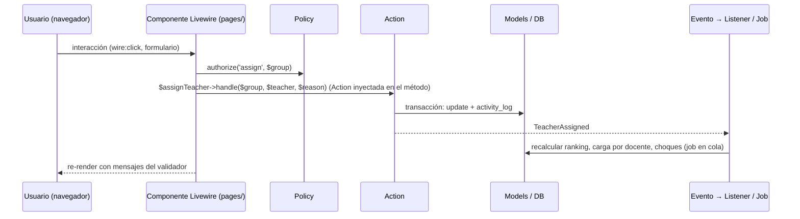

# Arquitectura

Nexus es un **monolito modular** en Laravel 13 + Livewire 4. No es hexagonal ni DDD: no hay capas Domain/Infrastructure ni repositorios abstractos. La modularidad se logra con carpetas por módulo, dependencias en una sola dirección y una convención fija para cada tipo de clase.

## Stack

| Capa | Tecnología | Notas |
|---|---|---|
| Runtime | PHP 8.5 sobre FrankenPHP + Laravel Octane (worker mode) | Ya configurado en `Dockerfile` y `compose.yaml`. Cuidado con estado estático entre peticiones. |
| Framework | Laravel 13 | |
| UI | Livewire 4 con componentes multi-archivo (MFC), MaryUI sobre daisyUI y Tailwind 4 | Sin SPA ni API REST para la UI. |
| Base de datos | PostgreSQL 18.6 | Única fuente de verdad. Tests también contra PostgreSQL. |
| Caché, sesiones, colas | Valkey 9 (driver `redis`) | Colas para importaciones, recálculos y corridas del motor. |
| Auth | Laravel Fortify (username + contraseña), spatie/laravel-permission | Sin registro público; los usuarios se crean desde importación o por un admin. |
| Bitácora | spatie/laravel-activitylog | Inmutable. |
| Pruebas | Pest 5 (unit, feature, browser) | Ver `docs/arquitectura/testing.md`. |
| Motor de horarios | Heurística en PHP (R2) y servicio Python con OR-Tools CP-SAT (R2) | Ver `docs/arquitectura/solver.md`. |
| Infraestructura | Docker Compose: nginx (solo dev), app, queue, postgres, valkey, vite (dev); en producción `caddy` (HTTPS) reemplaza a nginx y se suma `backup` ([ADR-0013](../decisiones/0013-despliegue-on-premise-itcj.md)); `solver` se añade en R2 | |

## Estructura de un módulo

```
app/Modules/<Modulo>/
├── <Modulo>ServiceProvider.php   extiende ModuleServiceProvider (ver "Registro de un módulo")
├── Models/                       Eloquent, relaciones, scopes y casts; sin lógica de proceso
├── Enums/                        enums PHP respaldados por string
├── Actions/                      una clase por caso de uso de escritura (Create…, Assign…, Close…, Publish…)
├── Queries/                      consultas de lectura reutilizables para pantallas, tableros y exportes
├── Rules/                        reglas de validación y validadores de dominio (p. ej. ConstraintValidator)
├── Livewire/
│   ├── pages/                    pantallas completas (MFC: carpeta con .php y .blade.php)
│   └── components/               piezas reutilizables del módulo
├── Policies/                     autorización por rol y alcance (role_scopes)
├── Jobs/  Events/  Listeners/  Notifications/   solo si el módulo los necesita
├── Http/                         middleware y respuestas HTTP propias (p. ej. las de Fortify), solo si hacen falta
├── Providers/                    providers adicionales del módulo, registrados en bootstrap/providers.php junto al suyo
├── Routes/web.php                rutas del módulo, con middleware de auth y prefijo propio
├── Database/
│   ├── Migrations/
│   ├── Factories/
│   └── Seeders/
├── Views/                        vistas Blade que no son Livewire (PDF, correos), si hacen falta
└── Lang/es/                      textos del módulo (opcional; la app corre en español)
```

### Registro de un módulo

La clase base abstracta `App\Modules\Core\ModuleServiceProvider` vive en `Core` porque todos los módulos pueden depender de `Core`. Cada `<Modulo>ServiceProvider` la extiende, vive en la raíz de su carpeta y se agrega a `bootstrap/providers.php` en el orden del mapa. Al arrancar registra, a partir de la carpeta del módulo y **solo lo que existe**:

| Carpeta | Qué registra | Cómo se usa |
|---|---|---|
| `Routes/web.php` | Rutas con middleware `web`; el prefijo y `auth` los pone el archivo del módulo | `Route::livewire('/campus', 'core::pages.campuses')` |
| `Database/Migrations/` | Migraciones | `php artisan migrate` |
| `Views/` | Vistas Blade | `view('core::pdf.horario')` |
| `Livewire/` | Namespace Livewire para MFC: `pages/<nombre>/<nombre>.php` + `.blade.php` | `core::pages.<nombre>`, `core::components.<nombre>` |
| `Lang/` | Traducciones | `__('core::campus.title')` |
| `Policies/` | `Policies/<Modelo>Policy` ↔ `Models/<Modelo>` lo resuelve el auto-descubrimiento de Laravel. Las que no siguen la convención (p. ej. modelos de un paquete) se declaran en `protected array $policies` del provider | `$this->authorize('update', $campus)` |

El alias del módulo es el nombre de su carpeta en kebab-case (`Core` → `core`, `AcademicLoad` → `academic-load`). El namespace Livewire se registra aunque `Livewire/` todavía no exista, para que el primer componente se pueda generar con:

```bash
docker compose exec app php artisan make:livewire core::pages.campuses      # app/Modules/Core/Livewire/pages/campuses/
docker compose exec app php artisan make:livewire core::components.campus-badge
```

Un provider que sobrescriba `boot()` debe llamar a `parent::boot()`. La base no guarda estado estático (Octane). Las factories no se descubren por convención: el modelo las declara con `#[UseFactory(...)]`.

Las entradas de la barra lateral del módulo se declaran en el método `navigation()` de su provider (ver "Navegación").

Reglas:

- **Actions** son la única puerta de escritura. Reciben datos ya validados, abren la transacción, escriben, registran bitácora y disparan eventos. Los componentes Livewire nunca escriben en modelos directamente.
- **Queries** devuelven builders o DTOs simples para listados; evitan que las pantallas armen consultas complejas.
- **Models** solo tienen relaciones, casts, scopes y accessors. Nada de "si el estado es X entonces…" dentro del modelo; eso va en Actions o Rules.
- **Livewire** valida entrada, llama Actions o Queries y renderiza. Sin consultas en Blade.
- Un módulo **no importa clases** de un módulo a su derecha en el mapa de dependencias (ver `docs/dominio/modelo-de-datos.md`). La comunicación en sentido contrario se hace con **eventos**: el módulo de la izquierda dispara el suyo y el de la derecha lo escucha (por ejemplo, Core dispara `CampusUpdated` y un módulo de su derecha lo escucha para revalidar con el perfil nuevo). Escuchar el evento de un módulo de la derecha también es importar su clase, y la prueba de arquitectura lo rechaza.
- Pruebas de arquitectura en `tests/Arch/ModulesTest.php` hacen cumplir estas reglas: cada carpeta de `app/Modules` está en el mapa y tiene su provider registrado; dependencias solo hacia la izquierda del mapa, con `arch()` para las clases y una revisión de texto de toda la carpeta del módulo para lo que `arch()` no ve (rutas, migraciones y componentes MFC, que son clases anónimas, y Blade), que detecta namespaces, imports agrupados y alias (`scheduling::…`); modelos sin request, sesión ni auth (fachadas, alias globales como `\Auth`, helpers y los contratos `Guard`, `StatefulGuard` y `Factory`); Actions `final`; enums respaldados por string; policies con el trait `UsesScopedContext`. El mapa está copiado en la prueba y otra prueba lo compara con el diagrama de `docs/dominio/modelo-de-datos.md`: si cambia uno, cambia el otro en el mismo PR.

## Módulo de referencia: Campus

El CRUD de Campus de `Core` es la plantilla de todo módulo: cada archivo es el ejemplo de un tipo de clase. Un módulo nuevo copia su forma, no la reinventa (skill `nexus-module`). Rutas relativas a `app/Modules/Core/`.

| Tipo | Archivo | Qué muestra |
|---|---|---|
| Policy | `Policies/CampusPolicy.php` | `final`, trait `UsesScopedContext`. Una ability por permiso de `docs/dominio/reglas-de-negocio.md` ("Aprobaciones y permisos"), citado en el docblock: `viewAny` y `create` por rol; `view`, `update` y `updateProfile` por campus con `covers()`, que ya incluye al admin. Sin `delete`: un catálogo se desactiva. |
| Reglas | `Rules/CampusRules.php` | Las reglas del modelo en un solo lugar, compartidas por las dos Actions, cada una como `ValidationException` sobre su campo (Livewire la muestra junto a él): código UTF-8 válido, en mayúsculas, sin espacios (también NBSP) y no vacío; único también entre borrados (`ensureCodeIsFree`, `codeTaken`); perfil aceptado por `CampusProfile`, completo y normalizado. |
| Action de alta | `Actions/CreateCampus.php` | `final`, recibe `CampusRules` por constructor y `handle(array $data)` con datos ya validados en forma. En una transacción revisa el código, escribe, registra en la bitácora (`created`, `withChanges(['attributes' => …])`) y dispara `CampusCreated`. Si otra sesión gana la carrera del código, convierte la `UniqueConstraintViolationException` de la base en el mismo error de `code`. |
| Action de cambio | `Actions/UpdateCampus.php` | Cambia solo las claves que recibe. Dentro de la transacción relee el campus con `lockForUpdate()`, y contra ese estado calcula el valor anterior. Sin cambios no escribe, no registra ni avisa (compara el perfil normalizado: PostgreSQL reordena el jsonb). Un perfil guardado inválido no da error: lo demás se guarda igual y un perfil válido lo repara. Bitácora `updated` con `attributes` y `old` de lo que cambió, y `CampusUpdated`. No sabe de roles: qué claves le llegan lo decide la página con la policy. |
| Eventos | `Events/CampusCreated.php`, `Events/CampusUpdated.php` | `ShouldDispatchAfterCommit`: salen después del commit (el de cambio, con las columnas que cambiaron). Toda Action que da de alta o cambia un registro del dominio dispara el suyo, aunque todavía no lo escuche nadie: es como Core avisa a los módulos de la derecha. Las de acceso (`RecordLogin`, `UpdateUserPassword`) no lo disparan. |
| Query | `Queries/CampusQuery.php` | `forTable(ScopedContext, $search, $active, $perPage)`: al admin, todo; a los demás, `ScopedContext::campuses()` filtrado por la ability `view` de la policy, sin repetir el alcance. Busca con `TextSearch`, filtra por estado, ordena y pagina. `findOrFail($id)` carga lo que se edita: el componente no lee con Eloquent. |
| Búsqueda | `Queries/TextSearch.php` | `TextSearch::apply($query, ['code', 'name'], $search)`, para todos los listados: "contiene", sin distinguir mayúsculas, con `%`, `_` y `\` literales; un término vacío no filtra. |
| Página MFC | `Livewire/pages/campuses/campuses.{php,blade.php}` | `mount()` autoriza `viewAny`; cada acción carga con la Query y vuelve a autorizar (una petición puede traer una página que abrió otra sesión). Valida la forma con mensajes y atributos en español, convierte tipos (números, días como lista) y llama la Action. `#[Locked]` en lo que el navegador no debe cambiar, `#[Session]` en los filtros, toast de MaryUI con texto escapado. `x-table` con paginación, `x-modal` con `x-form`; lo que el rol no permite (alta, datos, estado, filtro de inactivos) se muestra deshabilitado con su motivo, y un perfil guardado inválido se edita desde los valores por omisión con un aviso. |
| Ruta y menú | `Routes/web.php`, `CoreServiceProvider::navigation()` | `Route::livewire('/campus', 'core::pages.campuses')->name('core.campuses')` bajo `auth`; `NavigationItem` con `ability: 'viewAny'` y `arguments: [Campus::class]`. |
| Factory | `Database/Factories/CampusFactory.php` | Estado con nombre del dominio: `inactive()`. |
| Pruebas | `tests/Feature/Core/CampusPolicyTest.php`, `CampusRulesTest.php`, `CreateCampusTest.php`, `UpdateCampusTest.php`, `CampusQueryTest.php`, `CampusesPageTest.php`; `tests/Unit/Core/TextSearchTest.php`; `tests/Browser/Core/CampusesTest.php` | Policy por rol y por campus. Reglas y Actions con bitácora, evento después del commit, carrera del código (un duplicado insertado entre la revisión y la escritura) y bloqueo (feature, porque necesitan la base o el contenedor; lo puro, como `CampusProfile` o `TextSearch::escape`, va en unit). Query por rol. Página: lo que hace cada rol, errores en español, negativas por rol y por campus llamando cada método de Livewire directo, y quién ve la entrada del menú. Un flujo de navegador: el admin da de alta y edita; el coordinador no ve la opción. |

Para crear un módulo o agregarle una pantalla de catálogo, una Action, una Query o una Policy, sigue los pasos de `.claude/skills/nexus-module/SKILL.md`, que remite a estos archivos y reúne los errores que ya atraparon las revisiones.

## Módulos

| Módulo | Responsabilidad | Entrega |
|---|---|---|
| `Core` | Auth (Fortify, username), usuarios, roles y alcances, campus y modalidad, periodos y etapas, parámetros, bitácora, notificaciones, layout y navegación | R1 |
| `Academic` | Departamentos, jefes, carreras, planes de estudio, materias, seriación, especialidades | R1 |
| `Facilities` | Edificios, salones, bloqueos, salones por defecto | R1 |
| `Faculty` | Docentes, plazas, disponibilidad, horas externas, historial, perfil, evaluaciones | R1 |
| `Students` | Alumnos, kardex, avance reticular | R1 |
| `Imports` | Importador por archivos: plantillas, mapeos, staging, validación, aplicación | R1 |
| `CatalogValidation` | Revisión y validación de catálogos por jefes de departamento cada periodo | R1 |
| `AcademicLoad` | Orquestación del flujo: propuestas, estados, acuerdos, solicitudes de cambio, cierre, aprobación, publicación, snapshots, re-análisis | R1 (base), R2 (re-análisis e impacto) |
| `Scheduling` | Grupos, sesiones, cupos por carrera, salones, validador de restricciones, editor de horarios, tablero de choques | R1 (manual + validador), R2 (heurística) |
| `Staffing` | Ranking docente, asignación, historial, carga por docente | R1 |
| `Demand` | Proyección de demanda y grupos sugeridos | R2 |
| `Solver` | Cliente del motor, corridas, contrato; servicio Python en `services/solver/` | R2 |
| `Enrollment` | Orden de inscripción, citas, auto-inscripción, listas de espera | R3 |

## Flujo de una petición típica



## Llaves

Todo modelo de Nexus usa UUIDv7 como llave primaria ([ADR-0014](../decisiones/0014-uuidv7-como-llave-primaria.md)); `tests/Arch/ModulesTest.php` y `tests/Feature/Core/PrimaryKeysTest.php` lo exigen.

- **Migración:** `$table->uuid('id')->primary()->default(DB::raw('uuidv7()'));`, `foreignUuid()` para las llaves foráneas y `nullableUuidMorphs()` para las polimórficas. El default cubre los inserts que no pasan por el modelo, como las importaciones en bloque.
- **Modelo:** `use HasUuids;`, que genera el UUIDv7 en la app antes de insertar.
- **Ids que llegan del cliente:** una propiedad de Livewire, un argumento de `wire:click` o un segmento de ruta pueden traer algo que no es uuid, y PostgreSQL lo rechaza con un error. Las Queries buscan con `KeyLookup::findOrFail($query, $id)` (`Core/Queries`), que lo trata como un registro que no existe (`ModelNotFoundException`), o con `KeyLookup::find()`, que devuelve `null` (así lee `ScopedContext` el periodo guardado en la sesión). Una prueba de texto prohíbe `find()` y `findOrFail()` del modelo en Queries y componentes. Las propiedades de id son `?string`; un select vacío llega como `''`, así que se pregunta con `blank()`.
- **Blade:** el id va entre comillas en las expresiones que Livewire evalúa: `wire:click="edit('{{ $campus->id }}')"` y `spinner="edit('{{ $campus->id }}')"`.
- **Orden:** los listados ordenan por una columna del dominio (código, nombre, fecha), no por `id`.
- **Infraestructura:** `jobs`, `failed_jobs`, `roles`, `permissions` y `activity_log` conservan su llave bigint; no son entidades de Nexus. Por eso el sujeto de la bitácora es siempre un modelo de Nexus: un cambio de rol se registra sobre el usuario, no sobre el `Role` de spatie.

## Autorización y alcance

- Los **roles** (spatie, enum `Role`) dicen qué puede hacer alguien; los **alcances** (`role_scopes`, modelo `RoleScope`) dicen sobre qué campus, departamento o carrera. Un rol cuenta solo con el rol de spatie **y** un alcance vigente hoy en Ciudad Juárez (`RoleScope::current()`), en un campus activo y no borrado, que llene lo que exige `Role::scopeColumns()`: campus para `subdireccion` y `docente`, departamento en un campus para los dos jefes, carrera en un campus para `coordinador`. Un usuario inactivo no tiene ningún rol.
- `admin` tiene todos los roles y lo cubre todo sin alcance, también los campus desactivados o borrados (reactiva los desactivados en el CRUD de Campus), pero sus acciones quedan en bitácora como las de cualquiera.
- `docente` nunca cubre por `covers()`, ni pasando `Role::Docente`: su acceso a su propia carga lo deciden las policies de Staffing y Scheduling por asignación. `has(Role::Docente)` y `canAccessCampus()` sí lo cuentan.
- Un alcance cubre un objetivo de su campus si no fija departamento o carrera, o si fija los del objetivo: el jefe de D cubre lo de D en cualquier carrera; el coordinador de X, lo de X en cualquier departamento.
- `ScopedContext` (`Core/Queries`) es la única puerta para preguntar por rol y alcance; el contenedor la registra con `scoped` (una instancia por petición, por Octane) para el usuario autenticado:

| Método | Responde |
|---|---|
| `has(Role $role): bool` | ejerce el rol en algún lugar |
| `covers(Role\|array $roles, Campus\|string $campus, ?string $department = null, ?string $career = null): bool` | con alguno de los roles cubre el campus completo, o el departamento o la carrera dentro de él |
| `canAccessCampus(Campus\|string $campus): bool` | trabaja en el campus con algún rol, aunque sea sobre una parte |
| `isAdmin()`, `user()`, `scopes(?Role $role = null)` | admin, usuario activo, alcances vigentes y completos |
| `campuses()`, `activeCampus()`, `activeTerm()` | campus activos donde trabaja (selector de la topbar), y el campus y periodo activos |
| `forUser(User $user)` | el contexto de otro usuario, sin su elección de sesión; se recuerda por id en la instancia y no carga los roles del autenticado para compararlo |
| `refresh(): void` | vuelve a cargar roles y alcances en la misma petición; la llama la Action que los cambie |

- **Policies:** usan el trait `Core\Policies\Concerns\UsesScopedContext` (una prueba arch lo exige) y preguntan con `$this->scope($user)`, que decide por el usuario que recibe la policy aunque no sea el autenticado (`Gate::forUser()`). Ejemplo: `$this->scope($user)->covers([Role::JefeDepartamento, Role::Coordinador], $group->campus_id, department: $group->department_id, career: $group->career_id)`.
- **Contexto activo:** la Action `SetActiveContext::handle(?Campus $campus, ?Term $term)` lo guarda en la sesión (`ScopedContext::ACTIVE_CAMPUS` y `ACTIVE_TERM`); rechaza con `AuthorizationException` un campus que no esté en `campuses()` y `null` vuelve al de omisión. Por omisión, el campus es el único de `campuses()` (si hay varios, ninguno) y el periodo, el `is_current`. Cada lectura revalida el campus guardado contra el alcance vigente; `campuses()` y `activeTerm()` se recuerdan en la petición.
- **Catálogos de un campus** (salones, carrera-campus, todo lo que tenga `campus_id`): el listado filtra por `activeCampus()` y el alta usa ese campus; los formularios no llevan un select de campus. Sin campus activo, la pantalla pide elegir uno en la topbar.
- La navegación y los tableros se filtran por alcance con `ScopedContext`, para que ninguna pantalla repita la lógica. Las pruebas usan `User::factory()->admin()` y `User::factory()->withRole(Role::Coordinador, ['campus_id' => …, 'career_id' => …])`, que lanza `InvalidArgumentException` si el alcance no llena lo que exige el rol.

## Navegación

La barra lateral del layout (`resources/views/layouts/app.blade.php`) la arma Core, pero las entradas las declara cada módulo, así que Core no conoce a los módulos de su derecha:

```php
// app/Modules/Core/CoreServiceProvider.php
public function navigation(): array
{
    return [
        new NavigationItem('Inicio', 'home', 'o-home'),
        new NavigationItem('Campus', 'core.campuses', 'o-building-office-2', ability: 'viewAny', arguments: [Campus::class]),
    ];
}

// app/Modules/AcademicLoad/AcademicLoadServiceProvider.php (ejemplo)
public function navigation(): array
{
    return [
        new NavigationItem('Propuestas', 'academic-load.proposals', 'o-document-text',
            visible: static fn (ScopedContext $context): bool => $context->has(Role::Coordinador)),
    ];
}
```

- `NavigationItem` (`Core/Navigation`): etiqueta en español, **nombre** de una ruta del módulo, icono Heroicon de MaryUI y quién la ve. "Quién" es `visible` (una función que recibe `ScopedContext`), una ability de Gate con su argumento (`ability` y `arguments`, que reutilizan la policy del módulo) o ambas, y entonces debe cumplir las dos; sin ninguna, la ve cualquier usuario activo. Nunca se decide por el código del campus.
- `Navigation` (`Core/Navigation`) es el registro: junta las entradas de todos los `ModuleServiceProvider` en el orden de `bootstrap/providers.php` y, dentro de un módulo, en el que las declara. Es un singleton **inmutable** (clases `final readonly`, lo exige `tests/Arch/NavigationTest.php`) que Core arma en `booted`, cuando ya arrancaron todos los módulos: con Octane se crea una vez por worker. Lo que depende del usuario se calcula en `visibleTo(ScopedContext)` en cada petición, sin guardarlo.
- `core::components.navigation` muestra `visibleTo()` del usuario. Ninguna entrada puede apuntar a una ruta inexistente: `tests/Feature/Core/NavigationTest.php` lo verifica para todas las declaradas. Una entrada se agrega en el mismo PR que su pantalla, con una prueba de quién la ve y quién no.

La topbar lleva `core::components.context-switcher`: ofrece `ScopedContext::campuses()` (fijo si solo hay uno) y los periodos de `TermQuery::selectable()`, y guarda la elección con `SetActiveContext`; elegir el periodo actual deja el de omisión para seguirlo cuando cambie, y sin periodo activo muestra "Sin periodo". Si el campus o el periodo no existen o no se permiten, avisa con un toast de error y regresa la selección al contexto vigente, sin el error de Livewire. No hace falta middleware: `ScopedContext` lee la sesión en cada petición. El middleware `NormalizeSidebarState` (grupo `web`) reescribe a `'false'` cualquier valor de `mary-sidebar-collapsed` que no sea `'true'` o `'false'`, porque `<x-main>` de MaryUI lo imprime dentro de `x-data`. La página de inicio (`/`, `core::pages.home`) muestra un bloque por cada rol que el usuario ejerce según `ScopedContext::has()`; el admin, solo el suyo.

## Acceso

- **Login** con Fortify por `username` (ADR-0004), configurado en `config/fortify.php` y en `App\Modules\Core\Providers\FortifyServiceProvider`: `authenticateUsing` busca el username tal como viene del SII y rechaza a los inactivos con el mismo mensaje genérico que una credencial incorrecta. Para que el tiempo no delate si el usuario existe, la contraseña se compara siempre (contra un hash señuelo del mismo costo, calculado una vez por proceso, si el username no existe) y el intento fallido dura al menos lo mismo (Timebox). El limitador `login` permite 5 intentos por minuto por username e IP. Al entrar, la Action `RecordLogin` anota `last_login_at` (no la de un usuario inactivo). Fortify solo expone login, logout, `PUT /user/password` y la confirmación de contraseña (`core::auth.confirm-password`, para el middleware `password.confirm`): sin registro, recuperación por correo, verificación, perfil, 2FA ni passkeys.
- **Middleware del grupo `web`** (`bootstrap/app.php`), así cubren las rutas de todos los módulos sin que cada uno los declare, en este orden:
  1. `AuthenticateSession` de Laravel: cierra las sesiones cuyo hash de contraseña ya no coincide, es decir, las demás sesiones de quien cambió su contraseña.
  2. `EnsureUserIsActive`: si el usuario se desactivó con la sesión abierta, la cierra en su siguiente petición (logout, invalidar sesión, nuevo token CSRF) y lo manda al login con un aviso genérico.
  3. `EnsurePasswordIsChanged`: mientras `must_change_password` sea true, solo deja pasar `GET /user/password` (`core::auth.change-password`), su `PUT` y el logout.

  A una petición JSON o de Livewire (`X-Livewire`) los dos de Core le responden 401 y 403 en lugar de redirigir.
- **Cambio de contraseña:** el `PUT` lo atiende Fortify con la Action `UpdateUserPassword` (contrato `UpdatesUserPasswords`): exige la contraseña actual y una nueva confirmada y distinta, conforme a `Password::defaults()` (mínimo 8 caracteres con letras y números), apaga `must_change_password`, rota el `remember_token` y registra `password-changed` en la bitácora sin la contraseña. Su respuesta (`Http/Responses/PasswordUpdateResponse`) regenera el id de la sesión actual, que sigue activa; si era el cambio obligatorio lleva a la página que se había pedido (o al inicio) y si fue voluntario vuelve a la pantalla con el aviso "Tu contraseña se actualizó.".
- Cada módulo sigue poniendo `auth` en sus rutas (ver "Registro de un módulo"); estos middleware no lo sustituyen.

## Configuración por campus y modalidad

`campuses.settings` es el **perfil de flujo**. Las pantallas y validadores consultan ese perfil, no el código del campus. Así el flujo presencial de R1 sirve para Campus I y II, y en R4 las modalidades EAD, EnLínea y TecNM Virtual se activan ajustando el perfil y añadiendo solo las reglas que de verdad son distintas (asignación centralizada, sesiones virtuales, docentes externos).

El modelo `Campus` expone el perfil como `$campus->profile`, un `CampusProfile` de solo lectura (`app/Modules/Core/Models`). Lo siembra `CampusSeeder` con lo que dicen los documentos; EAD, EnLínea y TecNM Virtual quedan inactivos y su perfil se define en la planeación de la fase 10.

## Colas y trabajos en segundo plano

Todo lo que tarde más de un segundo va a la cola `redis` (servicio `queue`): validar y aplicar lotes de importación, recalcular `student_progress`, `staffing_rankings`, `teacher_term_loads` y `schedule_conflicts`, generar snapshots y exportes, y correr el motor. Las pantallas muestran progreso con polling de Livewire (`wire:poll`) y notificaciones en base de datos.

## Caché

Valkey como caché para: perfil de flujo por campus, calendario de etapas del periodo actual, conteos de tableros y resultados del validador por periodo. Toda clave incluye `term_id` y `campus_id`, y se invalida por eventos de escritura. Nunca se cachea nada que dependa del usuario sin incluir su id en la clave.

## Internacionalización

La aplicación corre en español (`APP_LOCALE=es`). Los textos de UI van en archivos de idioma del módulo o inline en Blade si son únicos. Nombres de clases, tablas, columnas, rutas y variables en inglés; términos del dominio según `docs/dominio/glosario.md`.

## Observabilidad mínima

Logs estructurados en JSON a stdout (los recoge Docker), `laravel/pail` en desarrollo, página `/up` para healthcheck. Antes de R2 se evalúa Laravel Pulse para ver colas y consultas lentas.

## Lo que queda fuera a propósito

- API pública o móvil: no en R1 a R3. Si se necesita, se expone sobre las mismas Actions y Queries.
- Multi-tenancy: Nexus es una sola institución; campus es un atributo, no un tenant.
- Microservicios más allá del solver: no. El solver existe porque OR-Tools no tiene equivalente en PHP.
