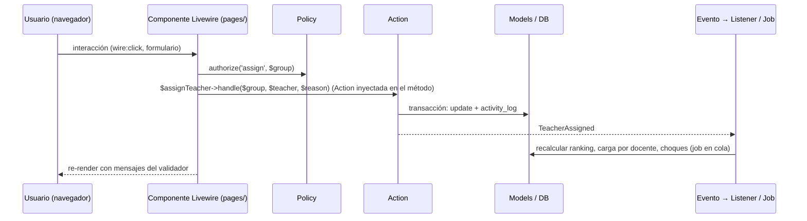

# Arquitectura

Nexus es un **monolito modular** en Laravel 13 + Livewire 4. No es hexagonal ni DDD: no hay capas Domain/Infrastructure ni repositorios abstractos. La modularidad se logra con carpetas por módulo, dependencias en una sola dirección y una convención fija para cada tipo de clase.

## Stack

| Capa | Tecnología | Notas |
|---|---|---|
| Runtime | PHP 8.5 sobre FrankenPHP + Laravel Octane (worker mode) | Ya configurado en `Dockerfile` y `compose.yaml`. Cuidado con estado estático entre peticiones. |
| Framework | Laravel 13 | |
| UI | Livewire 4 con componentes multi-archivo (MFC), MaryUI sobre daisyUI y Tailwind 4 | Sin SPA ni API REST para la UI. |
| Base de datos | PostgreSQL 18.6 | Única fuente de verdad. Tests también contra PostgreSQL. |
| Caché, sesiones, colas | Valkey 9 (driver `redis`) | Colas para importaciones, recálculos y corridas del motor. |
| Auth | Laravel Fortify (username + contraseña), puestos y nombramientos propios (ADR-0018) | Sin registro público; los usuarios se crean desde importación o por un admin. |
| Bitácora | spatie/laravel-activitylog | Inmutable. |
| Pruebas | Pest 5 (unit, feature, browser) | Ver `docs/arquitectura/testing.md`. |
| Motor de horarios | Heurística en PHP (R2) y servicio Python con OR-Tools CP-SAT (R2) | Ver `docs/arquitectura/solver.md`. |
| Infraestructura | Docker Compose: nginx (solo dev), app, queue, postgres, valkey, vite (dev); en producción `caddy` (HTTPS) reemplaza a nginx y se suma `backup` ([ADR-0013](../decisiones/0013-despliegue-on-premise-itcj.md)); `solver` se añade en R2 | |

## Estructura de un módulo

```
app/Modules/<Modulo>/
├── <Modulo>ServiceProvider.php   extiende ModuleServiceProvider (ver "Registro de un módulo")
├── Models/                       Eloquent, relaciones, scopes y casts; sin lógica de proceso
├── Enums/                        enums PHP respaldados por string
├── Actions/                      una clase por caso de uso de escritura (Create…, Assign…, Close…, Publish…)
├── Queries/                      consultas de lectura reutilizables para pantallas, tableros y exportes
├── Rules/                        reglas de validación y validadores de dominio (p. ej. ConstraintValidator)
├── Livewire/
│   ├── pages/                    pantallas completas (MFC: carpeta con .php y .blade.php)
│   └── components/               piezas reutilizables del módulo
├── Policies/                     autorización por puesto y alcance (role_assignments)
├── Jobs/  Events/  Listeners/  Notifications/   solo si el módulo los necesita
├── Http/                         middleware y respuestas HTTP propias (p. ej. las de Fortify), solo si hacen falta
├── Providers/                    providers adicionales del módulo, registrados en bootstrap/providers.php junto al suyo
├── Routes/web.php                rutas del módulo, con middleware de auth y prefijo propio
├── Database/
│   ├── Migrations/
│   ├── Factories/
│   └── Seeders/
├── Views/                        vistas Blade que no son Livewire (PDF, correos), si hacen falta
└── Lang/es/                      textos del módulo (opcional; la app corre en español)
```

### Registro de un módulo

La clase base abstracta `App\Modules\Core\ModuleServiceProvider` vive en `Core` porque todos los módulos pueden depender de `Core`. Cada `<Modulo>ServiceProvider` la extiende, vive en la raíz de su carpeta y se agrega a `bootstrap/providers.php` en el orden del mapa. Al arrancar registra, a partir de la carpeta del módulo y **solo lo que existe**:

| Carpeta | Qué registra | Cómo se usa |
|---|---|---|
| `Routes/web.php` | Rutas con middleware `web`; el prefijo y `auth` los pone el archivo del módulo | `Route::livewire('/campus', 'core::pages.campuses')` |
| `Database/Migrations/` | Migraciones | `php artisan migrate` |
| `Views/` | Vistas Blade | `view('core::pdf.horario')` |
| `Livewire/` | Namespace Livewire para MFC: `pages/<nombre>/<nombre>.php` + `.blade.php` | `core::pages.<nombre>`, `core::components.<nombre>` |
| `Lang/` | Traducciones | `__('core::campus.title')` |
| `Policies/` | `Policies/<Modelo>Policy` ↔ `Models/<Modelo>` lo resuelve el auto-descubrimiento de Laravel. Las que no siguen la convención (p. ej. modelos de un paquete) se declaran en `protected array $policies` del provider | `$this->authorize('update', $campus)` |

El alias del módulo es el nombre de su carpeta en kebab-case (`Core` → `core`, `AcademicLoad` → `academic-load`). El namespace Livewire se registra aunque `Livewire/` todavía no exista, para que el primer componente se pueda generar con:

```bash
docker compose exec app php artisan make:livewire core::pages.campuses      # app/Modules/Core/Livewire/pages/campuses/
docker compose exec app php artisan make:livewire core::components.campus-badge
```

Un provider que sobrescriba `boot()` debe llamar a `parent::boot()`. La base no guarda estado estático (Octane). Las factories no se descubren por convención: el modelo las declara con `#[UseFactory(...)]`.

Las entradas del menú del módulo se declaran en el método `navigation()` de su provider (ver "Navegación").

La demo por puntos del proceso (`php artisan demo:seed --hasta=`) también se declara en el provider: `demoSteps()` da los pasos con los que el módulo siembra la demo (`DemoStep`, cada uno **lleva a** un `DemoCheckpoint` terminando la etapa anterior), `demoChecks()` lo que esos pasos garantizan al llegar a cada punto (`DemoCheck`) y `demoQuietEvents()` los eventos del módulo que se descartan mientras siembra. Core los junta en `DemoPlan`, como el menú, sin conocer a ningún módulo (ver `docs/arquitectura/testing.md`, "Demo por puntos del proceso").

Reglas:

- **Actions** son la única puerta de escritura. Reciben datos ya validados, abren la transacción, escriben, registran bitácora y disparan eventos. Los componentes Livewire nunca escriben en modelos directamente.
- **Queries** devuelven builders o DTOs simples para listados; evitan que las pantallas armen consultas complejas.
- **Models** solo tienen relaciones, casts, scopes y accessors. Nada de "si el estado es X entonces…" dentro del modelo; eso va en Actions o Rules.
- **Livewire** valida entrada, llama Actions o Queries y renderiza. Sin consultas en Blade.
- Un módulo **no importa clases** de un módulo a su derecha en el mapa de dependencias (ver `docs/dominio/modelo-de-datos.md`). La comunicación en sentido contrario se hace con **eventos**: el módulo de la izquierda dispara el suyo y el de la derecha lo escucha (por ejemplo, Core dispara `CampusUpdated` y un módulo de su derecha lo escucha para revalidar con el perfil nuevo). Escuchar el evento de un módulo de la derecha también es importar su clase, y la prueba de arquitectura lo rechaza.
- Pruebas de arquitectura en `tests/Arch/ModulesTest.php` hacen cumplir estas reglas: cada carpeta de `app/Modules` está en el mapa y tiene su provider registrado; dependencias solo hacia la izquierda del mapa, con `arch()` para las clases y una revisión de texto de toda la carpeta del módulo para lo que `arch()` no ve (rutas, migraciones y componentes MFC, que son clases anónimas, y Blade), que detecta namespaces, imports agrupados y alias (`scheduling::…`); modelos sin request, sesión ni auth (fachadas, alias globales como `\Auth`, helpers y los contratos `Guard`, `StatefulGuard` y `Factory`); Actions `final`; enums respaldados por string; policies con el trait `AuthorizesActor`; nada fuera de `Core/Authorization` decide con `Role::` (`tests/Arch/AuthorizationTest.php`). El mapa está copiado en la prueba y otra prueba lo compara con el diagrama de `docs/dominio/modelo-de-datos.md`: si cambia uno, cambia el otro en el mismo PR.

## Módulo de referencia: Campus

El CRUD de Campus de `Core` es la plantilla de todo módulo: cada archivo es el ejemplo de un tipo de clase. Un módulo nuevo copia su forma, no la reinventa (skill `nexus-module`). Rutas relativas a `app/Modules/Core/`.

| Tipo | Archivo | Qué muestra |
|---|---|---|
| Policy | `Policies/CampusPolicy.php` | `final`, trait `AuthorizesActor`. Una ability por permiso de `docs/dominio/reglas-de-negocio.md` ("Aprobaciones y permisos"), citado en el docblock: cada ability pregunta por un permiso de `Enums/CorePermission.php` con `$this->actor($user)->allows(…, Target::of(campus: …))` (`viewAny` con `allowsAny`), que `CoreServiceProvider::grants()` concede por puesto; el admin los tiene todos. Sin `delete`: un catálogo se desactiva. |
| Reglas | `Rules/CampusRules.php` | Las reglas del modelo en un solo lugar, compartidas por las dos Actions, cada una como `ValidationException` sobre su campo (Livewire la muestra junto a él): código UTF-8 válido, en mayúsculas, sin espacios (también NBSP) y no vacío; único también entre borrados (`ensureCodeIsFree`, `codeTaken`); perfil aceptado por `CampusProfile`, completo y normalizado. |
| Action de alta | `Actions/CreateCampus.php` | `final`, recibe `CampusRules` por constructor y `handle(array $data)` con datos ya validados en forma. En una transacción revisa el código, escribe, registra en la bitácora (`created`, `withChanges(['attributes' => …])`) y dispara `CampusCreated`. Si otra sesión gana la carrera del código, convierte la `UniqueConstraintViolationException` de la base en el mismo error de `code`. |
| Action de cambio | `Actions/UpdateCampus.php` | Cambia solo las claves que recibe. Dentro de la transacción relee el campus con `lockForUpdate()`, y contra ese estado calcula el valor anterior. Sin cambios no escribe, no registra ni avisa (compara el perfil normalizado: PostgreSQL reordena el jsonb). Un perfil guardado inválido no da error: lo demás se guarda igual y un perfil válido lo repara. Bitácora `updated` con `attributes` y `old` de lo que cambió, y `CampusUpdated`. No sabe de roles: qué claves le llegan lo decide la página con la policy. |
| Eventos | `Events/CampusCreated.php`, `Events/CampusUpdated.php` | `ShouldDispatchAfterCommit`: salen después del commit (el de cambio, con las columnas que cambiaron). Toda Action que da de alta o cambia un registro del dominio dispara el suyo, aunque todavía no lo escuche nadie: es como Core avisa a los módulos de la derecha. Las de acceso (`RecordLogin`, `UpdateUserPassword`) no lo disparan. |
| Query | `Queries/CampusQuery.php` | `forTable(Actor, $search, $active, $perPage)`: al admin, todo; a los demás, `Actor::campuses()` filtrado por la ability `view` de la policy, sin repetir el alcance (las tablas con columnas de alcance usan `constrain()`). Busca con `TextSearch`, filtra por estado, ordena y pagina. `findOrFail($id)` carga lo que se edita: el componente no lee con Eloquent. |
| Búsqueda | `Queries/TextSearch.php` | `TextSearch::apply($query, ['code', 'name'], $search)`, para todos los listados: "contiene", sin distinguir mayúsculas, con `%`, `_` y `\` literales; un término vacío no filtra. |
| Página MFC | `Livewire/pages/campuses/campuses.{php,blade.php}` | `mount()` autoriza `viewAny`; cada acción carga con la Query y vuelve a autorizar (una petición puede traer una página que abrió otra sesión). Valida la forma con mensajes y atributos en español, convierte tipos (números, días como lista) y llama la Action. `#[Locked]` en lo que el navegador no debe cambiar, `#[Session]` en los filtros, toast de MaryUI con texto escapado. `x-table` con paginación y el estado con la insignia de Core (`<x-core::status-badge>`, DESIGN.md), `x-modal` con `x-form`; lo que el rol no permite (alta, datos, estado, filtro de inactivos) se muestra deshabilitado con su motivo, y un perfil guardado inválido se marca en la tabla y se edita desde los valores por omisión con un aviso. |
| Ruta y menú | `Routes/web.php`, `CoreServiceProvider::navigation()` | `Route::livewire('/campus', 'core::pages.campuses')->name('core.campuses')` bajo `auth`; `NavigationItem` en el área `NavigationArea::Academico`, con `ability: 'viewAny'` y `arguments: [Campus::class]`. |
| Factory | `Database/Factories/CampusFactory.php` | Estado con nombre del dominio: `inactive()`. |
| Pruebas | `tests/Feature/Core/CampusPolicyTest.php`, `CampusRulesTest.php`, `CreateCampusTest.php`, `UpdateCampusTest.php`, `CampusQueryTest.php`, `CampusesPageTest.php`; `tests/Unit/Core/TextSearchTest.php`; `tests/Browser/Core/CampusesTest.php` | Policy por rol y por campus. Reglas y Actions con bitácora, evento después del commit, carrera del código (un duplicado insertado entre la revisión y la escritura) y bloqueo (feature, porque necesitan la base o el contenedor; lo puro, como `CampusProfile` o `TextSearch::escape`, va en unit). Query por rol. Página: lo que hace cada rol, errores en español, negativas por rol y por campus llamando cada método de Livewire directo, y quién ve la entrada del menú. Un flujo de navegador: el admin da de alta y edita; el coordinador no ve la opción. |

Para crear un módulo o agregarle una pantalla de catálogo, una Action, una Query o una Policy, sigue los pasos de `.claude/skills/nexus-module/SKILL.md`, que remite a estos archivos y reúne los errores que ya atraparon las revisiones.

## Plantillas de importación

Cada catálogo que llega del SII se importa con una plantilla: una clase en `app/Modules/Imports/Templates/` que extiende `ImportTemplate` y se agrega a la lista `TEMPLATES` de `ImportsServiceProvider`. Todas viven en Imports, también las de Academic, Faculty, Facilities y Students, porque Imports depende de los catálogos y no al revés (tarea 1.1). El ejemplo para copiar es `tests/Fixtures/ImportTemplates/CampusesTemplate.php`.

| Método | Qué decide |
|---|---|
| `key()`, `label()` | Clave (`import_batches.template`) y nombre en la interfaz |
| `fields()` | Campos que espera, en orden, con su etiqueta en español: a ellos se mapean las columnas del archivo y con ellas se escriben los mensajes de error |
| `naturalKey()`, `requiresCampus()` | Clave natural de `reglas-de-negocio.md` ("Reglas de datos"); si es por campus, `requiresCampus()` agrega `campus_id` del campus del lote |
| `model()` | El modelo que escribe |
| `normalize()` | Recorta, junta espacios y convierte vacíos en null; la plantilla la extiende (claves en mayúsculas, fechas del SII) |
| `rules()`, `messages()` | Reglas de Laravel por campo sobre la fila normalizada |
| `check()` | Lo que lee la base (claves cruzadas). La de la base ya marca como error un registro borrado con la misma clave y como advertencia uno inactivo; la plantilla la extiende |
| `attributes()`, `defaults()` | Lo que se escribe en altas y cambios, y lo que solo se escribe al dar de alta |
| `recordKey()` | La clave con que se busca el registro en la base; por omisión la de `keyFor()`. La traduce una plantilla cuyo archivo identifica el registro con claves de otros catálogos (el kardex trae el número de control y la clave de materia; la tabla guarda `student_id` y `subject_id`, tarea 1.4). Devuelve null si la fila apunta a algo que no existe, y `check()` lo reporta |
| `apply()` | Alta o cambio por clave natural. En un cambio no pisa con null lo que el archivo trae vacío y nunca cambia `is_active`; un borrado no se restaura. La plantilla lo sobrescribe solo si su escritura no es un registro por fila |
| `afterApply()` | Lo que corre una vez al terminar el lote, como el job de recálculo de progreso de Students (tarea 1.4) |

`validate()` y `keyFor()` son `final`: el motor depende de que se comporten igual en toda plantilla. `keyFor()` da la clave tal como viene en el archivo, con la que el motor encuentra filas repetidas; `apply()` y `check()` buscan el registro con `recordKey()`. `validate()` también rechaza el texto que no es UTF-8 válido.

La plantilla `rooms` (tarea 1.15) es la primera de un campus (`requiresCampus()`): la clave natural es `code` más el campus del lote, y «desactivar faltantes» solo mira los salones activos de ese campus. Crea el edificio que el campus no tiene con su clave como nombre y avisa (S11, igual que `SubjectsTemplate` con las especialidades), y usa `RoomRules` y `BuildingRules` de Facilities para normalizar las claves como las capturadas a mano.

`TemplateRegistry` se arma al arrancar, como `Navigation`. Ahí rechaza claves repetidas, una clave natural fuera de los campos y los campos que pone el sistema (`id`, `deleted_at`, marcas de tiempo). Guarda clases y pide una plantilla nueva al contenedor en cada `get()`, por eso es un singleton seguro con Octane. Una plantilla no guarda estado del lote: quién lo aplica y el campus llegan en `ImportContext`.

`apply()` escribe sin pasar por las Actions del catálogo porque corre dentro de la Action que aplica el lote. Por eso no deja bitácora por registro: el lote deja una entrada y el detalle queda en `import_rows`. Si el catálogo tiene reglas propias (como `CampusRules`), la plantilla las usa en `normalize()` y `check()`, para que un registro importado cumpla lo mismo que uno capturado.

El motor lee el archivo con `Imports/Readers/SpreadsheetReader`, en streaming con openspout. Toma la primera hoja de un CSV o XLSX y usa la primera fila que no está vacía como encabezado. En un CSV detecta el separador (coma, punto y coma o tabulador) y la codificación: UTF-16 por su BOM, que es el "Texto Unicode" de Excel; si no, UTF-8 o Windows-1252, revisando el archivo completo por bloques. Las filas se numeran como en el archivo, para que los errores digan "fila 12". Un archivo que no se puede importar tal cual (`.xls` antiguo, sin encabezado, columna repetida) lanza `UnreadableFile` con el mensaje que ve el admin.

`ValidateImportBatch` toma un lote `uploaded` y no escribe en el catálogo:
1. Mapea las columnas con `Templates/ColumnMatcher`: con el mapeo del lote o, sin él, por nombre de campo o por etiqueta, sin importar mayúsculas, acentos ni espacios. Sin la columna de la clave natural, el lote queda `failed`. El asistente usa el mismo `ColumnMatcher` para proponer el mapeo antes de validar.
2. Por cada fila llama a `normalize()`, `validate()` y `keyFor()`.
3. Guarda las filas en `import_rows` de 500 en 500.
4. Marca en SQL, por `key_hash`, las filas que repiten la clave de una anterior.

El lote queda `validated` con sus cuentas, con bitácora y `BatchValidated`. Como la fila normalizada se guarda en JSON y `apply()` la lee de ahí, `normalize()` pasa las fechas a texto ISO.

`ApplyImportBatch` toma un lote `validated`. Escribe con `apply()` las filas válidas y con advertencia, en el orden del archivo y de 500 en 500, una transacción por bloque, y salta las filas con error. Antes de escribir cada fila la vuelve a validar, porque el catálogo pudo cambiar desde la validación: la que ya no pasa queda como error y se salta. Pagina por `row_number` y no por offset, porque cada fila sale del filtro al pasar a `applied`. Al terminar corre `afterApply()` y deja **una** entrada de bitácora para el lote, con altas, cambios, filas sin cambios y filas saltadas, más `BatchApplied`. Si una fila no se puede escribir, su bloque se revierte y el lote queda `failed` con la fila y el motivo. Los bloques anteriores se quedan: la bitácora del fallo y `BatchApplied` llevan lo que sí se escribió, y volver a importar es seguro por el upsert.

Un mapeo de columnas se guarda con `CreateImportMapping`, para reutilizarlo con cada archivo del mismo layout del SII (ADR-0005): el nombre no se repite dentro de la plantilla (sin importar mayúsculas), cada campo recibe a lo más una columna y la clave natural tiene que tener la suya. Lo que decide si un mapeo cabe en una plantilla vive en `ColumnMatcher` (`unknownFields()`, `describeMissingKey()`), que también dice qué columnas de un mapeo guardado no vienen en el archivo (`absentColumns()`), para que el asistente lo avise antes de validar. Un mapeo no se edita ni se borra: el que ya no sirve se desactiva, porque los lotes que lo usaron lo siguen citando.

El asistente lee el lote con `Queries/ImportBatchQuery`: los lotes recientes para retomarlos, las filas con error o con advertencia por número de fila (`Enums/RowIssue`), el avance y lo escrito. El CSV con las filas con error lo escribe la cola con `Actions/ExportBatchErrors` al terminar de validar y otra vez al terminar de aplicar, porque al aplicar pueden aparecer filas nuevas con error. Queda en el disco `imports` junto al archivo subido (`$batch->errors_path`), y el lote anota cuándo quedó listo (`errors_exported_at`, que vuelve a null al empezar a aplicar), para que nadie descargue el de la validación mientras se rehace; la marca no depende del reloj del sistema de archivos. Cada fila sale tal como vino en el archivo, con su número al principio y sus errores al final, para corregirla y volver a subir el archivo; un texto que Excel tomaría por fórmula sale con un apóstrofo. La página solo lo descarga, desde `GET /imports/batches/{id}/errors` (`Http/Controllers/DownloadBatchErrors`). Armarlo en la petición pasaría del segundo que se permite con un kardex mal mapeado, que puede traer cientos de miles de filas con error.

La pantalla es `imports::pages.import-wizard` (`/imports`, entrada "Importaciones" del menú, solo para el admin), un asistente en cuatro pasos: archivo, columnas, validación y aplicación. Lee el encabezado del archivo y propone las columnas con `ColumnMatcher`, por nombre o con un mapeo guardado. Si el admin cambia la propuesta, la guarda como mapeo nuevo con nombre. Después sube el lote y lo manda a validar a la cola. El lote abierto va en la URL (`?lote=`), así que se retoma al volver o desde los lotes recientes. Con el lote validado, la página muestra sus cuentas y las filas con error o con advertencia, con sus mensajes, y ofrece el CSV de errores en cuanto la cola lo termina. "Aplicar" encola `ApplyQueuedBatch` solo si el lote sigue validado y tiene filas válidas. Al terminar, muestra altas, cambios, filas sin cambios y filas con error que no se aplicaron. Mientras la cola trabaja, o prepara el archivo de errores, la tarjeta del lote se refresca con `wire:poll`. La copia temporal que Livewire guarda al subir vive en el mismo disco `imports` (`tmp/`, `config/livewire.php`), porque trae datos personales. Se borra al subir el lote, al cambiar de archivo y al empezar de nuevo; si el admin cierra la pestaña, la borra la limpieza de Livewire a las 24 horas. Si la cola no responde al subir, el lote ya quedó abierto y "Validar de nuevo" lo vuelve a encolar (un job de más no lo toca). Livewire acepta hasta 19 MB para que, con el resto de la petición, quepa en los 20 MB de PHP (`docker/php/prod.ini` y, en desarrollo, `docker/php/dev.ini`), Caddy y nginx.

Las Actions de lote y de mapeo (`StoreImportBatch`, `ValidateImportBatch`, `ApplyImportBatch`, `CreateImportMapping`) no autorizan: lo hace la página con `ImportBatchPolicy`, que solo deja al admin; guardar un mapeo es parte de importar.

Validar y aplicar corren en la cola con `Jobs/ValidateQueuedBatch` y `Jobs/ApplyQueuedBatch`. Cada bloque de 500 filas suma al lote su avance (`processed_rows`: filas leídas al validar, revisadas al aplicar) y, al aplicar, las altas, cambios y filas sin cambios ya escritas; la pantalla lo lee con `wire:poll`, y la bitácora y `BatchApplied` toman las cuentas de ahí (`ImportBatchQuery::appliedCounts()`). Cada job hace un solo intento con 30 minutos de tiempo máximo y lleva su corrida (`run`), que queda en el lote (`run_id`) al empezar. Si la Action encuentra el lote en otro estado (`BatchNotReady`: otra corrida lo tomó, como dos clics en "aplicar", o ya terminó), el job termina sin tocarlo. Si el job falla, su `failed()` llama a `InterruptImportBatch`, que deja fallido el lote solo si sigue "validando" o "aplicando" por esa misma corrida: el proceso murió o pasó del tiempo máximo. Así el fallo de un job duplicado no tumba la corrida que sigue viva. Cuando el job pasa del tiempo, Laravel revierte la transacción que quedó abierta antes de llamar a `failed()`, porque los jobs fallidos se guardan en la misma base (`queue.failed`). Todo lote fallido pasa por `FailImportBatch`: una validación fallida se queda sin filas ni avance; una aplicación fallida conserva lo escrito y lo dice en su bitácora y en `BatchApplied`.

Pruebas de una plantilla: unit para `normalize()` y lo puro; feature para `validate()` (cada regla con su mensaje y cada clave cruzada) y `apply()` (alta, cambio, aplicar dos veces sin cambios). Copia `tests/Unit/Imports/ImportTemplateTest.php` y `tests/Feature/Imports/ImportTemplateTest.php`.

La migración repetible del SII (`imports:migrate-sii`, tarea 1.16) pasa la exportación cruda por estas mismas plantillas, paso por paso. Cómo se corre, qué deja y qué pisa una segunda corrida: [migracion-sii.md](migracion-sii.md).

## Módulos

| Módulo | Responsabilidad | Entrega |
|---|---|---|
| `Core` | Auth (Fortify, username), usuarios, roles y alcances, campus y modalidad, periodos y etapas, parámetros, bitácora, notificaciones, layout y navegación | R1 |
| `Academic` | Departamentos, jefes, carreras, planes de estudio, materias, seriación, especialidades | R1 |
| `Facilities` | Edificios, salones, bloqueos, salones por defecto | R1 |
| `Faculty` | Docentes, plazas, disponibilidad, horas externas, historial, perfil, evaluaciones | R1 |
| `Students` | Alumnos, kardex, avance reticular | R1 |
| `Imports` | Importador por archivos: plantillas, mapeos, staging, validación, aplicación | R1 |
| `CatalogValidation` | Revisión y validación de catálogos por jefes de departamento cada periodo | R1 |
| `AcademicLoad` | Orquestación del flujo: propuestas, estados, acuerdos, solicitudes de cambio, cierre, aprobación, publicación, snapshots, re-análisis | R1 (base), R2 (re-análisis e impacto) |
| `Scheduling` | Grupos, sesiones, cupos por carrera, salones, validador de restricciones, editor de horarios, tablero de choques | R1 (manual + validador), R2 (heurística) |
| `Staffing` | Ranking docente, asignación, historial, carga por docente | R1 |
| `Demand` | Proyección de demanda y grupos sugeridos | R2 |
| `Solver` | Cliente del motor, corridas, contrato; servicio Python en `services/solver/` | R2 |
| `Enrollment` | Orden de inscripción, citas, auto-inscripción, listas de espera | R3 |

## Flujo de una petición típica



## Llaves

Todo modelo de Nexus usa UUIDv7 como llave primaria ([ADR-0014](../decisiones/0014-uuidv7-como-llave-primaria.md)); `tests/Arch/ModulesTest.php` y `tests/Feature/Core/PrimaryKeysTest.php` lo exigen.

- **Migración:** `$table->uuid('id')->primary()->default(DB::raw('uuidv7()'));`, `foreignUuid()` para las llaves foráneas y `nullableUuidMorphs()` para las polimórficas. El default cubre los inserts que no pasan por el modelo, como las importaciones en bloque.
- **Modelo:** `use HasUuids;`, que genera el UUIDv7 en la app antes de insertar.
- **Ids que llegan del cliente:** una propiedad de Livewire, un argumento de `wire:click` o un segmento de ruta pueden traer algo que no es uuid, y PostgreSQL lo rechaza con un error. Las Queries buscan con `KeyLookup::findOrFail($query, $id)` (`Core/Queries`), que lo trata como un registro que no existe (`ModelNotFoundException`), o con `KeyLookup::find()`, que devuelve `null` (así lee `Actor` el periodo guardado en la sesión). Una prueba de texto prohíbe `find()` y `findOrFail()` del modelo en Queries y componentes. Las propiedades de id son `?string`; un select vacío llega como `''`, así que se pregunta con `blank()`.
- **Blade:** el id va entre comillas en las expresiones que Livewire evalúa: `wire:click="edit('{{ $campus->id }}')"` y `spinner="edit('{{ $campus->id }}')"`.
- **Orden:** los listados ordenan por una columna del dominio (código, nombre, fecha), no por `id`.
- **Infraestructura:** `jobs`, `failed_jobs` y `activity_log` conservan su llave bigint; no son entidades de Nexus. Por eso el sujeto de la bitácora es siempre un modelo de Nexus: un cambio de puesto se registra sobre el usuario, no sobre el nombramiento.

## Autorización y alcance

Quién puede qué lo decide el motor de `app/Modules/Core/Authorization/` ([ADR-0018](../decisiones/0018-permisos-por-puesto-y-perfil-activo.md)): un permiso, el nombramiento del perfil activo que lo concede y el objetivo (campus, unidad, carrera). Ninguna Policy ni pantalla pregunta por un puesto: `tests/Arch/AuthorizationTest.php` lo exige.

### Piezas

| Pieza | Qué es |
|---|---|
| `Permission` | Contrato de un permiso `modulo.recurso.accion`: etiqueta, dimensiones que declara, si es personal y a qué unidades aplica (`appliesTo()`, D20). Cada módulo lo implementa en `Enums/<Modulo>Permission.php`. Su provider declara `permissions()` y `grants()` (puesto → permisos), como `navigation()`. |
| `UnitApplicability` | A qué unidades aplica un permiso (D20, ADR-0018 adenda): tipos de unidad y claves de unidades estructurales; `academic()` son los departamentos académicos y la Subdirección Académica. |
| `Dimension` | Campus, unidad o carrera: cómo compara un nombramiento contra un `Target`; su `column()` es la de `role_assignments`. |
| `Role` | Enum de puestos (`admin`, `subdireccion`, `jefe_departamento`, `jefe_proyecto_docente`, `coordinador`, `docente`). Sabe su etiqueta, su descripción para Inicio, su nombre y descripción para quien lo ocupa sobre ciertas unidades (`titleOn()`, `descriptionOn()`: «Jefe del Departamento de Servicios Escolares», D20), las columnas de alcance que exige (`scopeColumns()`), si es único por unidad (`isExclusive()`), el tipo de unidad (`unitKind()`), cómo se llama esa unidad y la pista del puesto en «Nombrar» (`unitLabel()`, `appointHint()`) y su nombre en una lista para elegirlo, sin persona ni unidad (`listLabel()`). |
| `PermissionRegistry` | Junta los permisos y las concesiones de los providers al arrancar el worker; inmutable. Responde `grants()`, `rolesGranting()`, `permissions()` y la `matrix()` y la `applicability()` que congela `matrix.json`. |
| `OrgTree` | El árbol `org_units`: su mapa de descendientes con el tipo y la clave de cada unidad, cacheado con una huella de la tabla; `fits()` dice si el subárbol de una unidad tiene una a la que aplica un permiso, e `idOf()` busca una unidad estructural por clave, una vez por clave en cada petición; `scoped`. |
| `Target` | Los atributos del recurso (campus, unidad, carrera y dueño) que arma la Policy a partir del modelo: `Target::of(campus: …, unit: …, career: …)`. |
| `AuthorizationSnapshot` y `AuthorizationSnapshots` | Los nombramientos vigentes de una persona como datos planos (`AssignmentScope`), y el servicio que los lee y cachea. |
| `Actor` | La persona en la petición: sus nombramientos, el perfil activo, el campus y el periodo activos, y las preguntas de abajo. Registrado con `scoped`. |
| `AuthorizesActor` | Trait de las Policies (`Core\Policies\Concerns`): `$this->actor($user)`. |
| `RecipientsQuery::holders()` | A quién le llega un aviso: los usuarios activos que con alguno de sus puestos vigentes tienen un permiso y cubren un `Target`. |
| `ScopeLabels` y `UnitAdscriptions` | Contratos que llena un módulo de la derecha (abajo). |

- **Contratos que llena un módulo de la derecha:** Core declara la interfaz y liga con `bindIf` una implementación que no sabe nada; el módulo dueño de los datos la reemplaza con `bind` en su `register()`, y Core nunca lo importa. `ScopeLabels` (`Core/Authorization`) nombra las carreras y da las de un campus; la llena Academic. `UnitAdscriptions` (`Core/Queries`, 3.P7) da con `userIdsByUnit()` los usuarios adscritos a cada unidad, para contar las personas del Organigrama (`OrgChartQuery`); Core liga `NoUnitAdscriptions` (nadie) y Faculty `TeacherUnitAdscriptions`: las adscripciones sin borrar de los docentes activos, sin borrar y con usuario, por departamento (el id de un departamento es el de su unidad).

### Regla de decisión y `constrain()`

- **Regla de decisión:** un permiso personal lo concede cualquier nombramiento vigente sobre lo suyo, sin importar el perfil; uno de gestión exige que el **perfil activo** lo conceda y que alguno de sus nombramientos cubra el objetivo en cada dimensión que el permiso declara (nulo cubre; si el objetivo no tiene valor, solo cubre un nombramiento que no fija la dimensión). Un admin activo concede todo menos sus excepciones y cubre cualquier objetivo. Las condiciones del recurso y del entorno (estado, etapa, perfil de campus) siguen en la Policy.
- **Unidad del jefe (AZ-02, AZ-S16):** solo cuentan los nombramientos que aportan el permiso: los que no llevan unidad y los que la llevan si ella, o una de sus descendientes, es de las que el permiso declara en `appliesTo()` (`Actor::contributing()`, la misma para `allows()`, `allowsAny()`, `constrain()` y `rolesAllowing()`). Así el jefe de Servicios Escolares, con el puesto de jefe de departamento, no tiene nada académico y su menú solo muestra «Planes de estudio». Todo permiso concedido al jefe de departamento declara sus unidades (`AuthorizationMatrixTest`), y la Subdirección Académica no se mueve en el Organigrama, para que ninguna otra unidad la tenga en su subárbol (AZ-S16).
- **`constrain()`:** `$columns` mapea cada dimensión que el permiso declara (y `owner` si es personal); si falta una, falla. El campus es siempre una columna: un nombramiento sin campus deja los campus activos y los registros sin campus (lo general), como `allows()`. Unidad y carrera aceptan una columna o una Closure que recibe los valores que el nombramiento cubre (la unidad con sus descendientes). El filtro se agrega con AND: una consulta con un `orWhere` suelto falla, y las condiciones con OR van agrupadas en un `where(function …)`. Una prueba compara `constrain()` contra `allows()` fila por fila.

### Dimensiones por recurso

Lo que es de un campus declara campus, lo de un departamento declara unidad y lo de una carrera declara carrera. `PermissionDimensionsTest` lo revisa sobre las tablas con `campus_id`, con sus excepciones: solo del admin (`core.assignment.*` e `imports.batch.*`, que cubre todo), o solo de puestos de todo el Tec (`core.term.manage_calendar` y `catalog_validation.progress.*`, hoy de la Subdirección). La prueba también exige que todo permiso de gestión concedido a un puesto que no sea el admin ni la Subdirección declare una dimensión que ese puesto acota. Una dimensión vacía en un nombramiento cubre cualquier valor, así que, sin esta guardia, un permiso que no declara ninguna de las dimensiones que el puesto fija lo cubriría todo. Un nombramiento con una columna que su puesto no pide (por ejemplo, un jefe con campus) solo acota: vale en ese campus y no en los demás.

### Nombramientos

- Se escriben con las Actions `AppointRole` y `EndRoleAssignment`, que validan lo que exige cada puesto (`RoleAssignmentRules`, a partir de `Role::scopeColumns()`); solo el admin los nombra, y las jefaturas también desde la ficha del docente, las pantallas de personas y el Organigrama (3.P8, abajo, «Acceso de docentes»).
- La base lo garantiza con tres CHECK de `role_assignments`: `role_assignments_validity_check` (la vigencia no se invierte), `role_assignments_admin_unscoped` (el admin no lleva campus, unidad ni carrera) y `role_assignments_scope_complete` (cada puesto llena las columnas de `Role::scopeColumns()`; no rechaza una columna de más).
- Las exclusiones de AZ-S7, `role_assignments_one_jefe` y `role_assignments_one_subdireccion`, impiden dos jefes de departamento o dos subdirecciones sobre la misma unidad en una misma fecha.
- Un nombramiento vale si está vigente hoy en Ciudad Juárez. Sin campus vale en cada campus activo y no borrado; con campus, solo ahí. Los campus desactivados o borrados quedan para el admin. Un usuario inactivo no tiene ningún puesto.
- El docente no tiene permisos de gestión: lo suyo («Mi espacio») son permisos personales, que concede cualquier nombramiento vigente sobre lo suyo. Su acceso a su propia carga lo deciden las policies de Staffing y Scheduling por asignación.

### Caché

- **Caché:** el registro vive en memoria del worker; el snapshot, en Valkey con `authz:user:v{FORMAT}:{id}:{authz_version}` (`FORMAT` es la versión del formato del snapshot, `AuthorizationSnapshots::FORMAT`; es 2 desde 3.P9 y subirla invalida lo cacheado; un trigger de `role_assignments` sube `users.authz_version`), escrito solo al confirmarse la transacción y leído estricto (un dato incompleto se descarta y se vuelve a leer de la base); el árbol, con una huella de `org_units` (id, madre, tipo y clave de cada unidad: cambiar el tipo o la clave cambia lo que aporta un nombramiento en la siguiente petición). El snapshot vence a la siguiente medianoche de Ciudad Juárez, porque las vigencias son por día; no sabe qué campus están activos, eso se filtra en cada petición. La versión sale del usuario que el guard de sesión ya leyó; un modelo sin `authz_version` cargada (como el de una factory) lee sus nombramientos sin caché, y `refresh()` la vuelve a leer tras un cambio a media petición. Los triggers de `departments` y `role_assignments` son la excepción documentada a «las escrituras pasan por Actions» (ADR-0018).

### Perfil activo

- **Perfil activo (3.P4, AZ-S4 a AZ-S6):** la sesión guarda el perfil en `core.active_role`; por defecto es `users.last_role` y, si no lo tiene o ya no lo ejerce, el primer puesto que ejerce en el orden del enum. El de omisión se fija en la sesión la primera vez que se resuelve, así que cambiar de perfil en otro dispositivo (que cambia `last_role`) no cambia el de esta sesión. Solo aplica al contexto del usuario autenticado: `forUser()` de otra persona, o sin usuario autenticado, es la unión de sus puestos, y los destinatarios de un aviso salen de `RecipientsQuery::holders()` (que usa `Actor::rolesAllowing()`, la unión de sus puestos); `asRole()` da el contexto de la misma persona con otro perfil sin tocar la sesión, para preguntar antes de cambiar. `SwitchRole` (Action) guarda `last_role` y la bitácora en una transacción y, solo si se guardaron, cambia el perfil de la sesión; desde la credencial («Actuando como», un renglón por puesto con su alcance) lo manda a Inicio, y elegir campus o periodo nunca cambia el perfil. El menú muestra solo lo que el perfil activo puede hacer. Las notificaciones abren en el perfil al que iban dirigidas (`data.role`): se decide si se pueden abrir con ese perfil (`asRole()`) y solo entonces se cambia, con una carga completa de la pantalla del aviso; si ya no tiene ese puesto, el aviso no está disponible aunque el perfil activo sea otro, incluido el de Administración (AZ-S8). Una pestaña pintada con otro perfil recibe 419 en su siguiente acción, sea porque cambió en otra pestaña o porque cambiaron sus puestos: `ActiveRoleHook` responde con la cabecera `X-Nexus-Role-Changed` y la página ofrece recargar con un mensaje neutro.

### API de `Actor`

| Método | Responde |
|---|---|
| `forUser(User $user)` | El contexto de otro usuario, sin su elección de sesión: la unión de todos sus puestos («quién podría»); se recuerda por id en la instancia. Si es el autenticado, devuelve este mismo. |
| `asRole(Role $role)` | El contexto de la misma persona con `$role` como perfil, sin tocar la sesión; un puesto que no tiene da un contexto sin puestos efectivos: `allows()`, `allowsAny()` y `constrain()` dicen que no y `campuses()` queda vacío. Para preguntar antes de cambiar de perfil (`OpenNotification`). |
| `user()` | El usuario del contexto, solo si está activo. |
| `refresh()` | Vuelve a leer los nombramientos en la siguiente pregunta, con la `authz_version` de la base; la llama la Action que los cambie. |
| `allows(Permission $permission, ?Target $target = null)` | Si puede el permiso sobre el objetivo (regla de decisión). Sin objetivo, uno de gestión es `allowsAny()` y uno personal, falso. |
| `allowsAny(Permission $permission)` | Si puede el permiso sobre algo: para el menú y la entrada a una pantalla de lista, que luego se filtra con `constrain()`. |
| `constrain(Builder $query, Permission $permission, array $columns)` | La regla de `allows()` en SQL, para las listas. |
| `rolesAllowing(Permission $permission, Target $target)` | Los puestos que tiene (todos, sin el admin) con que `allows()` daría que sí; de ahí salen los destinatarios de un aviso. |
| `heldRoles()` | Los puestos que tiene, el admin incluido, en el orden del enum; no depende del perfil activo. |
| `activeRole()` | El perfil activo: la elección de la sesión (`ACTIVE_ROLE`) si aún lo tiene; si no, `users.last_role` si lo conserva; si no, el primero de `heldRoles()`. Nulo en `forUser()` de otra persona y sin puestos. |
| `heldScopes(?Role $role = null)` | Los nombramientos de todos sus puestos (o solo de `$role`), sin importar el perfil activo: lo que muestra «Actuando como». |
| `campuses()`, `activeCampus()`, `activeTerm()` | Los campus activos donde trabaja con el perfil activo (selector de la credencial; con un nombramiento sin campus, todos), y el campus y periodo activos. |
| `ACTIVE_CAMPUS`, `ACTIVE_TERM`, `ACTIVE_ROLE` | Claves de sesión del campus, el periodo y el perfil elegidos. |

### Policies, menú y pantallas

- **Policies:** usan el trait `Core\Policies\Concerns\AuthorizesActor` (una prueba arch lo exige) y preguntan con `$this->actor($user)`, que decide por el usuario que recibe la policy aunque no sea el autenticado (`Gate::forUser()`). Ejemplo: `return $this->actor($user)->allows(SchedulingPermission::GroupUpdate, Target::of(campus: $group->campus_id, unit: $group->department_id, career: $group->career_id));`.
- **Menú:** cada entrada de `navigation()` lleva `visible: static fn (Actor $context): bool => $context->allowsAny(…)`, para que ninguna pantalla repita la lógica. El menú muestra solo lo que el perfil activo puede hacer.
- **Contexto activo:** la Action `SetActiveContext::handle(?Campus $campus, ?Term $term)` lo guarda en la sesión (`Actor::ACTIVE_CAMPUS` y `ACTIVE_TERM`); rechaza con `AuthorizationException` un campus que no esté en `campuses()` y `null` vuelve al de omisión. Por omisión, el campus es el único de `campuses()` (si hay varios, ninguno) y el periodo, el `is_current`. Cada lectura revalida el campus guardado contra el alcance vigente; `campuses()` y `activeTerm()` se recuerdan en la petición.
- **Catálogos de un campus** (salones, carrera-campus, todo lo que tenga `campus_id`): el listado filtra por `activeCampus()` y el alta usa ese campus; los formularios no llevan un select de campus. Sin campus activo, la pantalla pide elegir uno en la credencial.

### Pruebas

- `User::factory()->admin()` y `User::factory()->withRole(Role::Coordinador, ['campus_id' => …, 'career_id' => …])`, que lanza `InvalidArgumentException` si el alcance no llena lo que exige el puesto (sin `campus_id`, el nombramiento es de todo el Tec: `withRole(Role::Subdireccion)`); `actingAsRole()` en las pruebas de pantallas.
- La matriz congelada `tests/Fixtures/Authorization/matrix.json`, que `AuthorizationMatrixTest` compara con el registro: cambiar una concesión es cambiar el archivo en el mismo PR. El mismo archivo revisa que todo permiso esté concedido a algún puesto o lo tenga el admin, y que cada módulo con Policies declare los suyos.
- `tests/Arch/AuthorizationTest.php`: nada fuera de `Core/Authorization` decide con `Role::`, salvo `grants()` de los providers y una lista de piezas que nombran puestos por oficio (nombrar, listar, sembrar, mostrar); cada excepción debe seguir necesitando su entrada, y nadie importa `Role` con otro nombre.
- `PermissionDimensionsTest`: lo de «Dimensiones por recurso».

## Navegación

El menú del layout (`resources/views/layouts/app.blade.php`) lo arma Core, pero las entradas las declara cada módulo, así que Core no conoce a los módulos de su derecha:

```php
// app/Modules/Core/CoreServiceProvider.php
public function navigation(): array
{
    return [
        new NavigationItem('Inicio', 'home', 'o-home', NavigationArea::Academico),
        new NavigationItem('Campus', 'core.campuses', 'o-building-office-2', NavigationArea::Academico,
            ability: 'viewAny', arguments: [Campus::class]),
    ];
}

// app/Modules/AcademicLoad/AcademicLoadServiceProvider.php (ejemplo)
public function navigation(): array
{
    return [
        new NavigationItem('Propuestas', 'academic-load.proposals', 'o-document-text', NavigationArea::Academico,
            visible: static fn (Actor $context): bool => $context->allowsAny(AcademicLoadPermission::ProposalView)),
    ];
}
```

- `NavigationItem` (`Core/Navigation`): etiqueta en español, **nombre** de una ruta del módulo, icono Heroicon de MaryUI, **área** del menú (cuarto argumento, obligatorio) y quién la ve. "Quién" es `visible` (una función que recibe `Actor`), una ability de Gate con su argumento (`ability` y `arguments`, que reutilizan la policy del módulo) o ambas, y entonces debe cumplir las dos; sin ninguna, la ve cualquier usuario activo. Nunca se decide por el código del campus.
- `NavigationArea` (`Core/Enums`, ADR-0015) son las áreas del menú, cada una con `label()` e `icon()`: Académico, Servicios escolares, Recursos humanos, Recursos financieros y Datos. **El orden de sus casos es el del menú**; toda entrada declara la suya. Un área nueva es un caso nuevo del enum, en el lugar donde debe aparecer, y cambia ADR-0015: se acuerda antes. Hoy Inicio y Campus van en Académico, e Importaciones en Datos.
- `Navigation` (`Core/Navigation`) es el registro: junta las entradas de todos los `ModuleServiceProvider` en el orden de `bootstrap/providers.php` y, dentro de un módulo, en el que las declara. Es un singleton **inmutable** (clases `final readonly`, lo exige `tests/Arch/NavigationTest.php`) que Core arma en `booted`, cuando ya arrancaron todos los módulos: con Octane se crea una vez por worker. Lo que depende del usuario se calcula en cada petición, sin guardarlo: `visibleTo(Actor)` da la lista plana y `visibleByArea(Actor)` la agrupa (`list<array{area: NavigationArea, items: non-empty-list<NavigationItem>}>`), con las áreas en el orden del enum, solo las que tienen alguna entrada visible y, dentro de cada una, las entradas en el orden del registro. `forRoute(string $route)` da la entrada declarada para una ruta, la vea o no el usuario (la primera si varias la declaran; `null` si ninguna), para mostrar «área › pantalla».
- `core::components.navigation` es el menú que se transforma (DESIGN.md): muestra `visibleByArea()` del usuario, cada área como un grupo con su nombre (`aria-label`), su icono y sus entradas. El **área actual** es la de la entrada de la pantalla (`forRoute()` con el nombre de la ruta) si el usuario la ve; si no, la primera que ve. La **entrada activa** es esa misma entrada y lleva `aria-current="page"`. Cada elemento lleva su lugar en la retícula del menú abierto como variables CSS (`--c`, `--i`, `--col-t`, `--base-t`), que calcula el componente. El icono de cada área es un enlace (`wire:navigate`): el del área actual lleva a su primera entrada visible; el de las demás, a la última página que el usuario visitó de esa área o, si no hay, a su primera entrada. Ninguna entrada puede apuntar a una ruta inexistente: `tests/Feature/Core/NavigationTest.php` lo verifica para todas las declaradas. Una entrada se agrega en el mismo PR que su pantalla, con una prueba de quién la ve y quién no.
- `RecentPages` (`Core/Navigation`) guarda en la sesión esa última página por área (`core.recent_pages.<área>`), como la ruta relativa de la petición con su consulta (`getRequestUri()`). La anota el menú al montarse en una página completa, solo si la ruta es de una entrada, o de una pantalla hija (`childRoutes`), que el usuario ve. `SetActiveContext` la olvida al cambiar el campus o el periodo. No se registra en el contenedor: cada uso arma la suya con la sesión y el `Actor` de su petición, así que no guarda nada entre peticiones con Octane.

### Layout (shell)

`resources/views/layouts/app.blade.php` es el layout de toda página MFC. Con sesión pinta, en este orden:

1. `core::components.band`: la banda con la liebre (el botón del menú completo), «Nexus», la ruta (el área de `forRoute()` y el `#[Title]` de la página, que el layout le pasa), «Buscar o ir a… Ctrl K» y la credencial. La credencial muestra el nombre, las iniciales, el perfil activo (`Actor::activeRole()`) con `Role::label()`, y el campus y el periodo activos; se abre como tarjeta con `core::components.context-switcher`, el tema (el `x-theme-toggle` de MaryUI, que lo aplica y lo recuerda en `localStorage`; los botones Claro y Oscuro solo le piden cambiarlo), «Cambiar contraseña» y «Cerrar sesión».
2. `core::components.navigation`: el menú.
3. `<main id="nexus-content">`, el contenido, y los toasts de MaryUI (`<x-toast />`).

Sin sesión, solo el contenido. El layout ya no usa `x-nav` ni el cajón de `x-main` de MaryUI.

El estado y el movimiento los lleva el componente Alpine `nexusShell` (`resources/js/app.js`, registrado en `alpine:init`; Alpine viene con Livewire), puesto en `<body>`. El menú abierto o cerrado vive en `<body data-menu="open|closed">` y las utilidades de la banda y del menú lo leen con la variante `in-data-[menu=open]:`; la geometría por ancho (`--shell-top`, `--menu-w`, `--panel-w`, `--panel-clip`) la declara `<body>` con `max-desktop:` y `max-md:`. El breakpoint `desktop` (1200 px) es un token de `resources/css/app.css`. La única regla del shell escrita a mano en ese archivo bloquea el desplazamiento de la página con el menú abierto, con el candado de daisyUI que usan los modales, porque vive en `:root` y una utilidad no llega ahí. Antes de que Livewire cambie de página (`livewire:navigating`), `nexusShell` cierra todo sin animar, así la página que guarda para el botón de atrás queda cerrada; la página nueva llega cerrada del servidor.

La tarjeta de la credencial lleva `core::components.context-switcher`: ofrece `Actor::campuses()` (fijo si solo hay uno) y los periodos de `TermQuery::selectable()`, y guarda la elección con `SetActiveContext`, que además olvida las páginas que el menú recuerda por área; elegir el periodo actual deja el de omisión para seguirlo cuando cambie, y sin periodo activo muestra "Sin periodo". Si el campus o el periodo no existen o no se permiten, avisa con un toast de error y regresa la selección al contexto vigente, sin el error de Livewire. No hace falta middleware: `Actor` lee la sesión en cada petición. El middleware `NormalizeSidebarState` (grupo `web`) reescribe a `'false'` cualquier valor de `mary-sidebar-collapsed` que no sea `'true'` o `'false'`, porque `<x-main>` de MaryUI lo imprime dentro de `x-data`; el shell ya no usa `<x-main>`, pero la ruta de MaryUI que guarda ese valor sigue registrada. La página de inicio (`/`, `core::pages.home`) muestra solo el bloque del perfil activo (`Actor::activeRole()`), con su `Role::label()`.

## Acceso

- **Login** con Fortify por `username` (ADR-0004), configurado en `config/fortify.php` y en `App\Modules\Core\Providers\FortifyServiceProvider`: `authenticateUsing` busca el username tal como viene del SII y rechaza a los inactivos con el mismo mensaje genérico que una credencial incorrecta. Para que el tiempo no delate si el usuario existe, la contraseña se compara siempre (contra un hash señuelo del mismo costo, calculado una vez por proceso, si el username no existe) y el intento fallido dura al menos lo mismo (Timebox). El limitador `login` permite 5 intentos por minuto por username e IP. Al entrar, la Action `RecordLogin` anota `last_login_at` (no la de un usuario inactivo). Fortify solo expone login, logout, `PUT /user/password` y la confirmación de contraseña (`core::auth.confirm-password`, para el middleware `password.confirm`): sin registro, recuperación por correo, verificación, perfil, 2FA ni passkeys.
- **Middleware del grupo `web`** (`bootstrap/app.php`), así cubren las rutas de todos los módulos sin que cada uno los declare, en este orden:
  1. `AuthenticateSession` de Laravel: cierra las sesiones cuyo hash de contraseña ya no coincide, es decir, las demás sesiones de quien cambió su contraseña.
  2. `EnsureUserIsActive`: si el usuario se desactivó con la sesión abierta, la cierra en su siguiente petición (logout, invalidar sesión, nuevo token CSRF) y lo manda al login con un aviso genérico.
  3. `EnsurePasswordIsChanged`: mientras `must_change_password` sea true, solo deja pasar `GET /user/password` (`core::auth.change-password`), su `PUT` y el logout.

  A una petición JSON o de Livewire (`X-Livewire`) los dos de Core le responden 401 y 403 en lugar de redirigir.
- **Cambio de contraseña:** el `PUT` lo atiende Fortify con la Action `UpdateUserPassword` (contrato `UpdatesUserPasswords`): exige la contraseña actual y una nueva confirmada y distinta, conforme a `Password::defaults()` (mínimo 8 caracteres con letras y números), apaga `must_change_password`, rota el `remember_token` y registra `password-changed` en la bitácora sin la contraseña. Su respuesta (`Http/Responses/PasswordUpdateResponse`) regenera el id de la sesión actual, que sigue activa; si era el cambio obligatorio lleva a la página que se había pedido (o al inicio) y si fue voluntario vuelve a la pantalla con el aviso "Tu contraseña se actualizó.".
- **Contraseña por defecto:** `Core\Support\DefaultPassword` lee `auth.default_password` (env `NEXUS_DEFAULT_PASSWORD`; falla con `RuntimeException` si está vacía) y compara con `hash_equals`. `CreateStaffUser` da de alta usuarios activos con ella y `must_change_password`; `ResetUserPassword` (solo admin) la restablece, rota el `remember_token` y cierra las demás sesiones; `authenticateUsing` llama a `RequirePasswordChange` cuando alguien entra con ella, y `UpdateUserPassword` la rechaza como contraseña nueva («No puedes usar la contraseña por defecto.»). La bitácora (`created`, `password-change-required`, `password-reset`) nunca lleva contraseñas.
- Cada módulo sigue poniendo `auth` en sus rutas (ver "Registro de un módulo"); estos middleware no lo sustituyen.

## Acceso de docentes

Los usuarios, roles y alcances de los docentes y de los jefes se escriben solo con estas Actions (reglas-de-negocio.md, "Acceso de docentes", "Baja de un docente", «Quitar de mi departamento» y S15). Cuando cambian roles o alcances recargan `Actor` (también el del usuario autenticado y los de `forUser()`); `EndRoleAssignment` y `SyncTeacherAccess`, si no cambian nada, no escriben ni registran nada. La bitácora va por cambio, sobre el registro que cambia (abajo), y ninguna entrada lleva contraseñas.

- **Jefaturas (desde 3.P8, AZ-S14):** son nombramientos de `Role::HEADSHIPS` (`jefe_departamento`, de todo el Tec, y `jefe_proyecto_docente`, de un campus) sobre la unidad del departamento. Se nombran y terminan con `AppointRole` y `EndRoleAssignment` desde la ficha del docente, «Personas y puestos» y el panel del Organigrama, que comparten el trait `AppointsRoles` y las vistas `core::people.appoint-fields` (el formulario «Nombrar») y `core::people.end-box` (el recuadro «Terminar…»). El jefe es uno por departamento (AZ-S7: `RoleAssignmentRules::ensureSeatFree()` dice quién lo ocupa y `role_assignments_one_jefe` lo garantiza); la misma persona no repite el jefe de proyecto docente en el departamento y campus con fechas que se traslapan (`ensureNotDuplicated()` y `role_assignments_jpd_no_duplicate`). Si otra sesión escribe entre la revisión y la escritura, `AppointRole` vuelve el 23P01 de cada exclusión el mismo error de validación. `department_heads` es histórica y de solo lectura: ningún código la escribe ni la lee.
- **Docentes (Faculty):** `SyncTeacherAccess::handle(Teacher)` es idempotente y devuelve `AccessSync` (`created`, `linked`, `updated`, `unchanged`, `conflict`). Con el docente activo, usa su usuario ligado o liga el de username = RFC sin tocar su contraseña, solo si está activo, no es de otro docente (aunque esté borrado) y no tiene más puesto que `docente`; si no, devuelve `conflict` y no toca nada. Si no existe, lo crea con `CreateStaffUser(..., withAccess: false)` (el parámetro no tiene valor por omisión), **sin acceso** (sin contraseña, AC-02), con el correo del docente si ningún otro usuario lo usa; el acceso lo da después el admin con «Dar acceso» (`ResetUserPassword`, AC-03). Luego activa el usuario ya ligado (así vuelve el de un docente reactivado), le da un solo nombramiento de `docente` sin campus, que no depende de sus adscripciones (un docente sin departamento lo conserva), y cierra los alcances de `docente` con campus que quedaron de antes con la regla de `CloseRoleScopes`. Con el docente inactivo o borrado, toma `RoleAssignmentRules::ADMIN_SEATS_LOCK` y después el candado del usuario, desactiva su usuario (salvo que sea admin vigente o que su Administración programada haga falta para que ningún día se quede sin admin: AZ-S12 y P3) y termina con fecha de ayer sus jefaturas vigentes o por empezar con `EndRoleAssignment`, que quita las que empiezan hoy o después; sus alcances de `docente` se quedan para cuando se reactive, porque un usuario inactivo no ejerce ningún rol. La bitácora va por cambio: la liga sobre el docente, el alta (`CreateStaffUser`) y el acceso (activo, `docente_general` y los `docente_campus_ids` cerrados, antes y después) sobre el usuario, y cada jefatura terminada sobre su usuario. Si cambió algo avisa con `TeacherAccessChanged` (el docente y el resultado) después del commit.
- **Adscripciones (Faculty):** `RemoveAdscription::handle(TeacherDepartment): ?TeacherDepartment` es «Quitar de mi departamento». En una transacción bloquea al docente y sus adscripciones, borra la adscripción (lógico) y, si era la principal, la deja de marcar y hace principal la más antigua que le quede (`created_at` y luego id); la devuelve, o `null` si la principal no cambió de lugar. Sin adscripciones, el docente sigue activo y su acceso no cambia: no llama a `SyncTeacherAccess`. Deja bitácora sobre la quitada (`old`: departamento y si era principal; propiedades: `teacher_id` y la `primary_adscription_id` que le queda) y sobre la principal nueva, y avisa con `AdscriptionChanged` después del commit. Una ya quitada es `ValidationException` sobre `adscription`. Quién puede lo decide la policy de docentes.
- **Provisión:** `ProvisionTeacherUsers::handle(?User $actor)` corre `SyncTeacherAccess` sobre todos los docentes por bloques de 200, también los borrados, para aplicarles la baja si no se aplicó al borrarlos (sin cambios si ya se aplicó); como los usuarios nacen sin acceso, no necesita `NEXUS_DEFAULT_PASSWORD`. Devuelve `{created, linked, updated, unchanged, conflicts}` con los números de empleado en conflicto. Además de la bitácora de cada docente que cambió, deja una entrada `provisioned` de la corrida, sin registro sujeto, con las cuentas; con `$actor`, todas a su nombre. La despacha `ProvisionTeacherUsersJob` (único en la cola y sin encimarse, como `RecomputeStudentProgress`), que lanzan el botón «Dar de alta usuarios» de Docentes y la plantilla `teachers` al aplicar.
- **Invitación de acceso (Core y Faculty, AC-06 a AC-08):** `SendAccessInvitation::handle(User, string $email, ?User $actor, bool $unlessInvited)` pone el correo, deja `email_verified_at` nulo, marca `access_invited_at` y manda `AccessInvitation` (solo canal `mail`, en la cola, después del commit) a ese correo con `Notification::route()`, así que el correo va a la dirección del momento aunque cambie después. El enlace es `AccessInvitationLink`: `URL::temporarySignedRoute('access.accept')` de 7 días con el id del usuario y una huella (`sha256`) del correo y de la hora de la invitación, de modo que solo sirve el último. La contraseña por defecto se lee al armar el correo; nunca viaja en la cola. `AccessInvitationPage` atiende `GET` y `POST /access/{user}/{hash}`: el `GET` solo muestra el botón y el `POST` llama a `AcceptAccessInvitation`, cierra la sesión que hubiera, inicia la del invitado con sesión nueva y lo manda a `user-password.edit`; todo enlace que no sirve da la misma página con 403. La notificación va cifrada en la cola (`ShouldBeEncrypted`) y con transporte `log` o `array` no lleva la contraseña. `SendAccessInvitation` rechaza a quien tiene un puesto distinto de docente vigente o por empezar (`RoleAssignmentRules::holdsStaffRole()`); el correo institucional lo cambian solo quienes pueden reenviar la invitación (`TeacherPolicy::updateInstitutionalEmail`), y el de un docente con otro puesto, solo el admin. En Faculty, `InviteTeacherAccess` revisa al docente (activo, usuario sin contraseña, correo institucional) y llama a `SendAccessInvitation`; cuando cambia el correo institucional de un docente ya invitado, `UpdateTeacher` vuelve a llamar a `SendAccessInvitation` con el correo nuevo, o a `CancelAccessInvitation` si lo borra o el docente está inactivo; `InviteTeacherAccess::resend()` es «Reenviar invitación» y solo sirve a quien ya se invitó. Todo enlace se genera con una hora de invitación posterior a la anterior, aunque caigan en el mismo segundo. La ruta del enlace no exige ser invitado (en una computadora compartida puede haber otra sesión) y tiene un límite de 60 por minuto por IP. En CatalogValidation (AC-09), `InviteTeachersOnReviewValidated` (al validar una revisión de docentes) e `InviteTeacherAfterValidation` (cuando un docente de un departamento que ya validó, en un periodo que no ha terminado, queda en condiciones: `TeacherUpdated` con su correo institucional, `AdscriptionChanged` o `TeacherAccessChanged`) encolan `InviteReviewTeachersJob`, que llama a `InviteReviewTeachers`: invita con `InviteTeacherAccess` (con `unlessInvited`, revisado con el usuario bloqueado) a los que da `TeacherAccessQuery::awaitingInvitation()` (Faculty) y deja una entrada `teachers-invited` sobre la revisión. El aviso del modal de Validar sale de `TeacherAccessQuery::missingInvitations()`. En desarrollo y en la demo el correo lo atrapa Mailpit ([ADR-0024](../decisiones/0024-mailpit-para-el-correo-en-desarrollo-y-demo.md)).

## Configuración por campus y modalidad

`campuses.settings` es el **perfil de flujo**. Las pantallas y validadores consultan ese perfil, no el código del campus. Así el flujo presencial de R1 sirve para Campus I y II, y en R4 las modalidades EAD, EnLínea y TecNM Virtual se activan ajustando el perfil y añadiendo solo las reglas que de verdad son distintas (asignación centralizada, sesiones virtuales, docentes externos).

El modelo `Campus` expone el perfil como `$campus->profile`, un `CampusProfile` de solo lectura (`app/Modules/Core/Models`). Lo siembra `CampusSeeder` con lo que dicen los documentos; EAD, EnLínea y TecNM Virtual quedan inactivos y su perfil se define en la planeación de la fase 10.

### Eventos con veto

Un evento normal avisa a los módulos de la derecha de lo que ya pasó. Cuando una Action de un módulo necesita **preguntarles** si puede seguir (borrar un departamento que Faculty o Facilities usan, desactivar una materia que Students necesita), no puede llamarlos: no depende de ellos. Usa un evento con veto:

- La Action despacha el evento **dentro de su transacción y antes de escribir**, con `event(new DepartmentDeleting($department))` (no `::dispatch()`, que no devuelve la instancia que vieron los listeners). No es `ShouldDispatchAfterCommit` ni se encola: los listeners contestan en la misma petición.
- El evento usa el trait `Core\Events\Concerns\CanBeVetoed`: el listener llama `$event->block('motivo')` (varios bloqueos juntan sus motivos en orden) y la Action lee `blocked()` y `reasons()`. Si hubo veto lanza `ValidationException::withMessages([...])` con los motivos, y la transacción no escribe nada.
- El evento lleva el registro y, por convención, el nombre en gerundio (`DepartmentDeleting`); el aviso posterior al commit sigue siendo el evento normal (`DepartmentDeleted`).
- Los listeners se registran en el provider del módulo que los escucha.
- Ejemplos: `DepartmentDeleting`, que vetan Faculty (docentes adscritos), Facilities (salones de los que es dueño) y AcademicLoad (cargas académicas), y `SubjectDeactivating`, que Students veta con `BlockSubjectDeactivationWhileNeeded` cuando hay alumnos que todavía necesitan la materia (`SubjectDemandQuery`, desde el kárdex del momento).

### Eventos con reporte

Hay operaciones de un módulo que solo tienen sentido completas junto con lo que hacen los de la derecha. Abrir un periodo en un campus (`OpenTerm`, de Core) también crea las cargas en borrador (AcademicLoad) y las revisiones de catálogo (CatalogValidation), pero Core no los conoce. Usa un evento con reporte:

- La Action despacha el evento **dentro de su transacción**, con `event(new TermOpened($term, $campus))` (no `::dispatch()`, que no devuelve la instancia que vieron los listeners). No es `ShouldDispatchAfterCommit` ni se encola: los listeners corren síncronos en la misma transacción, así que la operación es **todo o nada**. Si un listener falla, se revierte también lo de Core.
- El evento usa el trait `Core\Events\Concerns\CollectsReport`: cada listener hace su parte y la dice con `$event->report('12 cargas académicas nuevas')`. Las líneas se juntan en el orden de los listeners, que es el de `bootstrap/providers.php`. La Action lee `lines()` para su bitácora y lo devuelve a la pantalla, que lo muestra en el toast (o «No faltaba nada» si viene vacío).
- Los listeners crean solo lo que falta (insert que ignora lo existente), así que repetir la operación es seguro, y reportan solo si crearon algo. No dejan bitácora propia por fila: la Action deja una sola entrada con el reporte.
- Los listeners se registran en el provider del módulo que los escucha, como los de veto.
- Ejemplo: `TermOpened`, que escuchan `CreateReviewsOnTermOpened` (CatalogValidation) y `CreateLoadsOnTermOpened` (AcademicLoad).

### Transiciones de la carga

El estado de una carga (`academic_loads.status`) cambia en un solo lugar: `AcademicLoad\Actions\Transitions\TransitionLoad`. Cada transición es una Action propia y delgada (hoy `ProposeLoad` y `StartStaffing`, esta sin guarda propia porque la veta Scheduling; las demás llegan en las fases 3 y 4) que la llama con el estado destino y una guarda:

- **El diagrama son datos**: `LoadStatus::transitions(CampusProfile)` y `canTransitionTo($to, CampusProfile)` listan los destinos permitidos desde cada estado (el diagrama de `docs/proceso/proceso-propuesto.md`). Dependen del perfil del campus: desde Cerrada, un campus con `requires_subdireccion_approval` pasa a Aprobada y uno sin él publica directo. `TransitionLoad` (que recibe al actor como parámetro, para que también la llame un job o un comando) relee la carga con bloqueo dentro de la transacción y rechaza con una `ValidationException` sobre `status` si el estado de la base no permite el destino.
- **Guarda para las reglas de la izquierda**: la Action de la transición pasa un `Closure(AcademicLoad): list<string>` con los motivos que bloquean, que salen de clases de `Rules/Constraints` (`ProposeLoad` junta `CatalogsValidated`, HC-14, y `ProposalPartAccepted`, HC-20). Lo que depende de un módulo a la derecha del mapa (Scheduling, Staffing) no se importa: lo veta un listener de `LoadTransitioning`.
- **Veto para los módulos de la derecha**: `TransitionLoad` despacha `LoadTransitioning` (evento con veto, ver arriba) dentro de la transacción y antes de escribir. Los motivos de la guarda y los del veto se juntan; con cualquiera no se escribe nada y la excepción los lleva todos.
- **Lo que deja una transición**: el nuevo estado, una fila inmutable en `load_transitions` (de, a, actor, comentario; HC-18), una entrada de bitácora de la carga (evento `transitioned`) y, después del commit, `LoadTransitioned`.
- **Quién puede**: lo decide `AcademicLoadPolicy` (una ability por transición) antes de llamar a la Action.
- **Desde otra Action**: una transición también se llama dentro de la transacción de otra Action, que bloquea la carga antes de leer su estado. `AcceptProposalReview` llama a `ProposeLoad` cuando el departamento acepta su primera parte con la carga en borrador; si la transición se bloquea, la parte no se acepta.
- **Lo que se congela con la transición**: `CloseLoad` (tarea 4.1) despacha `LoadClosing` dentro de su transacción, después de `TransitionLoad`, para que Scheduling confirme los grupos activos en la misma operación; si un listener falla, la carga no se cierra. La publicación (tarea 4.3) arma el snapshot igual, con `LoadSnapshotRequested`. No sirve `LoadTransitioned`, que llega después del commit.
- **Reabrir** (`ReopenLoad`): de cerrada, aprobada o publicada a ajustes, con motivo obligatorio. Asignación también pasa a ajustes, pero solo con una solicitud de cambio aprobada (`StartAdjusting`), así que su guarda rechaza reabrir desde ahí.
- **Lo que la transición necesita de la derecha**: si, además de preguntar, la transición necesita datos de un módulo a la derecha, los pide con un evento síncrono dentro de su propia transacción, después de `TransitionLoad`, y el listener solo lee. Así lo hace `PublishLoad` (tarea 4.3): despacha `LoadSnapshotRequested` y Scheduling contesta con los grupos de la foto (`ProvideLoadSnapshot`, que lee `LoadSnapshotQuery`). Después AcademicLoad revisa el payload contra `Rules\SnapshotPayload` y guarda la versión siguiente en `load_snapshots`. Por último lleva el historial docente a esa versión con `Faculty\Actions\SyncPublishedTeaching`. Si algo falla, no queda carga publicada sin foto.

Para agregar una transición: una Action `Transitions/<Verbo>Load` que llame a `TransitionLoad` con su estado destino y su guarda, la ability en la policy, y las pruebas con la regla que la bloquea. El diagrama ya la permite o se agrega a `LoadStatus::transitions()`.

### Cambios en la retícula

Lo que entra en el avance de los alumnos (la retícula de un plan, su especialidad y su seriación, los créditos totales del plan, los créditos o el tipo de una materia) es de Academic, pero `student_progress` es de Students. Cada Action de Academic que lo cambia despacha `Academic\Events\CurriculumChanged` con el plan afectado, la materia o los dos (al menos uno). Es `ShouldDispatchAfterCommit`, así que un cambio que se revierte no avisa. Students lo escucha (`RecomputeProgressOnCurriculumChange`, registrado en `StudentsServiceProvider`) y encola `RecomputeStudentProgress`, que es único en la cola y siempre recalcula completo: varios cambios seguidos esperan un solo recálculo. Hoy lo despacha `UpdateSubject` cuando cambian los créditos o el tipo; las Actions de planes y retícula de la tarea 1.8 lo usarán igual.

### Notificaciones

Los avisos del proceso van por el canal `database` de Laravel (tarea 2.9; el correo queda para después). Cada módulo define los suyos en `<Modulo>/Notifications` sobre `Core\Notifications\NexusNotification`, que guarda un `NotificationMessage`: título, detalle, icono y tono, el destino como nombre de ruta con parámetros, y el periodo y el campus del aviso. Así la campana de la banda (`core::components.bell`) los muestra sin conocer cada clase, y un aviso puede apuntar a una pantalla que todavía no existe.

- A quién: `Core\Queries\RecipientsQuery::holders($permission, $target)` da `{user, role}`: quien, con cualquiera de sus puestos vigentes, tiene el permiso y cubre el objetivo (`Actor::rolesAllowing`), sin el atajo del admin, que no recibe avisos por serlo. Una persona entra una vez, con el primer puesto del enum. La Action `NotifyHolders` manda una copia por destinatario con su puesto.
- Cuándo: una Action del módulo que avisa (por ejemplo `NotifyPendingReviews`), llamada desde un listener en cola que se encola después del commit (`ShouldQueue` con `$afterCommit`), para que un cambio revertido no avise y avisar a muchos no haga esperar a quien hizo el cambio.
- Al abrirlo (`OpenNotification`): se marca leído, la clase decide si el destino sigue disponible (`NexusNotification::unavailableReason`: la ruta existe y, según la clase, el registro y el alcance), la ruta tiene que aceptar los parámetros guardados y el usuario tiene que trabajar en el campus del aviso. Un aviso con puesto (`data.role`, ausente o desconocido es «sin puesto») que no es el activo se revisa con ese puesto (`Actor::asRole()`); solo si se puede abrir, la sesión cambia a ese perfil. Después la credencial pasa al periodo y el campus del aviso. Si no se puede abrir, la campana lo dice en un toast en lugar de llevarlo y nada cambia.
- La tarjeta de la campana muestra las 15 más recientes y «Ver todas (N)» lleva a la página `core.notifications` (`/notifications`): todas las del usuario, de 25 en 25, con filtro Todas / Sin leer.
- Las llaves son UUIDv7: Laravel clona la notificación por destinatario y `__clone` le da a cada copia la suya.

### Bitácora

Un listener de `Activity::creating`, `StampActingAs`, agrega `properties.acting_as` (el perfil activo) a cada entrada cuyo causante es la persona en sesión y tiene perfil activo; sin sesión (jobs, consola, una Action para otro usuario) no agrega nada. Resuelve `Actor` en cada llamada, sin estado estático (Octane). `Core\Rules\SelfApproval` (AZ-01) decide si quien aprueba es quien envió o solicitó, para marcar `self_approval: true` y avisar en pantalla.

## Validador de restricciones

El validador de Scheduling (tarea 3.2) lo usan el editor de horarios, la asignación de docentes, el job que recalcula `schedule_conflicts` y el tablero de choques, así que tiene una sola forma:

- **Reglas puras.** Cada regla dura o blanda es una clase de `Scheduling/Rules/Constraints` que implementa `Constraint` (`rule()` con su id y `check(ScheduleState, ValidationScope)`) y cita su id en el docblock. Lee una foto en memoria (`Validation\ScheduleState`), nunca la base, así que se prueba en `tests/Unit/Scheduling` con `ScheduleStateBuilder` (atajos en `tests/Support/Scheduling/States`). Cada choque se reporta como `Violation` en cada grupo involucrado, para que cada departamento y carrera lo cuente.
- **Foto del periodo.** `ScheduleStateQuery::forCampus(Term, ?Campus)` la arma en pocas consultas agregadas: los grupos del campus, más los grupos con docente de los otros campus (HC-01 cruza campus), con materias, salones, docentes (horas base y externas, no disponibilidad), bloqueos, cupos, perfiles, carreras ofrecidas, planes activos y parámetros `staffing.*` y `scheduling.*`. `withSession()` y `withTeacher()` devuelven otra foto para preguntar «¿y si…?».
- **Orquestador.** `Validation\ScheduleValidator` corre las reglas de `CONSTRAINTS` y responde `validateGroup`, `validateTeacher`, `validateRoom`, `validateLoad`, `checkSession(s)` (el editor, sin escribir) y `checkTeacher(s)` (el ranking: HC-01, HC-08 y HC-09, sin contarse a sí mismo). Guarda la foto de cada periodo y campus mientras vive la instancia; no es singleton (Octane) y `forget()` la olvida después de escribir.
- **Red de seguridad.** La base rechaza HC-01, HC-02 y HC-07 aunque el código falle; el validador da los mensajes antes de escribir. Las demás duras se guardan y quedan como choque (reglas-de-negocio.md, "Grupos y horarios").
- **Choques guardados.** `Actions\SyncScheduleConflicts` deja `schedule_conflicts` de la carga de un campus igual a lo que encuentra `validateLoad` (conserva lo vigente, agrega lo nuevo y marca `resolved_at` en lo que ya no aparece; solo el lado de su campus de un empalme entre campus) y avisa con `ScheduleConflictsSynced`. Lo corre el job `RecomputeScheduleConflicts` (uno por periodo y campus en la cola), que encola `QueueConflictRecompute` con los eventos de grupos, sesiones y docentes de Scheduling, de salones y bloqueos de Facilities y de disponibilidad, horas externas y plazas de Faculty. Lo que el validador no escucha (cambios de catálogo) se recalcula con `php artisan scheduling:recompute-conflicts <periodo> [--campus=C2]`. Una prueba mide que 400 grupos se validen en menos de 5 s y que una sesión candidata responda en menos de 300 ms.

## Colas y trabajos en segundo plano

Todo lo que tarde más de un segundo va a la cola `redis` (servicio `queue`): validar y aplicar lotes de importación, recalcular `student_progress`, `staffing_rankings`, `teacher_term_loads` y `schedule_conflicts`, generar snapshots y exportes, y correr el motor. Las pantallas muestran progreso con polling de Livewire (`wire:poll`) y notificaciones en base de datos.

`staffing_rankings` lo recalcula `Staffing\Jobs\ComputeRankings` por periodo, campus y departamento: llama a `Actions\RankGroups`, que lee los insumos con `RankingInputsQuery`, marca choque, horas y disponibilidad con una instancia nueva de `ScheduleValidator` (`checkTeachers()` una vez por grupo), ordena con `RankingScorer` y reescribe las filas del departamento en una transacción, sin bitácora, y avisa con `RankingsComputed` después del commit. Lo encolan los listeners de Staffing con `Actions\QueueRankings`: `GroupsCreated` (cada departamento de los grupos nuevos), `GroupScheduleChanged`, `GroupCancelled` y `GroupTeacherChanged` (el departamento del grupo y los alcances de su docente, el anterior y el nuevo), y los eventos de Faculty de plaza, horas externas, disponibilidad, perfil, adscripción, datos y acceso del docente (sus alcances). Los alcances de un docente son los departamentos donde es candidato, en cada campus con grupos de ellos, más donde todavía aparece en el ranking; sin periodo en el evento, los periodos con alguna carga en `proposed`, `staffing` o `adjusting`. Para que una ráfaga de cambios espere un solo recálculo, el job se encola con 5 segundos de retraso y es único por alcance hasta que empieza a correr (`ShouldBeUniqueUntilProcessing`); dos corridas del mismo alcance no se enciman (`WithoutOverlapping`). El comando `staffing:rank {periodo} {--campus=} {--department=}` corre lo mismo sin la cola para los seeders y los operadores.

El `timeout` de un job tiene que quedar por debajo del `retry_after` de la conexión (`config/queue.php`, 31 minutos): si un job dura más, la cola lo entrega otra vez mientras el primero sigue corriendo. Los más largos son los de importación (30 minutos); un job que necesite más sube los dos. En desarrollo, `queue:listen` mata al proceso que pasa de su `--timeout` (`compose.override.yaml`), que también va por encima. Con un solo worker, un lote largo hace esperar a los demás jobs; y al apagar el contenedor (`stop_grace_period` de 60 s) un job que no termina a tiempo muere, y su lote queda fallido cuando vence el `retry_after`.

## Caché

Valkey como caché para: perfil de flujo por campus, calendario de etapas del periodo actual, conteos de tableros y resultados del validador por periodo. Toda clave incluye `term_id` y `campus_id`, y se invalida por eventos de escritura. Nunca se cachea nada que dependa del usuario sin incluir su id en la clave.

## Internacionalización

La aplicación corre en español (`APP_LOCALE=es`). Los textos de UI van en archivos de idioma del módulo o inline en Blade si son únicos. Nombres de clases, tablas, columnas, rutas y variables en inglés; términos del dominio según `docs/dominio/glosario.md`.

## Observabilidad mínima

Logs estructurados en JSON a stdout (los recoge Docker), `laravel/pail` en desarrollo, página `/up` para healthcheck. Antes de R2 se evalúa Laravel Pulse para ver colas y consultas lentas.

## Lo que queda fuera a propósito

- API pública o móvil: no en R1 a R3. Si se necesita, se expone sobre las mismas Actions y Queries.
- Multi-tenancy: Nexus es una sola institución; campus es un atributo, no un tenant.
- Microservicios más allá del solver: no. El solver existe porque OR-Tools no tiene equivalente en PHP.
