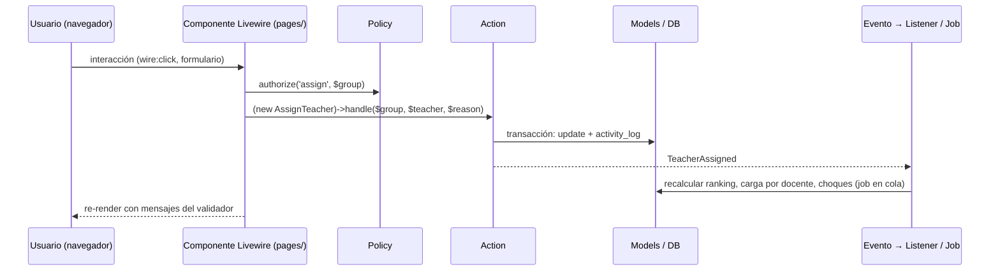

# Arquitectura

Nexus es un **monolito modular** en Laravel 13 + Livewire 4. No es hexagonal ni DDD: no hay capas Domain/Infrastructure ni repositorios abstractos. La modularidad se logra con carpetas por módulo, dependencias en una sola dirección y una convención fija para cada tipo de clase.

## Stack

| Capa | Tecnología | Notas |
|---|---|---|
| Runtime | PHP 8.5 sobre FrankenPHP + Laravel Octane (worker mode) | Ya configurado en `Dockerfile` y `compose.yaml`. Cuidado con estado estático entre peticiones. |
| Framework | Laravel 13 | |
| UI | Livewire 4 con componentes multi-archivo (MFC), MaryUI sobre daisyUI y Tailwind 4 | Sin SPA ni API REST para la UI. |
| Base de datos | PostgreSQL 18.6 | Única fuente de verdad. Tests también contra PostgreSQL. |
| Caché, sesiones, colas | Valkey 9 (driver `redis`) | Colas para importaciones, recálculos y corridas del motor. |
| Auth | Laravel Fortify (username + contraseña), spatie/laravel-permission | Sin registro público; los usuarios se crean desde importación o por un admin. |
| Bitácora | spatie/laravel-activitylog | Inmutable. |
| Pruebas | Pest 5 (unit, feature, browser) | Ver `docs/arquitectura/testing.md`. |
| Motor de horarios | Heurística en PHP (R2) y servicio Python con OR-Tools CP-SAT (R2) | Ver `docs/arquitectura/solver.md`. |
| Infraestructura | Docker Compose: nginx (solo dev), app, queue, postgres, valkey, vite (dev); en producción `caddy` (HTTPS) reemplaza a nginx y se suma `backup` ([ADR-0013](../decisiones/0013-despliegue-on-premise-itcj.md)); `solver` se añade en R2 | |

## Estructura de un módulo

```
app/Modules/<Modulo>/
├── <Modulo>ServiceProvider.php   registra rutas, migraciones, vistas, namespace Livewire y policies
├── Models/                       Eloquent, relaciones, scopes y casts; sin lógica de proceso
├── Enums/                        enums PHP respaldados por string
├── Actions/                      una clase por caso de uso de escritura (Create…, Assign…, Close…, Publish…)
├── Queries/                      consultas de lectura reutilizables para pantallas, tableros y exportes
├── Rules/                        reglas de validación y validadores de dominio (p. ej. ConstraintValidator)
├── Livewire/
│   ├── pages/                    pantallas completas (MFC: carpeta con .php y .blade.php)
│   └── components/               piezas reutilizables del módulo
├── Policies/                     autorización por rol y alcance (role_scopes)
├── Jobs/  Events/  Listeners/  Notifications/   solo si el módulo los necesita
├── Routes/web.php                rutas del módulo, con middleware de auth y prefijo propio
├── Database/
│   ├── Migrations/
│   ├── Factories/
│   └── Seeders/
└── Lang/es/                      textos del módulo (opcional; la app corre en español)
```

Reglas:

- **Actions** son la única puerta de escritura. Reciben datos ya validados, abren la transacción, escriben, registran bitácora y disparan eventos. Los componentes Livewire nunca escriben en modelos directamente.
- **Queries** devuelven builders o DTOs simples para listados; evitan que las pantallas armen consultas complejas.
- **Models** solo tienen relaciones, casts, scopes y accessors. Nada de "si el estado es X entonces…" dentro del modelo; eso va en Actions o Rules.
- **Livewire** valida entrada, llama Actions o Queries y renderiza. Sin consultas en Blade.
- Un módulo **no importa clases** de un módulo a su derecha en el mapa de dependencias (ver `docs/dominio/modelo-de-datos.md`). La comunicación en sentido contrario se hace con **eventos** (por ejemplo, `Imports` emite `BatchApplied` y `Students` recalcula progreso al escucharlo).
- Pruebas de arquitectura con `arch()` de Pest hacen cumplir estas reglas (dependencias entre módulos, que los modelos no usen Facades de request, que las Actions sean `final`).

## Módulos

| Módulo | Responsabilidad | Entrega |
|---|---|---|
| `Core` | Auth (Fortify, username), usuarios, roles y alcances, campus y modalidad, periodos y etapas, parámetros, bitácora, notificaciones, layout y navegación | R1 |
| `Academic` | Departamentos, jefes, carreras, planes de estudio, materias, seriación, especialidades | R1 |
| `Facilities` | Edificios, salones, bloqueos, salones por defecto | R1 |
| `Faculty` | Docentes, plazas, disponibilidad, horas externas, historial, perfil, evaluaciones | R1 |
| `Students` | Alumnos, kardex, avance reticular | R1 |
| `Imports` | Importador por archivos: plantillas, mapeos, staging, validación, aplicación | R1 |
| `CatalogValidation` | Revisión y validación de catálogos por jefes de departamento cada periodo | R1 |
| `AcademicLoad` | Orquestación del flujo: propuestas, estados, acuerdos, solicitudes de cambio, cierre, aprobación, publicación, snapshots, re-análisis | R1 (base), R2 (re-análisis e impacto) |
| `Scheduling` | Grupos, sesiones, cupos por carrera, salones, validador de restricciones, editor de horarios, tablero de choques | R1 (manual + validador), R2 (heurística) |
| `Staffing` | Ranking docente, asignación, historial, carga por docente | R1 |
| `Demand` | Proyección de demanda y grupos sugeridos | R2 |
| `Solver` | Cliente del motor, corridas, contrato; servicio Python en `services/solver/` | R2 |
| `Enrollment` | Orden de inscripción, citas, auto-inscripción, listas de espera | R3 |

## Flujo de una petición típica



## Autorización y alcance

- Los **roles** dicen qué puede hacer alguien; los **alcances** (`role_scopes`) dicen sobre qué campus, departamento o carrera.
- Cada Policy comprueba ambos. Ejemplo: un `jefe_departamento` puede asignar docente a un grupo solo si el grupo pertenece a un departamento y campus de su alcance.
- La navegación y los tableros se filtran por alcance desde una Query central en `Core` (`ScopedContext`), para que ninguna pantalla tenga que repetir la lógica.
- Un `admin` ve todo pero sus acciones quedan en bitácora como las de cualquiera.

## Configuración por campus y modalidad

`campuses.settings` es el **perfil de flujo**. Las pantallas y validadores consultan ese perfil, no el código del campus. Así el flujo presencial de R1 sirve para Campus I y II, y en R4 las modalidades EAD, EnLínea y TecNM Virtual se activan ajustando el perfil y añadiendo solo las reglas que de verdad son distintas (asignación centralizada, sesiones virtuales, docentes externos).

## Colas y trabajos en segundo plano

Todo lo que tarde más de un segundo va a la cola `redis` (servicio `queue`): validar y aplicar lotes de importación, recalcular `student_progress`, `staffing_rankings`, `teacher_term_loads` y `schedule_conflicts`, generar snapshots y exportes, y correr el motor. Las pantallas muestran progreso con polling de Livewire (`wire:poll`) y notificaciones en base de datos.

## Caché

Valkey como caché para: perfil de flujo por campus, calendario de etapas del periodo actual, conteos de tableros y resultados del validador por periodo. Toda clave incluye `term_id` y `campus_id`, y se invalida por eventos de escritura. Nunca se cachea nada que dependa del usuario sin incluir su id en la clave.

## Internacionalización

La aplicación corre en español (`APP_LOCALE=es`). Los textos de UI van en archivos de idioma del módulo o inline en Blade si son únicos. Nombres de clases, tablas, columnas, rutas y variables en inglés; términos del dominio según `docs/dominio/glosario.md`.

## Observabilidad mínima

Logs estructurados en JSON a stdout (los recoge Docker), `laravel/pail` en desarrollo, página `/up` para healthcheck. Antes de R2 se evalúa Laravel Pulse para ver colas y consultas lentas.

## Lo que queda fuera a propósito

- API pública o móvil: no en R1 a R3. Si se necesita, se expone sobre las mismas Actions y Queries.
- Multi-tenancy: Nexus es una sola institución; campus es un atributo, no un tenant.
- Microservicios más allá del solver: no. El solver existe porque OR-Tools no tiene equivalente en PHP.
