# Motor de horarios (solver)

Arquitectura del componente que sugiere horarios y salones para los grupos de un periodo. Desde el 17 de noviembre de 2026 una corrida abarca la carga de un departamento en una modalidad, en todos sus campus a la vez (decisión del usuario; «Punto de partida» de la fase 6). Dos implementaciones bajo una sola interfaz y un solo contrato: una heurística en PHP (fase 6) y un servicio en Python con OR-Tools CP-SAT (fase 7). Las reglas que ambas respetan están en `docs/dominio/reglas-de-negocio.md`; las tablas, en `docs/dominio/modelo-de-datos.md`.

## Propósito

- Convertir la validación de la fase 3 (que solo dice "esto choca") en una propuesta completa de sesiones y salones sin choques duros y con buen puntaje blando.
- Mantener a la persona en control: el motor **propone**, el coordinador o jefe **acepta**; nada se escribe en `group_sessions` sin aceptación explícita y bitácora.
- Permitir cambiar de motor sin tocar pantallas, flujo ni base de datos.

## Ciclo de vida de una corrida

```mermaid
stateDiagram-v2
    [*] --> queued : el usuario lanza una corrida
    queued --> running : el job la toma del worker queue
    queued --> cancelled : se cancela antes de correr
    running --> done : salida válida según el contrato
    running --> failed : error, tiempo agotado sin solución, servicio caído
    running --> cancelled : se pidió cancelar y el motor avisó avance
    done --> applied : el usuario acepta; se escribe en group_sessions
    done --> discarded : el usuario descarta
    failed --> [*]
    cancelled --> [*]
```

Cada corrida es una fila en `solver_runs` con su entrada y salida completas, métricas y autor. La entrada y la salida van en la fila (jsonb) si su JSON cabe en 1 MiB y si no, en un archivo `solver/runs/<id>/input.json` u `output.json` del disco `local` (`storage/app`, compartido por la aplicación y la cola), con la ruta en la fila (`Solver\Support\RunPayloads`). Una corrida en `done` puede consultarse y compararse cuantas veces haga falta; `applied` es terminal y deja en `activity_log` qué sesiones cambiaron.

**Lanzar y correr (tarea 6.8).** `Actions\LaunchSolverRun` valida el motor y el límite de tiempo (10 a 600 s, SV-04), revisa que el departamento no tenga otra corrida en curso (SV-01), arma la entrada con `BuildSolverInput`, guarda su huella (`input_hash`, SV-02) y despacha `Jobs\RunSolver` después del commit. El job toma la corrida solo si sigue en cola, la pasa a `running` y llama a `solve()`; su aviso de avance guarda `progress` y `best_score` a lo más una vez por segundo y, si se pidió cancelar (`cancel_requested_at`, `Actions\CancelSolverRun`, SV-03), corta al motor y deja la corrida `cancelled`. Al terminar guarda la salida validada, las métricas con un resumen y la deja `done` aunque la salida sea `partial` o `infeasible` (la pantalla decide qué mostrar); una salida `error` o una excepción la dejan `failed` con el mensaje, sin traza. Lista o fallida, avisa a quien la lanzó (`Notifications\SolverRunFinished`, que lleva a `solver.runs?corrida=<id>`). Su `timeout` es el límite de la corrida más un minuto, con un solo intento. El guardado final bloquea la fila y solo escribe si la corrida sigue `running`: un job tardío no pisa una corrida que ya se dio por perdida o se canceló. Lanzar y cancelar autorizan a quien las llama con `SolverRunPolicy` (`launchForDepartment`, `launchForCareer`, `cancel`).

**Limpieza de archivos.** `php artisan solver:prune-files [--days=30]` (`Actions\PruneSolverRunFiles`) borra los archivos de las corridas fallidas, canceladas y descartadas que terminaron hace más de esos días y quita su ruta de la fila, y las carpetas de `solver/runs` sin corrida de más de un día. Nunca toca las aplicadas, las terminadas ni las que están en curso. Hoy se corre a mano; no está en el schedule.

## Interfaz `SolverEngine`

Una interfaz en `app/Modules/Solver/Engines/` con tres responsabilidades: resolver (recibe el contrato de entrada, devuelve el contrato de salida), reportar progreso (porcentaje y mejor puntaje intermedio para `wire:poll`) y cancelar. El registro de motores disponibles vive en `settings` (`solver.engines`) y el motor predeterminado por modalidad en `solver.default_engine`.

| Implementación | Dónde corre | Cuándo usarla |
|---|---|---|
| `PhpHeuristicEngine` | Contenedor `queue`, en PHP | Rápida, sin dependencias externas; buena para corridas por carrera, re-análisis y alternativas de solicitudes de cambio |
| `CpSatEngine` | Cliente en PHP que llama al servicio `solver` (Python) | Cargas grandes o muy restringidas (departamentos con muchos grupos en varios campus), mejor puntaje blando |

La pantalla de corridas (fase 6) no distingue entre ambas: elige motor, lanza, compara, acepta.

## Contrato JSON

Versión actual: `1`. El contrato es la frontera entre Nexus y cualquier motor; los DTOs de PHP (`Solver/Contract/`) y los modelos pydantic del servicio lo implementan por igual, y los fixtures compartidos lo prueban en ambos lados.

### Entrada

| Campo | Tipo | Obligatorio | Significado |
|---|---|---|---|
| `version` | entero | sí | Versión del contrato. Un motor rechaza versiones que no soporte. |
| `run_id` | cadena | sí | Identificador de la corrida (`solver_runs.id`) para correlación en logs. |
| `term` | objeto | sí | `code` del periodo. Solo informativo para el motor. |
| `modality` | objeto | sí | `code` de la modalidad de la carga. Solo informativo. |
| `campuses[]` | lista | sí | Un objeto por campus de la corrida: `code`, `block_minutes`, `day_start`, `day_end` (`HH:MM`), `days` (lista de 1 a 6) y `uses_rooms`. Cada campus tiene su rejilla de bloques, y `block_minutes` debe dividir la jornada de `day_start` a `day_end` en bloques completos (si no, la entrada se rechaza en `day_end`). |
| `time_limit_seconds` | entero | sí | Tiempo máximo de resolución. El motor devuelve la mejor solución encontrada al vencer. |
| `scope` | objeto | sí | `kind` (`department`: la carga del departamento en la modalidad; `career`: exploración del coordinador) e `id`. Para logs y para que la pantalla sepa qué se programó. |
| `travel_minutes` | entero | sí | Minutos mínimos para que un docente cambie de campus entre dos sesiones seguidas (`staffing.min_campus_travel_minutes`, SC-09). |
| `weekly_hours_tolerance` | entero | no (0) | Tolerancia de HC-12, en minutos: la suma de las sesiones de un grupo puede diferir de `weekly_hours` por esa cantidad (MS17). `BuildSolverInput` la toma del perfil de la modalidad (`weekly_hours_tolerance`) y, si no la tiene, de `scheduling.weekly_hours_tolerance`. Ausente vale 0, así que las entradas anteriores siguen siendo válidas en la versión 1. |
| `groups[]` | lista | sí | Grupos a programar. Por grupo: `id`, `campus_code`, `subject_code`, `department_id`, `owner_career_id`, `study_plan_id`, `semester` (reticular), `weekly_hours` (teoría más práctica), `practice_hours`, `needs_lab`, `capacity`, `teacher_id` (opcional), `cohorts[]` (claves de cohorte: conjuntos de grupos que un mismo alumno toma juntos y que no se empalman; ver HC-03), `fixed_sessions[]` (sesiones que no se mueven), `candidate_room_ids[]` (opcional, para acotar el dominio), `movable` (si es `false` el grupo entra solo como ocupación), `current_sessions[]` (opcional; las sesiones que un grupo movible ya tiene, con la forma de `fixed_sessions[]`, para que el motor marque `changed` en la salida; vacía si no tenía horario). |
| `teachers[]` | lista | sí | Docentes referidos por los grupos. Por docente: `id`, `remaining_hours`, `honorarios` (si es de honorarios, para SC-08), `unavailable[]` (día, inicio, fin), `preferred[]` (día, inicio, fin), `busy[]` (sesiones ya asignadas fuera de la corrida, con su `campus_code`, como ocupación fija). |
| `rooms[]` | lista | sí si `campus.uses_rooms` | Por salón: `id`, `campus_code`, `type`, `capacity`, `building_id`, `owner_department_id` (opcional), `blocks[]` (día, inicio, fin bloqueados), `busy[]` (sesiones de grupos fuera del alcance). |
| `agreements[]` | lista | no | Préstamos aceptados: `room_id`, `to_department_id`, `day`, `starts_at`, `ends_at`. Sin acuerdo, un salón con dueño solo lo usa su departamento (HC-10). |
| `subject_room_defaults[]` | lista | no | `subject_code`, `campus_code`, `room_id`, `priority`. Alimenta SC-03. |
| `hard_rules[]` | lista de cadenas | sí | Identificadores HC activos (por defecto HC-01 a HC-13). Permite desactivar una regla para una corrida exploratoria; la salida la reporta como desactivada. |
| `soft_weights` | objeto | sí | Peso por SC-01 a SC-09. Cero desactiva la regla blanda. Salen del parámetro `solver.soft_weights` (campos `sc_01`…`sc_09`, que `BuildSolverInput` pasa a `SC-01`…), que la Subdirección edita en «Parámetros»; sin valor válido, los de la tabla SC. |
| `options` | objeto | no | `threads`, `seed`, `suggest_teachers` (si el motor puede sugerir docente para grupos sin él), `return_intermediate` (si reporta soluciones intermedias). |

**Cohortes.** Una cohorte es un conjunto de grupos que un mismo alumno toma juntos; sus sesiones no se empalman (HC-03). Quien arma la entrada pone las claves en cada grupo:

- `plan:<study_plan_id>:<semestre>:<campus_code>` en los grupos de una materia que es el único grupo de su materia para la carrera en ese plan, semestre y campus (el alumno tipo de HC-03);
- `package:<package_id>:<campus_code>:<número>` en cada grupo de la instancia *n* de un paquete de primer semestre (DM-09; `groups.package_id` y `groups.package_number`, tarea 5.6).

El motor no sabe de dónde viene cada cohorte: solo garantiza que los grupos con una misma clave no se empalmen.

### Salida

| Campo | Tipo | Obligatorio | Significado |
|---|---|---|---|
| `version` | entero | sí | Misma versión del contrato que la entrada. |
| `run_id` | cadena | sí | Eco del identificador. |
| `status` | cadena | sí | `optimal`, `feasible` (sin violaciones duras pero sin prueba de óptimo), `partial` (hay grupos sin programar o violaciones residuales), `infeasible`, `error`. |
| `sessions[]` | lista | sí | Por sesión propuesta: `group_id`, `day`, `starts_at`, `ends_at`, `room_id` (nulo si la modalidad no usa salones), `kind` (`teoria`, `practica`, `virtual`), `changed` (si difiere de lo que había en la entrada). |
| `teacher_suggestions[]` | lista | no | `group_id`, `teacher_id`, `reason`. Solo si `options.suggest_teachers`. Es sugerencia; la asignación sigue el ranking de la fase 3. |
| `unscheduled[]` | lista | sí | Grupos que no se pudieron colocar: `group_id`, `reasons[]` (identificadores HC y texto). |
| `hard_violations[]` | lista | sí | Violaciones duras residuales en la solución devuelta: `rule`, `group_ids[]`, `teacher_id`, `room_id`, `message`. Debe estar vacía para `optimal` y `feasible`. |
| `soft_score` | objeto | sí | `total` y desglose por SC-01 a SC-09 (penalización por regla). Menor es mejor. |
| `relaxed_rules[]` | lista | no | Reglas que el motor relajó para encontrar solución en una instancia infactible, con los grupos afectados. |
| `metrics` | objeto | sí | `elapsed_seconds`, `engine`, `engine_version`, `variables`, `constraints`, `iterations` o `branches`, `intermediate_solutions`. |
| `log` | lista de cadenas | no | Mensajes informativos para la pantalla de corridas. |

### Versionado

- `version` se incrementa solo cuando cambia la forma o el significado de un campo. Agregar un campo opcional no cambia la versión.
- Cada motor declara qué versiones soporta; una entrada de versión no soportada devuelve `status = error` con mensaje claro.
- Las corridas guardadas conservan su versión; la pantalla de corridas sabe mostrar cualquier versión que haya existido.
- Los fixtures se guardan por versión en `tests/Fixtures/solver/v1/`.

## Mapeo de reglas a cada motor

| Regla | Heurística en PHP | CP-SAT |
|---|---|---|
| HC-01 docente sin empalme | Al colocar, el evaluador rechaza bloques ocupados por el docente (incluye `busy` de otros campus) | Suma de variables del docente por bloque ≤ 1, con `busy` como constantes |
| HC-02 salón sin empalme | Rechaza salones ocupados en el bloque (incluye `busy` y bloqueos) | Suma de variables del salón por bloque ≤ 1 |
| HC-03 alumno tipo sin empalme | Rechaza bloques ocupados por otro grupo de la misma cohorte (`cohorts[]`) | Suma por (cohorte, bloque) ≤ 1 |
| HC-04 ventana y bloques | El dominio de bloques se construye solo dentro de la ventana y alineado | Solo se crean variables dentro de la ventana y alineadas |
| HC-05 capacidad del salón | Filtro de salones candidatos por capacidad | Solo se crean variables con `room.capacity >= group.capacity` |
| HC-06 laboratorio | Filtro de tipo de salón para sesiones prácticas | Solo se crean variables de salones del tipo requerido para horas prácticas |
| HC-07 suma de cupos | No aplica al motor (se valida al editar cupos); se verifica en la entrada | Igual: verificación previa, no restricción del modelo |
| HC-08 horas del docente | Verificación previa con `remaining_hours`; el motor no cambia docentes salvo sugerencia | Igual; si `suggest_teachers`, suma de horas sugeridas ≤ `remaining_hours` |
| HC-09 disponibilidad | Rechaza bloques `unavailable` del docente | Variables en bloques `unavailable` fijadas en cero |
| HC-10 préstamo de salón | Salón con dueño ajeno solo si hay acuerdo que cubra el bloque | Variables de salón ajeno existen solo en bloques cubiertos por un acuerdo |
| HC-11 bloqueos de salón | Rechaza bloques en `blocks` | Variables en bloques bloqueados fijadas en cero |
| HC-12 horas semanales | El constructor coloca exactamente `weekly_hours` horas por grupo | Suma de horas de las sesiones del grupo = `weekly_hours` |
| HC-13 grupos válidos | Verificación previa al armar la entrada | Igual |
| SC-01 horas seguidas del alumno tipo | Penaliza huecos por (plan, semestre, día) en la búsqueda local | Variables auxiliares de primer y último bloque por (plan, semestre, día); penaliza su diferencia menos las horas ocupadas |
| SC-02 reparto en días | Penaliza más de N horas del mismo grupo en un día | Penalización por grupo y día cuando excede el umbral |
| SC-03 salón por defecto | Bonifica el salón de mayor prioridad del `subject_room_defaults` | Término negativo por usar un salón por defecto |
| SC-04 bloques preferidos del docente | Bonifica sesiones en `preferred` | Término negativo por sesión en bloque preferido |
| SC-05 compacidad del docente | Penaliza huecos por docente y día | Primer y último bloque por docente y día, como SC-01 |
| SC-06 cambio de edificio | Penaliza edificios distintos en horas consecutivas del docente | Penalización por par de sesiones consecutivas con edificio distinto |
| SC-07 semestres consecutivos | Penaliza empalmes entre semestre N y N+1 de la misma carrera | Penalización por (plan, semestre, semestre+1, bloque) ocupados a la vez |
| SC-08 turnos para honorarios | Penaliza sesiones fuera de la disponibilidad declarada de docentes de honorarios | Penalización por sesión fuera de `preferred` cuando el docente es de honorarios |
| SC-09 traslado entre campus | Penaliza dos sesiones seguidas del docente en campus distintos con menos de `travel_minutes` entre ellas | Penalización por par de sesiones del docente en campus distintos demasiado cerca |

HC-14 a HC-18 son reglas del flujo (validación de catálogos, cierre, motivo de asignación, visibilidad, bitácora) y no entran al motor.

## Evaluador en memoria

Tarea 6.5. La heurística en PHP y la pantalla de corridas comparan soluciones candidatas con **las mismas clases de reglas** que el validador de la fase 3, sin base de datos y sin una segunda definición de cada regla.

| Pieza | Módulo | Qué hace |
|---|---|---|
| `Rules/Evaluator/HardRuleEvaluator` | Scheduling | Corre HC-01 a HC-13 (las clases de `ScheduleValidator::CONSTRAINTS`, sin SC-09) sobre un `ScheduleState` y un alcance, todas o las que se piden. `forGroup()` da los choques de un grupo para preguntar «¿y si…?» después de `withSession()` o `withTeacher()`. No usa la base ni el contenedor. |
| `Rules/Soft/*` y `Rules/Soft/SoftScorer` | Scheduling | Una clase por regla blanda, SC-01 a SC-09 (SC-09 cuenta con `CampusTravel`), con su unidad en el docblock y en `docs/dominio/reglas-de-negocio.md`. `SoftScorer` las multiplica por los pesos (`array<string, int>`; un peso cero no se calcula) y da el total, el desglose con peso y las unidades sin peso. Lo que la foto no trae (cohortes, preferidos, edificios y salones por defecto) va en `SoftContext`. |
| `Evaluation/ContractState` | Solver | Arma el `ScheduleState` desde `SolverInput` y las sesiones propuestas de los grupos movibles (`ProposedSession`; `currentSessions()` da las actuales). Su alcance son los movibles. |
| `Evaluation/ContractEvaluator` | Solver | `evaluate(SolverInput, list<ProposedSession>)` da `hardViolations` (`HardViolation`, un choque de dos grupos una sola vez con los dos; si una sesión es candidata sin id, una vez por grupo) y `softScore` (`SoftScore`); `evaluateState()` hace lo mismo sobre una foto ya armada (`ContractState::withState()`). Respeta `hard_rules` y `soft_weights` de la entrada. |

Scheduling no conoce el contrato: Solver depende de Scheduling y no al revés.

**Cómo se traduce el contrato a la foto** (`ContractState`):

- Cada grupo de la entrada es un grupo activo: los movibles con las sesiones propuestas (sin propuesta, sin horario: HC-12 no lo revisa) y los fijos con `fixed_sessions`.
- El contrato no trae ids de materia, modalidad ni campus. La materia es su `subject_code`, con las horas y el laboratorio del grupo; el campus es su código; la modalidad es una por campus, con el perfil de la rejilla de ese campus (HC-04). Las reglas solo comparan igualdad.
- **HC-03 sigue las cohortes de la entrada.** Cada clave `plan:<plan>:<semestre>:<campus>` mete al grupo en ese semestre del alumno tipo (`ScheduleState` acepta los semestres en que cuenta cada grupo, y `TypicalStudentSchedule` revisa los de cada grupo del alcance; un tronco común puede contar en dos planes). Un grupo sin clave de plan no cuenta en ninguno: la entrada no trae los otros grupos de su materia y parecería el único. La clave `package:<id>:<campus>:<n>` da el paquete y su número al grupo.
- La ocupación de fuera de la corrida (`teachers[].busy`, `rooms[].busy`) entra como grupos de contexto sin horas (ids con el prefijo `busy:`), uno por docente y campus y uno por salón. Sus choques no salen del evaluador.
- HC-08: las horas base del docente son `remaining_hours` más las horas de sus grupos fijos de la entrada, así que lo que le queda es lo mismo que en la base.
- HC-10: un préstamo aceptado (`agreements`) cubre a todos los grupos del departamento al que se presta.
- HC-12: la tolerancia de la entrada (`weekly_hours_tolerance`), que `BuildSolverInput` toma de la modalidad o de `scheduling.weekly_hours_tolerance`, como la base.

**Lo que el contrato no trae** (el evaluador no lo puede ver; se revisa al armar la entrada o queda pendiente):

- HC-07 (cupos) y HC-13 (materia, plan y carrera ofrecida): sin cupos ni catálogos en el contrato.
- El núcleo sin combinación de HC-03: cuando ningún par de grupos únicos de su materia se empalma, pero materias con varios grupos no dejan combinación al alumno tipo. El contrato solo trae las cohortes de las materias con un solo grupo, así que ni el evaluador ni el motor lo ven. En la demo movida a propósito fue 1 grupo de 291.

**Equivalencia con la base** (`tests/Feature/Solver/ContractEvaluatorEquivalenceTest.php` y `ContractEvaluatorDemoTest.php`): con un escenario por regla (también la ocupación de otra modalidad, el grupo fijo de otro departamento, el tronco común, los préstamos y el «falso único») y con la demo al punto `cierre` movida a propósito (4 cargas presenciales, 291 grupos movibles, 250 con choques; la prueba exige primero que la demo llegue al cierre), el evaluador sobre el contrato da las mismas reglas duras por grupo movible que `ScheduleValidator` sobre `ScheduleStateQuery`, salvo lo de la lista anterior.

**Costo** (17 de noviembre de 2026, `department-multicampus`: 1 139 grupos movibles, 2 708 en la entrada, 3 175 con los de contexto; PHP 8.5 sin cobertura):

| Operación | Tiempo |
|---|---|
| Leer el JSON y `SolverInput::fromArray` | ~120–230 ms |
| `ContractState::from` (la foto) | ~100 ms, +17 MB |
| HC-01 a HC-13 de todos los movibles | ~90 ms (HC-08 ~45 ms, HC-02 ~27 ms) |
| SC-01 a SC-09 de todos los movibles | ~13 ms |
| `withSession` | ~50 µs |
| `withSession` y `forGroup` (HC-01 a HC-13 de un grupo) | ~1 ms: HC-02 ~350 µs, HC-08 ~200 µs, HC-03 ~190 µs, el resto < 75 µs |
| `withSession` y el puntaje blando de un grupo | ~115 µs |

Lo caro de un grupo es lo que recorre todo: los pares de sesiones de su salón en la semana (`OverlappingPairs`, HC-02), todos los grupos para las horas del docente (`TeacherHourLimit`, HC-08) y todos los grupos con paquete (HC-03). Si la heurística (6.6) pregunta por cada bloque y salón candidato, esos tres son los primeros que conviene indexar.

## Heurística PHP: construcción

Tarea 6.6. `Engines/PhpHeuristic/PhpHeuristicEngine` (clave `heuristic`, «Heurística (PHP)», contrato v1, `checksHardRules()` verdadero) coloca los grupos movibles con una construcción voraz (`Builder`) y valida el resultado con el evaluador en memoria (`FinalValidation`). Se registra en `solver.engines` después del motor de prueba, así que es el predeterminado mientras no llegue `solver.default_engine` (7.11). Después de validar lo construido corre la búsqueda local (6.7, la sección siguiente) y vuelve a validar.

**Patrón de sesiones** (`SessionPattern`; reglas-de-negocio.md, «Patrón de sesiones», PS-01 a PS-08). Sesiones de una hora, una por día en días distintos y a la misma hora todos los días. Las opciones van por niveles y gana el mejor candidato del primer nivel donde alguno cabe:

1. El patrón (PS-01 a PS-03): 4 horas de lunes a jueves, 5 de lunes a viernes, 6 de lunes a viernes más el sábado si el campus lo trae (confirmado el 17 de noviembre de 2026). Con otras horas, los primeros días del campus (3 horas: lunes a miércoles).
2. Los otros juegos con la misma cantidad de días (PS-04): primero los que más se parecen al patrón, al final los que llevan sábado.
3. Menos días, con el reparto más parejo: 5 horas en 4 días son un día de 2 horas seguidas, hasta 2 por día. Sin este nivel no caben `small` ni `medium`: un docente que no puede los viernes con una materia de 5 horas, o un laboratorio prestado solo los martes para 2 horas de práctica.

Con más horas que días del campus (6 sin sábado, 7…), el patrón ya es de todos los días con las horas de sobra repartidas. Si el bloque del campus no es de 60 minutos, una hora son 60/`block_minutes` bloques seguidos cuando 60 es múltiplo del bloque (30, 20, 15 min); si no (50 o 90 min), la unidad es un bloque y las horas semanales tienen que dar un número entero de bloques, o el grupo queda sin programar por HC-12 (PS-06). Todo esto, salvo el patrón de 4, 5 y 6 horas, es supuesto por confirmar.

**Orden de los grupos** (`GroupOrder`, parametrizado). Lo más restringido primero: es lo que más afecta al resultado. Cada grupo recibe una dificultad, la suma de estos términos por su peso, y se colocan de mayor a menor; empatan por semestre (el menor primero), horas (las más primero) e id.

| Término | Peso | Qué mide |
|---|---|---|
| `teacherPattern` | 3 | Qué tan pocas horas de inicio le quedan al docente para el patrón (0 todas, 1 ninguna), con lo fijo e indisponible |
| `teacherLoad` | 3 | Horas de los grupos movibles del docente entre sus horas libres en el campus (hasta 2) |
| `rooms` | 2 | Pocos salones que le sirven (capacidad, dueño y laboratorio): 1 con 4 o menos |
| `hours` | 1 | Horas semanales entre 6 |
| `cohort` | 2 | La cohorte más llena del grupo (alumno tipo o paquete): sus horas entre las de la rejilla |
| `semester` | 0.5 | 1 entre el semestre: primeros semestres antes |

**Factibilidad rápida.** Índices de ocupación por bloque de la rejilla de cada campus que se actualizan al colocar cada grupo: docente × día × bloque (HC-01, con `busy` de otros campus y los grupos fijos), su indisponibilidad (HC-09), salón × día × bloque (HC-02) con sus bloqueos aparte (HC-11), cohorte × día × bloque (HC-03) y los préstamos aceptados por salón, departamento y día (HC-10). La capacidad (HC-05), el laboratorio (HC-06) y el dueño del salón se filtran al ordenar los salones; la ventana (HC-04) y las horas exactas (HC-12) salen de cómo se arman los candidatos. Solo se revisan las reglas activas (`hard_rules`). Las cohortes son más estrictas que HC-03, como dice el contrato: dos grupos con una misma clave nunca se empalman.

**Salones.** Cada grupo ordena los de su campus (o sus `candidate_room_ids`): el por defecto de la materia por prioridad (SC-03), el tipo (aula para teoría; laboratorio, taller o sala de cómputo para la práctica de una materia con laboratorio), la capacidad más ajustada y el id. Los de otro departamento entran solo si hay préstamo para el suyo, y se usan solo en los bloques que el préstamo cubre. Por día se toma el primero libre; si el docente tiene una sesión pegada en otro edificio, uno igual de bueno en ese edificio (SC-06); luego un mismo salón todos los días si alguno queda libre sin agregar cambios de edificio, y si no, uno del mismo edificio. El salón actual del grupo gana si es igual de bueno (PS-07). Las horas de práctica van a los días con laboratorio libre; las de teoría, al aula (PS-05).

**Desempate blando.** Entre los candidatos que caben gana el de menor puntaje estimado con los mismos índices y los pesos de la entrada: huecos del alumno tipo (SC-01) y del docente (SC-05), horas fuera de los preferidos (SC-04, más SC-08 con honorarios), empalmes con el semestre de al lado (SC-07), salón por defecto (SC-03), cambio de edificio (SC-06) y traslado (SC-09); SC-02 no entra: es igual en todos los candidatos de un nivel (cero con una hora por día) y los niveles no se comparan por puntaje. Luego gana la hora actual del grupo (`current_sessions`, que también da `changed`), el orden del nivel y la hora más temprana.

**Validación final.** El evaluador es la autoridad. Si le quedan violaciones duras en grupos movibles, se cubren de forma voraz: se quitan las sesiones del grupo que aparece en más violaciones (si empatan, del colocado después) y se repite con las que quedan, sin garantizar el mínimo de grupos. Cada uno queda sin programar con la regla y el mensaje del evaluador, y se vuelve a validar hasta que no quede ninguna. Quitar sesiones no crea choques, así que pasado el plazo se quitan de una vez todos los grupos de las violaciones que queden. HC-08 no depende del horario: un docente cuyos grupos movibles suman más de lo que le queda se pasa igual con o sin sesiones, así que sus grupos se colocan, la violación queda en `hard_violations` y la corrida sale `partial` (PS-08, supuesto por confirmar).

**Salida.** `feasible` si todo cupo sin violaciones, `partial` si algo quedó. Cada grupo sin programar lleva sus motivos con la regla al frente, del que más candidatos descartó al que menos: «HC-09: el docente no tiene disponibilidad a una misma hora en lunes a jueves ni en otros días», «HC-03: choca con su cohorte (el paquete #1: …)», «HC-06: no queda laboratorio… libre». Sin búsqueda local (`new PhpHeuristicEngine(search: null)`, para medir), el avance llega a 90 al construir, va de 91 a 99 en cada pasada de la validación (con el puntaje de esa evaluación, así que la corrida se puede cancelar ahí) y llega a 100 al final; con `time_limit_seconds` construye hasta el límite menos lo que guarda para validar (0.25 s más 0.2 ms por grupo de la entrada, hasta la mitad del límite), valida con plazo y devuelve lo que lleva, validado; lo que no alcanzó queda sin programar con ese motivo (o con el suyo, si nunca iba a caber). En `metrics`, `iterations` son los candidatos revisados e `intermediate_solutions` las validaciones con el evaluador. Con la búsqueda, el avance, el plazo y las métricas cambian como dice la sección siguiente. El `log` dice cuántos colocó, cuántos fueron a otros días o con dos horas el mismo día, si se acabó el tiempo y qué docentes se pasan de horas.

**Medición** (17 de noviembre de 2026, PHP 8.5 sin cobertura, contenedor `app`):

| Fixture | Tiempo | Colocados | Sin programar | Violaciones duras | Puntaje blando |
|---|---|---|---|---|---|
| tiny | < 0.01 s | 3 de 3 | 0 | 0 | 44 |
| small | < 0.01 s | 6 de 6 | 0 | 0 | 141 |
| medium | 0.01 s | 11 de 11 | 0 | 0 | 64 |
| infeasible | < 0.01 s | 3 de 5 | 2 (HC-09) | 0 | 12 |
| department-multicampus | 1.5 s | 1 139 de 1 139 | 0 | 0 | 24 749 |

En `department-multicampus` revisó 24 950 candidatos y validó una vez; 49 grupos fueron a otros días y 19 llevan un día de dos horas. El desglose: SC-04 16 784, SC-05 5 709, SC-06 960, SC-01 460, SC-08 342, SC-09 338, SC-02 120, SC-07 36 (SC-03 en cero: la instancia no trae salones por defecto). Como referencia, el horario actual de la demo da 42 543 (13 668 de SC-02, porque trae sesiones de varias horas), la misma construcción sin el desempate blando 33 893 y con los grupos en el orden de la entrada (sin `GroupOrder`) 26 658. Sin los términos del docente en el orden, `medium` deja un grupo sin programar.

## Heurística PHP: búsqueda local

Tarea 6.7. `Engines/PhpHeuristic/LocalSearch` corre dentro del mismo motor, después de validar lo construido, sobre los mismos índices de ocupación del `Builder`: libera un grupo (`release`), pregunta qué otras colocaciones le caben (`alternatives`, `placementAt`, `roomAlternatives`) y lo vuelve a colocar (`assign`). Cada ocupación de los índices guarda su dueño en una lista por docente, salón o cohorte y día, así que liberar reconstruye los bloques de ese día sin el grupo, exacto aunque dos ocupaciones toquen el mismo bloque.

**Movimientos.** Siempre sobre grupos movibles colocados, enteros y con su patrón (PS-01 a PS-05): una hora por día, a la misma hora todos sus días.

| Movimiento | Qué hace |
|---|---|
| Mover | El grupo a otra hora de inicio, o a otro juego de días de su nivel o de uno mejor, con los salones que elige la construcción en esa hora. Un grupo en su patrón no sale de él; uno que fue a otros días o con dos horas un día puede volver hacia el patrón, nunca alejarse (PS-09). |
| Intercambiar | Con un grupo colocado del mismo campus que ocupa, por docente (HC-01) o por cohorte (HC-03), una hora a la que el grupo no puede ir: cada uno toma la hora de inicio del otro y conserva sus días (un grupo de 4 horas y uno de 3 pueden cambiar de hora). |
| Cambiar salón | En un día o en todos, por un salón por defecto de la materia (SC-03) o uno del edificio de la sesión pegada del docente (SC-06), libre y que le sirva. Mover a la misma hora también vuelve a elegir salones. |
| Desplazar al docente | Todos los grupos movibles colocados del docente, las mismas horas antes o después, cada uno en sus días. Mueve su bloque de clases sin abrirle huecos: es lo que necesita SC-04 cuando mover un solo grupo a sus preferidos le abre huecos que cuestan más (SC-05). Se revisa en la iteración del primer grupo del docente. |

**Aceptación.** Un movimiento solo se considera si cabe en los índices del constructor, que revisan HC-01 a HC-13 como al construir (no crea choques duros), y entra solo si baja el puntaje blando; menor es mejor. Es mejor mejora por grupo y primera mejora entre grupos: de todos los movimientos de un grupo toma el que más baja el puntaje y lo aplica en seguida. Revisar los movimientos de un grupo cuesta poco (unas decenas de horas y salones), y esperar a recorrer los 1 139 grupos para aplicar un solo movimiento sería muy lento. Los empates se quedan con el primero que encontró (nivel, juego de días y hora más temprana) y los grupos se recorren en el orden en que se colocaron. No hay nada aleatorio: la misma entrada da siempre la misma salida, así que `options.seed` no se usa.

**Puntaje incremental** (`LocalScore`). Da el mismo puntaje que el evaluador (`SoftScorer` con los pesos de la entrada), con las mismas cuentas de `Timeline` y las mismas unidades, partido en términos que dependen de un docente en un día (SC-05, SC-06 y SC-09, con sus grupos fijos y su `busy`), de una cohorte en un día (SC-01), de un grupo (SC-02, SC-03, SC-04 y SC-08) o de un par de grupos de semestres seguidos (SC-07). El delta de un movimiento solo vuelve a contar los términos de los docentes y cohortes de los grupos que cambian, en los días de antes y de después, los de esos grupos y sus pares; los demás quedan guardados. Las pruebas comparan el total con el evaluador regla por regla en los fixtures y en `department-multicampus`, el delta de cambios de uno y dos grupos con la diferencia del evaluador y, en 40 entradas generadas con semilla fija (varios campus y tamaños de bloque, `busy` desalineados, grupos fijos, cohortes, laboratorios, préstamos y pesos al azar), el puntaje inicial y final con el evaluador, que no aparezcan choques y que los índices del constructor queden como recién construidos.

**Paro.** Por el plazo o por iteraciones seguidas sin mejora (una iteración es revisar los movimientos de un grupo). Por omisión, una vuelta completa a los grupos sin mejora: es un óptimo local de estos movimientos, otra vuelta daría lo mismo. El contrato no trae un campo para cambiarlo (`options` solo trae `threads`, `seed`, `suggest_teachers` y `return_intermediate`), así que es un parámetro del constructor (`new LocalSearch(maxIdleIterations: N)`).

**Plazo, avance y métricas.** Construye hasta el límite menos lo que guarda para validar (0.25 s más 0.2 ms por grupo de la entrada, hasta la mitad del límite), igual que sin búsqueda, para que la búsqueda nunca le quite tiempo a la construcción, y valida lo construido, midiendo lo que tarda una pasada. Solo si la construcción terminó y todavía no llega la reserva de la búsqueda (esa misma, o dos pasadas medidas si son más), busca hasta ella; la búsqueda mira el reloj entre grupos y en cada paso de sus bucles largos (intercambios y corrimientos del docente), así que una iteración no se pasa. La validación final solo empieza si una pasada cabe en lo que queda; si algo no cabe, se devuelve lo construido, validado, y el `log` lo dice. En `department-multicampus` una pasada tarda 0.32–0.43 s y la reserva es de 0.79 s; con una búsqueda que nunca converge termina en 4.57 s con 5 s de límite, y con 3 s no le queda tiempo para buscar y termina en 2.39 s. Una prueba con reloj real lo revisa en una instancia generada de 150 grupos con 1 s. El avance va hasta 50 al construir, de 51 a 59 al validar lo construido, de 60 a 90 al buscar y de 91 a 99 en la validación final, y 100 al terminar; nunca baja, y al buscar se reporta en cada iteración (lo que más haya avanzado entre el reloj y las iteraciones sin mejora), porque quien lanza la corrida decide cada cuánto lo escribe y revisa ahí si la cancelaron: una excepción lanzada desde el avance sale de `solve()`. El puntaje que se reporta mientras busca es el de `LocalScore`, antes de la validación final: si esa validación revierte, el del 100 es el de antes de buscar. En `metrics`, `iterations` son las iteraciones de la búsqueda e `intermediate_solutions` las soluciones que encontró: la construida más una por movimiento aceptado. El contrato no tiene campos para el puntaje inicial ni para los movimientos por tipo: van en el `log` («Búsqueda local: 3 616 iteraciones y 31 121 movimientos revisados; aceptó 187 (27 de mover, 84 de intercambiar, 66 de cambiar salón y 10 de desplazar docente). El puntaje blando bajó de 24 749 a 23 608.»), con por qué paró.

**Garantía.** Lo que propone la búsqueda pasa por `FinalValidation`, como lo construido. Si esa validación quitara un grupo o diera un puntaje peor que el de antes de buscar (no debería: los movimientos solo entran si caben y bajan el puntaje), el motor devuelve lo validado antes de buscar y lo dice en el `log`. Así la búsqueda nunca empeora el puntaje ni agrega una violación dura.

**Medición** (17 de noviembre de 2026, PHP 8.5 sin cobertura, contenedor `app`; antes es la construcción sola, `search: null`):

| Fixture | Antes | Después | Tiempo con búsqueda | Movimientos aceptados |
|---|---|---|---|---|
| tiny | 44 | 44 | < 0.01 s | 0 |
| small | 141 | 79 | 0.01 s | 1 (intercambiar) |
| medium | 64 | 64 | 0.02 s | 0 |
| infeasible | 12 | 12 | < 0.01 s | 0 |
| department-multicampus | 24 749 | 23 608 (−4.6 %) | 21–26 s (construir 1.5 s) | 187 |

En `department-multicampus`, por regla (antes → después): SC-01 460 → 360 (−22 %), SC-05 5 709 → 5 217 (−9 %), SC-06 960 → 546 (−43 %), SC-04 16 784 → 16 708 (−0.5 %), SC-09 338 → 296, SC-07 36 → 21, SC-08 342 → 340, SC-02 120 → 120; SC-03 en cero (sin salones por defecto). Paró por convergencia tras 3 616 iteraciones (algo más de tres vueltas), muy dentro de los 300 s de la corrida de departamento. SC-04 casi no baja porque tiene poco margen: aun asignando a cada docente sus grupos a horas distintas sin ver salones, cohortes ni huecos, lo menos que puede dar con una hora por día a la misma hora es 15 272 (−9 % como mucho), y casi todas las horas preferidas que quedan libres le abren huecos al docente. Lo que impide cada mejora de SC-04 es el propio docente: sus otros grupos (HC-01) o su indisponibilidad (HC-09), no los salones. Un intercambio en cadena (el otro grupo a su mejor hora y no solo a la del primero) dio 23 617 con el doble de tiempo, así que no se dejó.

## Descomposición del problema

La unidad de corrida es la carga: un departamento en una modalidad, con sus grupos de todos sus campus (decisión del usuario, 17 de noviembre de 2026). Lo que no es de la carga entra fijo: los grupos de otras cargas que comparten docentes, salones o cohortes, como `busy` o como grupos con `movable = false`, y las sesiones ya aceptadas, como `fixed_sessions`.

1. **Por departamento.** El jefe lanza la corrida de su carga y la acepta. Es la corrida normal.
2. **Por carrera.** El coordinador lanza corridas de los grupos de su carrera dentro de las cargas que toca, para explorar y comparar. No las acepta.
3. **Tronco común primero, sugerido.** Las materias compartidas entre carreras (Cálculo, Álgebra, Ética…) cruzan más restricciones, así que conviene programarlas primero. No se exige: cada departamento corre cuando quiere, y la pantalla avisa cuando los grupos con los que comparte cohorte todavía no tienen horario aceptado. `PlanRun` (fase 6) propone el orden y deja la decisión al jefe.

Una parte aceptada se vuelve fija para las siguientes corridas. Si una parte queda `partial`, se puede relanzar con más tiempo o con otra regla relajada.

## Límites de tiempo y soluciones parciales

- Toda corrida tiene `time_limit_seconds`; por defecto 60 por carrera y 300 por departamento (parámetros en `settings`).
- El motor devuelve siempre la mejor solución encontrada, con `status` honesto: `feasible` si no violó nada pero no probó óptimo, `partial` si dejó grupos sin colocar.
- Las soluciones intermedias se reportan para progreso; la pantalla muestra el mejor puntaje hasta el momento y permite cancelar y quedarse con lo que hay.
- Una instancia `infeasible` no se devuelve vacía: el motor relaja reglas en un orden fijo (SC primero, después HC-09 preferencias convertidas, nunca HC-01, HC-02 ni HC-05) y reporta en `relaxed_rules` qué relajó y qué grupos lo necesitaron, para que la persona decida.

## Límites del contrato v1

- **Cohortes HC-03 solo de materias de un grupo.** El contrato lleva únicamente las cohortes de HC-03 de las materias con un solo grupo activo (ver `Cohorts`). Si materias con varios grupos dejan al alumno tipo sin ninguna combinación posible, ni el evaluador ni el motor lo ven; el validador lo marca después de aplicar la salida.
- **HC-07 y HC-13 fuera del alcance del motor.** El motor no cambia cupos ni materias: HC-07 (cupo contra capacidad del salón) y HC-13 (materias, planes y carreras activos u ofrecidos) dependen de datos que no mueve. `BuildSolverInput` pasa los grupos tal como están y el validador los marca.

## Fixtures compartidos y pruebas

- `tests/Fixtures/solver/v1/<nombre>/` trae `input.json` (instancia del contrato, válida para `SolverInput::fromArray`) y `expected.json`, que describe lo que logra un motor correcto y no una salida exacta: `feasible` (`true`, `false` o `null` si no se sabe), `must_schedule` (grupos que deben quedar completos, con sus horas semanales), `may_leave_unscheduled`, `min_unscheduled` (en las infactibles), `max_soft_score` (`null` hasta tener línea base) y `notes`.
  - `tiny`: 3 grupos, 2 campus, un laboratorio ajeno con préstamo; `output.json` es una solución de referencia.
  - `small`: una carrera, un semestre, un campus; 6 grupos de una cohorte, 2 docentes, 3 salones (uno de laboratorio). Factible.
  - `medium`: 12 grupos movibles y uno fijo, 2 campus, 2 carreras con tronco común (claves de cohorte compartidas), laboratorio con préstamo aceptado, paquete (`package:<id>:<campus>:1`), docente en dos campus con traslado y salón ajeno sin préstamo. Factible.
  - `infeasible`: un docente cuyos bloques `unavailable` dejan menos horas libres que las de sus grupos (HC-09); al menos dos de sus tres grupos deben salir en `unscheduled`.
  - `department-multicampus`: la carga de Ciencias Económico-Administrativas (1 139 grupos movibles, 2 708 con los fijos, 657 docentes, 426 salones, C1 y C2) en PRES, Ene-Jun 2027, generada de la demo masiva y anonimizada (fichas `g001`, `t001`, `r001`…). No lleva resultado esperado; se mide en el benchmark. Grupo `solver-slow` en la suite.
- Para regenerar una instancia real: `docker compose exec -e DB_DATABASE=<base demo> app php artisan solver:export-fixture <periodo> <modalidad> <clave de departamento> <nombre> [--career=<clave>]` (por ejemplo `20271 PRES CEA department-multicampus`). Escribe solo `input.json`; `expected.json` se escribe a mano.
- `tests/Feature/Solver/SolverFixturesTest.php` corre cada motor registrado sobre cada fixture. A todos les exige una salida válida del contrato, el `run_id` de la entrada, el tiempo límite y sesiones de grupos de la entrada, dentro de la rejilla de su campus, alineadas a bloques y en un salón de ese campus. Solo a los motores que declaran `checksHardRules()` les exige además lo de `expected.json`: cero `hard_violations` y todo programado donde hay solución, `unscheduled` correcto donde no, y las horas semanales de `must_schedule` (HC-12). El motor de prueba (`FixedEngine`) corre solo las revisiones estructurales.
- El servicio Python lee los mismos archivos y corre la misma verificación con pytest.
- Los fixtures grandes corren fuera del CI de PR (job nocturno o manual; el CI de PR los salta con `--exclude-group=solver-slow`); `tiny`, `small`, `medium` e `infeasible` corren en cada PR.
- El comando de benchmark reporta tiempo, violaciones y puntaje por motor y fixture; los resultados se registran aquí al cierre de las fases 6 y 7.

### Línea base (se llena al cerrar cada fase)

`php artisan solver:benchmark [--engine=*] [--fixture=*] [--markdown]` corre cada motor registrado (o los de `--engine`) sobre cada fixture (o los de `--fixture`) y mide el tiempo con `hrtime`. La tabla de consola trae motor, fixture, grupos movibles, sesiones propuestas, sin programar, violaciones duras, puntaje blando, estado, segundos y «Cumple» (✓/✗ contra `expected.json` en los motores que declaran `checksHardRules()`; «—» en los demás). Con `--markdown` imprime la tabla con las columnas de abajo para pegarla aquí. Un motor o fixture desconocido termina con error.

Fila de referencia del arnés (6.12): el motor de prueba (`fixed`) no revisa reglas duras ni calcula puntaje, así que sus ceros no miden nada y solo muestran que el comando corre. Las filas de la heurística (construcción y búsqueda local, 6.7) son del 17 de noviembre de 2026; las de la línea base de la fase se vuelven a correr al cerrarla.

| Fixture | Motor | Tiempo | Violaciones duras | Puntaje blando | Sin programar |
|---|---|---|---|---|---|
| tiny | fixed | 0.00 s | 0 | 0 | 0 |
| small | fixed | 0.00 s | 0 | 0 | 0 |
| medium | fixed | 0.00 s | 0 | 0 | 0 |
| infeasible | fixed | 0.00 s | 0 | 0 | 0 |
| department-multicampus | fixed | 0.01 s | 0 | 0 | 0 |
| tiny | heuristic | 0.01 s | 0 | 44 | 0 |
| small | heuristic | 0.01 s | 0 | 79 | 0 |
| medium | heuristic | 0.01 s | 0 | 64 | 0 |
| infeasible | heuristic | 0.00 s | 0 | 12 | 2 |
| department-multicampus | heuristic | 25.93 s | 0 | 23608 | 0 |

## Despliegue del servicio Python

| Aspecto | Decisión |
|---|---|
| Ubicación | `services/solver/` con su propio `Dockerfile`, `pyproject` y pruebas; imagen de Python 3.12 fijada por versión y digest como el resto del stack |
| Compose | Servicio `solver` en `compose.yaml` en la red `backend`, sin `ports` públicos; en `compose.override.yaml` el código montado como volumen y recarga automática |
| Acceso | Solo desde `queue` (y `app` para la consulta de salud) por nombre de servicio; token compartido en variable de entorno (`SOLVER_TOKEN`) verificado en cada petición |
| Recursos | Límite de CPU y memoria en compose; número de hilos de CP-SAT por configuración; límite de corridas simultáneas en el servicio |
| Estado | Sin estado persistente: las corridas en curso viven en memoria; el registro duradero es `solver_runs`. Al reiniciar, lo que estaba corriendo se marca `failed` desde PHP por tiempo de espera y se relanza |
| Salud | Endpoint de salud usado por el healthcheck de Docker; `queue` depende de que el servicio esté sano solo cuando el motor predeterminado es CP-SAT |
| Versionado | El servicio expone su versión y las versiones de contrato que soporta en `/health` (`CpSatClient::health()` lo revisa) y rechaza con 422 una entrada de otra versión |

## Cliente PHP (`CpSatEngine`)

`Engines/CpSat/` (tarea 7.9). `CpSatEngine` (clave `cpsat`, «CP-SAT (servicio)», `checksHardRules() = true`) implementa `SolverEngine` sobre `CpSatClient`, que envuelve el cliente HTTP de Laravel con `services.solver` (`SOLVER_URL`, `SOLVER_TOKEN` como `Authorization: Bearer`; 3 s para conectar, 30 s para el envío, que lleva la entrada grande, y 5 s para cada consulta o cancelación, `poll_timeout`). El resto de Nexus no sabe que hay un servicio.

- **Registro.** `cpsat` entra a `solver.engines` solo si hay URL y token (`SolverServiceProvider::engineClasses()`); se decide al arrancar, así que cambiar el `.env` pide reiniciar `app` y `queue`. Va antes del de prueba para no volverse el predeterminado (el último registrado) antes de la 7.11 (supuesto por confirmar). En las pruebas no aparece: `phpunit.xml` deja `SOLVER_TOKEN` vacío y `CpSatEngineTest` simula el servicio con `Http::fake()` y respuestas grabadas de su API (`tests/Fixtures/solver/cpsat/`).
- **Ciclo.** `solve()` manda la entrada (`POST /solve`) y consulta `GET /runs/{id}` cada `services.solver.poll_interval_ms` (1000 por omisión). En `queued` y `running` llama al aviso de avance con `progress` y `best_score`; en `done` valida `output` con `SolverOutput::fromArray` y revisa que traiga el `run_id` de la entrada; en `failed` lanza con el `error` del servicio; un `cancelled` que Nexus no pidió también es error.
- **Cancelación.** Si el aviso de avance lanza (SV-03), manda `DELETE /runs/{id}` y deja salir la excepción; RunSolver deja la corrida cancelada.
- **Tiempo de espera.** El límite es `time_limit_seconds` (L) más 30 s (`CpSatEngine::DEADLINE_MARGIN_SECONDS`) desde que empieza `solve()`. Ninguna consulta, ni un reintento, empieza si no termina antes del límite; cuando ya no cabe otra, o las tres consultas de un intento se vencen (el servicio está pero no contesta), cancela la corrida en el servicio y lanza «El servicio del motor no respondió a tiempo.». Peor caso con los valores por omisión: el envío (30 s) termina antes de L + 30; la última consulta, antes de L + 30; después, una pausa de 1 s y la cancelación de 5 s: L + 36 s, por debajo de L + 60 (`RunSolver::TIMEOUT_MARGIN`), así que la corrida termina con este mensaje y no la corta el worker.
- **Envío vencido.** El envío no se reintenta (encolaría la corrida dos veces). Si se vence después de que el servicio lo aceptó, la corrida de Nexus queda fallida pero la del servicio queda huérfana: Nexus no recibió su identificador y el servicio no conoce el `run_id` de Nexus, así que nadie la cancela; ocupa un lugar hasta que termina sola en su límite y su salida no se recoge.
- **Errores** (SV-08), con mensajes en español y sin trazas, que RunSolver guarda como `error` de la corrida fallida:

| Respuesta del servicio | Excepción | Mensaje |
|---|---|---|
| Conexión rechazada (después de 3 intentos si es una consulta; el envío no se repite), envío vencido o 5xx | `SolverServiceUnavailable` | «El servicio del motor no está disponible.» |
| 429 | `SolverServiceUnavailable` | «El servicio del motor está ocupado con otras corridas: vuelve a lanzarla en unos minutos.» |
| 401 | `SolverServiceUnavailable` | «El servicio del motor no está disponible: rechazó el token de Nexus (SOLVER_TOKEN).» |
| 422 al enviar | `SolverInputRejected` (`problems` con la ruta y el mensaje de cada campo) | «El servicio del motor rechazó la entrada: campuses[0].day_end: …» (los tres primeros problemas) |
| 404 al consultar | `SolverRunNotFound` | «El servicio del motor ya no tiene esta corrida (pudo reiniciarse): vuelve a lanzarla.» |
| Tres consultas vencidas seguidas, o la siguiente ya no cabe en el límite | `SolverServiceTimedOut` (el motor cancela y lanza `CpSatRunFailed`) | «El servicio del motor no respondió a tiempo.» |
| `failed`, salida inválida, salida de otra corrida | `CpSatRunFailed` | El motivo del servicio o la ruta del campo malo |

## Observabilidad

- Logs estructurados en JSON a stdout en ambos lados con `run_id`, motor, alcance, tamaño de la instancia, tiempo, estado y, en CP-SAT, número de variables, restricciones y soluciones intermedias.
- `solver_runs.metrics` guarda lo mismo para consultarlo desde Nexus sin leer logs.
- Tablero mínimo en la pantalla de corridas: corridas por estado, tiempo promedio por alcance, porcentaje `partial` o `failed`.
- Alertas: corrida en `running` más del doble de su límite de tiempo se marca `failed` y notifica al autor.

## Qué queda fuera

- Asignar docentes de forma automática como decisión final: el motor sugiere; el ranking y el jefe deciden.
- Programar modalidades sin bloques fijos (EnLínea): entran en la fase 10 con su propio perfil; el contrato ya admite campus sin salones.
- Optimizar todo el Tec a la vez: cada corrida es la carga de un departamento en una modalidad (todos sus campus); lo de otras cargas entra como `busy` o como grupos fijos.
- Un motor comercial o en la nube: todo corre en el stack de Docker de la institución.
