# Motor de horarios (solver)

Arquitectura del componente que sugiere horarios y salones para los grupos de un periodo. Dos implementaciones bajo una sola interfaz y un solo contrato: una heurística en PHP (fase 6) y un servicio en Python con OR-Tools CP-SAT (fase 7). Las reglas que ambas respetan están en `docs/dominio/reglas-de-negocio.md`; las tablas, en `docs/dominio/modelo-de-datos.md`.

## Propósito

- Convertir la validación de la fase 3 (que solo dice "esto choca") en una propuesta completa de sesiones y salones sin choques duros y con buen puntaje blando.
- Mantener a la persona en control: el motor **propone**, el coordinador o jefe **acepta**; nada se escribe en `group_sessions` sin aceptación explícita y bitácora.
- Permitir cambiar de motor sin tocar pantallas, flujo ni base de datos.

## Ciclo de vida de una corrida

```mermaid
stateDiagram-v2
    [*] --> queued : el usuario lanza una corrida
    queued --> running : el job la toma del worker queue
    running --> done : salida válida según el contrato
    running --> failed : error, tiempo agotado sin solución, servicio caído
    done --> applied : el usuario acepta; se escribe en group_sessions
    done --> [*] : el usuario descarta
    failed --> [*]
```

Cada corrida es una fila en `solver_runs` con su entrada y salida completas (en JSON o en archivo bajo `storage/solver` si es grande), métricas y autor. Una corrida en `done` puede consultarse y compararse cuantas veces haga falta; `applied` es terminal y deja en `activity_log` qué sesiones cambiaron.

## Interfaz `SolverEngine`

Una interfaz en `app/Modules/Solver/Engines/` con tres responsabilidades: resolver (recibe el contrato de entrada, devuelve el contrato de salida), reportar progreso (porcentaje y mejor puntaje intermedio para `wire:poll`) y cancelar. El registro de motores disponibles vive en `settings` (`solver.engines`) y el motor predeterminado por campus en `solver.default_engine`.

| Implementación | Dónde corre | Cuándo usarla |
|---|---|---|
| `PhpHeuristicEngine` | Contenedor `queue`, en PHP | Rápida, sin dependencias externas; buena para corridas por carrera, re-análisis y alternativas de solicitudes de cambio |
| `CpSatEngine` | Cliente en PHP que llama al servicio `solver` (Python) | Instancias grandes o muy restringidas, campus completo, mejor puntaje blando |

La pantalla de corridas (fase 6) no distingue entre ambas: elige motor, lanza, compara, acepta.

## Contrato JSON

Versión actual: `1`. El contrato es la frontera entre Nexus y cualquier motor; los DTOs de PHP (`Solver/Contract/`) y los modelos pydantic del servicio lo implementan por igual, y los fixtures compartidos lo prueban en ambos lados.

### Entrada

| Campo | Tipo | Obligatorio | Significado |
|---|---|---|---|
| `version` | entero | sí | Versión del contrato. Un motor rechaza versiones que no soporte. |
| `run_id` | cadena | sí | Identificador de la corrida (`solver_runs.id`) para correlación en logs. |
| `term` | objeto | sí | `code` del periodo. Solo informativo para el motor. |
| `campus` | objeto | sí | `code`, `block_minutes`, `day_start`, `day_end`, `days` (lista de 1 a 6). Define la rejilla de bloques. |
| `time_limit_seconds` | entero | sí | Tiempo máximo de resolución. El motor devuelve la mejor solución encontrada al vencer. |
| `scope` | objeto | sí | `kind` (`campus`, `department`, `career`) e `id`. Para logs y para que la pantalla sepa qué se programó. |
| `groups[]` | lista | sí | Grupos a programar. Por grupo: `id`, `subject_code`, `department_id`, `owner_career_id`, `study_plan_id`, `semester` (reticular), `weekly_hours` (teoría más práctica), `practice_hours`, `needs_lab`, `capacity`, `teacher_id` (opcional), `fixed_sessions[]` (sesiones que no se mueven), `candidate_room_ids[]` (opcional, para acotar el dominio), `movable` (si es `false` el grupo entra solo como ocupación). |
| `teachers[]` | lista | sí | Docentes referidos por los grupos. Por docente: `id`, `remaining_hours`, `unavailable[]` (día, inicio, fin), `preferred[]` (día, inicio, fin), `busy[]` (sesiones ya asignadas en cualquier campus, como ocupación fija). |
| `rooms[]` | lista | sí si `campus.uses_rooms` | Por salón: `id`, `type`, `capacity`, `building_id`, `owner_department_id` (opcional), `blocks[]` (día, inicio, fin bloqueados), `busy[]` (sesiones de grupos fuera del alcance). |
| `agreements[]` | lista | no | Préstamos aceptados: `room_id`, `to_department_id`, `day`, `starts_at`, `ends_at`. Sin acuerdo, un salón con dueño solo lo usa su departamento (HC-10). |
| `subject_room_defaults[]` | lista | no | `subject_code`, `room_id`, `priority`. Alimenta SC-03. |
| `hard_rules[]` | lista de cadenas | sí | Identificadores HC activos (por defecto HC-01 a HC-13). Permite desactivar una regla para una corrida exploratoria; la salida la reporta como desactivada. |
| `soft_weights` | objeto | sí | Peso por SC-01 a SC-08. Cero desactiva la regla blanda. |
| `options` | objeto | no | `threads`, `seed`, `suggest_teachers` (si el motor puede sugerir docente para grupos sin él), `return_intermediate` (si reporta soluciones intermedias). |

### Salida

| Campo | Tipo | Obligatorio | Significado |
|---|---|---|---|
| `version` | entero | sí | Misma versión del contrato que la entrada. |
| `run_id` | cadena | sí | Eco del identificador. |
| `status` | cadena | sí | `optimal`, `feasible` (sin violaciones duras pero sin prueba de óptimo), `partial` (hay grupos sin programar o violaciones residuales), `infeasible`, `error`. |
| `sessions[]` | lista | sí | Por sesión propuesta: `group_id`, `day`, `starts_at`, `ends_at`, `room_id` (nulo si el campus no usa salones), `kind` (`teoria`, `practica`, `virtual`), `changed` (si difiere de lo que había en la entrada). |
| `teacher_suggestions[]` | lista | no | `group_id`, `teacher_id`, `reason`. Solo si `options.suggest_teachers`. Es sugerencia; la asignación sigue el ranking de la fase 3. |
| `unscheduled[]` | lista | sí | Grupos que no se pudieron colocar: `group_id`, `reasons[]` (identificadores HC y texto). |
| `hard_violations[]` | lista | sí | Violaciones duras residuales en la solución devuelta: `rule`, `group_ids[]`, `teacher_id`, `room_id`, `message`. Debe estar vacía para `optimal` y `feasible`. |
| `soft_score` | objeto | sí | `total` y desglose por SC-01 a SC-08 (penalización por regla). Menor es mejor. |
| `relaxed_rules[]` | lista | no | Reglas que el motor relajó para encontrar solución en una instancia infactible, con los grupos afectados. |
| `metrics` | objeto | sí | `elapsed_seconds`, `engine`, `engine_version`, `variables`, `constraints`, `iterations` o `branches`, `intermediate_solutions`. |
| `log` | lista de cadenas | no | Mensajes informativos para la pantalla de corridas. |

### Versionado

- `version` se incrementa solo cuando cambia la forma o el significado de un campo. Agregar un campo opcional no cambia la versión.
- Cada motor declara qué versiones soporta; una entrada de versión no soportada devuelve `status = error` con mensaje claro.
- Las corridas guardadas conservan su versión; la pantalla de corridas sabe mostrar cualquier versión que haya existido.
- Los fixtures se guardan por versión en `tests/Fixtures/solver/v1/`.

## Mapeo de reglas a cada motor

| Regla | Heurística en PHP | CP-SAT |
|---|---|---|
| HC-01 docente sin empalme | Al colocar, el evaluador rechaza bloques ocupados por el docente (incluye `busy` de otros campus) | Suma de variables del docente por bloque ≤ 1, con `busy` como constantes |
| HC-02 salón sin empalme | Rechaza salones ocupados en el bloque (incluye `busy` y bloqueos) | Suma de variables del salón por bloque ≤ 1 |
| HC-03 alumno tipo sin empalme | Rechaza bloques ocupados por otro grupo del mismo plan y semestre cuando es el único grupo de esa materia | Suma por (plan, semestre, bloque) ≤ 1 sobre los grupos únicos de su materia |
| HC-04 ventana y bloques | El dominio de bloques se construye solo dentro de la ventana y alineado | Solo se crean variables dentro de la ventana y alineadas |
| HC-05 capacidad del salón | Filtro de salones candidatos por capacidad | Solo se crean variables con `room.capacity >= group.capacity` |
| HC-06 laboratorio | Filtro de tipo de salón para sesiones prácticas | Solo se crean variables de salones del tipo requerido para horas prácticas |
| HC-07 suma de cupos | No aplica al motor (se valida al editar cupos); se verifica en la entrada | Igual: verificación previa, no restricción del modelo |
| HC-08 horas del docente | Verificación previa con `remaining_hours`; el motor no cambia docentes salvo sugerencia | Igual; si `suggest_teachers`, suma de horas sugeridas ≤ `remaining_hours` |
| HC-09 disponibilidad | Rechaza bloques `unavailable` del docente | Variables en bloques `unavailable` fijadas en cero |
| HC-10 préstamo de salón | Salón con dueño ajeno solo si hay acuerdo que cubra el bloque | Variables de salón ajeno existen solo en bloques cubiertos por un acuerdo |
| HC-11 bloqueos de salón | Rechaza bloques en `blocks` | Variables en bloques bloqueados fijadas en cero |
| HC-12 horas semanales | El constructor coloca exactamente `weekly_hours` horas por grupo | Suma de horas de las sesiones del grupo = `weekly_hours` |
| HC-13 grupos válidos | Verificación previa al armar la entrada | Igual |
| SC-01 horas seguidas del alumno tipo | Penaliza huecos por (plan, semestre, día) en la búsqueda local | Variables auxiliares de primer y último bloque por (plan, semestre, día); penaliza su diferencia menos las horas ocupadas |
| SC-02 reparto en días | Penaliza más de N horas del mismo grupo en un día | Penalización por grupo y día cuando excede el umbral |
| SC-03 salón por defecto | Bonifica el salón de mayor prioridad del `subject_room_defaults` | Término negativo por usar un salón por defecto |
| SC-04 bloques preferidos del docente | Bonifica sesiones en `preferred` | Término negativo por sesión en bloque preferido |
| SC-05 compacidad del docente | Penaliza huecos por docente y día | Primer y último bloque por docente y día, como SC-01 |
| SC-06 cambio de edificio | Penaliza edificios distintos en horas consecutivas del docente | Penalización por par de sesiones consecutivas con edificio distinto |
| SC-07 semestres consecutivos | Penaliza empalmes entre semestre N y N+1 de la misma carrera | Penalización por (plan, semestre, semestre+1, bloque) ocupados a la vez |
| SC-08 turnos para honorarios | Penaliza sesiones fuera de la disponibilidad declarada de docentes de honorarios | Penalización por sesión fuera de `preferred` cuando el docente es de honorarios |

HC-14 a HC-18 son reglas del flujo (validación de catálogos, cierre, motivo de asignación, visibilidad, bitácora) y no entran al motor.

## Descomposición del problema

Un campus presencial completo (estimado: 400 grupos, 60 salones, 70 bloques semanales) es grande para resolverlo de una vez con garantías. Se resuelve por partes, en este orden:

1. **Tronco común primero.** Las materias compartidas entre varias carreras y departamentos (Cálculo Diferencial, Álgebra Lineal, Taller de Ética, etc.) son las que más restricciones cruzan: distintos planes y semestres reticulares, cupos por carrera, salones de otro departamento. Se programan primero sobre el campus completo.
2. **Luego, un departamento a la vez.** Con las sesiones del tronco común fijadas (`fixed_sessions` y `busy`), cada departamento programa sus grupos; sus docentes y salones ya saben qué bloques están ocupados.
3. **Por carrera** cuando el coordinador quiere explorar solo su retícula; el resto del campus entra fijo.

`PlanRun` (fase 6) orquesta la secuencia y el usuario acepta cada parte antes de seguir; una parte aceptada se vuelve fija para la siguiente. Si una parte queda `partial`, se puede relanzar con más tiempo o con otra regla relajada antes de continuar.

## Límites de tiempo y soluciones parciales

- Toda corrida tiene `time_limit_seconds`; por defecto 60 por carrera, 300 por departamento, 600 para tronco común (parámetros en `settings`).
- El motor devuelve siempre la mejor solución encontrada, con `status` honesto: `feasible` si no violó nada pero no probó óptimo, `partial` si dejó grupos sin colocar.
- Las soluciones intermedias se reportan para progreso; la pantalla muestra el mejor puntaje hasta el momento y permite cancelar y quedarse con lo que hay.
- Una instancia `infeasible` no se devuelve vacía: el motor relaja reglas en un orden fijo (SC primero, después HC-09 preferencias convertidas, nunca HC-01, HC-02 ni HC-05) y reporta en `relaxed_rules` qué relajó y qué grupos lo necesitaron, para que la persona decida.

## Fixtures compartidos y pruebas

- `tests/Fixtures/solver/v1/` contiene instancias del contrato con su resultado esperado: `tiny` (3 grupos, solución única conocida a mano), `small` (una carrera, un semestre), `medium` (laboratorios, tronco común entre dos carreras, un préstamo de salón), `infeasible` (docente sin bloques suficientes), `campus-ii` (tamaño real estimado, generado desde el seeder).
- Una suite parametrizada en PHP corre cualquier `SolverEngine` sobre todos los fixtures y verifica: cero `hard_violations` donde hay solución, `unscheduled` correcto donde no, puntaje blando dentro de un rango y respeto del tiempo límite.
- El servicio Python lee los mismos archivos y corre la misma verificación con pytest.
- Los fixtures grandes corren fuera del CI de PR (job nocturno o manual); `tiny`, `small` y `medium` corren en cada PR.
- El comando de benchmark reporta tiempo, violaciones y puntaje por motor y fixture; los resultados se registran aquí al cierre de las fases 6 y 7.

### Línea base (se llena al cerrar cada fase)

| Fixture | Motor | Tiempo | Violaciones duras | Puntaje blando |
|---|---|---|---|---|
| pendiente | | | | |

## Despliegue del servicio Python

| Aspecto | Decisión |
|---|---|
| Ubicación | `services/solver/` con su propio `Dockerfile`, `pyproject` y pruebas; imagen de Python 3.12 fijada por versión y digest como el resto del stack |
| Compose | Servicio `solver` en `compose.yaml` en la red `backend`, sin `ports` públicos; en `compose.override.yaml` el código montado como volumen y recarga automática |
| Acceso | Solo desde `queue` (y `app` para la consulta de salud) por nombre de servicio; token compartido en variable de entorno (`SOLVER_TOKEN`) verificado en cada petición |
| Recursos | Límite de CPU y memoria en compose; número de hilos de CP-SAT por configuración; límite de corridas simultáneas en el servicio |
| Estado | Sin estado persistente: las corridas en curso viven en memoria; el registro duradero es `solver_runs`. Al reiniciar, lo que estaba corriendo se marca `failed` desde PHP por tiempo de espera y se relanza |
| Salud | Endpoint de salud usado por el healthcheck de Docker; `queue` depende de que el servicio esté sano solo cuando el motor predeterminado es CP-SAT |
| Versionado | El servicio expone su versión y las versiones de contrato que soporta; `CpSatEngine` lo comprueba antes de enviar |

## Observabilidad

- Logs estructurados en JSON a stdout en ambos lados con `run_id`, motor, alcance, tamaño de la instancia, tiempo, estado y, en CP-SAT, número de variables, restricciones y soluciones intermedias.
- `solver_runs.metrics` guarda lo mismo para consultarlo desde Nexus sin leer logs.
- Tablero mínimo en la pantalla de corridas: corridas por estado, tiempo promedio por alcance, porcentaje `partial` o `failed`.
- Alertas: corrida en `running` más del doble de su límite de tiempo se marca `failed` y notifica al autor.

## Qué queda fuera

- Asignar docentes de forma automática como decisión final: el motor sugiere; el ranking y el jefe deciden.
- Programar modalidades sin bloques fijos (EnLínea): entran en la fase 10 con su propio perfil; el contrato ya admite campus sin salones.
- Optimizar entre campus a la vez: cada corrida es de un campus; los docentes con carga en otro campus entran como `busy`.
- Un motor comercial o en la nube: todo corre en el stack de Docker de la institución.
