# Motor de horarios (solver)

Arquitectura del componente que sugiere horarios y salones para los grupos de un periodo. Desde el 17 de noviembre de 2026 una corrida abarca la carga de un departamento en una modalidad, en todos sus campus a la vez (decisión del usuario; «Punto de partida» de la fase 6). Dos implementaciones bajo una sola interfaz y un solo contrato: una heurística en PHP (fase 6) y un servicio en Python con OR-Tools CP-SAT (fase 7). Las reglas que ambas respetan están en `docs/dominio/reglas-de-negocio.md`; las tablas, en `docs/dominio/modelo-de-datos.md`.

## Propósito

- Convertir la validación de la fase 3 (que solo dice "esto choca") en una propuesta completa de sesiones y salones sin choques duros y con buen puntaje blando.
- Mantener a la persona en control: el motor **propone**, el coordinador o jefe **acepta**; nada se escribe en `group_sessions` sin aceptación explícita y bitácora.
- Permitir cambiar de motor sin tocar pantallas, flujo ni base de datos.

## Ciclo de vida de una corrida

```mermaid
stateDiagram-v2
    [*] --> queued : el usuario lanza una corrida
    queued --> running : el job la toma del worker queue
    queued --> cancelled : se cancela antes de correr
    running --> done : salida válida según el contrato
    running --> failed : error, tiempo agotado sin solución, servicio caído
    running --> cancelled : se pidió cancelar y el motor avisó avance
    done --> applied : el usuario acepta; se escribe en group_sessions
    done --> discarded : el usuario descarta
    failed --> [*]
    cancelled --> [*]
```



Cada corrida es una fila en `solver_runs` con su entrada y salida completas, métricas y autor. La entrada y la salida van en la fila (jsonb) si su JSON cabe en 1 MiB y si no, en un archivo `solver/runs/<id>/input.json` u `output.json` del disco `local` (`storage/app`, compartido por la aplicación y la cola), con la ruta en la fila (`Solver\Support\RunPayloads`). Una corrida en `done` puede consultarse y compararse cuantas veces haga falta; `applied` es terminal y deja en `activity_log` qué sesiones cambiaron.

**Lanzar y correr (tarea 6.8).** `Actions\LaunchSolverRun` valida el motor y el límite de tiempo (10 a 600 s, SV-04), revisa que el departamento no tenga otra corrida en curso (SV-01), arma la entrada con `BuildSolverInput`, guarda su huella (`input_hash`, SV-02) y despacha `Jobs\RunSolver` después del commit. El job toma la corrida solo si sigue en cola, la pasa a `running` y llama a `solve()`; su aviso de avance guarda `progress` y `best_score` a lo más una vez por segundo y, si se pidió cancelar (`cancel_requested_at`, `Actions\CancelSolverRun`, SV-03), corta al motor y deja la corrida `cancelled`. Al terminar guarda la salida validada, las métricas con un resumen y la deja `done` aunque la salida sea `partial` o `infeasible` (la pantalla decide qué mostrar); una salida `error` o una excepción la dejan `failed` con el mensaje, sin traza. Lista o fallida, avisa a quien la lanzó (`Notifications\SolverRunFinished`, que lleva a `solver.runs?corrida=<id>`). Su `timeout` es el límite de la corrida más un minuto, con un solo intento. El guardado final bloquea la fila y solo escribe si la corrida sigue `running`: un job tardío no pisa una corrida que ya se dio por perdida o se canceló. Lanzar y cancelar autorizan a quien las llama con `SolverRunPolicy` (`launchForDepartment`, `launchForCareer`, `cancel`).

**Limpieza de archivos.** `php artisan solver:prune-files [--days=30]` (`Actions\PruneSolverRunFiles`) borra los archivos de las corridas fallidas, canceladas y descartadas que terminaron hace más de esos días y quita su ruta de la fila, y las carpetas de `solver/runs` sin corrida de más de un día. Nunca toca las aplicadas, las terminadas ni las que están en curso. Hoy se corre a mano; no está en el schedule.

## Interfaz `SolverEngine`

Una interfaz en `app/Modules/Solver/Engines/` con tres responsabilidades: resolver (recibe el contrato de entrada, devuelve el contrato de salida), reportar progreso (porcentaje y mejor puntaje intermedio para `wire:poll`) y cancelar. El registro de motores disponibles vive en `settings` (`solver.engines`) y el motor predeterminado por modalidad en `solver.default_engine`.

| Implementación | Dónde corre | Cuándo usarla |
|---|---|---|
| `PhpHeuristicEngine` | Contenedor `queue`, en PHP | Rápida, sin dependencias externas; buena para corridas por carrera, re-análisis y alternativas de solicitudes de cambio |
| `CpSatEngine` | Cliente en PHP que llama al servicio `solver` (Python) | Cargas grandes o muy restringidas (departamentos con muchos grupos en varios campus), mejor puntaje blando |

La pantalla de corridas (fase 6) no distingue entre ambas: elige motor, lanza, compara, acepta.

## Contrato JSON

Versión actual: `1`. El contrato es la frontera entre Nexus y cualquier motor; los DTOs de PHP (`Solver/Contract/`) y los modelos pydantic del servicio lo implementan por igual, y los fixtures compartidos lo prueban en ambos lados.

### Entrada

| Campo | Tipo | Obligatorio | Significado |
|---|---|---|---|
| `version` | entero | sí | Versión del contrato. Un motor rechaza versiones que no soporte. |
| `run_id` | cadena | sí | Identificador de la corrida (`solver_runs.id`) para correlación en logs. |
| `term` | objeto | sí | `code` del periodo. Solo informativo para el motor. |
| `modality` | objeto | sí | `code` de la modalidad de la carga. Solo informativo. |
| `campuses[]` | lista | sí | Un objeto por campus de la corrida: `code`, `block_minutes`, `day_start`, `day_end` (`HH:MM`), `days` (lista de 1 a 6) y `uses_rooms`. Cada campus tiene su rejilla de bloques, y `block_minutes` debe dividir la jornada de `day_start` a `day_end` en bloques completos (si no, la entrada se rechaza en `day_end`). |
| `time_limit_seconds` | entero | sí | Tiempo máximo de resolución. El motor devuelve la mejor solución encontrada al vencer. |
| `scope` | objeto | sí | `kind` (`department`: la carga del departamento en la modalidad; `career`: exploración del coordinador) e `id`. Para logs y para que la pantalla sepa qué se programó. Los acomodos en la petición (`forGroups`, 8.7 y 8.3b) usan `department` con el departamento de sus grupos. |
| `travel_minutes` | entero | sí | Minutos mínimos para que un docente cambie de campus entre dos sesiones seguidas (`staffing.min_campus_travel_minutes`, SC-09). |
| `weekly_hours_tolerance` | entero | no (0) | Tolerancia de HC-12, en minutos: la suma de las sesiones de un grupo puede diferir de `weekly_hours` por esa cantidad (MS17). `BuildSolverInput` la toma del perfil de la modalidad (`weekly_hours_tolerance`) y, si no la tiene, de `scheduling.weekly_hours_tolerance`. Ausente vale 0, así que las entradas anteriores siguen siendo válidas en la versión 1. |
| `hint_sessions[]` | lista | no (vacía) | Solución inicial sugerida para el motor (por ejemplo, la salida de la heurística PHP): sesiones con `group_id`, `day`, `starts_at`, `ends_at`, `kind` y `room_id` opcional, la forma de una sesión propuesta sin `changed`. Es una pista: el motor puede ignorarla, no cambia el problema y no entra en la huella (SV-02). Cada `group_id` debe estar en `groups[]` y cada `room_id` en `rooms[]`. Una pista de un grupo con `movable = false` se acepta y no hace nada: ese grupo entra solo como ocupación con sus `fixed_sessions`, y `CpSatEngine` solo manda pistas de grupos movibles. La llena `CpSatEngine` (Riel C) y el modelo CP-SAT la usa como solución de partida y con `add_hint` (Riel B; ver «Pista de la heurística»). Ausente vale vacía, así que las entradas anteriores siguen siendo válidas en la versión 1. |
| `groups[]` | lista | sí | Grupos a programar. Por grupo: `id`, `campus_code`, `subject_code`, `department_id`, `owner_career_id`, `study_plan_id`, `semester` (reticular), `weekly_hours` (teoría más práctica), `practice_hours`, `needs_lab`, `capacity`, `teacher_id` (opcional), `cohorts[]` (claves de cohorte: conjuntos de grupos que un mismo alumno toma juntos y que no se empalman; ver HC-03), `fixed_sessions[]` (sesiones que no se mueven), `candidate_room_ids[]` (opcional, para acotar el dominio), `movable` (si es `false` el grupo entra solo como ocupación), `current_sessions[]` (opcional; las sesiones que un grupo movible ya tiene, con la forma de `fixed_sessions[]`, para que el motor marque `changed` en la salida; vacía si no tenía horario). |
| `teachers[]` | lista | sí | Docentes referidos por los grupos. Por docente: `id`, `remaining_hours`, `honorarios` (si es de honorarios, para SC-08), `unavailable[]` (día, inicio, fin), `preferred[]` (día, inicio, fin), `busy[]` (sesiones ya asignadas fuera de la corrida, con su `campus_code`, como ocupación fija). |
| `rooms[]` | lista | sí si `campus.uses_rooms` | Por salón: `id`, `campus_code`, `type`, `capacity`, `building_id`, `owner_department_id` (opcional), `blocks[]` (día, inicio, fin bloqueados), `busy[]` (sesiones de grupos fuera del alcance). |
| `groups[].cohorts[]` | lista de cadenas | no | Claves de cohorte (ver «Cohortes»): `plan:<plan>:<semestre>:<campus>` (únicos de su materia, HC-03), `package:<id>:<campus>:<n>` (DM-09) y `combination:<plan>:<semestre>:<campus>` (la combinación vigente del alumno tipo: los únicos y un grupo de cada materia de varios grupos, nunca dos opciones de la misma materia). Para todo motor, una clave es «estos grupos no se empalman». El evaluador cuenta en el semestre de una clave `combination:` a todos los grupos de la entrada de ese plan, semestre y campus (la entrada lo trae completo), y SC-01 la ignora. |
| `agreements[]` | lista | no | Préstamos aceptados: `room_id`, `to_department_id`, `day`, `starts_at`, `ends_at`. Sin acuerdo, un salón con dueño solo lo usa su departamento (HC-10). |
| `agreements[].group_id` | cadena | no | El grupo para el que se pidió el préstamo (debe estar en `groups`): solo a él le sirve, como lo revisa el validador (`RoomLoan`, por grupo). Sin él, el préstamo cubre a todos los grupos de `to_department_id` (las entradas de antes). `BuildSolverInput` lo manda siempre (18 de noviembre de 2026); es opcional, así que no cambia la versión del contrato, y entra a la huella (SV-02): una corrida lanzada antes de este cambio ya no se acepta y hay que volver a correrla. Con `group_id`, `to_department_id` solo es informativo: la cobertura sigue al grupo (PHP y Python ignoran ahí el departamento, como `RoomLoan`). El servicio Python lo lee desde el #639; antes lo ignoraba y trataba el préstamo como del departamento. |
| `subject_room_defaults[]` | lista | no | `subject_code`, `campus_code`, `room_id`, `priority`. Alimenta SC-03. |
| `hard_rules[]` | lista de cadenas | sí | Identificadores HC activos (por defecto HC-01 a HC-13). Permite desactivar una regla para una corrida exploratoria; la salida la reporta como desactivada. |
| `soft_weights` | objeto | sí | Peso por SC-01 a SC-09, entero de 0 a 10 000 (más se rechaza con «debe estar entre 0 y 10 000»: un peso enorme desbordaría los coeficientes de 64 bits de CP-SAT). Cero desactiva la regla blanda. Salen del parámetro `solver.soft_weights` (campos `sc_01`…`sc_09`, que `BuildSolverInput` pasa a `SC-01`…), que la Subdirección edita en «Parámetros»; sin valor válido, los de la tabla SC. |
| `options` | objeto | no | `threads`, `seed`, `suggest_teachers` (si el motor puede sugerir docente para grupos sin él), `return_intermediate` (si reporta soluciones intermedias). |

**Cohortes.** Una cohorte es un conjunto de grupos que un mismo alumno toma juntos; sus sesiones no se empalman (HC-03). Quien arma la entrada pone las claves en cada grupo:

- `plan:<study_plan_id>:<semestre>:<campus_code>` en los grupos de una materia que es el único grupo de su materia para la carrera en ese plan, semestre y campus (el alumno tipo de HC-03);
- `package:<package_id>:<campus_code>:<número>` en cada grupo de la instancia *n* de un paquete de primer semestre (DM-09; `groups.package_id` y `groups.package_number`, tarea 5.6);
- `combination:<study_plan_id>:<semestre>:<campus_code>`, la combinación del alumno tipo (`Cohorts::combinations()`), en los semestres donde alguna materia tiene varios grupos: va en los grupos únicos de su materia y en un grupo de cada una de las demás. Así el motor conserva una combinación sin empalmes, que es lo que pide HC-03 (antes el núcleo sin combinación no viajaba: un único podía quedar a la hora de cada opción de otra materia). La llevan solo los grupos del semestre de cada movible (y de cada grupo virtual de `forGroups()`, ver «Acomodos de unos grupos»), que la entrada trae completo. El elegido de cada materia es el de la combinación que el alumno tipo tiene hoy, la primera que encuentra `TypicalStudentCombination` con materias y grupos por clave; si hoy no hay ninguna, la que tendría si los movibles de la corrida no tuvieran sesiones (se van a reprogramar), y si tampoco, el primer grupo de cada materia por su clave (supuesto por confirmar). Es más estricta que HC-03 porque fija qué grupo de cada materia, como toda cohorte.

Quien arma la entrada se obliga a traer completo el semestre de cada clave `combination:`: la llevan solo grupos de ese plan, semestre y campus, uno por materia (`subject_code`), y cada materia de ese semestre en la entrada tiene el suyo. `SolverInput` lo valida al leer la entrada (`groups[i].cohorts[j]`), porque una sola clave cambia qué grupos cuentan en HC-03 del evaluador.

El motor no sabe de dónde viene cada cohorte: solo garantiza que los grupos con una misma clave no se empalmen. SC-01 (huecos del alumno tipo) cuenta todas las claves menos `combination:`, cuyos únicos ya cuentan en `plan:` (`Cohorts::forStudentGaps()`, en `StudentGaps`, `LocalScore` y el desempate del `Builder`); un motor que puntúe SC-01 debe hacer lo mismo para dar el mismo puntaje.

### Salida

| Campo | Tipo | Obligatorio | Significado |
|---|---|---|---|
| `version` | entero | sí | Misma versión del contrato que la entrada. |
| `run_id` | cadena | sí | Eco del identificador. |
| `status` | cadena | sí | `optimal`, `feasible` (sin violaciones duras pero sin prueba de óptimo), `partial` (hay grupos sin programar o violaciones residuales), `infeasible`, `error`. |
| `sessions[]` | lista | sí | Por sesión propuesta: `group_id`, `day`, `starts_at`, `ends_at`, `room_id` (nulo si la modalidad no usa salones), `kind` (`teoria`, `practica`, `virtual`), `changed` (si difiere de lo que había en la entrada). |
| `teacher_suggestions[]` | lista | no | `group_id`, `teacher_id`, `reason`. Solo si `options.suggest_teachers`. Es sugerencia; la asignación sigue el ranking de la fase 3. |
| `unscheduled[]` | lista | sí | Grupos que no se pudieron colocar: `group_id`, `reasons[]` (identificadores HC y texto). |
| `hard_violations[]` | lista | sí | Violaciones duras residuales en la solución devuelta: `rule`, `group_ids[]`, `teacher_id`, `room_id`, `message`. Debe estar vacía para `optimal` y `feasible`. |
| `soft_score` | objeto | sí | `total` y desglose por SC-01 a SC-09 (penalización por regla). Menor es mejor. |
| `relaxed_rules[]` | lista | no | Reservada para reglas que un motor relaje. En v1 va vacía: ningún motor relaja una regla dura, y lo que no cabe sale en `unscheduled` con las reglas que lo impiden (ver «Resolución», «Relajación»). |
| `metrics` | objeto | sí | `elapsed_seconds`, `engine`, `engine_version`, `variables`, `constraints`, `iterations` o `branches`, `intermediate_solutions`. |
| `log` | lista de cadenas | no | Mensajes informativos para la pantalla de corridas. |

### Versionado

- `version` se incrementa solo cuando cambia la forma o el significado de un campo. Agregar un campo opcional no cambia la versión.
- En v1 pueden aparecer prefijos de cohorte nuevos (`combination:` llegó el 18 de noviembre de 2026): todo motor trata cualquier clave de `cohorts[]` como «estos grupos no se empalman», sin mirar el prefijo, y un motor que puntúe SC-01 lo calcula sin `combination:`. Por eso un prefijo nuevo con esa semántica no sube la versión.
- Cada motor declara qué versiones soporta; una entrada de versión no soportada devuelve `status = error` con mensaje claro.
- Las corridas guardadas conservan su versión; la pantalla de corridas sabe mostrar cualquier versión que haya existido.
- Los fixtures se guardan por versión en `tests/Fixtures/solver/v1/`.

## Mapeo de reglas a cada motor

| Regla | Heurística en PHP | CP-SAT |
|---|---|---|
| HC-01 docente sin empalme | Al colocar, el evaluador rechaza bloques ocupados por el docente (incluye `busy` de otros campus) | A lo más una ventana del docente en cada inicio de ventana, en minutos; lo fijo y `busy` no entran al dominio |
| HC-02 salón sin empalme | Rechaza salones ocupados en el bloque (incluye `busy` y bloqueos) | A lo más un `z` del salón en cada inicio de ventana; lo fijo y `busy` no entran al dominio |
| HC-03 alumno tipo sin empalme | Rechaza bloques ocupados por otro grupo de la misma cohorte (`cohorts[]`) | Como HC-01, por clave de cohorte |
| HC-04 ventana y bloques | El dominio de bloques se construye solo dentro de la ventana y alineado | Solo se crean variables dentro de la ventana y alineadas |
| HC-05 capacidad del salón | Filtro de salones candidatos por capacidad | Solo se crean variables con `room.capacity >= group.capacity` |
| HC-06 laboratorio | Filtro de tipo de salón para sesiones prácticas | Las unidades del grupo en laboratorio, taller o sala de cómputo alcanzan las de práctica de su opción |
| HC-07 suma de cupos | No aplica al motor (se valida al editar cupos); se verifica en la entrada | Igual: verificación previa, no restricción del modelo |
| HC-08 horas del docente | Verificación previa con `remaining_hours`; el motor no cambia docentes salvo sugerencia | Igual; si `suggest_teachers`, suma de horas sugeridas ≤ `remaining_hours` |
| HC-09 disponibilidad | Rechaza bloques `unavailable` del docente | No se crean ventanas en bloques `unavailable` |
| HC-10 préstamo de salón | Salón con dueño ajeno solo si hay acuerdo que cubra el bloque | Variables de salón ajeno existen solo en bloques cubiertos por un acuerdo |
| HC-11 bloqueos de salón | Rechaza bloques en `blocks` | No se crean `z` en bloques bloqueados |
| HC-12 horas semanales | El constructor coloca exactamente `weekly_hours` horas por grupo | Cada opción lleva las horas exactas (o dentro de la tolerancia) y cada grupo toma exactamente una |
| HC-13 grupos válidos | Verificación previa al armar la entrada | Igual |
| SC-01 horas seguidas del alumno tipo | Penaliza huecos por (plan, semestre, día) en la búsqueda local | Por cohorte y día, por tramos: un tramo libre con algo antes y algo después es hueco (`objective.py`) |
| SC-02 reparto en días | Penaliza más de N horas del mismo grupo en un día | Constante de cada opción: las horas de cada día por encima del reparto parejo |
| SC-03 salón por defecto | Bonifica el salón de mayor prioridad del `subject_room_defaults` | Fase B con objetivo (`room_model.py`): las horas fuera de los salones por defecto |
| SC-04 bloques preferidos del docente | Bonifica sesiones en `preferred` | Constante de cada opción: las horas de sus sesiones fuera de `preferred` |
| SC-05 compacidad del docente | Penaliza huecos por docente y día | Por docente y día, por tramos, como SC-01, con su ocupación de fuera y sus grupos fijos |
| SC-06 cambio de edificio | Penaliza edificios distintos en horas consecutivas del docente | Fase B con objetivo: por par de sesiones pegadas del docente, un cambio si sus edificios difieren |
| SC-07 semestres consecutivos | Penaliza empalmes entre semestre N y N+1 de la misma carrera | Por par de grupos de cohortes `plan:` de semestres seguidos y tramo común, una booleana si los dos lo ocupan |
| SC-08 turnos para honorarios | Penaliza sesiones fuera de la disponibilidad declarada de docentes de honorarios | Como SC-04, solo con docente de honorarios |
| SC-09 traslado entre campus | Penaliza dos sesiones seguidas del docente en campus distintos con menos de `travel_minutes` entre ellas | Un fin de sesión en un campus y un inicio en otro a menos de `travel_minutes`, sin otra sesión en medio |

HC-14 a HC-18 son reglas del flujo (validación de catálogos, cierre, motivo de asignación, visibilidad, bitácora) y no entran al motor.

## Evaluador en memoria

Tarea 6.5. La heurística en PHP y la pantalla de corridas comparan soluciones candidatas con **las mismas clases de reglas** que el validador de la fase 3, sin base de datos y sin una segunda definición de cada regla.

| Pieza | Módulo | Qué hace |
|---|---|---|
| `Rules/Evaluator/HardRuleEvaluator` | Scheduling | Corre HC-01 a HC-13 (las clases de `ScheduleValidator::CONSTRAINTS`, sin SC-09) sobre un `ScheduleState` y un alcance, todas o las que se piden. `forGroup()` da los choques de un grupo para preguntar «¿y si…?» después de `withSession()` o `withTeacher()`. No usa la base ni el contenedor. |
| `Rules/Soft/*` y `Rules/Soft/SoftScorer` | Scheduling | Una clase por regla blanda, SC-01 a SC-09 (SC-09 cuenta con `CampusTravel`), con su unidad en el docblock y en `docs/dominio/reglas-de-negocio.md`. `SoftScorer` las multiplica por los pesos (`array<string, int>`; un peso cero no se calcula) y da el total, el desglose con peso y las unidades sin peso. Lo que la foto no trae (cohortes, preferidos, edificios y salones por defecto) va en `SoftContext`. |
| `Evaluation/ContractState` | Solver | Arma el `ScheduleState` desde `SolverInput` y las sesiones propuestas de los grupos movibles (`ProposedSession`; `currentSessions()` da las actuales). Su alcance son los movibles. |
| `Evaluation/ContractEvaluator` | Solver | `evaluate(SolverInput, list<ProposedSession>)` da `hardViolations` (`HardViolation`, un choque de dos grupos una sola vez con los dos; si una sesión es candidata sin id, una vez por grupo) y `softScore` (`SoftScore`); `evaluateState()` hace lo mismo sobre una foto ya armada (`ContractState::withState()`). Respeta `hard_rules` y `soft_weights` de la entrada. |

Scheduling no conoce el contrato: Solver depende de Scheduling y no al revés.

**Cómo se traduce el contrato a la foto** (`ContractState`):

- Cada grupo de la entrada es un grupo activo: los movibles con las sesiones propuestas (sin propuesta, sin horario: HC-12 no lo revisa) y los fijos con `fixed_sessions`.
- El contrato no trae ids de materia, modalidad ni campus. La materia es su `subject_code`, con las horas y el laboratorio del grupo; el campus es su código; la modalidad es una por campus, con el perfil de la rejilla de ese campus (HC-04). Las reglas solo comparan igualdad.
- **HC-03 sigue las cohortes de la entrada.** Cada clave `plan:<plan>:<semestre>:<campus>` mete al grupo en ese semestre del alumno tipo (`ScheduleState` acepta los semestres en que cuenta cada grupo, y `TypicalStudentSchedule` revisa los de cada grupo del alcance; un tronco común puede contar en dos planes). Un grupo sin clave de plan no cuenta en ninguno: la entrada no tiene por qué traer los otros grupos de su materia y parecería el único. La clave `combination:<plan>:<semestre>:<campus>` dice que la entrada trae ese semestre completo (`BuildSolverInput` mete fijos todos los grupos del semestre de cada movible y de cada grupo virtual): sus grupos y todos los de la entrada de ese plan, semestre y campus cuentan ahí, también los de materias con varios grupos, así que el evaluador ve el núcleo sin combinación igual que el validador. La clave `package:<id>:<campus>:<n>` da el paquete y su número al grupo.
- La ocupación de fuera de la corrida (`teachers[].busy`, `rooms[].busy`) entra como grupos de contexto sin horas (ids con el prefijo `busy:`), uno por docente y campus y uno por salón. Sus choques no salen del evaluador.
- HC-08: las horas base del docente son `remaining_hours` más las horas de sus grupos fijos de la entrada, así que lo que le queda es lo mismo que en la base.
- HC-10: un préstamo aceptado (`agreements`) con `group_id` es solo de ese grupo, como en el validador; sin él, cubre a todos los grupos del departamento al que se presta.
- HC-12: la tolerancia de la entrada (`weekly_hours_tolerance`), que `BuildSolverInput` toma de la modalidad o de `scheduling.weekly_hours_tolerance`, como la base.

**Lo que el contrato no trae** (el evaluador no lo puede ver; se revisa al armar la entrada o queda pendiente):

- HC-07 (cupos) y HC-13 (materia, plan y carrera ofrecida): sin cupos ni catálogos en el contrato.

El núcleo sin combinación de HC-03 (ningún par de grupos únicos se empalma, pero las materias con varios grupos no dejan combinación al alumno tipo) ya viaja: lo trae la clave `combination:` con el semestre completo (18 de noviembre de 2026). En la demo de `asignacion`, la corrida de la heurística de Ciencias Básicas terminaba con 0 duras y al aceptarla dejaba 6 HC-03 en el semestre 7: Desarrollo Sustentable (CB) quedaba a la hora de la única opción de Mercadotecnia Electrónica (tres grupos de CEA, que ni entraban a la entrada) que no chocaba con los otros únicos.

**Equivalencia con la base** (`tests/Feature/Solver/ContractEvaluatorEquivalenceTest.php` y `ContractEvaluatorDemoTest.php`): con un escenario por regla (también la ocupación de otra modalidad, el grupo fijo de otro departamento, el tronco común, los préstamos y el «falso único») y con la demo al punto `cierre` movida a propósito (4 cargas presenciales, 291 grupos movibles, 250 con choques; la prueba exige primero que la demo llegue al cierre), el evaluador sobre el contrato da las mismas reglas duras por grupo movible que `ScheduleValidator` sobre `ScheduleStateQuery`, salvo lo de la lista anterior; también el núcleo sin combinación (en la demo movida, 8 grupos movibles del semestre 1) y el préstamo de un grupo que otro de su departamento no puede usar. `HeuristicRunApplyDemoTest` cierra el ciclo: con la demo en `asignacion`, acepta la corrida de la heurística de Ciencias Básicas y el validador no encuentra choques duros.

**Costo** (17 de noviembre de 2026, `department-multicampus`: 1 139 grupos movibles, 2 708 en la entrada, 3 175 con los de contexto; PHP 8.5 sin cobertura):

| Operación | Tiempo |
|---|---|
| Leer el JSON y `SolverInput::fromArray` | ~120–230 ms |
| `ContractState::from` (la foto) | ~100 ms, +17 MB |
| HC-01 a HC-13 de todos los movibles | ~90 ms (HC-08 ~45 ms, HC-02 ~27 ms) |
| SC-01 a SC-09 de todos los movibles | ~13 ms |
| `withSession` | ~50 µs |
| `withSession` y `forGroup` (HC-01 a HC-13 de un grupo) | ~1 ms: HC-02 ~350 µs, HC-08 ~200 µs, HC-03 ~190 µs, el resto < 75 µs |
| `withSession` y el puntaje blando de un grupo | ~115 µs |

Lo caro de un grupo es lo que recorre todo: los pares de sesiones de su salón en la semana (`OverlappingPairs`, HC-02), todos los grupos para las horas del docente (`TeacherHourLimit`, HC-08) y todos los grupos con paquete (HC-03). Si la heurística (6.6) pregunta por cada bloque y salón candidato, esos tres son los primeros que conviene indexar.

## Heurística PHP: construcción

Tarea 6.6. `Engines/PhpHeuristic/PhpHeuristicEngine` (clave `heuristic`, «Heurística (PHP)», contrato v1, `checksHardRules()` verdadero) coloca los grupos movibles con una construcción voraz (`Builder`) y valida el resultado con el evaluador en memoria (`FinalValidation`). Se registra en `solver.engines` después del motor de prueba, así que es el predeterminado mientras no llegue `solver.default_engine` (7.11). Después de validar lo construido corre la búsqueda local (6.7, la sección siguiente) y vuelve a validar.

**Patrón de sesiones** (`SessionPattern`; reglas-de-negocio.md, «Patrón de sesiones», PS-01 a PS-08). Sesiones de una hora, una por día en días distintos y a la misma hora todos los días. Las opciones van por niveles y gana el mejor candidato del primer nivel donde alguno cabe:

1. El patrón (PS-01 a PS-03): 4 horas de lunes a jueves, 5 de lunes a viernes, 6 de lunes a viernes más el sábado si el campus lo trae (confirmado el 17 de noviembre de 2026). Con otras horas, los primeros días del campus (3 horas: lunes a miércoles).
2. Los otros juegos con la misma cantidad de días (PS-04): primero los que más se parecen al patrón, al final los que llevan sábado.
3. Menos días, con el reparto más parejo: 5 horas en 4 días son un día de 2 horas seguidas, hasta 2 por día. Sin este nivel no caben `small` ni `medium`: un docente que no puede los viernes con una materia de 5 horas, o un laboratorio prestado solo los martes para 2 horas de práctica.

Con más horas que días del campus (6 sin sábado, 7…), el patrón ya es de todos los días con las horas de sobra repartidas. Si el bloque del campus no es de 60 minutos, una hora son 60/`block_minutes` bloques seguidos cuando 60 es múltiplo del bloque (30, 20, 15 min); si no (50 o 90 min), la unidad es un bloque y las horas semanales tienen que dar un número entero de bloques, o el grupo queda sin programar por HC-12 (PS-06). Todo esto, salvo el patrón de 4, 5 y 6 horas, es supuesto por confirmar.

**Orden de los grupos** (`GroupOrder`, parametrizado). Lo más restringido primero: es lo que más afecta al resultado. Cada grupo recibe una dificultad, la suma de estos términos por su peso, y se colocan de mayor a menor; empatan por semestre (el menor primero), horas (las más primero) e id.

| Término | Peso | Qué mide |
|---|---|---|
| `teacherPattern` | 3 | Qué tan pocas horas de inicio le quedan al docente para el patrón (0 todas, 1 ninguna), con lo fijo e indisponible |
| `teacherLoad` | 3 | Horas de los grupos movibles del docente entre sus horas libres en el campus (hasta 2) |
| `rooms` | 2 | Pocos salones que le sirven (capacidad, dueño y laboratorio): 1 con 4 o menos |
| `hours` | 1 | Horas semanales entre 6 |
| `cohort` | 2 | La cohorte más llena del grupo (alumno tipo o paquete): sus horas entre las de la rejilla |
| `semester` | 0.5 | 1 entre el semestre: primeros semestres antes |

**Factibilidad rápida.** Índices de ocupación por bloque de la rejilla de cada campus que se actualizan al colocar cada grupo: docente × día × bloque (HC-01, con `busy` de otros campus y los grupos fijos), su indisponibilidad (HC-09), salón × día × bloque (HC-02) con sus bloqueos aparte (HC-11), cohorte × día × bloque (HC-03) y los préstamos aceptados por salón, quien los tiene y día (HC-10: un grupo con préstamos propios, `group_id`, usa los suyos y los de su departamento; uno sin ellos, solo los de su departamento; así nunca usa la ventana prestada a otro grupo). La capacidad (HC-05), el laboratorio (HC-06) y el dueño del salón se filtran al ordenar los salones; la ventana (HC-04) y las horas exactas (HC-12) salen de cómo se arman los candidatos. Solo se revisan las reglas activas (`hard_rules`). Las cohortes son más estrictas que HC-03, como dice el contrato: dos grupos con una misma clave nunca se empalman.

**Salones.** Cada grupo ordena los de su campus (o sus `candidate_room_ids`): el por defecto de la materia por prioridad (SC-03), el tipo (aula para teoría; laboratorio, taller o sala de cómputo para la práctica de una materia con laboratorio), la capacidad más ajustada y el id. Los de otro departamento entran solo si hay préstamo para el suyo, y se usan solo en los bloques que el préstamo cubre. Por día se toma el primero libre; si el docente tiene una sesión pegada en otro edificio, uno igual de bueno en ese edificio (SC-06); luego un mismo salón todos los días si alguno queda libre sin agregar cambios de edificio, y si no, uno del mismo edificio. El salón actual del grupo gana si es igual de bueno (PS-07). Las horas de práctica van a los días con laboratorio libre; las de teoría, al aula (PS-05).

**Desempate blando.** Entre los candidatos que caben gana el de menor puntaje estimado con los mismos índices y los pesos de la entrada: huecos del alumno tipo (SC-01) y del docente (SC-05), horas fuera de los preferidos (SC-04, más SC-08 con honorarios), empalmes con el semestre de al lado (SC-07), salón por defecto (SC-03), cambio de edificio (SC-06) y traslado (SC-09); SC-02 no entra: es igual en todos los candidatos de un nivel (cero con una hora por día) y los niveles no se comparan por puntaje. Luego gana la hora actual del grupo (`current_sessions`, que también da `changed`), el orden del nivel y la hora más temprana.

**Validación final.** El evaluador es la autoridad. Si le quedan violaciones duras en grupos movibles, se cubren de forma voraz: se quitan las sesiones del grupo que aparece en más violaciones (si empatan, del colocado después) y se repite con las que quedan, sin garantizar el mínimo de grupos. Cada uno queda sin programar con la regla y el mensaje del evaluador, y se vuelve a validar hasta que no quede ninguna. Quitar sesiones no crea choques, así que pasado el plazo se quitan de una vez todos los grupos de las violaciones que queden. HC-08 no depende del horario: un docente cuyos grupos movibles suman más de lo que le queda se pasa igual con o sin sesiones, así que sus grupos se colocan, la violación queda en `hard_violations` y la corrida sale `partial` (PS-08, supuesto por confirmar).

**Salida.** `feasible` si todo cupo sin violaciones, `partial` si algo quedó. Cada grupo sin programar lleva sus motivos con la regla al frente, del que más candidatos descartó al que menos: «HC-09: el docente no tiene disponibilidad a una misma hora en lunes a jueves ni en otros días», «HC-03: choca con su cohorte (el paquete #1: …)», «HC-06: no queda laboratorio… libre». Sin búsqueda local (`new PhpHeuristicEngine(search: null)`, para medir), el avance llega a 90 al construir, va de 91 a 99 en cada pasada de la validación (con el puntaje de esa evaluación, así que la corrida se puede cancelar ahí) y llega a 100 al final; con `time_limit_seconds` construye hasta el límite menos lo que guarda para validar (0.25 s más 0.2 ms por grupo de la entrada, hasta la mitad del límite), valida con plazo y devuelve lo que lleva, validado; lo que no alcanzó queda sin programar con ese motivo (o con el suyo, si nunca iba a caber). En `metrics`, `iterations` son los candidatos revisados e `intermediate_solutions` las validaciones con el evaluador. Con la búsqueda, el avance, el plazo y las métricas cambian como dice la sección siguiente. El `log` dice cuántos colocó, cuántos fueron a otros días o con dos horas el mismo día, si se acabó el tiempo y qué docentes se pasan de horas.

**Medición** (17 de noviembre de 2026, PHP 8.5 sin cobertura, contenedor `app`):

| Fixture | Tiempo | Colocados | Sin programar | Violaciones duras | Puntaje blando |
|---|---|---|---|---|---|
| tiny | < 0.01 s | 3 de 3 | 0 | 0 | 44 |
| small | < 0.01 s | 6 de 6 | 0 | 0 | 141 |
| medium | 0.01 s | 11 de 11 | 0 | 0 | 64 |
| infeasible | < 0.01 s | 3 de 5 | 2 (HC-09) | 0 | 12 |
| department-multicampus | 1.5 s | 1 139 de 1 139 | 0 | 0 | 24 749 |

En `department-multicampus` revisó 24 950 candidatos y validó una vez; 49 grupos fueron a otros días y 19 llevan un día de dos horas. El desglose: SC-04 16 784, SC-05 5 709, SC-06 960, SC-01 460, SC-08 342, SC-09 338, SC-02 120, SC-07 36 (SC-03 en cero: la instancia no trae salones por defecto). Como referencia, el horario actual de la demo da 42 543 (13 668 de SC-02, porque trae sesiones de varias horas), la misma construcción sin el desempate blando 33 893 y con los grupos en el orden de la entrada (sin `GroupOrder`) 26 658. Sin los términos del docente en el orden, `medium` deja un grupo sin programar.

## Heurística PHP: búsqueda local

Tarea 6.7. `Engines/PhpHeuristic/LocalSearch` corre dentro del mismo motor, después de validar lo construido, sobre los mismos índices de ocupación del `Builder`: libera un grupo (`release`), pregunta qué otras colocaciones le caben (`alternatives`, `placementAt`, `roomAlternatives`) y lo vuelve a colocar (`assign`). Cada ocupación de los índices guarda su dueño en una lista por docente, salón o cohorte y día, así que liberar reconstruye los bloques de ese día sin el grupo, exacto aunque dos ocupaciones toquen el mismo bloque.

**Movimientos.** Siempre sobre grupos movibles colocados, enteros y con su patrón (PS-01 a PS-05): una hora por día, a la misma hora todos sus días.

| Movimiento | Qué hace |
|---|---|
| Mover | El grupo a otra hora de inicio, o a otro juego de días de su nivel o de uno mejor, con los salones que elige la construcción en esa hora. Un grupo en su patrón no sale de él; uno que fue a otros días o con dos horas un día puede volver hacia el patrón, nunca alejarse (PS-09). |
| Intercambiar | Con un grupo colocado del mismo campus que ocupa, por docente (HC-01) o por cohorte (HC-03), una hora a la que el grupo no puede ir: cada uno toma la hora de inicio del otro y conserva sus días (un grupo de 4 horas y uno de 3 pueden cambiar de hora). |
| Cambiar salón | En un día o en todos, por un salón por defecto de la materia (SC-03) o uno del edificio de la sesión pegada del docente (SC-06), libre y que le sirva. Mover a la misma hora también vuelve a elegir salones. |
| Desplazar al docente | Todos los grupos movibles colocados del docente, las mismas horas antes o después, cada uno en sus días. Mueve su bloque de clases sin abrirle huecos: es lo que necesita SC-04 cuando mover un solo grupo a sus preferidos le abre huecos que cuestan más (SC-05). Se revisa en la iteración del primer grupo del docente. |

**Aceptación.** Un movimiento solo se considera si cabe en los índices del constructor, que revisan HC-01 a HC-13 como al construir (no crea choques duros), y entra solo si baja el puntaje blando; menor es mejor. Es mejor mejora por grupo y primera mejora entre grupos: de todos los movimientos de un grupo toma el que más baja el puntaje y lo aplica en seguida. Revisar los movimientos de un grupo cuesta poco (unas decenas de horas y salones), y esperar a recorrer los 1 139 grupos para aplicar un solo movimiento sería muy lento. Los empates se quedan con el primero que encontró (nivel, juego de días y hora más temprana) y los grupos se recorren en el orden en que se colocaron. No hay nada aleatorio: la misma entrada da siempre la misma salida, así que `options.seed` no se usa.

**Puntaje incremental** (`LocalScore`). Da el mismo puntaje que el evaluador (`SoftScorer` con los pesos de la entrada), con las mismas cuentas de `Timeline` y las mismas unidades, partido en términos que dependen de un docente en un día (SC-05, SC-06 y SC-09, con sus grupos fijos y su `busy`), de una cohorte en un día (SC-01), de un grupo (SC-02, SC-03, SC-04 y SC-08) o de un par de grupos de semestres seguidos (SC-07). El delta de un movimiento solo vuelve a contar los términos de los docentes y cohortes de los grupos que cambian, en los días de antes y de después, los de esos grupos y sus pares; los demás quedan guardados. Las pruebas comparan el total con el evaluador regla por regla en los fixtures y en `department-multicampus`, el delta de cambios de uno y dos grupos con la diferencia del evaluador y, en 40 entradas generadas con semilla fija (varios campus y tamaños de bloque, `busy` desalineados, grupos fijos, cohortes, laboratorios, préstamos y pesos al azar), el puntaje inicial y final con el evaluador, que no aparezcan choques y que los índices del constructor queden como recién construidos.

**Paro.** Por el plazo o por iteraciones seguidas sin mejora (una iteración es revisar los movimientos de un grupo). Por omisión, una vuelta completa a los grupos sin mejora: es un óptimo local de estos movimientos, otra vuelta daría lo mismo. El contrato no trae un campo para cambiarlo (`options` solo trae `threads`, `seed`, `suggest_teachers` y `return_intermediate`), así que es un parámetro del constructor (`new LocalSearch(maxIdleIterations: N)`).

**Plazo, avance y métricas.** Construye hasta el límite menos lo que guarda para validar (0.25 s más 0.2 ms por grupo de la entrada, hasta la mitad del límite), igual que sin búsqueda, para que la búsqueda nunca le quite tiempo a la construcción, y valida lo construido, midiendo lo que tarda una pasada. Solo si la construcción terminó y todavía no llega la reserva de la búsqueda (esa misma, o dos pasadas medidas si son más), busca hasta ella; la búsqueda mira el reloj entre grupos y en cada paso de sus bucles largos (intercambios y corrimientos del docente), así que una iteración no se pasa. La validación final solo empieza si una pasada cabe en lo que queda; si algo no cabe, se devuelve lo construido, validado, y el `log` lo dice. En `department-multicampus` una pasada tarda 0.32–0.43 s y la reserva es de 0.79 s; con una búsqueda que nunca converge termina en 4.57 s con 5 s de límite, y con 3 s no le queda tiempo para buscar y termina en 2.39 s. Una prueba con reloj real lo revisa en una instancia generada de 150 grupos con 1 s. El avance va hasta 50 al construir, de 51 a 59 al validar lo construido, de 60 a 90 al buscar y de 91 a 99 en la validación final, y 100 al terminar; nunca baja, y al buscar se reporta en cada iteración (lo que más haya avanzado entre el reloj y las iteraciones sin mejora), porque quien lanza la corrida decide cada cuánto lo escribe y revisa ahí si la cancelaron: una excepción lanzada desde el avance sale de `solve()`. El puntaje que se reporta mientras busca es el de `LocalScore`, antes de la validación final: si esa validación revierte, el del 100 es el de antes de buscar. En `metrics`, `iterations` son las iteraciones de la búsqueda e `intermediate_solutions` las soluciones que encontró: la construida más una por movimiento aceptado. El contrato no tiene campos para el puntaje inicial ni para los movimientos por tipo: van en el `log` («Búsqueda local: 3 616 iteraciones y 31 121 movimientos revisados; aceptó 187 (27 de mover, 84 de intercambiar, 66 de cambiar salón y 10 de desplazar docente). El puntaje blando bajó de 24 749 a 23 608.»), con por qué paró.

**Garantía.** Lo que propone la búsqueda pasa por `FinalValidation`, como lo construido. Si esa validación quitara un grupo o diera un puntaje peor que el de antes de buscar (no debería: los movimientos solo entran si caben y bajan el puntaje), el motor devuelve lo validado antes de buscar y lo dice en el `log`. Así la búsqueda nunca empeora el puntaje ni agrega una violación dura.

**Medición** (17 de noviembre de 2026, PHP 8.5 sin cobertura, contenedor `app`; antes es la construcción sola, `search: null`):

| Fixture | Antes | Después | Tiempo con búsqueda | Movimientos aceptados |
|---|---|---|---|---|
| tiny | 44 | 44 | < 0.01 s | 0 |
| small | 141 | 79 | 0.01 s | 1 (intercambiar) |
| medium | 64 | 64 | 0.02 s | 0 |
| infeasible | 12 | 12 | < 0.01 s | 0 |
| department-multicampus | 24 749 | 23 608 (−4.6 %) | 21–26 s (construir 1.5 s) | 187 |

En `department-multicampus`, por regla (antes → después): SC-01 460 → 360 (−22 %), SC-05 5 709 → 5 217 (−9 %), SC-06 960 → 546 (−43 %), SC-04 16 784 → 16 708 (−0.5 %), SC-09 338 → 296, SC-07 36 → 21, SC-08 342 → 340, SC-02 120 → 120; SC-03 en cero (sin salones por defecto). Paró por convergencia tras 3 616 iteraciones (algo más de tres vueltas), muy dentro de los 300 s de la corrida de departamento. SC-04 casi no baja porque tiene poco margen: aun asignando a cada docente sus grupos a horas distintas sin ver salones, cohortes ni huecos, lo menos que puede dar con una hora por día a la misma hora es 15 272 (−9 % como mucho), y casi todas las horas preferidas que quedan libres le abren huecos al docente. Lo que impide cada mejora de SC-04 es el propio docente: sus otros grupos (HC-01) o su indisponibilidad (HC-09), no los salones. Un intercambio en cadena (el otro grupo a su mejor hora y no solo a la del primero) dio 23 617 con el doble de tiempo, así que no se dejó.

## Acomodos de unos grupos (8.7 y 8.3b)

Para las alternativas de una solicitud de cambio (8.7) y para abrir un grupo en el re-análisis (8.3b) el motor no corre como corrida: `ProposePlacements` lo llama directo, sobre unos pocos grupos y con un tope chico. Quien lo llama decide dónde: la 8.7 lo hace en un job de Staffing (abajo). No deja fila en `solver_runs` (no la necesita: nadie la acepta ni la cancela, y así el CHECK de `scope_kind` y el índice de una corrida por departamento, SV-01, no estorban). Staffing la llama ([ADR-0029](../decisiones/0029-staffing-depende-de-solver.md)).

**Entrada** (`Queries/BuildSolverInput::forGroups(Term, Modality, list<string> $movableGroupIds, list<GroupInput> $extraGroups = [], ?string $runId = null, ?int $timeLimitSeconds = null, ?ScheduleState $state = null): SolverInput`). Se mueven solo los grupos pedidos, con sus `current_sessions`, y los **grupos virtuales** de `$extraGroups`, que todavía no existen: id `new:<materia>:<campus>:<carrera>` (acordado con la 8.3b), movibles, sin sesiones, en un campus que existe, y nunca se escriben en la base. Todo lo demás entra fijo como en una corrida de departamento: los grupos que comparten docente, salón o cohorte con un movible (o docente o cohorte con un virtual) como `movable = false` con sus `fixed_sessions` (sin `current_sessions`), y el resto como `busy`. Los movibles son grupos activos del periodo y la modalidad y, con los virtuales, de un solo departamento: el alcance es `department` con ese departamento, así que el contrato v1 no cambia. La cohorte de HC-03 de un virtual se calcula como en `Cohorts` (`plan:<plan>:<semestre>:<campus>` si ningún grupo activo ni otro virtual de su materia está en ese semestre del alumno tipo) y se suma a las claves que traiga; la de los grupos que ya existen no cambia aunque el virtual les quite ser el único de su materia (más estricto; supuesto por confirmar). Las combinaciones del alumno tipo aplican igual que en una corrida (ver «Cohortes»): el semestre de cada movible y de cada virtual entra completo y fijo, con su `combination:`, y el virtual la lleva si su semestre la lleva y ningún grupo de su materia la trae (es la única opción de la suya y la combinación lleva un grupo de cada materia); si su materia ya la trae, es una opción más y no la lleva. La combinación se elige con los grupos que ya existen: si el virtual es el que le da a una materia su segundo grupo, el semestre no la lleva y basta `plan:`. Sin `run_id`, uno nuevo (`groups:<uuid>`); sin tiempo, el de departamento. La huella (SV-02) es estable: dos armados de lo mismo dan la misma, con cualquier `run_id`.

**Acomodos** (`Actions/ProposePlacements`). `handle(Term, Modality, list<string> $movableGroupIds, string $engineKey, int $alternatives = 1, list<GroupInput> $extraGroups = [], ?array<string, list<SessionSlot>> $pinnedSessions = null): PlacementProposals` arma la entrada con `forGroups()` y llama a `propose(SolverInput $base, string $engineKey, int $alternatives = 1, ?array $pinnedSessions = null): PlacementProposals`, que también se usa con una entrada ya armada (la 8.7 guarda su huella). `PlacementProposals` se recorre y se cuenta como la lista de alternativas (`alternatives`: hasta `$alternatives`, máximo 5, salidas del contrato con las sesiones de todos los movibles, también los fijados, en el orden de la entrada, sin `unscheduled` y con el puntaje de la evaluación) y dice por qué paró (`stop`, `PlacementStop`: `complete`, `no_placement` o `time_limit`, con `message()` para la pantalla). No escribe nada.

- **Motor.** Uno que revise reglas duras (`checksHardRules()`); el de prueba se rechaza. La 8.7 usa la heurística en PHP. Para pedir más de una, HC-03 tiene que estar activa (las horas apartadas van por cohortes).
- **Fijar sesiones** (`$pinnedSessions`, por id de un grupo movible): el motor recibe ese grupo como fijo con esas sesiones (la propuesta del coordinador en una cadena) y la salida lo trae con ellas. Lo fijado no viene vacío y suma las horas semanales del grupo con la tolerancia de HC-12 (`ProposePlacements::pinnedProblem()`, que la 8.7 pregunta antes de pedir la cadena).
- **Validación.** Cada vuelta se evalúa con `ContractEvaluator` sobre la entrada sin modificar, con los fijados como movibles: cuenta solo si todos los movibles quedaron programados, sin violaciones duras **nuevas** (se restan las que la base ya tenía con sus sesiones actuales) y si cambia algo respecto de las sesiones actuales. HC-07, HC-08 y HC-13 no dependen del acomodo (`ApplyPlan::INPUT_RULES`): no la descartan y quedan, como las previas, en `hard_violations` de una salida `partial`, para mostrarlas como problemas de la entrada.
- **Diversificar.** La heurística es determinista (`options.seed` no se usa), así que la siguiente vuelta aparta las horas ya propuestas sin tocar el motor ni el contrato: por cada grupo no fijado que cambió en una vuelta anterior entran grupos fijos sin salón ni docente con esas sesiones (`avoid:<grupo>:<n>`) y el grupo recibe la cohorte `avoid:<grupo>`, que comparte con ellos; el constructor y la búsqueda local nunca empalman una cohorte, así que ese grupo ya no vuelve a ninguna de esas horas. Si una vuelta no cambió nada, se apartan las horas de todos los no fijados. Un grupo que no cambió en una alternativa sí puede quedar igual en otra. De paso, el hueco de SC-01 en esa cohorte acerca la siguiente hora a la anterior. Además se quitan las repetidas por colocación (día, horas y salón de las sesiones de los movibles). La cohorte `avoid:<grupo>` (y sus grupos `avoid:<grupo>:<n>`) es una clave interna de la entrada: nunca sale en la salida, el log, las métricas ni la huella, y el validador de horarios no la ve, porque Staffing revisa cada alternativa con sus sesiones resultantes y las cohortes de siempre (HC-03; `AssessChangeImpact::simulateSessions`).
- **Plazo** (`TIME_LIMIT_SECONDS = 5`, supuesto por confirmar). Todas las vueltas comparten 5 s de motor desde que empieza `propose()`, con el reloj de la Action, que también recibe el motor si lo acepta (`Engines/AcceptsClock`, la heurística): las pruebas vencen el plazo a mitad de una vuelta con el motor real. Cada vuelta le da al motor los segundos enteros que quedan (`time_limit_seconds`) y no empieza con menos de uno. Hay a lo más `$alternatives + 1` vueltas y se para en cuanto una no da un acomodo completo y sin duras nuevas. Si no quedaba un segundo, o la vuelta sin acomodo usó al menos la mitad de su plazo, el motivo es `time_limit`; si no, `no_placement`.

**En la 8.7, en la cola.** `Staffing\Actions\ChangeRequests\ProposeChangeAlternatives` deja la solicitud en `computing` y despacha `Staffing\Jobs\ComputeChangeAlternatives` (un intento, 120 s), que marca `started_at`, llama dos veces a `propose()` (la cadena y el grupo solo) y guarda `ready`, `none` o `failed`; un cálculo se da por fallido 240 s después de empezar o, si no empieza, 1 800 s después de pedirlo (la cola la comparten las corridas del motor), y lo que termine después ya no se guarda (reglas-de-negocio.md, CR-02).

**Medición** (18 de noviembre de 2026, PHP 8.5 sin cobertura, contenedor `app`):

- **`propose()`, tres alternativas de un grupo de `department-multicampus`.** Con una entrada del tamaño que arma `forGroups()` (el grupo y los 60 a 90 que comparten con él docente, cohorte o salón, con los 426 salones) tarda 0.08 a 0.17 s (mediana 0.13 s, 20 grupos). Con los 2 708 grupos de la carga como fijos, unos 0.33 s por vuelta (1.6 s en total para dos alternativas), casi todo en leer y evaluar la entrada.
- **Calcular las alternativas de una solicitud** (el job, de punta a punta: la foto, el impacto, las dos entradas, las dos llamadas y la revisión de cada alternativa), con la demo masiva en `asignacion` (sin docentes todavía) y 15 solicitudes reales con un choque duro: mediana 0.76 s, máximo 0.93 s; leer la foto de la modalidad son unos 0.6 s. El Riel A midió de 1.3 s a unos 11 s, con los dos topes de 5 s del motor, por eso va en la cola.
- **Elegir una** (ChooseChangeAlternative, CR-03): la revisión pesada, antes de los candados, mediana 0.69 s y máximo 0.82 s (13 solicitudes); lo que corre con los candados tomados, la huella barata de los grupos (`GroupsScheduleFingerprintQuery`), unos 2 ms.
- De esas 15 solicitudes, 6 dieron las tres alternativas, 7 una o dos y 2 ninguna. En los casos revisados, el motor sí dio acomodos y los descartó el validador por el núcleo sin combinación de HC-03, que el contrato entonces no traía; desde el #653 viaja con `combination:` (ver «Lo que el contrato no trae») y `forGroups()` lo aplica.

## Modelo CP-SAT: variables y restricciones duras

Tareas 7.4 y 7.5. El modelo vive en `services/solver/app/model/`: `pattern.py` (la rejilla y el patrón de sesiones, espejo de `Grid` y `SessionPattern` en PHP), `data.py` (la entrada indexada una vez: reglas activas, ocupación fija, bloqueos y préstamos), `variables.py` (7.4) y `constraints.py` (7.5). El objetivo (7.6) está en «Modelo CP-SAT: objetivo»; la resolución con avance y relajación (7.7) y su registro como motor vienen después.

### Variables (7.4)

Dos familias de booleanas, enlazadas:

- `y[g, o]`, el horario: una por opción factible de cada grupo movible. Una opción es un reparto de unidades en días de `SessionPattern` (el patrón, los otros juegos de días y los de menos días con un día de 2 horas; PS-01 a PS-04) con su bloque de inicio común (PS-02), y fija las ventanas del grupo, una por día: (día, bloque, unidades). Cada opción guarda su nivel de PS-04 (`tier`), para que el objetivo prefiera el patrón.
- `z[g, w, s]`, el salón de cada ventana `w`: puede cambiar de un día a otro, como en la heurística y en el contrato (cada sesión trae su `room_id`), y en un día de 2 horas las dos van en el mismo salón (PS-05). Se enlazan con `Σ_s z[g, w, s] = Σ_{o ∋ w} y[g, o]`, una restricción por ventana. Un campus sin salones (`uses_rooms` falso) no tiene `z`.

**Ocupación.** `Occupancy` guarda, por docente, salón y cohorte y por día, las ventanas posibles con sus literales: los `y` de las opciones que pasan por la ventana (para docente y cohorte) o el `z` de su salón. Dos ventanas se empalman si y solo si una contiene el inicio de la otra, así que la exclusividad se pone en cada inicio de ventana (`cliques`), en minutos: vale aunque un docente tenga grupos en dos campus con bloques distintos. `at(recurso, día, minuto)` da los literales de un minuto para el objetivo (7.6).

**Lo fijo no tiene variables.** Los grupos con `movable = false` (con sus `fixed_sessions`), `teachers[].busy` (en cualquier campus) y `rooms[].busy` son constantes que recortan el dominio de su docente, sus salones y sus cohortes. Los `fixed_sessions` de un grupo movible no cuentan: se programa desde cero, como en `ContractState` y `Builder` (PS-07).

**Dominio pre-filtrado.** Solo se crea lo que cabe con las reglas activas (`hard_rules`); lo que una regla desactivada permitiría entra al dominio:

| Qué no se crea | Regla |
|---|---|
| Ventanas fuera de los días, la jornada o la alineación del campus | HC-04 (siempre: las ventanas salen de la rejilla) |
| Opciones con horas que la rejilla no da exactas, salvo dentro de la tolerancia | HC-12 |
| Ventanas en que el docente no está disponible | HC-09 |
| Ventanas en que el docente, una de sus cohortes o el salón ya están ocupados por lo fijo | HC-01, HC-03, HC-02 |
| Salones con menos lugares que el grupo | HC-05 |
| Salones de otro departamento donde la unión de sus préstamos aceptados no cubre la ventana | HC-10 |
| Salones bloqueados en la ventana | HC-11 |
| Opciones cuyas ventanas con laboratorio, taller o sala de cómputo libre no alcanzan sus horas de práctica | HC-06 |
| Salones de otro campus o fuera de `candidate_room_ids` | El contrato (siempre) |

Cada grupo guarda cuántas opciones y salones descartó cada regla (`rejected_options`, `rejected_rooms`); un grupo sin opciones (`Variables.unplaceable()`, con `main_reason()`) es lo que la resolución (7.7) reporta en `unscheduled` con sus reglas. Con bloques de 50 o 90 min, las horas que la rejilla no da exactas toman las dos cantidades de bloques más cercanas: con HC-12 activa, solo las que quedan dentro de `weekly_hours_tolerance`, así que con tolerancia 0 el grupo no tiene opciones, como en la heurística (PS-06); sin HC-12, las dos (supuesto por confirmar: la heurística no usa la tolerancia).

**Presupuesto al armar** (`BuildBudget`). Las corridas son hilos de un solo proceso con el `mem_limit` del servicio, y cada variable cuesta unos cientos de bytes en Python (9.9 M ocuparon 5.2 GB). Antes de crear los salones de cada grupo se revisa que el modelo no pase de `SOLVER_MAX_MODEL_VARIABLES` (1.5 M por omisión); si pasaría, la corrida falla con `ModelTooLarge` y un mensaje que dice qué hacer, en vez de tumbar el servicio. Cada 25 grupos se revisan también la cancelación (`RunContext.check_cancelled`) y el plazo (`BuildTimeout`). `Window`, `Option` y `Span` usan `__slots__`.

**Por qué esta forma** (medido el 18 de noviembre de 2026 con `department-multicampus`, OR-Tools 9.15: 1 139 grupos movibles; en promedio 424 opciones, 116 ventanas y 130 salones por grupo después de pre-filtrar; el pre-filtro quitó 240 757 de 723 218 opciones, 221 895 por HC-09):

| Forma | Booleanas | Qué dice |
|---|---|---|
| (a) `x[g, o, s]`: una para opción y salón, el mismo salón todos los días | 11 861 284 | No expresa la práctica en laboratorio un día y la teoría en aula los demás: `tiny` no tiene solución así (su laboratorio prestado es solo el martes). Solo con el patrón serían 202 707, pero sin los niveles de PS-04 `small` y `medium` no caben. |
| (b) `y[g, o]` + `z[g, w, s]` | 482 461 + 9 453 754 = 9 936 215 | El salón por día, como la heurística y el contrato. |

(b) es más chica que (a) con todos los niveles y es la única que dice lo mismo que la heurística, así que es la elegida. Pero ninguna cabe entera en la instancia real: armar (b) toma 66 s y 5.2 GB, antes de resolver. Lo que multiplica es el salón: 130 salones para cada una de las 116 ventanas de cada grupo, porque casi todos los salones del campus le sirven a casi todos los grupos. Para `tiny`, `small` y `medium` son 446, 1 623 y 2 782 variables.

### Restricciones duras (7.5)

`add_hard_constraints` agrega la asignación y las reglas activas de la entrada. Cada regla dice lo mismo que su clase del evaluador (`Scheduling/Rules/Constraints/*` sobre la foto de `ContractState`) y entra al modelo de una de tres formas (`RULES` en `constraints.py`): como **restricción** sobre las variables, en el **dominio** (`variables.py` no crea lo que la rompe) o como problema de la **entrada**, que no depende del acomodo y no vuelve infactible el modelo (como `ApplyPlan::INPUT_RULES` y PS-08).

| Regla | Forma | En el modelo |
|---|---|---|
| Asignación | — | Cada grupo movible toma exactamente una opción (`add_exactly_one`). Un grupo sin opciones vuelve infactible el modelo duro: es el gancho de la relajación de la asignación (7.7), que lo cambia por «a lo más una» y reporta el grupo en `unscheduled` con sus reglas. |
| HC-01 | Restricción y dominio | En cada inicio de ventana de un docente, `add_at_most_one` de los `y` de las ventanas que lo cubren, en minutos (vale para grupos de campus con rejillas distintas). Su ocupación fija no entra al dominio. Sin traslado: en el evaluador `travel_minutes` solo cuenta en SC-09, un aviso que no bloquea, así que va al objetivo (7.6). |
| HC-02 | Restricción y dominio | Igual con los `z` de cada salón; una ventana de 2 horas ocupa su salón completa (PS-05). |
| HC-03 | Restricción y dominio | Igual por clave de cohorte: dos grupos con una misma clave nunca se empalman, como dice el contrato y hace la heurística. El evaluador busca una combinación del alumno tipo, pero la entrada solo pone `plan:` en el grupo único de su materia, así que dicen lo mismo; el modelo solo es más estricto en una entrada mal armada (dos grupos de una materia con la misma clave `plan:`). |
| HC-04 | Dominio | Las ventanas salen de la rejilla: no hay variables fuera que desactivar, así que quitar HC-04 no cambia nada, como en la heurística. |
| HC-05 | Dominio | Sin `z` en salones chicos. |
| HC-06 | Restricción y dominio | Por grupo, `Σ unidades de sus ventanas × z` en laboratorio, taller o sala de cómputo ≥ las unidades de práctica de su opción. Las de teoría pueden quedar en laboratorio (HC-06 lo permite; PS-05 las prefiere en aula: término del objetivo, 7.6). Cuáles unidades son de práctica se decide al escribir la salida (`solution.py`, como `practiceDays` y `chooseRooms`). |
| HC-07 | Entrada | El contrato no trae cupos: no se puede revisar, como en el evaluador. |
| HC-08 | Entrada | `input_problems`: si los grupos movibles de un docente suman más que su `remaining_hours`, una violación en cada uno, con el mensaje de `TeacherHours`; los grupos se programan igual (PS-08). |
| HC-09, HC-10, HC-11 | Dominio | Sin ventanas en la indisponibilidad del docente; sin `z` en salones ajenos donde la unión de sus préstamos no cubre la ventana, ni en bloqueos. |
| HC-12 | Dominio | Cada opción lleva las horas exactas (o, si la rejilla no las da, dentro de la tolerancia) y cada grupo toma una. |
| HC-13 | Entrada | El contrato no trae catálogos: no se puede revisar, como en el evaluador. |

**Verificador.** `app/model/verify.py` revisa una salida del contrato contra la entrada con la definición del evaluador, regla por regla y solo las activas: empalmes en minutos, la ocupación de fuera y de los grupos fijos como contexto y cada choque de dos grupos una sola vez. Es independiente del modelo: solo lee el contrato y no importa nada de `app/model` (una prueba lo revisa), para que un error que compartan el modelo y sus datos no se le escape; en la 7.10 las salidas de CP-SAT pasan además por el `ContractEvaluator` de PHP. Es la red de las pruebas del modelo y sirve para los fixtures (7.10); la autoridad sigue siendo el evaluador en PHP.

**Pruebas** (`services/solver/tests/test_model_constraints.py`, `test_model_fixtures.py`, `test_model_verify.py`): por regla, una instancia mínima que la rompe es infactible y sin la regla, factible (HC-01 también entre dos campus con bloques de 60 y 30 min y con un grupo fijo; HC-02 con `busy`; HC-03 con un paquete fijo; HC-06 con un solo laboratorio para dos grupos); HC-04 no se desactiva; HC-07, HC-08 y HC-13 no cambian el modelo y HC-08 se reporta. Con `tiny`, `small` y `medium`, el modelo sin objetivo encuentra solución en menos de un segundo, la salida pasa los modelos pydantic y el verificador no encuentra duras; `infeasible` no tiene solución sin relajación. En `department-multicampus`, agregar las duras toma 17 s más que las variables: 158 779 restricciones (131 861 enlaces de ventana y salón, 25 756 cliques de docente, salón y cohorte, 23 de laboratorio y 1 139 asignaciones).

### Tamaño de la instancia real

**Decisión** (18 de noviembre de 2026, medida con `department-multicampus`): la primera solución sin duras de la carga de un departamento sale de **salones en dos fases con arranque tibio y búsqueda por vecindarios (LNS)** (`app/model/rooms.py` y `search.py`). El modelo exacto de 7.4 y 7.5 (un `z` por ventana y salón, todos los niveles) queda para corridas chicas y como referencia de las pruebas (`phases.solve_hard(pool_rooms=False, tiers_by_need=False)`).

| Forma | Variables (vuelta mayor) | Restricciones | Armado | Memoria máx. | Los 1 139 grupos sin duras | Duras (verificador) |
|---|---|---|---|---|---|---|
| Exacta (7.4 y 7.5) | 9 936 215 | 158 779 | 66 s + 17 s | 5.2 GB | no se llega a resolver | — |
| Dos fases, cada grupo solo con el primer nivel que cabe | 13 301 | 11 995 | 1.2 s | 0.19 GB | infactible (el presolve lo prueba al instante) | — |
| Dos fases, ampliando niveles en todo el modelo a los que no quedan | hasta 131 151 | 23 728 | 2–4 s por vuelta | 2.3 GB | no llega en 60 s (1 125 a lo más) | 0 |
| **Dos fases + LNS, 2 hilos** (2 CPU y 2 GB, como el servicio en compose) | 30 432 (vecindarios de 300 a 6 000) | 14 114 | 1.9–2.2 s | 0.47–0.54 GB | **32–35 s** | **0** |
| Dos fases + LNS, 8 hilos | 30 432 | 14 114 | 2.1 s | 0.91 GB | 25.6 s | 0 |

Límite de 60 s (el del servicio por omisión), semilla 7, Python 3.12 y OR-Tools 9.15; las duras, con el verificador de `verify.py`, que no comparte código con el modelo. La heurística en PHP tarda 1.5 s en construir con 0 duras; CP-SAT todavía no tiene objetivo (7.6), así que aquí solo se mide llegar a una solución completa. Con el tope del servicio (`SOLVER_MAX_MODEL_VARIABLES`, 1.5 M), el modelo exacto y las dos fases con todos los niveles fallan rápido con `ModelTooLarge` (a los 150 y 345 grupos de 1 139) en vez de agotar la memoria; sin el tope, el proceso muere por memoria con 2 GB.

**Cómo reproducirla.** `services/solver/scripts/benchmark.py` corre cada forma en su propio proceso (para que la memoria sea solo suya) y da la tabla en Markdown. Desde la raíz del repositorio:

```bash
docker build --target dev -t nexus-solver-dev services/solver
docker run --rm --cpus 2 --memory 2g -e PYTHONPATH=/srv/solver \
  -v "$PWD/services/solver:/srv/solver:ro" -v "$PWD/tests/Fixtures/solver:/fixtures:ro" \
  nexus-solver-dev python scripts/benchmark.py department-multicampus --threads 2 [--forms lns,two-phase,exact] [--time-limit 60] [--max-variables 1500000]
```

Las formas son `lns` (la elegida), `two-phase` (`solve_hard` en dos fases: niveles por necesidad y, si es infactible, todos) y `exact` (el modelo de 7.4 y 7.5). La fila de «ampliar niveles en todo el modelo» salió de una variante de la búsqueda que se descartó, así que el script ya no la tiene. Los plazos son de reloj, en la primera vuelta y en cada vecindario: aun con un hilo y la misma semilla, otra máquina puede dar otro tiempo u otra solución. Para una prueba de CI que tenga que dar siempre lo mismo, conviene `max_deterministic_time` en vez del reloj.

**Salones en dos fases** (`rooms.py`). Los grupos del conjunto de salones de su campus (`RoomPool`: los del departamento con más grupos movibles en ese campus, sin `candidate_room_ids`) no llevan `z` en sus ventanas de un bloque.

- *Fase A*, el horario: en cada campus, día y bloque, y para cada par de umbrales (`a`, la capacidad de teoría; `b`, la de práctica), las sesiones del conjunto que solo caben en `U(a, b)` (salones libres con al menos `a` lugares, más los espacios de práctica con al menos `b`) y los salones de `U(a, b)` que tomaron ventanas con `z` no pasan de `|U(a, b)|`. Las ventanas de un grupo con laboratorio llevan una booleana que dice si van en espacio de práctica (HC-06).
- *Fase B*, los salones: con el horario fijo, cada bloque se reparte por emparejamiento (Kuhn), la teoría primero en aula y del salón más ajustado al más grande.
- *Por qué la B siempre tiene solución si la A la tiene:* todos los grupos del conjunto son de un departamento, así que en un bloque a cada sesión le sirven `S(c)` (todos los salones libres con al menos `c` lugares) o `P(c)` (los de práctica). Para cualquier conjunto de sesiones, sus salones posibles son exactamente `U(a, b)` con los umbrales más chicos de cada tipo, y la fase A exige justo eso: es la condición de Hall. Los términos cruzados resuelven el contraejemplo de la revisión del Riel A (laboratorio de 40 y aula de 20 contra una práctica de 20 y una teoría de 35), que tiene su prueba.
- *Pruebas que lo respaldan* (`test_model_rooms.py`): el contraejemplo armado como modelo es infactible en dos fases, con el modelo exacto y en la búsqueda; sin los pares cruzados, la fase A le da solución y la fase B no la puede repartir. Una familia de 60 instancias que aprieta Hall (un día de 1 o 2 bloques, de 4 a 8 grupos, 1 o 2 laboratorios y de 3 a 5 aulas) da 22 factibles y 38 infactibles, las dos formas coinciden siempre y la fase B nunca falla; sin los pares cruzados, la fase B falla en alguna.
- *Lo que no se cuenta* lleva `z` exacto y entra a la cuenta como salones tomados: las ventanas de más de un bloque (días de 2 horas, por PS-05, y bloques de 30 min), los grupos de otro departamento (corridas de carrera), los que traen candidatos y los que tienen préstamos solo suyos (`agreements[].group_id`). En 60 instancias generadas con semilla fija (capacidades, laboratorios, bloqueos, `busy`, préstamos, otro departamento, candidatos, días de 2 horas), el modelo en dos fases es factible exactamente cuando el exacto lo es, la fase B nunca se queda sin salón y el verificador no encuentra duras (`test_model_rooms.py`).

**Niveles por necesidad** (`DomainOptions`). Cada grupo lleva el primer nivel del patrón donde alguna opción cabe y los siguientes mientras sean de una hora por día (otros juegos de días: van al conjunto, sin `z`). Así el dominio baja de 482 461 a 26 927 opciones. No basta solo: los grupos no caben juntos (en la instancia, siete grupos de 5 horas de un mismo docente con indisponibilidad). Ampliar niveles en todo el modelo trae de vuelta los `z` de los días de 2 horas: con los vecinos de los que no quedan, la corrida pasó de 3 GB.

**Arranque tibio y vecindarios** (`search.lns`):

1. Primera vuelta con la asignación relajada (a lo más una opción por grupo; un grupo sin opciones se salta) y el objetivo de programar a la mayor cantidad y, entre soluciones con los mismos, con el menor nivel del patrón. Desde la 7.6 lleva solo el primer nivel que cabe de cada grupo, sin los siguientes de una hora por día: lo que programa queda en su patrón y los otros días llegan con los vecindarios, a los que no quedaron (PS-10). Con los de una hora por día, la primera vuelta dejaba de 134 a 415 grupos fuera del patrón; así, 65 (la construcción de la heurística, 68), y programa a todos en el mismo tiempo. La pista es el horario actual cuando es una opción del patrón (`current_sessions`, PS-07). En esta instancia no lo es: 2 278 de sus 2 970 sesiones actuales son de 2 horas. Tiene a lo más una cuarta parte del tiempo; con los niveles de una hora por día (antes de la 7.6) programó 1 124 de 1 139 en 5.5 s con 8 hilos (la mejor de su dominio) y de 1 122 a 1 124 en 13 s con 2.
2. Para cada grupo que no quedó, un modelo chico: él y los programados que comparten su docente o una cohorte se mueven, y los demás entran fijos con sus sesiones (`movable = false`). El vecindario crece en cada intento: primero los vecinos con los niveles de una hora; luego con todos sus niveles; luego también los vecinos de los vecinos y, si lleva laboratorio, los demás grupos con laboratorio de su campus. Hasta 5 intentos, cada uno con más tiempo y otra semilla. Los días de 2 horas del vecindario solo llevan `z` en sus 12 salones más ajustados.
3. Solo se acepta un vecindario que programa más grupos que antes, así que la solución nunca empeora. Si la fase B no pudiera repartir sus salones (la fase A lo impide), el vecindario se descarta y la búsqueda sigue con lo que tenía; un vecindario que pasa del tope de variables también se descarta.
4. Los límites del servicio llegan en `SearchLimits.of(RunContext)`: los hilos son `SOLVER_THREADS` (con 0, los núcleos del contenedor según su cuota de cgroup, nunca todos los de la máquina), el tope de variables y la cancelación, que se revisa al armar, cada 0.2 s mientras CP-SAT resuelve (`stop_search`) y entre vecindarios.

En la instancia fueron de 22 a 24 vecindarios por corrida, de 300 a 6 000 variables y de 0.03 a 3.3 s cada uno.

Supuestos y pendientes (para 7.6 a 7.8):

- Para que quepa un grupo, un vecino puede pasar del patrón a otros días o a un día de 2 horas, como en la construcción de la heurística, donde los primeros toman el patrón y los siguientes lo que queda (PS-04, supuesto por confirmar). Preferir el patrón y la hora actual es del objetivo (7.6, PS-10).
- Con más de un hilo, CP-SAT no es reproducible: el tiempo cambia entre corridas.
- **7.7** registra la búsqueda como motor del servicio, con avance, cancelación y lo que no quedó en `unscheduled` con sus reglas: ver «Resolución».
- Una pista mejor es la salida de la heurística: desde la 7.10 llega en `hint_sessions` y sus grupos entran ya programados (ver «Pista de la heurística»).
- Partir por campus (7.8) achica todavía más cada vuelta.

## Modelo CP-SAT: objetivo

Tarea 7.6. Tres piezas en `services/solver/app/model/`: `score.py` (el puntaje, el mismo número que PHP), `objective.py` (las reglas como términos lineales del modelo del horario) y `room_model.py` (la fase B con objetivo, para los salones); `search.improve` las usa en la búsqueda por vecindarios.

**El puntaje es el de PHP** (`score.py`). Es un espejo de `Scheduling/Rules/Soft/*` y `SoftScorer` sobre la foto de `ContractState`, con las unidades de reglas-de-negocio.md («Unidades del puntaje blando»): el alcance son los movibles, los grupos fijos entran con sus `fixed_sessions` y los `busy` de un docente como grupos de contexto sin salón (por campus; sin `campus_code`, el de su primer grupo), una fracción de hora cuenta como hora y un peso cero no se calcula. Lee solo el contrato, como `verify.py`. El `soft_score` de la salida (total y `by_rule` de SC-01 a SC-09, que suman el total) y el mejor puntaje que se reporta salen de aquí, así que son el número de PHP aunque el objetivo del modelo sea una aproximación. Lo prueban dos lados con los mismos archivos: pytest revisa que el `soft_score` guardado en `tests/Fixtures/solver/v1/{small,medium,department-multicampus}/cpsat-output.json` (salidas de CP-SAT, `scripts/objective.py --output`) y en `tests/Fixtures/solver/scores/all-rules` (una solución a mano que penaliza en las nueve reglas: 190 con peso 10) es el de `score.py`, y `tests/Unit/Solver/CpSatScoreTest.php` que es el de `ContractEvaluator`. La de `department-multicampus` es la carga real: una corrida de 60 s guardada en una línea (5 248 sesiones de los 1 139 grupos, 680 KB), que da 31 083 en los dos lados. Las salidas guardadas son fotos: las pruebas revisan el puntaje, no que el motor las repita.

**Dónde va cada regla.** En el modelo, cada regla cuenta en minutos sin peso (una hora, un cambio de edificio o un traslado son 60) y se multiplica por su peso de `soft_weights`; un peso cero no crea nada.

| Regla | Dónde | Cómo |
|---|---|---|
| SC-02 | Fase A, por opción | La constante de cada `y`: las horas de cada día por encima del techo de las semanales entre los días del campus |
| SC-04, SC-08 | Fase A, por opción | Las horas fuera de los preferidos de cada sesión (una por unidad) de la opción; SC-08 solo con docente de honorarios |
| SC-01, SC-05 | Fase A, por cohorte o docente y día | El día se parte en tramos entre todos los inicios y fines posibles. `antes[p] ≥ antes[p-1]`, `antes[p] ≥ ocupado[p-1]` (y al revés `después`), `hueco[p] ≥ antes[p] + después[p] - 1 - ocupado[p]`; un tramo entre dos sesiones fijas que no son del alcance solo cuenta si una sesión del modelo cae entre ellas, como en PHP. SC-01 no cuenta las cohortes `combination:` (núcleo sin combinación), que solo impiden el empalme (HC-03), como `StudentGaps` |
| SC-07 | Fase A, por par de grupos | Por cada tramo común de un par de semestres seguidos (las cohortes `plan:` de `ConsecutiveSemesters`, una vez por par), una booleana `≥ ocupa₁ + ocupa₂ - 1` |
| SC-09 | Fase A, por docente con más de un campus | Un fin de sesión en un campus y un inicio en otro a menos de `travel_minutes`, sin otra sesión en medio: `justo ≥ sale + llega - 1 - en medio` |
| SC-03, SC-06 | Fase B (`room_model.py`) | Con el horario fijo, un modelo por día: horas fuera del salón por defecto y, por par de sesiones pegadas del docente, `cambio ≥ Σ salones del edificio B en una - Σ en la otra` para cada edificio |

Al minimizar, cada booleana auxiliar vale lo mínimo que permiten las sesiones que se usan, así que en el óptimo el desglose del modelo es el de `score.py`: lo prueban 20 instancias al azar con dos campus, preferidos, honorarios, `busy`, grupos fijos y cohortes seguidas (`test_model_objective.py`). Es exacto cuando todo cae en horas enteras (rejillas de 60 min y lo fijo alineado, como en los fixtures y en la carga real); con bloques de 30 min o lo fijo desalineado, media hora de hueco vale 30 y no una hora, y lo fijo que se empalma entre sí (dos `busy` iguales) se cuenta como PHP solo en lo que se puede: ahí el objetivo aproxima y el puntaje reportado sigue siendo el de `score.py`. Los huecos se modelaron primero con primer inicio y último fin (`hueco ≥ último - primero - ocupado`); con esa forma una instancia de 7 grupos no probaba el óptimo en 20 s y con los tramos lo prueba en 2.7 s, y en los vecindarios de la carga real la misma mejora tarda la mitad.

**Orden lexicográfico** (PS-10, confirmado el 18 de noviembre de 2026): (1) los grupos programados; (2) el nivel del patrón (`Option.tier`, PS-04); (3) SC-01 a SC-09; (4) las sesiones que cambian respecto a `current_sessions` (PS-07), como desempate. Lunes a jueves para 4 horas y lunes a viernes para 5 se respetan siempre: un grupo solo va a otros días cuando no cabe en su patrón, y el motor nunca lo saca de su patrón para bajar el puntaje. La hora actual sí cede ante el puntaje, porque todo grupo movible se puede mover.

Cómo se cumple cada nivel, sin una escala que crezca con los pesos:

- **Programados**: `lns` maximiza los programados y, entre soluciones con los mismos, el menor nivel (cada grupo vale más que la suma de los niveles de todos: una escala que depende de los niveles, no de los pesos), y la mejora nunca quita uno.
- **Nivel del patrón**: en cada vecindario de la mejora, cada grupo lleva como tope el nivel que ya tiene (`DomainOptions.keep_tiers`): las opciones de un nivel peor no se crean. Así la suma de los niveles nunca sube (`Σ niveles ≤ actual`) y además ningún grupo sube el suyo a cambio de que otro baje, que también sería sacarlo de su patrón para bajar el puntaje. El tope no basta para regresar a su patrón a un grupo que ya cabe en él (revisión del Riel A): si algún grupo del vecindario está fuera de su patrón, hay dos resoluciones, como en la reserva de la 7.7. La primera minimiza la suma de los niveles; la segunda la toma como tope y minimiza las reglas. Si la primera no termina (UNKNOWN), el vecindario no se descarta: sigue con las reglas, con el nivel de cada grupo como tope. La mejora acepta un vecindario si los niveles no suben y el puntaje baja, o si los niveles bajan, aunque el puntaje suba.
- **SC-01 a SC-09 y la hora actual**: lo único que se minimiza (`Objective.expression`) es `reglas × (cambios posibles + 1) + cambios`. La escala de la hora actual es el número de sesiones del modelo, así que el coeficiente más grande es peso × minutos × (sesiones + 1): con los pesos de 0 a 10 000 del contrato, muy lejos del límite de 64 bits de CP-SAT.

*Por qué no una escala.* La primera forma ponía el nivel en el mismo objetivo, multiplicado por la penalización blanda máxima + 1 (Riel A en la revisión del #647): esa escala crece con pesos × minutos de toda la instancia y, multiplicada por la de la hora actual, puede desbordar los 64 bits con pesos grandes. Con el tope por grupo, el nivel es una restricción y no un término. En los salones desempatan, por debajo de SC-03 y SC-06, el salón actual y la teoría en aula (PS-05), con una escala que es el número de ventanas del día.

**Tope de variables.** `SOLVER_MAX_MODEL_VARIABLES` cuenta todo lo que se arma, no solo el dominio: el objetivo lo revisa después de cada recurso y día (`BuildBudget.check`, que lanza `ModelTooLarge`), y el modelo de salones de cada día de la fase B también. Un vecindario de la mejora que lo pasa se descarta (`Improvement.too_large`) y un día de salones que lo pasa se queda con lo que tenía.

**Fase B con objetivo** (`room_model.py`). El emparejamiento de la fase B da salones sin choques; después, por día, un modelo chico vuelve a elegir el salón de las ventanas que pueden cambiar el puntaje (las de una materia con salón por defecto y las pegadas a otra sesión del docente con salón) y de las que ocupan, a la misma hora, un salón que esas querrían, para que dos grupos puedan cambiar. Sus candidatos son el salón actual, los por defecto y los 4 más ajustados de cada edificio cercano, todos con las mismas reglas que el dominio (campus y candidatos, HC-05, HC-11, la ocupación fija de HC-02, HC-10 y, si lleva práctica, HC-06); las demás ventanas se quedan y ocupan su salón. La pista es lo que había, y el resultado solo se queda si el puntaje no sube. Los pares de sesiones pegadas se cuentan una vez en un orden fijo (grupo, día, inicio), así que el modelo es el mismo entre corridas.

**Búsqueda con objetivo** (`search.improve`). Sobre lo que programó `lns` (sin objetivo), vecindarios de los grupos de unos docentes, juntados hasta 24 grupos en un orden al azar con la semilla, más los programados que comparten cohorte con ellos. Los demás entran fijos pero siguen en el alcance del objetivo, así que sus huecos y empalmes cuentan como en el problema completo. Cada vecindario usa la asignación exacta (nunca deja fuera a un grupo que estaba), los niveles de cada grupo hasta el que ya tenía (`DomainOptions.keep_tiers`), la pista de lo que tenía y 0.4 s de CP-SAT, contados después de armar el vecindario (con un grupo fuera de su patrón, la cuarta parte para bajar los niveles y el resto para las reglas); sus salones se ajustan con la fase B con objetivo (0.3 s) y se acepta si los niveles no suben y el puntaje de toda la solución (`score.py`) baja, o si los niveles bajan. Para cuando se acaba el plazo o una vuelta entera no mejora nada.

*Los programados, por fases y no con un peso grande.* Primero se maximizan los grupos programados (`lns`, que solo acepta un vecindario que programa más) y después se minimizan el nivel y el puntaje sin quitar ninguno. Se probó lo otro, un peso por grupo programado mayor que todo el puntaje en una sola resolución: con el objetivo completo la primera vuelta programó 229 de 1 139 grupos en 15 s (sin objetivo, 1 122), y con solo las constantes por opción no programó más rápido ni mejor. Por la misma razón, la primera vuelta de `lns` tiene hasta 15 s (o la cuarta parte del plazo, si es menos; `scripts/objective.py`, `first_share`): con 300 s y la cuarta parte (75 s), `lns` terminó de programar a todos a los 92 s; con 15 s, a los 32–37 s, y ese tiempo es para mejorar.

**Medición** (18 de noviembre de 2026, después de la revisión del Riel A, `department-multicampus`, 2 hilos en un contenedor de 2 CPU y 2 GB como el servicio en compose, una corrida a la vez, con la máquina compartida con otras sesiones (carga de 2 a 3 en 16 núcleos); `scripts/objective.py`, semilla 7). La heurística en PHP da 24 749 al construir, con 68 grupos fuera de su patrón (49 en otros días y 19 con un día de 2 horas), y 23 608 con su búsqueda local (21–26 s), que no aleja a ninguno de su patrón.

| | Plazo | Fuera del patrón | Total | SC-01 | SC-02 | SC-03 | SC-04 | SC-05 | SC-06 | SC-07 | SC-08 | SC-09 |
|---|---|---|---|---|---|---|---|---|---|---|---|---|
| Heurística, construcción | 1.5 s | 68 | 24 749 | 460 | 120 | 0 | 16 784 | 5 709 | 960 | 36 | 342 | 338 |
| Heurística con búsqueda local | 21–26 s | 68 o menos | 23 608 | 360 | 120 | 0 | 16 708 | 5 217 | 546 | 21 | 340 | 296 |
| CP-SAT, al programar a todos (`lns`) | 37–39 s | 65 | 37 463 | 2 080 | 156 | 0 | 17 508 | 13 608 | 3 286 | 33 | 382 | 410 |
| CP-SAT | 60 s | 65 | 29 027 | 220 | 156 | 0 | 17 116 | 9 666 | 1 108 | 21 | 370 | 370 |
| CP-SAT | 300 s | 65 | 23 168 | 60 | 156 | 0 | 16 692 | 4 776 | 884 | 6 | 350 | 244 |

Con los 300 s de una corrida de departamento (`solver.time_limits`, el `time_limit_seconds` del fixture), CP-SAT le gana a la heurística por un 1.9 %: 23 168 contra 23 608 (con el motor de la 7.7, 23 191). Deja menos huecos al docente (SC-05, 4 776 contra 5 217) y al alumno tipo (SC-01, 60 contra 360) y menos traslados justos (SC-09, 244 contra 296), pero más cambios de edificio (SC-06, 884 contra 546) y casi las mismas horas fuera de los preferidos (SC-04). Con el límite del servicio por omisión (60 s) queda peor, 29 027 (con el motor, 28 579): `lns` tardó de 37 a 39 s solo en programar a todos sin objetivo (en la medición anterior, con la máquina libre, de 29 a 30 s) y quedan unos 15 s para mejorar. Los 65 grupos que quedaron fuera de su patrón son los que `lns` no pudo programar en él, y ningún vecindario los regresó; contra la versión con el nivel escalado en el objetivo, el tope por grupo baja el puntaje (de 29 336 a 29 027 con 60 s y de 23 388 a 23 168 con 300 s); lo más probable es que sea porque los vecindarios ya no llevan los otros juegos de días de los grupos que están en su patrón, así que sus modelos son más chicos. Con cuatro corridas a la vez en la máquina (medición anterior, cada una con sus 2 CPU) da peor: de 23 479 a 23 649 con 300 s y de 31 023 a 32 077 con 60 s. SC-04 casi no baja en ninguno de los dos motores: la cota que da la heurística es 15 272 (ver «Heurística PHP: búsqueda local»).

*Con las dos resoluciones por vecindario* (la primera baja los niveles; segunda pasada del Riel A), una comparación a 300 s con la máquina más cargada (carga de 3 a 4; `lns` tardó de 46 a 60 s) dio 27 667 con ellas y 28 276 con el código anterior, el de la tabla. No hay pérdida medible. De 383 vecindarios, ninguno bajó los niveles: los 65 grupos fuera de su patrón no caben en él con lo demás como está. Los números absolutos de esa comparación no se comparan con la tabla, por la carga.

*Con el puntaje por encima del patrón* (la primera versión de este objetivo, que dejaba ir a un grupo de su patrón a otros días si bajaba el puntaje), en 300 s daba de 21 718 a 22 128 (de 6 a 8 % menos que la heurística), pero con más de 100 grupos fuera de su patrón. El usuario decidió el 18 de noviembre de 2026 que el patrón va primero (PS-10), así que ese orden no se usa.

En `tiny`, `small`, `medium` e `infeasible`, con el plazo de su entrada y 2 hilos, da 36, 42, 49 y 12 (la heurística, 44, 79, 64 y 12), en menos de un segundo; las salidas de `small` y `medium` guardadas en `cpsat-output.json` son de un hilo.

Supuestos y pendientes:

- Con más de un hilo, y con plazos de reloj, el resultado cambia entre corridas (los rangos de arriba).
- **Diferencia conocida en SC-09 con HC-01 apagada**: `score.py` y PHP cuentan los pares de sesiones seguidas en el orden (inicio, fin), y el modelo cuenta cada fin con cada inicio sin una sesión del docente entre los dos. Si dos sesiones del docente se empalman, el modelo puede contar un traslado que PHP no cuenta (g1 de 07:00 a 08:00 y g2 de 07:00 a 09:00 en C1, con una clase fuera a las 08:00 en C2: el modelo da 2 con peso 2 y PHP, 0). El puntaje que se reporta sale de `score.py`, así que solo desvía la búsqueda, y solo cuando la corrida apaga HC-01.
- La carga real no trae salones por defecto, así que la equivalencia de SC-03 con PHP la cubre la solución a mano de `scores/all-rules`.
- Para el límite de 60 s hacía falta una pista mejor que el horario actual: desde la 7.10 es la salida de la heurística (`hint_sessions`, ver «Pista de la heurística»).
- **Brecha conocida en SC-06** (y en SC-03): la fase A no ve salones ni edificios, así que elige horas sin saber si dejan juntas en un edificio las sesiones pegadas de un docente; la fase B con objetivo solo puede ajustar salones con el horario ya fijo. Por eso SC-06 queda en 884 con 300 s y en 1 108 con 60 s, más que la heurística (546), que elige hora y salón juntos. Mitigación de hoy: la fase B con objetivo en cada vecindario antes de compararlo y otra vez al final. Sustituto posible en la fase A, sin variables de salón: para cada par de sesiones pegadas de un docente, una constante por par de opciones que diga si sus salones probables (los por defecto o los de su conjunto) están en el mismo edificio; queda para cuando la brecha importe más que el tiempo que cuesta.

## Resolución

Tarea 7.7. `services/solver/app/model/solve.py` resuelve una entrada de punta a punta y `app/engine/cpsat.py` lo registra como motor del servicio: clave `cpsat`, versión `1.0.0`. Desde la 7.10 es el motor del servicio por omisión (`SOLVER_ENGINE`, acuerdo con el Riel C); el de prueba (`trivial`) queda solo si se pide con `SOLVER_ENGINE=trivial`, para pruebas y CI.

0. **La pista** (`hint.read_hint`): si la entrada trae `hint_sessions`, los grupos con pista válida entran ya programados (ver «Pista de la heurística»).
1. **Programar** (`search.lns`, sin objetivo blando): la primera vuelta, solo de los que no trajo la pista, con hasta 15 s o la cuarta parte del plazo, y después los vecindarios de los que no quedaron. Con la pista completa no hay primera vuelta. Tiene el plazo menos la reserva final.
2. **Mejorar** (`search.improve`, con el objetivo de la 7.6) hasta el plazo menos la reserva final.
3. **Reserva final** (la décima parte del plazo, hasta 10 s; `_complete`):
   - Un solo modelo con todos los que no quedaron, todos sus niveles y lo demás fijo. El dominio de cada grupo solo depende de lo fijo, así que ese modelo da, de todos a la vez, las opciones que le quitó cada regla. Es solo para los motivos: se arma una vez, con hasta el fin de la corrida, el tope de variables y la cancelación, y no se resuelve.
   - Los que no tienen ninguna opción van a `unscheduled` con sus motivos, de la regla que más opciones le quitó a la que menos (la primera es la de `main_reason()`). Por ejemplo, «HC-09: el docente no está disponible en 139 de sus 140 opciones.» y «HC-01: el docente ya tiene clase en 1 de sus 140 opciones, con 1 grupo programado.».
   - A los que sí tienen opciones, otro modelo con sus niveles por necesidad (`DomainOptions()`, como la primera vuelta de `lns`) los programa juntos (`_together`), con la asignación relajada y en orden lexicográfico (PS-10): primero los más programados con el menor nivel, después, con esas dos cotas, el menor puntaje. Cada resolución tiene la cuarta parte de lo que queda de la reserva.
   - *Por qué así* (revisión del Riel A, medido en la carga real con 2 CPU y la reserva de 3 s de una corrida de 60 s). Armar una entrada por grupo cuesta de 0.2 a 0.3 s, así que repartida uno por uno la reserva no programaba ninguno de 40. Con todos los niveles, el modelo conjunto es de 6 618 variables con 10 grupos y 37 360 con 40, y no se resolvía en su parte. Por necesidad son 306 y 1 370 variables, y se resuelve en 0.01 a 0.05 s. La prueba quita 10 y 40 grupos de la salida guardada de `department-multicampus` y la reserva los vuelve a programar a todos, en 1 a 1.3 s.
   - Si CP-SAT no probó que no caben más (no terminó, o algún dominio quedó recortado), una segunda ronda de `_together` con **todos** los niveles, solo para los que sobraron de la primera y con lo que ella programó fijo: los que necesitan otros días o un día de 2 horas, que por necesidad no tenían esas opciones (segunda pasada del Riel A). Son pocos, así que su modelo es chico.
   - Si CP-SAT probó que no caben más y los dominios ya traían todos los niveles (la segunda ronda los trae), los que quedan dicen «No cabe con los grupos ya programados…» con las reglas que les quitaron opciones. Si no lo probó, se intentan uno por uno (`_alone`): el armado tiene hasta el fin de la reserva y las resoluciones, su parte del tiempo que queda. Si no alcanza, el motivo lo dice; también si el modelo pasa del tope de variables o la fase B no le encuentra salón.
   - *Por qué la segunda ronda* (medido el 19 de noviembre de 2026 con 2 CPU y la reserva de 3 s, la máquina con carga de 4 a 5): de la salida guardada se quitaron 40 grupos, 20 fuera de su patrón y 20 no (tres selecciones). La primera ronda dejó fuera de 0 a 4. Sin la segunda, `_alone` los programaba uno por uno y la reserva tardaba de 2.6 a 3.3 s, al filo de su plazo; con ella, ninguno llegó a `_alone` y tardó de 2.0 a 2.7 s. Quitando solo grupos fuera de su patrón, en una de tres selecciones la primera ronda dejó 3 y la segunda los programó en 0.6 s (sin ella, 1 quedó sin tiempo). Límite que queda: con 40 grupos fuera de su patrón a la vez, en dos de tres selecciones la primera ronda no llega a una solución en su parte (6 350 variables, `UNKNOWN` en 0.45 s, aun con una pista en cero) y casi todos quedan sin tiempo, con o sin la segunda ronda; en una corrida eso no pasa, porque a la reserva llegan los pocos que `lns` no programó.
   - Después, la fase B con objetivo ajusta los salones. Una sesión que cambia de salón lleva `changed` vuelto a calcular contra `current_sessions`.
4. **La salida**:
   - el puntaje de `score.py`, el de PHP;
   - las duras que encuentre `verify.py`, que ya trae las de la entrada (HC-08, PS-08): una vez por grupo;
   - `metrics`: las variables y restricciones del modelo más grande, `iterations` (vecindarios de `lns` y de la mejora) e `intermediate_solutions`, las soluciones completas (todos los grupos programados): la primera de `lns` más los vecindarios aceptados sobre ella, 1 si solo la reserva completó a todos y 0 si nunca quedaron todos;
   - un `log` con lo programado, lo que quedó fuera de su patrón, la mejora y cuántos grupos no cupieron por sus reglas y cuántos por el plazo.

**Límites de la corrida.** El plazo es el `time_limit_seconds` de la entrada. Los hilos, el tope de variables y la cancelación vienen de `SearchLimits.of(RunContext)`: `SOLVER_THREADS` u `options.threads`; con 0, los núcleos del contenedor, y nunca más que esos (con `threads=64` en un contenedor de 2 CPU son 2), porque la memoria de CP-SAT crece con los hilos y el tope de variables se midió con 2. La semilla es `options.seed` (0 si no la trae), también en los modelos de salones.

**Cancelación.** Se revisa al armar cada modelo (`BuildBudget`), cada 0.2 s mientras CP-SAT resuelve (`stop_search`) y entre vecindarios. La excepción sale del motor y la corrida queda `cancelled`.

**Avance.** `context.report(avance, mejor puntaje)` nunca baja:
- de 0 a 40 al programar: los grupos programados entre los movibles, con cada solución intermedia de la primera vuelta (callback de CP-SAT, `run_solver(on_solution=…)`) y después de cada vecindario;
- de 40 a 95 al mejorar: el plazo transcurrido;
- 99 al terminar los salones; la corrida pone el 100 con la salida.

El mejor puntaje va solo cuando todos los grupos están programados; antes es `None`, porque el puntaje de menos grupos se ve mejor de lo que es. Si la corrida termina con grupos fuera, la corrida toma el `soft_score` de la salida al terminar.

**Estado y óptimo.** `feasible` si todo quedó sin duras. `infeasible` solo si no quedó ningún grupo y a todos los que faltan se lo impiden sus reglas (no tienen opciones, o CP-SAT probó que no caben). Si a alguno le faltó tiempo, `partial`, igual que con grupos fuera o con duras, también las de la entrada. Nunca `optimal`: la búsqueda por vecindarios no da una cota, así que no prueba que la solución sea la mejor, y el `log` lo dice. Los vecindarios sí prueban su óptimo local, y la mejora para cuando todos lo prueban sin mejorar. Un `MODEL_INVALID` de CP-SAT es un defecto del motor y no se esconde como «no cabe»: `run_solver` lanza `InvalidModel` y la corrida queda `failed` con el mensaje de CP-SAT.

**Relajación** (acuerdo entre rieles, supuesto por confirmar). Lo que se relaja es la asignación, no las reglas: en la búsqueda cada grupo toma «a lo más una opción», así que un grupo que no cabe no vuelve infactible la corrida; queda sin programar y se reporta en `unscheduled` con las reglas que lo impiden. Así se cumple lo que pide la 7.7, reportar qué restricciones no se pudieron cumplir y para qué grupos. Las reglas duras nunca se relajan en la salida, y `relaxed_rules` va vacía, como en la heurística: según SV-06, un grupo con una dura en la salida no se escribe y se queda como está (eso es supuesto por confirmar; lo confirmado por el usuario el 17 de noviembre de 2026 es que la corrida se acepta con grupos sin acomodar y que esos conservan su horario).

**Medición** (con el motor, 2 hilos, 2 CPU y 2 GB):
- en `tiny`, `small` y `medium`, con el plazo de su entrada, `feasible` en menos de 0.2 s, con 36, 42 y 49;
- en `infeasible`, `partial` en 0.1 s, con g001 y g002 en `unscheduled` (HC-09 al frente y HC-01) y los grupos de t002 programados;
- en `department-multicampus`, una corrida a la vez con la máquina compartida con otras sesiones (carga de 3 a 4 en 16 núcleos), todos programados, 65 fuera de su patrón y sin duras:

| Plazo | Tiempo | Vecindarios (aceptados) | Total | SC-01 | SC-02 | SC-03 | SC-04 | SC-05 | SC-06 | SC-07 | SC-08 | SC-09 |
|---|---|---|---|---|---|---|---|---|---|---|---|---|
| 60 s | 60.3 s | 24 (24) | 28 579 | 290 | 156 | 0 | 17 092 | 9 111 | 1 190 | 30 | 362 | 348 |
| 300 s | 300.3 s | 404 (180) | 23 191 | 60 | 162 | 0 | 16 756 | 4 701 | 898 | 6 | 350 | 258 |

La heurística da 23 608 con su búsqueda local. Con 60 s, `lns` tardó 38 s en programar a todos y quedaron 16 s para mejorar. Esta tabla es de antes de las dos resoluciones por vecindario (segunda pasada del Riel A, ver «Modelo CP-SAT: objetivo»). La comparación a 300 s de la 7.6 con y sin ellas no mostró pérdida, y la reserva nueva solo cambia algo cuando quedan grupos sin programar.

**Pruebas** (`services/solver/tests/test_engine_cpsat.py`):
- el ciclo completo por la API con el motor por omisión (`cpsat`) sobre `tiny`;
- los fixtures sin duras;
- `infeasible` con sus grupos y reglas;
- un grupo sin opciones (HC-05) que no tumba la corrida, y `infeasible` cuando ninguno cabe por sus reglas;
- 40 grupos sin lugar, todos con su regla y sin armar una entrada por cada uno;
- 40 grupos sin lugar que caben, programados juntos en una reserva de 1 s aunque intentar cada uno cueste 0.1 s;
- en la carga real, 10 y 40 grupos quitados de la salida guardada de `department-multicampus` vuelven a quedar con la reserva de 3 s;
- en la carga real, 20 grupos fuera de su patrón y 20 que no, quitados de la salida guardada, entran con las dos rondas de `_together` sin llegar a `_alone` (sin la segunda ronda, 2 iban a `_alone`);
- si CP-SAT prueba que no caben más, el que queda dice que no cabe con los programados, con sus reglas;
- un grupo al que le faltó tiempo en la reserva dice que faltó tiempo, y la corrida es `partial`;
- HC-08 una sola vez por grupo;
- los motivos de un caso a mano;
- el avance, sin mejor puntaje ni soluciones completas mientras falte un grupo;
- el plazo con reloj real en una carga generada de 150 grupos con 4 s;
- la cancelación desde el aviso de avance y por la API, que libera el lugar.

En `test_model_room_model.py`, `changed` al cambiar de salón; en `test_model_search.py`, el tope de hilos y que un `MODEL_INVALID` lanza `InvalidModel`.

## Pista de la heurística

Tarea 7.10. `CpSatEngine` en PHP (Riel C, #657) corre antes la heurística con el 15 % del límite y manda su salida sobre los movibles en `hint_sessions`, con el límite menos lo que tardó. El servicio la usa en `app/model/hint.py` y `search.py`:

- **Asignación por grupo.** Las sesiones de cada grupo se convierten a una opción del modelo: el reparto de días y el bloque de inicio, con su nivel de PS-04 (numerado como en el dominio), y el salón de cada día.
- **Solución de partida.** Los grupos con pista válida entran a la búsqueda ya programados. La primera vuelta de `lns` solo arma a los que faltan, con los de la pista fijos; con la pista completa no hay primera vuelta y la mejora (`improve`) tiene todo el plazo menos la reserva.
- **Pista de CP-SAT.** En cada vecindario donde un grupo se mueve (los de `lns` y los de la mejora), lo que lleva en la búsqueda va con `add_hint` (`search._add_hints`): su opción en `y`, el salón de cada día en `z` y, en las ventanas del conjunto con laboratorio, si su salón es espacio de práctica. Al empezar, eso es la pista de la entrada.
- **Una pista inválida no rompe la corrida.** Se ignora la de un grupo con una sesión fuera de la rejilla o sin alinear a sus bloques; con días y horas que no son una opción del patrón; con un día en dos salones, sin salón en un campus que los usa, en un salón de otro campus o fuera de sus candidatos; con más o menos horas de práctica que las suyas (como las escribe el modelo) o días en laboratorio que no las alcanzan (HC-06), o con una dura según el verificador (HC-05, HC-10, HC-11 o un choque con lo fijo o con otro grupo con pista; de cada choque entre grupos con pista sale solo uno, el que tiene más duras y, si empatan, el que la pista trae después). La pista de un grupo que no está en la entrada también se ignora, aunque el contrato ya la rechaza al validar la entrada. Ese grupo se programa como si no la trajera, y el `log` de la salida dice cuántos grupos entraron con la pista y cuáles se ignoraron, con su motivo (los diez primeros). La pista de un grupo fijo no hace nada, como dice el contrato.
- **Nunca peor que la pista.** Con la pista completa, el resultado no programa menos grupos (la mejora nunca quita uno), no sube la suma de los niveles del patrón (cada grupo lleva el suyo como tope) y, con la misma suma, no sube el puntaje (la mejora y la fase B con objetivo solo aceptan lo que lo baja). Es el orden lexicográfico de PS-10: si un vecindario regresa un grupo a su patrón, el puntaje sí puede subir. Con una pista incompleta, los vecindarios de `lns` pueden mover a un grupo de la pista a otro nivel para que quepa uno que faltaba, como sin pista. Lo prueba `test_model_hint.py` con las salidas guardadas de `small` y `medium`, con la de `lns` de `tiny` y `medium` y con la carga real y `heuristic-output.json` en 6 s.

**Medición** (19 de noviembre de 2026, `department-multicampus`, un contenedor de 2 CPU y 2 GB con 2 hilos como el servicio en compose, semilla 7, una corrida a la vez y la máquina compartida con otras sesiones; `scripts/objective.py`). La pista es `heuristic-output.json`: la heurística con 9 s, el 15 % de 60 s, tardó 8.8 s, así que `CpSatEngine` le deja a CP-SAT 52 s.

| Corrida | Tiempo | Fuera del patrón | Total | SC-01 | SC-02 | SC-03 | SC-04 | SC-05 | SC-06 | SC-07 | SC-08 | SC-09 |
|---|---|---|---|---|---|---|---|---|---|---|---|---|
| Heurística, con la búsqueda local cortada a 9 s (la pista) | 8.8 s | 68 | 24 252 | 410 | 120 | 0 | 16 772 | 5 484 | 770 | 36 | 340 | 320 |
| Heurística con su búsqueda local completa (17 de noviembre) | 21–26 s | 68 | 23 608 | 360 | 120 | 0 | 16 708 | 5 217 | 546 | 21 | 340 | 296 |
| CP-SAT sin pista, 60 s | 60.4 s | 65 | 36 266 | 2 160 | 162 | 0 | 17 500 | 13 695 | 1 958 | 21 | 382 | 388 |
| CP-SAT sin pista, 60 s (otra corrida) | 60.4 s | 65 | 34 822 | 1 380 | 156 | 0 | 17 496 | 13 305 | 1 676 | 33 | 382 | 394 |
| **Heurística 9 s + CP-SAT con la pista, 52 s** (lo que hace `CpSatEngine` con 60 s) | 8.8 + 52.3 s | 66 | **23 171** | 110 | 120 | 0 | 16 792 | 4 827 | 708 | 6 | 350 | 258 |
| Heurística 9 s + CP-SAT con la pista, 52 s (otra corrida) | 8.8 + 52.3 s | 67 | **23 091** | 110 | 120 | 0 | 16 796 | 4 746 | 710 | 21 | 350 | 238 |
| Heurística 9 s + CP-SAT con la pista, 60 s | 8.8 + 60.5 s | 67 | 23 185 | 60 | 120 | 0 | 16 764 | 4 908 | 726 | 21 | 348 | 238 |
| CP-SAT sin pista, 300 s | 300.5 s | 66 | 23 158 | 60 | 162 | 0 | 16 732 | 4 614 | 966 | 6 | 350 | 268 |

Con la pista, a 60 s CP-SAT ya no queda peor que la heurística: de 23 091 a 23 171 contra 23 608 de la heurística con su búsqueda local completa (de 1.9 a 2.2 % menos) y contra 24 252 de la pista, con uno o dos grupos menos fuera de su patrón (66 o 67 contra 68), y es lo mismo que daba CP-SAT sin pista con 300 s. Sin pista, con la máquina así de cargada (carga de 4 a 10 en 16 núcleos), `lns` tardó de 52 a 54 s solo en programar a todos y la búsqueda con objetivo casi no tuvo tiempo: de 34 822 a 36 266 (con la máquina libre daba 28 579, ver «Resolución»). Con la pista completa no hay primera vuelta (`lns` termina en menos de un segundo) y la mejora tiene unos 46 s.

*El paso de la mejora* (arreglo de esta tarea). La primera medición con la pista daba de 24 089 a 24 533: la mejora revisaba de 68 a 79 vecindarios y aceptaba de 1 a 6. El diagnóstico, 30 s de mejora desde la pista: de 45 vecindarios, 51 resoluciones de CP-SAT terminaron en `UNKNOWN` y solo 2 vecindarios dieron solución, con 3.5 s de CP-SAT en total. Los 0.4 s de cada vecindario se contaban desde antes de armarlo, y en la carga real armar uno (`_sub_input`, `ModelData.of`, el dominio y el objetivo) tarda de 0.3 a 0.6 s, así que a CP-SAT no le quedaba tiempo. Ahora se cuentan después de armarlo, y el armado tiene hasta 2 s (`IMPROVE_BUILD_SECONDS`; uno que tarda más se descarta y no se come el plazo de los demás): con el mismo diagnóstico, 22 vecindarios, todos con solución, 8 aceptados, de 24 252 a 23 711. Sin pista también cambia: con 300 s, 23 158 (antes, 23 191 con la máquina menos cargada), con 172 vecindarios revisados y 107 aceptados (antes, 404 y 180). Lo prueba `test_model_search.py` con un armado de 0.3 s y un paso de 0.1 s.

Una de las primeras corridas con la pista subió el puntaje de 24 252 a 24 533: un vecindario regresó un grupo a su patrón (de 68 a 67 fuera), que va antes que el puntaje (PS-10).

**Cómo reproducirla.** `heuristic-output.json` es una foto (la búsqueda local de la heurística para por reloj): la salida de `PhpHeuristicEngine` sobre `input.json` con `time_limit_seconds` en 9, guardada en una línea; no hay comando para regenerarla. Cada fila de CP-SAT sale de `scripts/objective.py`, con `--hint` o sin él, desde la raíz del repositorio:

```bash
docker build --target dev -t nexus-solver-dev services/solver
docker run --rm --cpus 2 --memory 2g -e PYTHONPATH=/srv/solver \
  -v "$PWD/services/solver:/srv/solver:ro" -v "$PWD/tests/Fixtures/solver:/fixtures:ro" \
  nexus-solver-dev python scripts/objective.py department-multicampus --time-limit 52 --threads 2 \
  --hint /fixtures/v1/department-multicampus/heuristic-output.json
```

## Colocar un grupo nuevo (re-análisis, tarea 8.3b)

«Abrir un grupo» del re-análisis usa la heurística fuera de una corrida, sin `solver_runs`. El drawer de sugerencias es de Scheduling, que no puede depender de Solver, así que lo pide con un evento con respuesta, como `LoadSnapshotRequested`: `Scheduling\Events\NewGroupPlacementRequested` lleva la carga y el grupo nuevo (`NewGroupSpec`), y `Solver\Listeners\ProvideNewGroupPlacement` lo contesta con `Solver\Queries\NewGroupSlotQuery`:

- arma la entrada de la carga con `BuildSolverInput::forDepartment()`, pasa sus grupos movibles a fijos (sus sesiones de hoy como `fixed_sessions`) y agrega el grupo nuevo como único movible (`virtualGroup()`: id `new:<materia>:<campus>:<carrera>`, sin docente, con la cohorte del alumno tipo de su carrera y semestre). `forGroups()` (8.7) ya existe y acepta ese grupo virtual tal cual, con su semestre completo y su `combination:` (ver «Acomodos de unos grupos»); pasar esta entrada a ella queda pendiente;
- sus `candidate_room_ids` son los salones activos del campus sin dueño o del departamento de la carga (HC-10): el grupo nuevo no tiene préstamos y el validador solo acepta en un salón ajeno el préstamo aceptado del mismo grupo (`Constraints\RoomLoan`), así que el motor, «Editar» y la revisión al aplicar (`NewGroupPlacementQuery::conflicts()`) usan los mismos salones. Sin ninguno, no hay lugar;
- agrega, fijos y solo con sus horas, los grupos de la cohorte del grupo nuevo que `forDepartment()` no trae (de otros departamentos, cuando ningún grupo de la carga tiene esa cohorte). Si la carga no tiene grupos en el campus, lo dice sin armar la entrada;
- corre solo la construcción (`new PhpHeuristicEngine(clock: …, search: null)`) con un límite de 5 s: con un movible, la construcción ya elige el candidato de menor puntaje del mejor nivel. Si se acaba el tiempo, el motivo es para el jefe («vuelve a buscar en un momento»); si el motor sale con error, su `log`; si lanza una excepción, se registra y la tarjeta dice que no hay lugar;
- como red, `NewGroupPlacementQuery::place()` revisa lo propuesto con `conflicts()` y, si algo no pasa, lo da sin lugar con ese motivo: la tarjeta nunca ofrece algo que al aplicar diría «Esto cambió…»;
- devuelve las sesiones del grupo nuevo (o sus motivos si no cabe), el puntaje blando de la salida, que es solo lo que agrega el grupo nuevo porque el evaluador cuenta lo que toca a los movibles, y su desglose. Las violaciones de los grupos fijos no cuentan.

Con la demo masiva (carga de CEA en re-análisis: 1 317 grupos en la entrada y 426 salones) tarda 0.72–0.86 s, casi todo en armar la entrada (0.65 s), con 26 a 28 consultas que no crecen con la carga; el faltante real de la demo (ACA-0909 en C2 para IGEM, 32 lugares) quedó de lunes a jueves de 14:00 a 15:00 con 12 de SC-07 en 0.79 s. Por eso se calcula en la petición al buscar en la tarjeta y no en cola. Reglas en reglas-de-negocio.md, «Abrir un grupo».

## Descomposición del problema

La unidad de corrida es la carga: un departamento en una modalidad, con sus grupos de todos sus campus (decisión del usuario, 17 de noviembre de 2026). Lo que no es de la carga entra fijo: los grupos de otras cargas que comparten docentes, salones o cohortes, o que son del semestre del alumno tipo de un movible (su plan, semestre, campus y modalidad, completo: lo que revisa HC-03), como `busy` o como grupos con `movable = false`, y las sesiones ya aceptadas, como `fixed_sessions`.

1. **Por departamento.** El jefe lanza la corrida de su carga y la acepta. Es la corrida normal.
2. **Por carrera.** El coordinador lanza corridas de los grupos de su carrera dentro de las cargas que toca, para explorar y comparar. No las acepta.
3. **Tronco común primero, sugerido.** Las materias compartidas entre carreras (Cálculo, Álgebra, Ética…) cruzan más restricciones, así que conviene programarlas primero. No se exige: cada departamento corre cuando quiere, y la pantalla avisa cuando los grupos con los que comparte cohorte todavía no tienen horario aceptado. `PlanRun` (fase 6) propone el orden y deja la decisión al jefe.

Una parte aceptada se vuelve fija para las siguientes corridas. Si una parte queda `partial`, se puede relanzar con más tiempo o después de ajustar lo que dicen los motivos de `unscheduled` (en v1 ningún motor relaja una regla dura).

## Límites de tiempo y soluciones parciales

- Toda corrida tiene `time_limit_seconds`; por defecto 60 por carrera y 300 por departamento (parámetros en `settings`).
- El motor devuelve siempre la mejor solución encontrada, con `status` honesto: `feasible` si no violó nada pero no probó óptimo, `partial` si dejó grupos sin colocar.
- Las soluciones intermedias se reportan para progreso; la pantalla muestra el mejor puntaje hasta el momento y permite cancelar y quedarse con lo que hay.
- Una instancia infactible no se devuelve vacía: los motores programan lo que cabe y reportan los demás en `unscheduled` con las reglas que se lo impiden (la heurística, del candidato que más descartó; CP-SAT, de las opciones que le quitó cada regla). Ninguno relaja una regla dura en su salida: en v1, `relaxed_rules` va vacía (ver «Resolución», «Relajación»).

## Límites del contrato v1

- **La combinación del alumno tipo es una sola.** `combination:` fija qué grupo de cada materia de varios grupos debe quedar libre de los únicos (el de la combinación de hoy). Es más estricto que HC-03, que acepta cualquier combinación: el motor puede dejar sin programar un grupo que cabría con otra elección. Elegir la combinación dentro del motor pediría una semántica de cohorte distinta de «no se empalman», que el contrato v1 no tiene.
- **HC-07 y HC-13 fuera del alcance del motor.** El motor no cambia cupos ni materias: HC-07 (cupo contra capacidad del salón) y HC-13 (materias, planes y carreras activos u ofrecidos) dependen de datos que no mueve. `BuildSolverInput` pasa los grupos tal como están y el validador los marca.

## Fixtures compartidos y pruebas

- `tests/Fixtures/solver/v1/<nombre>/` trae `input.json` (instancia del contrato, válida para `SolverInput::fromArray`) y `expected.json`, que describe lo que logra un motor correcto y no una salida exacta: `feasible` (`true`, `false` o `null` si no se sabe), `must_schedule` (grupos que deben quedar completos, con sus horas semanales), `may_leave_unscheduled`, `min_unscheduled` (en las infactibles), `max_soft_score` (`null` hasta tener línea base) y `notes`.
  - `tiny`: 3 grupos, 2 campus, un laboratorio ajeno con préstamo; `output.json` es una solución de referencia.
  - `small`: una carrera, un semestre, un campus; 6 grupos de una cohorte, 2 docentes, 4 salones (uno de laboratorio y r004, de otro departamento, prestado solo a g002: el caso de `agreements[].group_id` que pidió el Riel A). Factible.
  - `medium`: 12 grupos movibles y uno fijo, 2 campus, 2 carreras con tronco común (claves de cohorte compartidas), laboratorio con préstamo aceptado, paquete (`package:<id>:<campus>:1`), docente en dos campus con traslado y salón ajeno sin préstamo. Factible.
  - `infeasible`: un docente cuyos bloques `unavailable` dejan menos horas libres que las de sus grupos (HC-09); al menos dos de sus tres grupos deben salir en `unscheduled`.
  - `department-multicampus`: la carga de Ciencias Económico-Administrativas (1 139 grupos movibles, 2 708 con los fijos, 657 docentes, 426 salones, C1 y C2) en PRES, Ene-Jun 2027, generada de la demo masiva y anonimizada (fichas `g001`, `t001`, `r001`…). No lleva resultado esperado; se mide en el benchmark. Grupo `solver-slow` en la suite de PHP y marcador `realsize` en pytest. Trae dos salidas guardadas, que son fotos: `cpsat-output.json` (CP-SAT con 60 s) y `heuristic-output.json` (la heurística con 9 s, el 15 % de 60 s, como la corre `CpSatEngine` para la pista; 24 252, sin duras).
- Para regenerar una instancia real: `docker compose exec -e DB_DATABASE=<base demo> app php artisan solver:export-fixture <periodo> <modalidad> <clave de departamento> <nombre> [--career=<clave>]` (por ejemplo `20271 PRES CEA department-multicampus`). Escribe solo `input.json`; `expected.json` se escribe a mano.
- `tests/Feature/Solver/SolverFixturesTest.php` corre cada motor registrado sobre cada fixture. A todos les exige una salida válida del contrato, el `run_id` de la entrada, el tiempo límite y sesiones de grupos de la entrada, dentro de la rejilla de su campus, alineadas a bloques y en un salón de ese campus. Solo a los motores que declaran `checksHardRules()` les exige además lo de `expected.json`: cero `hard_violations` y todo programado donde hay solución, `unscheduled` correcto donde no, y las horas semanales de `must_schedule` (HC-12). El motor de prueba (`FixedEngine`) corre solo las revisiones estructurales.
- El servicio Python lee los mismos archivos y corre la misma verificación con pytest (tarea 7.10, `services/solver/tests/test_fixtures_cpsat.py`): cada fixture de punta a punta con el motor `cpsat` y 2 hilos, la salida válida del contrato con el `run_id` de la entrada, sesiones de movibles en la rejilla y en un salón de su campus, dentro del límite (con un margen de 5 %, mínimo 1.5 s, para armar la salida; PHP espera 30 s) y cero duras según el verificador independiente (`verify.py`); además, lo de `expected.json`: donde hay solución, todo programado con sus horas, y en `infeasible` los grupos en `unscheduled` con sus reglas al frente (HC-09 y HC-01).
- Los fixtures grandes corren fuera del CI de PR (job nocturno o manual; el CI de PR los salta con `--exclude-group=solver-slow` en PHP y con el marcador `realsize` en pytest, que `pyproject.toml` excluye por omisión); `tiny`, `small`, `medium` e `infeasible` corren en cada PR. El de Python corre la carga real con 60 s (el límite del servicio por omisión, no los 300 s de su entrada):

  ```bash
  docker build --target dev -t nexus-solver-dev services/solver
  docker run --rm --cpus 2 --memory 2g -e SOLVER_TOKEN=t -v "$PWD/tests/Fixtures/solver:/fixtures:ro" \
    -v "$PWD/services/solver:/srv/solver" nexus-solver-dev pytest -m realsize -q
  ```

  *Por qué fuera del CI de PR* (19 de noviembre de 2026): la prueba tarda 62 s en un contenedor de 2 CPU, más que todo el resto del pytest del servicio (unos 40 a 60 s), y lo que mide depende de la máquina: con la máquina cargada, `lns` tardó 55 s en programar a todos y la búsqueda con objetivo no tuvo tiempo. Sí corren en cada PR las pruebas cortas sobre la carga real: la reserva con grupos quitados y la pista de la heurística con 6 s, que no dependen de la velocidad.
- El comando de benchmark reporta tiempo, violaciones y puntaje por motor y fixture; los resultados se registran aquí al cierre de las fases 6 y 7.

### Línea base (se llena al cerrar cada fase)

`php artisan solver:benchmark [--engine=*] [--fixture=*] [--markdown]` corre cada motor registrado (o los de `--engine`) sobre cada fixture (o los de `--fixture`) y mide el tiempo con `hrtime`. La tabla de consola trae motor, fixture, grupos movibles, sesiones propuestas, sin programar, violaciones duras, puntaje blando, estado, segundos y «Cumple» (✓/✗ contra `expected.json` en los motores que declaran `checksHardRules()`; «—» en los demás). Con `--markdown` imprime la tabla con las columnas de abajo para pegarla aquí. Un motor o fixture desconocido termina con error.

Fila de referencia del arnés (6.12): el motor de prueba (`fixed`) no revisa reglas duras ni calcula puntaje, así que sus ceros no miden nada y solo muestran que el comando corre. Las filas de la heurística (construcción y búsqueda local, 6.7) son del 17 de noviembre de 2026; las de la línea base de la fase se vuelven a correr al cerrarla.

| Fixture | Motor | Tiempo | Violaciones duras | Puntaje blando | Sin programar |
|---|---|---|---|---|---|
| tiny | fixed | 0.00 s | 0 | 0 | 0 |
| small | fixed | 0.00 s | 0 | 0 | 0 |
| medium | fixed | 0.00 s | 0 | 0 | 0 |
| infeasible | fixed | 0.00 s | 0 | 0 | 0 |
| department-multicampus | fixed | 0.01 s | 0 | 0 | 0 |
| tiny | heuristic | 0.01 s | 0 | 44 | 0 |
| small | heuristic | 0.01 s | 0 | 79 | 0 |
| medium | heuristic | 0.01 s | 0 | 64 | 0 |
| infeasible | heuristic | 0.00 s | 0 | 12 | 2 |
| department-multicampus | heuristic | 25.93 s | 0 | 23608 | 0 |

## Despliegue del servicio Python

| Aspecto | Decisión |
|---|---|
| Ubicación | `services/solver/` con su propio `Dockerfile`, `pyproject` y pruebas; imagen de Python 3.12 fijada por versión y digest como el resto del stack |
| Compose | Servicio `solver` en `compose.yaml` en la red `backend`, sin `ports` públicos; en `compose.override.yaml` el código montado como volumen y recarga automática |
| Acceso | Solo desde `queue` (y `app` para la consulta de salud) por nombre de servicio; token compartido en variable de entorno (`SOLVER_TOKEN`) verificado en cada petición |
| Recursos | Límite de CPU y memoria en compose; número de hilos de CP-SAT por configuración; límite de corridas simultáneas en el servicio |
| Estado | Sin estado persistente: las corridas en curso viven en memoria; el registro duradero es `solver_runs`. Al reiniciar, lo que estaba corriendo se marca `failed` desde PHP por tiempo de espera y se relanza |
| Salud | Endpoint de salud usado por el healthcheck de Docker; `queue` depende de que el servicio esté sano solo cuando el motor predeterminado es CP-SAT |
| Versionado | El servicio expone su versión y las versiones de contrato que soporta en `/health` (`CpSatClient::health()` lo revisa) y rechaza con 422 una entrada de otra versión |

## Cliente PHP (`CpSatEngine`)

`Engines/CpSat/` (tarea 7.9). `CpSatEngine` (clave `cpsat`, «CP-SAT (servicio)», `checksHardRules() = true`) implementa `SolverEngine` sobre `CpSatClient`, que envuelve el cliente HTTP de Laravel con `services.solver` (`SOLVER_URL`, `SOLVER_TOKEN` como `Authorization: Bearer`; 3 s para conectar, 30 s para el envío, que lleva la entrada grande, y 5 s para cada consulta o cancelación, `poll_timeout`). El resto de Nexus no sabe que hay un servicio.

- **Registro.** `cpsat` entra a `solver.engines` solo si hay URL y token (`SolverServiceProvider::engineClasses()`); se decide al arrancar, así que cambiar el `.env` pide reiniciar `app` y `queue`. Va antes del de prueba para no volverse el predeterminado (el último registrado) antes de la 7.11 (supuesto por confirmar). En las pruebas no aparece: `phpunit.xml` deja `SOLVER_TOKEN` vacío y `CpSatEngineTest` simula el servicio con `Http::fake()` y respuestas grabadas de su API (`tests/Fixtures/solver/cpsat/`).
- **Pista de la heurística.** Antes de mandar la entrada, `solve()` corre `PhpHeuristicEngine` sobre la misma entrada con `time_limit_seconds` igual al 15 % del límite (`HINT_TIME_SHARE`, mínimo 1 s: 9 s a 60 s, 45 s a 300 s). La heurística ya reparte ese límite entre construcción y búsqueda local, así que la construcción va siempre y la búsqueda local queda topada por él. Con su salida arma `hint_sessions[]` solo de los grupos `movable` (grupo, día, inicio, fin, tipo y salón, sin `changed`) y manda el límite menos los segundos completos que gastó, sin bajar de `MIN_SOLVE_SECONDS` (10 s) ni pasar del original; el margen de espera se cuenta desde ahí. `current_sessions` y la huella (SV-02) no cambian. Si la heurística lanza una excepción o no coloca nada, la corrida sigue sin pista y con el límite completo, y queda una advertencia en el log de la aplicación (`Log::warning`, no en el `log` de la salida, que es del servicio). Mientras corre, el aviso de avance recibe `0` con el puntaje de la heurística, así que la cancelación (SV-03) también funciona durante ella y sale tal cual, sin contarse como fallo de la heurística.
- **Ciclo.** `solve()` manda la entrada (`POST /solve`) y consulta `GET /runs/{id}` cada `services.solver.poll_interval_ms` (1000 por omisión). En `queued` y `running` llama al aviso de avance con `progress` y `best_score`; en `done` valida `output` con `SolverOutput::fromArray` y revisa que traiga el `run_id` de la entrada; en `failed` lanza con el `error` del servicio; un `cancelled` que Nexus no pidió también es error.
- **Cancelación.** Si el aviso de avance lanza (SV-03), manda `DELETE /runs/{id}` y deja salir la excepción; RunSolver deja la corrida cancelada.
- **Tiempo de espera.** El límite es `time_limit_seconds` (L) más 30 s (`CpSatEngine::DEADLINE_MARGIN_SECONDS`) desde que empieza `solve()`. Ninguna consulta, ni un reintento, empieza si no termina antes del límite; cuando ya no cabe otra, o las tres consultas de un intento se vencen (el servicio está pero no contesta), cancela la corrida en el servicio y lanza «El servicio del motor no respondió a tiempo.». Peor caso con los valores por omisión: el envío (30 s) termina antes de L + 30; la última consulta, antes de L + 30; después, una pausa de 1 s y la cancelación de 5 s: L + 36 s, por debajo de L + 60 (`RunSolver::TIMEOUT_MARGIN`), así que la corrida termina con este mensaje y no la corta el worker.
- **Envío vencido.** El envío no se reintenta (encolaría la corrida dos veces). Si se vence después de que el servicio lo aceptó, la corrida de Nexus queda fallida pero la del servicio queda huérfana: Nexus no recibió su identificador y el servicio no conoce el `run_id` de Nexus, así que nadie la cancela; ocupa un lugar hasta que termina sola en su límite y su salida no se recoge.
- **Errores** (SV-08), con mensajes en español y sin trazas, que RunSolver guarda como `error` de la corrida fallida:

| Respuesta del servicio | Excepción | Mensaje |
|---|---|---|
| Conexión rechazada (después de 3 intentos si es una consulta; el envío no se repite), envío vencido o 5xx | `SolverServiceUnavailable` | «El servicio del motor no está disponible.» |
| 429 | `SolverServiceUnavailable` | «El servicio del motor está ocupado con otras corridas: vuelve a lanzarla en unos minutos.» |
| 401 | `SolverServiceUnavailable` | «El servicio del motor no está disponible: rechazó el token de Nexus (SOLVER_TOKEN).» |
| 422 al enviar | `SolverInputRejected` (`problems` con la ruta y el mensaje de cada campo) | «El servicio del motor rechazó la entrada: campuses[0].day_end: …» (los tres primeros problemas) |
| 404 al consultar | `SolverRunNotFound` | «El servicio del motor ya no tiene esta corrida (pudo reiniciarse): vuelve a lanzarla.» |
| Tres consultas vencidas seguidas, o la siguiente ya no cabe en el límite | `SolverServiceTimedOut` (el motor cancela y lanza `CpSatRunFailed`) | «El servicio del motor no respondió a tiempo.» |
| `failed`, salida inválida, salida de otra corrida | `CpSatRunFailed` | El motivo del servicio o la ruta del campo malo |

## Observabilidad

- Logs estructurados en JSON a stdout en ambos lados con `run_id`, motor, alcance, tamaño de la instancia, tiempo, estado y, en CP-SAT, número de variables, restricciones y soluciones intermedias.
- `solver_runs.metrics` guarda lo mismo para consultarlo desde Nexus sin leer logs.
- Tablero mínimo en la pantalla de corridas: corridas por estado, tiempo promedio por alcance, porcentaje `partial` o `failed`.
- Alertas: corrida en `running` más del doble de su límite de tiempo se marca `failed` y notifica al autor.

## Qué queda fuera

- Asignar docentes de forma automática como decisión final: el motor sugiere; el ranking y el jefe deciden.
- Programar modalidades sin bloques fijos (EnLínea): entran en la fase 10 con su propio perfil; el contrato ya admite campus sin salones.
- Optimizar todo el Tec a la vez: cada corrida es la carga de un departamento en una modalidad (todos sus campus); lo de otras cargas entra como `busy` o como grupos fijos.
- Un motor comercial o en la nube: todo corre en el stack de Docker de la institución.
