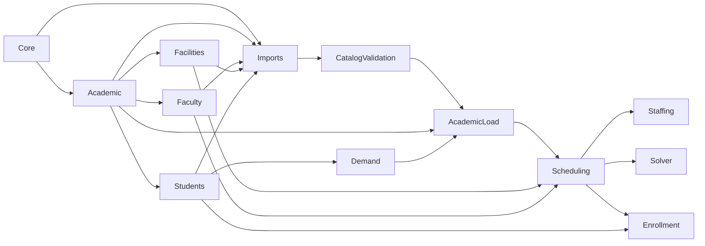
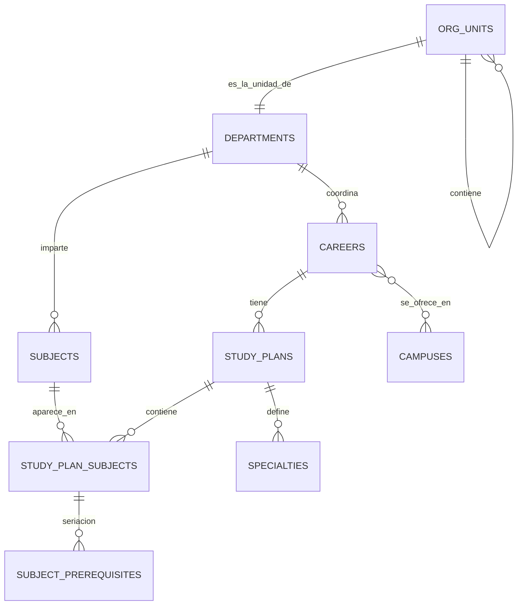
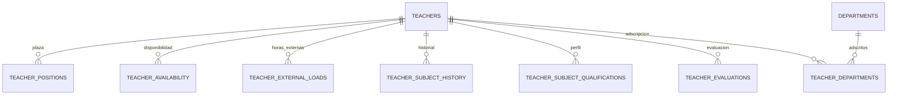
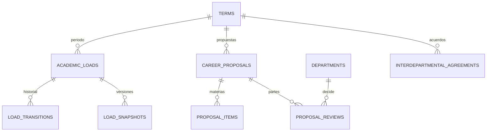
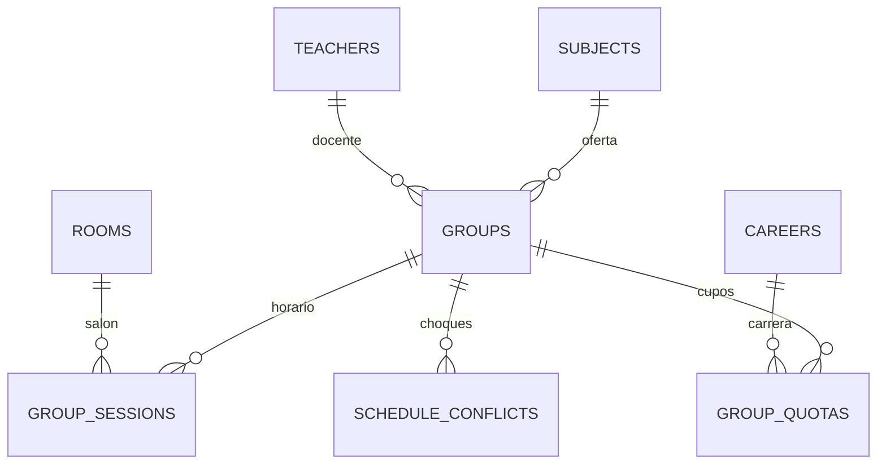

# Modelo de datos

Modelo conceptual por módulo. Describe tablas, campos clave y decisiones; los tipos exactos y los índices se definen en las migraciones de cada módulo (ver `docs/arquitectura/arquitectura.md`). Nombres de tablas y columnas en inglés, `snake_case`, plural. Todos los modelos usan `id` UUIDv7 (`HasUuids` y `default uuidv7()`, [ADR-0014](../decisiones/0014-uuidv7-como-llave-primaria.md)), con llaves foráneas y polimórficas en `uuid`, y `timestamps`; los catálogos usan **soft deletes** nunca borrado físico.

Convenciones transversales:

- Toda tabla de catálogo tiene `is_active` (lo que el SII llama "inactivo" no se borra, se desactiva) y una **clave natural** única (`code`, `control_number`, `rfc`) que sirve de llave de upsert en importaciones.
- Toda tabla que participe en la carga académica lleva `term_id` y `campus_id` explícitos, aunque sean derivables, para que las consultas por periodo y campus sean directas.
- Los cambios de negocio se registran con `spatie/laravel-activitylog` (tabla `activity_log`, inmutable).
- Los enums de dominio son enums de PHP respaldados por `string` en la base de datos.

## Mapa de dependencias entre módulos

Regla: un módulo solo puede depender de los módulos que están a su izquierda en este mapa. `Core` no depende de nadie.

## Core

Todas las tablas de Core, incluidas las base de Laravel (`users`, `sessions`, `cache`, `jobs`), viven en `app/Modules/Core/Database/Migrations`. Las tablas propias usan `timestamptz` en `created_at`, `updated_at` y `deleted_at`.

| Tabla | Campos clave | Notas |
|---|---|---|
| `users` | `username` (único), `name`, `email` (opcional), `password?`, `is_active`, `must_change_password`, `last_login_at` (timestamptz), `access_invited_at?` (timestamptz), `last_role?`, `authz_version` | Login por **username** con Fortify. Un usuario nuevo nace activo y con `must_change_password = true`: cambia la contraseña generada en su primer acceso. `password` nulo es **sin acceso** (AC-01, desde la migración `2026_11_11_000001`): nadie entra con él; así nacen los usuarios de los docentes (AC-02) hasta que se les da acceso (AC-03). `access_invited_at` es cuándo se le mandó su última invitación de acceso; nulo si nunca. El estado del acceso (`UserAccess`, AC-04) sale de las dos columnas y de `must_change_password`. Un usuario puede o no estar ligado a un `teachers.user_id`. `last_role` (enum `Role`, nulo) es el último perfil que usó (AZ-S4). `authz_version` (entero, 0) lo sube el trigger de `role_assignments` en cada alta, cambio o baja de uno de sus nombramientos; es parte de la llave de caché de la autorización. |
| (`roles`, `permissions`, … retiradas) | — | spatie/laravel-permission se retiró (ADR-0018; migración `2026_11_04_000002`): los puestos son el enum `Role` (`admin`, `subdireccion`, `jefe_departamento`, `jefe_proyecto_docente`, `coordinador`, `docente`; R3 añade `alumno`, `servicios_escolares`) y quién lo tiene lo dicen solo los nombramientos. Las policies deciden por puesto y alcance con `Actor` (`docs/arquitectura/arquitectura.md`, "Autorización y alcance"). |
| `role_assignments` | `user_id`, `role`, `campus_id?`, `org_unit_id?`, `career_id?`, `valid_from`, `valid_to?` | **Nombramiento** (ADR-0018; antes `role_scopes`): la única fuente de quién tiene qué puesto y sobre qué. Un coordinador lo es de una carrera en un campus; un jefe de proyecto docente, de la unidad de un departamento en un campus; un jefe de departamento, de la unidad de un departamento en todo el Tec; la Subdirección, de la unidad Subdirección Académica (AZ-S3); el docente, de todo el Tec; el admin, sin alcance. Las policies consultan esta tabla a través de `Actor`. `role` es el valor del enum `Role`; `valid_to` nulo es vigente sin fecha de fin y, si existe, no es anterior a `valid_from` (CHECK `role_assignments_validity_check`); un nombramiento `admin` no lleva campus, unidad ni carrera (CHECK `role_assignments_admin_unscoped`). Un nombramiento llena las columnas que exige su puesto (`Role::scopeColumns()`; CHECK `role_assignments_scope_complete`, desde 3.P9): nada para `admin` y `docente`; unidad para `subdireccion` y `jefe_departamento`; unidad y campus para `jefe_proyecto_docente`; carrera y campus para `coordinador`. Una columna que el puesto no lleva se admite porque solo acota, pero `AppointRole` no la escribe. El jefe de proyecto docente exige unidad y campus (supuesto por confirmar, Q1): una migración posterior puede relajar el campus si se decide que es de todo el Tec. La migración se detiene y lista los ids si ya hay nombramientos incompletos; nunca termina ni borra (confirmado el 4 de noviembre de 2026). `org_unit_id` tiene FK a `org_units`: el id de un departamento es el de su unidad, así que el nombramiento de un jefe apunta a su departamento. `career_id` tiene FK a `careers` (la agrega Academic, porque Core no depende de Academic). Modelo `RoleAssignment`: la vigencia se mide en días de Ciudad Juárez (`RoleAssignment::current()`) y un nombramiento distinto de `admin` solo cuenta si no tiene campus o su campus está activo y no borrado. `campus_id` nulo es de todo el Tec y vale en cada campus activo; con campus, vale solo ahí, aunque el puesto no lo pida. La unidad cubre su subárbol (`OrgTree`): la Subdirección cubre los departamentos que cuelgan de Subdirección Académica y deja de cubrir uno que se mueve fuera. **Puestos exclusivos** (AZ-S7, `Role::isExclusive()`): `role_assignments_one_jefe` y `role_assignments_one_subdireccion` (`EXCLUDE USING gist` sobre `org_unit_id` y `daterange(valid_from, valid_to, '[]')`, parciales por `role`) admiten un solo jefe y una sola Subdirección por unidad en cada fecha; la tabla no tiene borrado lógico, así que cuentan también los vencidos. El trigger `role_assignments_touch_user` (AFTER INSERT, UPDATE o DELETE, por fila) suma 1 a `users.authz_version` del usuario del nombramiento, y también al anterior si el nombramiento cambia de usuario. **Jefaturas** (3.P8, AZ-S14): son los nombramientos de `Role::HEADSHIPS` (`jefe_departamento` y `jefe_proyecto_docente`) sobre la unidad del departamento, y se escriben con `AppointRole` y `EndRoleAssignment`; `department_heads` ya no cuenta. AZ-S7 del jefe queda solo en `role_assignments_one_jefe` y en `AppointRole`. `role_assignments_jpd_no_duplicate` (`EXCLUDE USING gist` sobre `user_id`, `org_unit_id`, `campus_id` y el rango de fechas, parcial por `role = 'jefe_proyecto_docente'`) impide que la misma persona sea dos veces jefe de proyecto docente del mismo departamento y campus en fechas que se traslapan; de jefe de proyecto docente puede haber varios a la vez. La migración `2026_11_07_000001` (Academic) fundió `department_heads` aquí: cada jefatura sin borrar conservó su nombramiento gemelo (mismo usuario, puesto, unidad, campus o ninguno, sin carrera y mismo `valid_from`) con la fecha de fin más temprana. Si la jefatura terminaba antes, el gemelo terminó ese día (entrada `updated`); si el gemelo terminaba antes, se quedó así (entrada `skipped`); una jefatura sin gemelo no pasó (entrada `skipped`). Nunca creó ni alargó un nombramiento; las entradas van sobre el usuario, sin causante, con `department_head_id` (y `role_assignment_id` si hubo gemelo), y las jefaturas borradas no se tocaron. Antes de escribir se detiene si ya hay jefes de proyecto docente repetidos que se traslapan. Su `down()` quita los triggers y la exclusión, pero lo acortado no vuelve. La migración que la creó pasó la Subdirección a `SUB-ACADEMICA`, dio un nombramiento `admin` sin alcance desde ese día a cada admin de spatie (tras ella, `admin` es solo ese nombramiento y `AdminUserSeeder` lo crea) y, en los puestos exclusivos, conservó por unidad el primero (vigentes o por empezar antes que terminados; luego por `valid_from`, `created_at` e `id`) y **eliminó** los que se le traslapaban, con una entrada en la bitácora sobre su usuario (supuesto por confirmar). |
| `campuses` | `code` (`C1`, `C2`, `EAD`, `ENL`, `TNMV`, único aun entre borrados), `name`, `modality` (enum `Modality`: `presencial`, `mixta`, `en_linea`, `virtual_tecnm`), `settings` (jsonb), `is_active`, `deleted_at` | `settings` guarda el **perfil de flujo**: `uses_rooms`, `uses_time_blocks`, `staffing_mode` (`department` / `central`), `block_minutes`, `day_start`, `day_end` (`HH:MM`), `days` (1 = lunes a 6 = sábado), `allow_external_teachers`, `requires_subdireccion_approval`, `heads_edit_rooms` (si los jefes corrigen los salones de su departamento al validar los catálogos; reglas-de-negocio.md, "Validación de catálogos"). `Campus::profile` lo expone como `CampusProfile` de solo lectura: `block_minutes` debe dividir exacto la jornada de `day_start` a `day_end`; una clave que falta toma el perfil presencial de PROJECT.md (sin externos y sin visto bueno obligatorio de Subdirección, ADR-0008) y un valor inválido lanza error. EAD, ENL y TNMV se siembran inactivos y solo con lo documentado; su perfil se define en la planeación de la fase 10. |
| `org_units` | `parent_id?` (FK a sí misma), `code`, `name`, `kind` (enum `OrgUnitKind`: `direccion`, `subdireccion`, `division`, `departamento_academico`, `departamento`, `oficina`; CHECK), `sort`, `is_active`, `deleted_at` | **Organigrama** como árbol de adyacencia (ADR-0018, AZ-S1). Una sola raíz sin borrar (índice único parcial `org_units_one_root`) y `code` único aun entre borradas, salvo las de tipo `departamento_academico` (índice parcial `org_units_code_unique`), que cuidan su clave en `departments`. La migración siembra la raíz `DIRECCION` y su hija `SUB-ACADEMICA`. Cada departamento académico es también una unidad con el mismo id (ver `departments` en Academic). Un trigger `org_units_no_cycle` (BEFORE INSERT/UPDATE de `parent_id`) rechaza que una unidad sea su propia madre o cuelgue de su descendiente. `OrgTree` guarda el mapa de descendientes, con el tipo y la clave de cada unidad, en caché con vigencia de un día (la llave lleva la huella de los enlaces, los tipos y las claves) y tolera ciclos; sus búsquedas por clave (`idOf`) ignoran los departamentos académicos, que pueden repetir la clave de una unidad estructural. El tipo y la clave deciden a qué permisos aplica el nombramiento de un jefe (D20, AZ-02); la clave `SERVICIOS-ESCOLARES` no cambia mientras la unidad tenga jefe. Un alta concurrente de departamentos con la misma clave puede dejar una unidad `departamento_academico` sin departamento: el Organigrama la muestra con candado bajo su madre y no hay pantalla para limpiarla. |
| `terms` | `code` (`20271`, único; el código del SII: `1` Ene-Jun, `2` verano, `3` Ago-Dic, CHECK), `name`, `starts_on`, `ends_on`, `is_current` | Un solo periodo "actual" para capturar carga, garantizado con un índice único parcial; se pueden consultar los anteriores. `ends_on >= starts_on` (CHECK). |
| `term_stages` | `term_id`, `campus_id?`, `stage` (enum `Stage`), `starts_on`, `ends_on` | Calendario del proceso. `campus_id` nulo aplica a todos (`TermStage::appliesTo($campus)`). Única por (`term_id`, `campus_id`, `stage`), con nulos no distintos. `ends_on >= starts_on` (CHECK). `stage`: las etapas 2 a 9 de `docs/proceso/proceso-propuesto.md`: `catalog_validation`, `proposal`, `scheduling`, `staffing`, `rooms`, `closing`, `publication`, `reanalysis`. |
| `term_openings` | `term_id`, `campus_id`, `opened_by` (usuario), `opened_at` (timestamptz) | En qué campus se **abrió** cada periodo: el periodo se marca como actual una vez para todo el Tec y, aparte, se abre en cada campus que va a capturar; se puede abrir después en otro campus (D1, confirmado el 1 de noviembre de 2026). Única por periodo y campus. La guarda `OpenTerm` la primera vez, con quién y cuándo; volver a abrir no la cambia. Core no conoce cargas ni revisiones: `OpenTerm` despacha `TermOpened` dentro de su transacción y AcademicLoad y CatalogValidation crean lo suyo (`docs/arquitectura/arquitectura.md`, "Eventos con reporte"). |
| `settings` | `scope` (enum `SettingScope`: `global` / `campus` / `department`), `scope_id?`, `key`, `value` (jsonb) | Parámetros editables sin despliegue: pesos del ranking docente, tolerancia de horas, cupos por defecto. Una clave es única por alcance (`scope`, `scope_id`, `key`, con nulos no distintos). Solo `global` va sin `scope_id` (CHECK). |
| `activity_log` | (spatie) | Inmutable: un trigger de PostgreSQL rechaza `UPDATE`, `DELETE` y `TRUNCATE` venga de donde venga; por eso no se usa `activitylog:clean`. `properties.acting_as` es el perfil activo de quien causa la entrada, si es la persona en sesión; `properties.self_approval: true` marca AZ-01. Eventos con `timestamptz`. |
| `login_notices` | `title`, `image_path?` (disco público), `link_url?`, `sort_order`, `starts_at?`, `ends_at?` (timestamptz), `is_active`, `deleted_at` | Avisos del carrusel de la pantalla de acceso (LG-01, tarea 1.17). Vigente si no tiene inicio o ya empezó y no tiene fin o no ha terminado; `ends_at > starts_at` (CHECK). Catálogo: borrado lógico. |
| `login_shortcuts` | `kind` (enum `LoginShortcutKind`: `enlace`, `descarga`), `title`, `description?`, `url?`, `file_path?` (disco público), `sort_order`, `starts_at?`, `ends_at?`, `is_active`, `deleted_at` | Atajos de la pantalla de acceso (LG-02, tarea 1.17). Un enlace lleva `url` y una descarga `file_path` (CHECK); misma vigencia que los avisos. Catálogo: borrado lógico. |
| `notifications` | (Laravel) `type`, `notifiable_type`, `notifiable_id` (uuid), `data` (jsonb), `read_at?` (timestamptz) | Canal `database`; correo opcional después. Llave UUIDv7 por destinatario. `data` guarda el mensaje de una `NexusNotification`: `title`, `body`, `icon`, `tone`, `route` y `parameters` (el destino, que puede no existir todavía) y `term_id`/`campus_id` del aviso; `data.role` (opcional) es el puesto (`Role`) al que va el aviso: lo escribe `NotifyHolders`, la campana lo muestra como etiqueta y `OpenNotification` cambia a ese perfil (AZ-S8). Los avisos guardados antes de 3.P6 se rellenaron con `data.role` mediante migraciones de datos (`ProposalSubmitted` y `CatalogReviewsPending` al jefe de departamento, `ProposalReturned` al coordinador). Leerla solo llena `read_at`; no se borran. |

## Academic

| Tabla | Campos clave | Notas |
|---|---|---|
| `departments` | `code` (único), `name`, `is_active` | Globales a la institución: los del organigrama oficial, compartidos por todos los campus. No hay departamentos propios de Campus II. Su `id` es también un `org_units.id` de tipo `departamento_academico` (FK `departments_id_org_unit_foreign`): tres triggers de PostgreSQL mantienen la unidad igual al departamento (BEFORE INSERT la crea con el mismo id, clave y nombre; AFTER UPDATE de `code`, `name`, `is_active` o `deleted_at` la actualiza, y con ello el borrado lógico y la restauración; AFTER DELETE la borra), así las tablas con `department_id` no cambian. Los nuevos nacen bajo `SUB-ACADEMICA` por defecto (AZ-S2, supuesto por confirmar); si esa unidad falta o está borrada, bajo la raíz, y sin raíz el alta falla. Dos triggers BEFORE sobre `org_units` (`org_units_guard_department_update` y `_delete`) impiden cambiar el tipo, la clave, el nombre, el estado o el borrado de la unidad de un departamento, y borrarla, mientras exista el departamento; solo se puede moverla (`parent_id`, `sort`). |
| `department_heads` | `department_id`, `campus_id?`, `user_id`, `kind` (`jefe` / `jefe_proyecto_docente`), `valid_from`, `valid_to?` | Histórica, de solo lectura desde 3.P8 (AZ-S14): las jefaturas viven en `role_assignments`. Los triggers `department_heads_read_only_rows` y `_truncate` rechazan todo cambio. Se conserva por "En Academic nada se borra físicamente" y porque la bitácora cita sus ids. Guarda quién dirigió cada departamento hasta 3.P8: el `jefe` sin campus y el `jefe_proyecto_docente` con el suyo (CHECK `department_heads_campus_check`); sus exclusiones `department_heads_one_jefe` y `department_heads_no_duplicate` y sus CHECK de `kind` y de vigencia siguen en la tabla. Sin modelo desde 3.P8; fuera de las migraciones nada la nombra (prueba arch). La migración `2026_10_30_000101` dejó un jefe por departamento sin campus, cuando había uno por departamento y campus (el detalle está en la migración). |
| `careers` | `code` (único), `name`, `department_id`, `is_active` | Carrera; el departamento es el que la coordina administrativamente. |
| `career_campus` | `career_id`, `campus_id`, `is_active` | En qué campus se ofrece; una vez por carrera y campus. Se deja de ofrecer con `is_active`. El coordinador se asigna por `role_assignments`. |
| `study_plans` | `career_id`, `code` (único), `name`, `version`, `semesters_count?`, `total_credits?`, `is_active`, `is_current`, `is_historical`, `valid_from?` | Una retícula por versión; la clave natural es `code`, y `version` no es única por carrera porque el SII puede tener dos planes de la misma reforma. Las inactivas se conservan porque hay alumnos cursándolas. La exportación del SII no trae `semesters_count` ni `valid_from`: quedan vacíos hasta que se capturen. `total_credits` son los créditos con los que el alumno termina, contra los que se mide su avance, como en el SII: la migración los toma de `carreras.creditos_totales` (decidido el 10 de noviembre de 2026). `semesters_count` > 0 y `total_credits` ≥ 0 (CHECK). `is_current` (default `false`) marca el plan actual de la carrera, el que se asigna a los alumnos de nuevo ingreso: una carrera puede tener varias retículas activas y a lo más una actual (la migración marca la de nuevo ingreso); un índice único parcial (`career_id` donde `is_current` y no está borrado) lo garantiza (D15, confirmado el 5 de noviembre de 2026). `is_historical` (default `false`) marca una retícula histórica: un plan en el que ningún alumno está inscrito en el periodo actual y que no es el de nuevo ingreso; la migración del SII lo calcula en cada corrida (deja de serlo solo si vuelve un alumno) y lo migra tal cual viene del SII, con lo que no trae semestre esperando en «Por validar» sin contar como trabajo pendiente (D18, confirmado el 10 de noviembre de 2026). |
| `subjects` | `code` (único), `name`, `department_id`, `theory_hours`, `practice_hours`, `credits`, `kind?` (enum), `needs_lab`, `is_active` | Materia global; el tronco común se comparte entre carreras. `kind`: `basica`, `especialidad`, `complementaria`, `residencia`, `servicio_social`, `lengua_extranjera`; la migración del SII lo deriva de `tipo_materia` y del nombre (reglas-de-negocio.md, "Reglas de datos"); una materia sin tipo queda vacía hasta que se capture; si viene, solo acepta esos valores (CHECK). Horas y créditos ≥ 0 (CHECK). |
| `subject_aliases` | `subject_id`, `study_plan_id?`, `code` (único), `source` (default `sii`) | Las claves con que el SII conoce una materia, a veces distintas de la de Nexus y por plan; las escribe la importación de materias desde `clave del SII` o la plantilla «Claves del SII de materias» (`subject_aliases`: clave del SII, materia y plan), que usa la migración del SII para dejar cada clave, también las que se unieron en una clave TecNM. Una materia puede tener varias y una clave apunta a una sola materia. Mapeo técnico que escribe solo la importación: sin borrado lógico ni `is_active` (supuesto por confirmar). |
| `study_plan_subjects` | `study_plan_id`, `subject_id`, `semester`, `specialty_id?`, `is_required`, `position?` (smallint) | Posición de la materia en la retícula. Único por plan y materia, también contra una fila borrada: quitar una materia es borrado lógico y volver a ponerla la restaura. `semester` ≥ 1 (CHECK). La especialidad es del mismo plan: FK compuesta (`study_plan_id`, `specialty_id`) a `specialties` (`study_plan_id`, `id`); la llave también acepta una especialidad borrada, así que una especialidad con materias no se quita (S1; reglas-de-negocio.md, "Especialidades"). `position` es el renglón de la materia dentro de su semestre (D21, confirmado el 5 de noviembre de 2026; el `renglon` del SII); nulo es sin renglón y va después de las que lo tienen, por clave de materia. Índice (`study_plan_id`, `semester`, `position`). Poner o mover de semestre una materia la deja al final; `ReorderPlacements` reescribe 1..n. |
| `study_plan_subject_pendings` | `study_plan_id`, `subject_id`, `specialty_id?`, `source` (default `sii`), `sii_grid?` (la retícula del SII de la que salió, «carrera/retícula»), `position?` (el `renglon` del SII, solo para no perder el dato; al resolver el pendiente la materia queda al final del semestre, supuesto por confirmar), `suggested_semester?` (≥ 1, CHECK: el semestre que la migración sugiere en una retícula viva, el más frecuente entre las materias con el mismo nombre de la misma carrera, o el del SII de una materia de estatus `N`; solo la migración lo escribe y cada corrida lo reemplaza, también por vacío; «Por validar» lo muestra elegido, salvo en una retícula histórica, y Servicios Escolares lo confirma o lo cambia; D18, confirmado el 10 de noviembre de 2026), `note?`, `resolved_at?` (timestamptz), `resolved_by?` (usuario) | Lugares de retícula pendientes de la migración del SII (D18 y D19, confirmados el 5 y el 10 de noviembre de 2026): una materia que el SII trae sin semestre (o con estatus `N`) no entra a `study_plan_subjects`, que nunca queda sin semestre ni con uno que Nexus haya decidido; la materia sí existe (el kárdex la necesita) y su lugar queda aquí hasta que el jefe del Departamento de Servicios Escolares le asigna un semestre (`ResolvePendingPlacement`, que usa `PlaceSubject`). Único por plan y materia. La especialidad es del mismo plan: FK compuesta (`study_plan_id`, `specialty_id`) a `specialties`. Un pendiente resuelto conserva su fila con `resolved_at` y `resolved_by`; no tiene borrado lógico ni `is_active` (supuesto por confirmar). La carga la hace la plantilla `pending_placements`; se resuelve en «Por validar» de la retícula del plan (`academic.placement.validate`, AZ-S15). |
| `subject_prerequisites` | `study_plan_id`, `subject_id`, `prerequisite_subject_id`, `kind` (`seriacion` / `correquisito`) | Seriación por plan (la misma materia puede seriarse distinto en planes distintos). Única por plan, materia y requisito. La materia y su requisito tienen fila en la retícula de ese plan: dos FK compuestas a `study_plan_subjects` (`study_plan_id`, `subject_id`). Como una FK también acepta una fila borrada, quitar una materia de la retícula quita sus seriaciones en la misma Action (tarea 1.8). Una materia no es requisito de sí misma (CHECK); los ciclos los rechazan la Action de la 1.8 y la plantilla de la 1.9. `kind` solo acepta sus dos valores (CHECK). |
| `study_plan_prerequisite_pendings` | `study_plan_id`, `subject_id`, `prerequisite_subject_id`, `kind` (`seriacion` / `correquisito`), `source` (default `sii`), `sii_grid?` (la retícula del SII de la que salió, «carrera/retícula»), `note?`, `applied_at?` (timestamptz) | Requisitos de la seriación del SII que esperan (decisión del usuario del 10 de noviembre de 2026, confirmada; reglas-de-negocio.md, "Reglas de datos", migración de la seriación): la materia o su requisito están en «Por validar» del plan (`study_plan_subject_pendings`), así que no pueden entrar a `subject_prerequisites`, que pide las dos en la retícula. Las llaves van al plan y a `subjects` (no a `study_plan_subjects`). Único por plan, materia y requisito; una materia no es requisito de sí misma y `kind` solo acepta sus dos valores (CHECK). Lo escribe la plantilla `pending_prerequisites` del paso `seriacion` de la migración, sin revisar ciclos; entra a `subject_prerequisites` cuando sus dos materias quedan en la retícula, al resolver un pendiente (`ResolvePendingPlacement` con `ApplyWaitingPrerequisites`), y queda con `applied_at` (también si la seriación ya lo tenía, o si se quitó en Nexus: ese no se restaura y queda con la `note` «No entró: se quitó de la seriación en Nexus.»). Uno que cerraría un ciclo de seriación sigue esperando con `note`. Uno aplicado conserva su fila; sin borrado lógico ni `is_active`, como los lugares pendientes (supuesto por confirmar). Índices por (`study_plan_id`, `prerequisite_subject_id`) y (`study_plan_id`, `applied_at`). |
| `specialties` | `study_plan_id`, `code`, `name`, `is_active` | Módulo de especialidad. `code` es único dentro de su plan. |

Nada se borra físicamente en Academic: todas sus tablas llevan soft deletes, también la retícula y la seriación, porque los planes y las materias pasadas siguen haciendo falta para el historial (confirmado el 29 de octubre de 2026). Una clave natural la sigue ocupando un registro borrado; volver a poner una fila quitada la restaura.

## Facilities

| Tabla | Campos clave | Notas |
|---|---|---|
| `buildings` | `campus_id`, `code`, `name`, `is_active`, `deleted_at` | `code` única por campus, también contra un edificio borrado. Única también (`id`, `campus_id`) para la llave compuesta de `rooms`. |
| `rooms` | `campus_id`, `building_id`, `code`, `name?`, `type` (enum: `aula`, `laboratorio`, `taller`, `sala_computo`, `auditorio`), `capacity` (> 0), `department_id?` (dueño), `features` (jsonb, lista), `is_active`, `deleted_at` | `campus_id` explícito, como toda tabla de la carga académica; la llave compuesta (`building_id`, `campus_id`) a `buildings` impide que el campus se separe del de su edificio. `code` única por campus, también contra un salón borrado. Única también (`id`, `campus_id`) para `subject_room_defaults`. `capacity` es el dato que más cambia y que los jefes validan cada periodo. |
| `room_blocks` | `room_id`, `term_id?` (nulo: todos los periodos), `day` (1 = lunes a 6 = sábado, como `campuses.settings.days`), `starts_at`, `ends_at` (`time`, `ends_at > starts_at`), `reason`, `deleted_at` | Bloqueos (mantenimiento, reservado). |
| `subject_room_defaults` | `subject_id`, `campus_id`, `room_id`, `priority` (≥ 1), `source` (`manual` / `historial`), `deleted_at` | Salón por defecto o sugerido. Única por materia, campus y salón, también contra una fila borrada; la llave compuesta (`room_id`, `campus_id`) a `rooms` exige un salón del campus. Solo modelo y factory en la fase 1: la llenan la fase 3 y el historial de cargas anteriores. |

Facilities lleva borrado lógico en todas sus tablas; una clave natural la sigue ocupando un registro borrado.

## Faculty

| Tabla | Campos clave | Notas |
|---|---|---|
| `teachers` | `rfc` (RFC del docente: clave natural y username, único también contra borrados; antes `employee_number`, regla del 5 de noviembre de 2026), `user_id?` (único), `name`, `email?`, `degree?` (enum `TeacherDegree`: `licenciatura`, `especialidad`, `maestria`, `doctorado`; CHECK), `hired_on?`, `is_active`, `deleted_at` | Sus departamentos los dan las adscripciones (`teacher_departments`); ya no hay `department_id` ni `home_campus_id`. El docente no es de un campus: da clase en cualquier campus o modalidad (confirmado el 30 de octubre de 2026). |
| `teacher_departments` | `teacher_id`, `department_id`, `is_primary`, `deleted_at` | **Adscripción**: un departamento de un docente, sin campus (confirmado el 30 de octubre de 2026). Única por docente y departamento, también contra borradas: volver a ponerla la restaura. A lo más una principal sin borrar por docente (índice parcial): la del SII, para RH y reportes; en el ranking cuentan todas igual. Quitarla («Quitar de mi departamento») es borrado lógico y la quitada deja de ser principal. La migración `2026_10_30_000100` quitó `campus_id`: de las filas de un docente en el mismo departamento y distinto campus se quedó una (la sin borrar, luego la principal, luego la más antigua), con el `created_at` más antiguo de las vigentes de su grupo, y las demás se eliminaron, cada una con su entrada en la bitácora, porque una borrada habría roto la clave. |
| `teacher_positions` | `teacher_id`, `kind` (enum `PositionKind`: `tiempo_completo`, `tres_cuartos`, `medio_tiempo`, `asignatura`, `honorarios`, `apoyo`), `base_hours`, `valid_from?`, `valid_to?`, `deleted_at` | Las **horas base** vigentes en el periodo definen la prioridad. Son del docente, no de un departamento (confirmado el 30 de octubre de 2026). Máximo 40 por plaza; un docente puede tener varias vigentes a la vez (confirmado el 30 de octubre de 2026). CHECK por tipo (S3, supuesto por confirmar): tiempo completo 40, tres cuartos 30, medio tiempo 20, honorarios 0, asignatura y apoyo de 1 a 40 (`apoyo`, plaza de personal de apoyo y asistencia a la educación, desde la migración `2026_11_09_000001`; sus horas cuentan como horas base, confirmado el 6 de noviembre de 2026); `valid_to` no puede ser anterior a `valid_from`; un límite nulo es sin límite. Clave de importación: docente, tipo y `valid_from`. |
| `teacher_external_loads` | `teacher_id`, `term_id`, `source` (ej. `TecNM Virtual`), `hours`, `notes?`, `deleted_at` | Se restan de la disponibilidad del docente en ese periodo. `hours` de 1 a 40 y única por docente, periodo y `lower(source)` (índice único sobre la expresión), también contra borradas (S16, supuesto por confirmar); el origen se compara sin distinguir mayúsculas y poner uno quitado lo restaura. |
| `teacher_availability` | `teacher_id`, `term_id`, `day` (1 a 6), `starts_at`, `ends_at` (`time`), `kind` (enum `AvailabilityKind`: `unavailable`, `preferred`; CHECK), `deleted_at` | Por defecto todo bloque del campus está disponible; aquí solo excepciones y preferencias. `ends_at` > `starts_at`. Sin traslapes por docente, periodo y día: `EXCLUDE USING gist` con `tsrange(date '2000-01-01' + starts_at, date '2000-01-01' + ends_at)`, sin contar borrados; 9–10 y 10–11 son contiguos y se aceptan (ADR-0016, `btree_gist`). |
| `teacher_subject_history` | `teacher_id`, `subject_id`, `term_code`, `campus_id?`, `group_code`, `source` (enum `HistorySource`: `import`, `nexus`; CHECK), `deleted_at` | Una fila por **grupo** impartido (confirmado el 30 de octubre de 2026): dos grupos de la misma materia en el mismo periodo son dos filas. Única por docente, materia, periodo, campus y grupo (el campus nulo cuenta como un valor), también contra borradas. `term_code` es el código del SII con el CHECK del kárdex (`^[0-9]{4}[123]$`) y no llave a `terms`. Alimenta el desempate. Se importa del SII y Nexus la sigue llenando al publicar cargas. |
| `teacher_subject_qualifications` | `teacher_id`, `subject_id`, `level` (enum `QualificationLevel`: `apto`, `preferente`; CHECK), `qualified_by` (usuario), `notes?`, `deleted_at` | **Perfil**: el jefe declara qué materias puede dar cada docente, solo de departamentos que cubre (S17, supuesto por confirmar). Único por docente y materia, también contra borrados; volver a declarar una quitada la restaura. Auditado. |
| `teacher_evaluations` | `teacher_id`, `term_code`, `kind` (enum `EvaluationKind`: `estudiantil`, `departamental`; CHECK), `score` (decimal 3,2), `source?`, `deleted_at` | Puntaje usado en el desempate. Importado. Escala de 1 a 5 del TecNM; el CHECK admite de 0 a 5 y un puntaje fuera de ese rango es error (confirmado el 30 de octubre de 2026). Usa `term_code` (CHECK del kárdex), no `term_id`: vienen de periodos que `terms` no tiene. Única por docente, periodo y tipo, también contra borradas. |

## Students

| Tabla | Campos clave | Notas |
|---|---|---|
| `students` | `control_number` (único), `name`, `career_id`, `study_plan_id`, `campus_id`, `current_semester?`, `status?` (enum: `activo`, `baja_temporal`, `baja_definitiva`, `egresado`), `status_reason?`, `modality?`, `admitted_term_id?`, `is_active` | Solo lectura en R1 y R2 (viene de importación). R3 agrega datos de inscripción. El número de control es único en todo el Tec, así que el campus sale del archivo y no forma parte de la clave. El plan es de la carrera del alumno: FK compuesta (`study_plan_id`, `career_id`) a `study_plans` (`id`, `career_id`), que se actualiza en cascada si el plan cambia de carrera. `modality?` (enum `StudentModality`: `presencial`, `distancia`, `mixta`) es del alumno y no de la carrera (D15, confirmado el 5 de noviembre de 2026). `status_reason?` (hasta 10 caracteres) es el motivo del SII (BD1…, BT1…, TIT, TRA, BCP, BDF, ASP): Nexus conserva sus cuatro estatus y guarda además el motivo (D12, confirmado el 5 de noviembre de 2026). `current_semester` ≥ 1 o vacío (un egresado). `status` queda vacío si el SII trae un estatus que Nexus no conoce; los que se repitan en las exportaciones reales se agregan al enum (confirmado el 29 de octubre de 2026). |
| `kardex_records` | `student_id`, `subject_id`, `sii_subject_code?`, `term_code?`, `grade?`, `result` (enum: `aprobada`, `reprobada`, `cursando`, `baja`), `attempt` | Historial académico. Único por alumno, materia y periodo, también contra una fila borrada y también sin periodo (`nulls not distinct`); repetir la materia en otro periodo es otra fila. `term_code` lleva el código del SII (año y 1, 2 o 3, CHECK) y no es llave a `terms`, porque el kardex trae periodos de décadas anteriores; queda vacío cuando la historia del SII trae un periodo que no existe, para no perder la materia (decidido el 10 de noviembre de 2026). La materia puede no estar en el plan del alumno. `grade` de 0 a 100; `attempt` es la oportunidad, de 1 en adelante. `sii_subject_code` es la clave del SII con la que se cursó, cuando viene de la migración: la materia es la de la retícula del alumno y la clave original no se pierde. |
| `student_progress` | `student_id` (único), `study_plan_id`, `credits_approved`, `subjects_approved`, `subjects_pending` (json), `subjects_available` (json), `computed_at` | Vista materializada (tabla recalculada por job al terminar una importación, en una sola transacción: mientras se recalcula, quien la lee ve el avance anterior completo). `subjects_pending` son las materias del plan que el alumno no ha aprobado (sin las de otras especialidades si ya tomó una); `subjects_available`, las que de esas ya puede cursar: aprobó toda su seriación, están a su alcance (su semestre y dos más) y, si piden un porcentaje de créditos (Servicio Social y Residencia), ya llegó a él (reglas-de-negocio.md, "Elegibilidad y demanda"). Un alumno cuyo plan no tiene retícula no tiene fila, y la de un alumno borrado se borra. Los elegibles de una carrera en un campus se cuentan en una sola consulta que despliega `subjects_available` y agrupa por materia (tarea 1.5); el índice GIN sirve para buscar por contención a los alumnos de una sola materia. Créditos y materias aprobadas cuentan solo las del plan y no son negativos (CHECK). `study_plan_id` es el plan con que se calculó: si el alumno cambió de plan, la fila vale hasta el siguiente recálculo, así que quien la lee la cruza con `students.study_plan_id`. |

## Imports

| Tabla | Campos clave | Notas |
|---|---|---|
| `import_batches` | `template` (string: `departments`, `org_units`, `careers`, `study_plans`, `subjects`, `pending_placements`, `subject_aliases`, `prerequisites`, `teachers`, `positions`, `rooms`, `students`, `kardex`, `teacher_history`, `evaluations`), `campus_id?`, `mapping_id?`, `file_path`, `original_name`, `status` (enum: `uploaded`, `validating`, `validated`, `failed`, `applying`, `applied`), `total_rows`, `valid_rows`, `error_rows`, `run_id?`, `processed_rows`, `created_rows`, `updated_rows`, `unchanged_rows`, `deactivate_missing`, `deactivated_rows`, `errors_exported_at?`, `failure_reason?`, `uploaded_by`, `applied_by?`, `applied_at` | Un lote por archivo. Aplicar es idempotente (upsert por clave natural). `file_path` es relativo al disco `imports` (`storage/app/imports`, fuera de git). `campus_id` solo en las plantillas de un campus. `valid_rows` cuenta las filas sin error, también las que traen advertencia. `run_id` es la corrida de la cola que lo tomó. `processed_rows` es el avance de la etapa en curso (filas leídas al validar, revisadas al aplicar); `created_rows`, `updated_rows` y `unchanged_rows`, lo que la aplicación ya escribió, también si se interrumpió. `deactivate_missing` dice si el admin eligió "desactivar faltantes" al aplicarlo, y `deactivated_rows` cuántos registros desactivó. `errors_exported_at` dice cuándo quedó listo el CSV de errores; vuelve a null al empezar a aplicar. `failure_reason` dice por qué quedó `failed`. No se borra. |
| `import_rows` | `batch_id`, `row_number`, `raw` (json), `normalized` (json), `errors` (json), `warnings` (json), `status` (`valid` / `warning` / `error` / `applied`), `key_hash?`, `target_type?`, `target_id?` | Permite mostrar errores por fila y re-subir solo el archivo corregido. `row_number` es el del archivo, único en el lote; `errors` y `warnings` van por campo. `raw` es `json` (no `jsonb`) para conservar el orden de las columnas. `key_hash` es el hash de la clave natural normalizada, con el que se encuentran en SQL las filas que repiten clave. Es el detalle por registro de una importación: la bitácora guarda una entrada por lote. |
| `import_deactivations` | `batch_id`, `target_type`, `target_id`, `created_at` | Los registros del catálogo que un lote desactivó por no venir en el archivo, con "desactivar faltantes". Es el detalle por registro de esa desactivación, como `import_rows` lo es de lo que se escribió, y dice qué reactivar a mano si el archivo venía incompleto. Único por lote y registro. Solo se escribe una vez. |
| `import_mappings` | `template`, `name`, `columns` (json: columna origen → campo destino), `created_by`, `is_active` | Cada layout de exportación del SII se mapea una vez y se reutiliza. `name` es único por plantilla. Soft deletes e `is_active`: un mapeo viejo se desactiva, porque los lotes que lo usaron lo citan. |

Las **plantillas** (columnas esperadas, reglas de validación, lógica de aplicación) viven en código, una clase por plantilla.

El esquema de PostgreSQL **`sii_archivo`** es de Imports pero no es parte del modelo: es el archivo de solo lectura de la exportación original del SII (una tabla por archivo con `_linea` y sus columnas como texto, más `_cargas`), sin NIP, contraseñas de acceso del SII, fotos ni firmas, que `imports:migrate-sii` reemplaza completo en cada corrida para rastrear un dato hasta su origen. No se edita, vive fuera de las migraciones y ninguna pantalla lo lee ([migracion-sii.md](../arquitectura/migracion-sii.md), «Archivo del SII original»).

El esquema **`sii_verificacion`** es de Imports y tampoco es parte del modelo: la verificación de la última corrida de `imports:migrate-sii`, que compara `sii_archivo` con el kárdex y el avance de Nexus (`materias`: un renglón por renglón de la historia del SII con su diagnóstico; `alumnos`: créditos y si está completo según el SII y según Nexus; `_corrida`: de qué carpeta, cuándo y si quedó verificada, con diferencias o no verificada). Se reemplaza completo en cada corrida real, no se edita, vive fuera de las migraciones y ninguna pantalla lo lee ([migracion-sii.md](../arquitectura/migracion-sii.md), «Verificación contra el SII original»).

## CatalogValidation

| Tabla | Campos clave | Notas |
|---|---|---|
| `catalog_reviews` | `term_id`, `campus_id?`, `department_id`, `catalog` (enum `Catalog`: `teachers`, `rooms`, `subjects`, `study_plans`, `careers`), `status` (enum `ReviewStatus`: `pending` / `in_review` / `validated`; nace `pending`), `validated_by?`, `validated_at?` (timestamptz), `notes?`, `snapshot?` (jsonb) | El jefe valida docentes, materias, planes y carreras de su departamento **una vez por periodo, para todo el Tec** (`campus_id` nulo), y los **salones de su departamento en cada campus** (`campus_id` del campus) (D2, confirmado el 1 de noviembre de 2026). Un CHECK lo amarra: `(catalog = 'rooms') = (campus_id is not null)` (`catalog_reviews_campus_check`); otros dos CHECK limitan `catalog` y `status` a sus valores. Única por periodo, campus, departamento y catálogo, con el campus nulo como un valor más (nulos no distintos). Se crean al abrir el periodo en un campus, solo las que faltan: las cuatro generales de cada departamento activo y la de salones en ese campus si su perfil usa salones (`CreateTermReviews`). La carga académica no puede pasar de borrador hasta que estén `validated` las cuatro generales del departamento en el periodo y la de salones de su campus (HC-14). `snapshot` es la **foto** que se guarda al validar: la lista de `{id, code, name}` de los registros activos del catálogo (`code` es el RFC en los docentes). Las altas y bajas de un periodo se cuentan contra la foto de la última revisión validada del mismo departamento, catálogo y campus en un periodo que empieza antes (CV3). Al reabrir, la foto se queda hasta la siguiente validación, pero una revisión reabierta no cuenta como validación anterior (CV-S6). |
| `catalog_review_flags` | `review_id`, `flaggable_type`, `flaggable_id` (uuid), `flag` (enum `ReviewFlag`: `inactive`, `wrong_capacity`, `duplicate`, `missing_data`, `other`; CHECK), `comment?`, `flagged_by` (usuario), `resolved_at?` (timestamptz), `resolved_by?` (usuario) | **Observaciones** del jefe sobre registros concretos de una revisión (una materia, una carrera, un plan, un docente o un salón). No bloquean validar (CV4). Un CHECK exige comentario en una `other` (`catalog_review_flags_comment_check`) y otro, que `resolved_at` y `resolved_by` vayan juntos (`catalog_review_flags_resolved_check`). No se borran: se resuelven. Las correcciones se hacen en el catálogo con la Action de su módulo y quedan en su bitácora. |

## AcademicLoad (orquestador)

| Tabla | Campos clave | Notas |
|---|---|---|
| `academic_loads` | `term_id`, `campus_id`, `department_id`, `status` (enum `LoadStatus`: `draft`, `proposed`, `staffing`, `adjusting`, `closed`, `approved`, `published`, `reanalysis`; CHECK; nace `draft`), `closed_by/at?`, `approved_by/at?`, `published_by/at?` (usuario y timestamptz de la última vez; reabrir no los limpia y el historial completo está en `load_transitions`), `current_version` (0 al nacer) | Unidad de cierre: **departamento en un campus**. Único por periodo, campus y departamento. Se crea en borrador al abrir el periodo en el campus, una por departamento activo que no la tenga (`CreateTermLoads`). Un departamento con cargas no se borra (veto en `DepartmentDeleting`, S-A8, supuesto por confirmar). |
| `load_transitions` | `academic_load_id`, `from_status`, `to_status` (ambos con CHECK de los ocho estados de `LoadStatus`), `user_id` (obligatorio), `comment?`, `created_at` (timestamptz; sin `updated_at`) | Máquina de estados auditable. Una fila por transición, que escribe solo `TransitionLoad`. **Inmutable (HC-18)**: un trigger de PostgreSQL rechaza `UPDATE`, `DELETE` y `TRUNCATE`, igual que `activity_log`. |
| `load_snapshots` | `academic_load_id`, `version` (≥ 1, CHECK), `payload` (jsonb), `created_by` (usuario), `created_at` (timestamptz; sin `updated_at`) | Foto de la carga en cada publicación, también al republicar tras una reapertura y en cada re-análisis: lo que leen la consulta publicada y los exportes, nunca las tablas vivas. Única por carga y versión: la versión sube de uno en uno y `academic_loads.current_version` apunta a la última. **Inmutable (HC-18)**: un trigger rechaza `UPDATE`, `DELETE` y `TRUNCATE`, como en `load_transitions`; una versión vieja se conserva y el público no la ve. La forma del `payload` está abajo, en «Contenido del snapshot». Permite diffs entre versiones. |
| `career_proposals` | `term_id`, `campus_id`, `career_id`, `eligible_students` (entero, CHECK ≥ 0, «alumnos posibles»: alumnos activos distintos de la carrera y el campus elegibles para al menos una materia de la propuesta, congelado al armarla), `status` (enum `ProposalStatus`: `draft`, `submitted`, `returned`, `accepted`; CHECK; nace `draft`), `submitted_by?`, `submitted_at?` (usuario y timestamptz del último envío) | Propuesta del coordinador (reglas-de-negocio.md, "Propuesta de carrera"). Única por periodo, campus y carrera. La arma `StartCareerProposal`, una vez, en un periodo abierto en el campus y para una carrera que se ofrece en él. Enviada queda de solo lectura; queda `accepted` cuando todos los departamentos involucrados aceptaron su parte y `returned` si uno la regresa; regresada, los demás departamentos siguen decidiendo su parte pendiente y la propuesta sigue `returned` hasta el reenvío. |
| `proposal_items` | `career_proposal_id`, `subject_id`, `study_plan_id`, `semester` (≥ 1, CHECK), `eligible_students`, `expected_students`, `requested_groups` (los tres ≥ 0, CHECK), `notes?` | Una fila por materia activa de la retícula de los planes activos de la carrera (HC-13), única por propuesta y materia; el plan y el semestre son los del primer plan activo, por clave, que la tiene. `eligible_students` lo cuenta Nexus desde `student_progress` al armar la propuesta (`EligibleStudentsQuery`). `expected_students` nace igual a los elegibles y `requested_groups` con los grupos sugeridos (`SuggestedGroups`: `ceil(esperados / 35)`, o 25 si la materia lleva laboratorio, `demand.target_group_size`); los dos los corrige el coordinador (R2: los sugiere Demand). Cero grupos es no pedir la materia. El departamento de la fila es el de su materia. |
| `proposal_reviews` | `career_proposal_id`, `department_id`, `status` (enum `ProposalReviewStatus`: `pending`, `accepted`, `returned`; CHECK; nace `pending`), `comment?`, `decided_by?`, `decided_at?` (usuario y timestamptz) | La **parte** de cada departamento involucrado en una propuesta: todas las filas con grupos de sus materias, que el departamento acepta o regresa con comentario desde su bandeja (`AcceptProposalReview`, `ReturnProposalReview`), con la parte pendiente y la propuesta enviada o regresada por otro departamento; `decided_by` y `decided_at` son de esa decisión. Las Actions que la deciden y la corrección de una fila (`UpdateProposalItem`) bloquean la propuesta y luego la parte. Única por propuesta y departamento; una regresada exige comentario no vacío (CHECK `proposal_reviews_returned_comment_check`). La escribe el envío (`SubmitCareerProposal`): crea la de cada departamento al que se le piden grupos y, al reenviar, deja la aceptada como está, regresa la regresada a `pending` sin comentario ni decisión, deja la pendiente como está y borra la de un departamento al que ya no se le piden grupos (no es catálogo; lo que tenía queda en la bitácora del envío). |
| `interdepartmental_agreements` | `term_id`, `campus_id`, `kind` (enum `AgreementKind`: `room_loan` / `shared_group`; CHECK), `from_department_id` (quien lo pide), `to_department_id` (quien lo decide; distinto, CHECK), `group_id` (uuid obligatorio, sin llave foránea: el grupo es de Scheduling), `room_id?`, `day?` (1 a 6), `starts_at?`, `ends_at?` (`time`, fin > inicio), `career_id?`, `max_seats?` (> 0), `status` (enum `AgreementStatus`: `proposed` / `accepted` / `rejected` / `cancelled`; CHECK; nace `proposed`), `comment?` (obligatorio al rechazar, CHECK), `requested_by`, `decided_by?`, `decided_at?` (timestamptz), `cancelled_by?`, `cancelled_at?` (timestamptz) | Lo que hoy se acuerda en la junta queda registrado y es verificable por el validador (tareas 3.6 y 3.7). Un **préstamo de salón** es un salón del campus del acuerdo (llave compuesta `room_id`, `campus_id` a `rooms`), un día y unas horas para un grupo del departamento que lo pide; lo decide el dueño del salón, y HC-10 solo cuenta los aceptados del grupo de la sesión (varios contiguos la cubren juntos). Un **grupo compartido** es el cupo (`max_seats`) de una carrera de otro departamento en un grupo; lo propone el departamento que imparte y lo decide el jefe del departamento de esa carrera (confirmado el 7 de noviembre de 2026); el cupo nace al aceptarse. Un CHECK amarra la forma de cada tipo (el préstamo lleva salón, día y horas, y no carrera ni lugares; el compartido, al revés; los dos, grupo). Quién decidió y cuándo van juntos y solo en `accepted` y `rejected`; quién canceló y cuándo van juntos y solo en `cancelled` (CHECK `interdepartmental_agreements_decision_check`), que conserva la decisión si el acuerdo se aceptó antes y no la tiene si se canceló propuesto. Un salón no se presta dos veces a la misma hora del mismo día y periodo (`EXCLUDE USING gist` sobre los vivos: propuestos y aceptados) y una carrera tiene a lo más un acuerdo vivo por grupo (índice único parcial). No se borra: se rechaza o se cancela. Que `to_department_id` sea el dueño del salón o el departamento de la carrera lo aseguran las Actions que crean el acuerdo. El validador lee los préstamos con `RoomLoansQuery` (`covers`, `loanFor`, `liveFor`). |

### Contenido del snapshot (payload v1)

El `payload` de `load_snapshots` es la foto de una carga (departamento en un campus y un periodo) al publicarla. La forma la fija y la revisa `AcademicLoad\Rules\SnapshotPayload` (`errors`, `assertValid`): cada llave presente, ninguna de más y cada valor de su tipo. La publicación no guarda una foto que no cumpla. AcademicLoad arma el encabezado (`SnapshotPayload::header`). Los grupos los da Scheduling al contestar `LoadSnapshotRequested`, porque AcademicLoad no ve grupos, sesiones, docentes ni salones. Quien lee la foto (consulta publicada, PDF, Excel, exporte al SII) no necesita ninguna otra tabla, así que vive en AcademicLoad.

| Llave | Contenido |
|---|---|
| `schema_version` | `1`. Una forma nueva sube el número. Las fotos guardadas no se reescriben (HC-18), así que quien lee atiende todas las versiones que existan. |
| `load_id`, `version` | La carga y la versión de esta foto. |
| `published_at`, `published_by` | Cuándo (ISO 8601 con zona) y quién (`{id, name}`) publicó. |
| `term`, `campus`, `department` | `{id, code, name}` de cada uno. |
| `profile` | Del perfil del campus al publicar: `uses_rooms`, `uses_time_blocks`, `days` (1 a 6), `day_start`, `day_end` («HH:MM») y `block_minutes`. Con eso se pinta la semana igual que el editor. |
| `groups[]` | Los grupos no cancelados del departamento en el campus y el periodo, por clave de materia y de grupo (supuesto por confirmar: los cancelados no se publican). |
| `groups[].id`, `code`, `status`, `capacity` | `id` es el `groups.id` de Scheduling: con él se cruza la foto con lo vivo (por ejemplo, el ranking de la oferta). Después van la clave final del grupo, con la letra de su hora de inicio (ya no cambia al publicar), su estado (`planned` o `confirmed`) y su capacidad. |
| `groups[].justification` | Por qué el grupo se cerró sin docente o sin salón (HC-15, la escribe el jefe al cerrar). Es `null` si no le falta nada. Solo se muestra con sesión; la consulta pública dice «Por asignar». |
| `groups[].subject` | `{id, code, name, credits, theory_hours, practice_hours, department_id}`, con los nombres de ese momento. |
| `groups[].teacher` | `{id, rfc, name}` del docente vigente (`groups.teacher_id`), o `null`. El RFC es para el exporte al SII; la consulta pública no lo muestra. |
| `groups[].placements[]` | Dónde cuenta el grupo, congelado. Primero va la carrera dueña con el plan y el semestre del grupo (`is_owner`, la única). Después, por cada carrera con cupo, una entrada por cada retícula de esa carrera que tiene la materia, con el semestre que ahí tiene. Cada entrada es `{career {id, code, name}, study_plan {id, code} o null, semester o null, seats, is_owner}`. Los `seats` de una carrera se repiten en cada una de sus retículas: para sumar lugares se cuenta una vez por carrera. Una carrera con cupo que no tiene la materia en ninguna retícula queda con `study_plan` y `semester` en `null`. |
| `groups[].sessions[]` | `{day, starts_at, ends_at, kind, kind_label, room}`, por día y hora. Las horas van en «HH:MM» (para mostrarlas, `WeekTime::clock`). `kind` es `teoria`, `practica` o `virtual`. `room` es `{id, code, name, building {id, code, name}, owner_department_id}` o `null` (sesión virtual o campus sin salones); `name` puede ser `null` y entonces se muestra `code`. `owner_department_id` es el dueño del salón; distinto del departamento de la carga, es un préstamo. En un campus sin bloques de tiempo la lista puede ir vacía. |

## Scheduling

| Tabla | Campos clave | Notas |
|---|---|---|
| `groups` | `term_id`, `campus_id`, `subject_id`, `department_id`, `owner_career_id`, `study_plan_id`, `semester` (≥ 1), `code`, `teacher_id?`, `capacity` (> 0), `status` (enum `GroupStatus`: `planned` / `confirmed` / `cancelled`; CHECK; nace `planned`; el cierre de la carga confirma los activos), `proposal_item_id?`, `notes?`, `close_justification?`, `close_justified_by?`, `close_justified_at?` (justificación de HC-15 para cerrar sin docente o sin salón, con quién y cuándo; solo la escribe `JustifyGroup`) | `code` sigue la nomenclatura del SII (reglas-de-negocio.md, "Grupos y horarios") y es única por periodo y materia en todo el Tec, como en el SII. `department_id` se copia de la materia para consultas por departamento. `study_plan_id` y `semester` son el plan y el semestre reticular donde el editor acomoda el grupo y donde se revisa HC-03 (una carrera tiene varias retículas activas); el plan es de la carrera dueña (llave compuesta a `study_plans (id, career_id)`). `teacher_id` es el docente vigente y lo escribe solo `SetGroupTeacher`, que llama la asignación de Staffing (su historial es `group_teacher_assignments`). `proposal_item_id` es la fila de la propuesta de donde nació. No se borra: se cancela. |
| `group_sessions` | `group_id`, `day` (1 a 6), `starts_at`, `ends_at` (`time`, fin posterior al inicio), `room_id?`, `kind` (enum `SessionKind`: `teoria` / `practica` / `virtual`), y copiados del grupo por trigger: `term_id`, `campus_id`, `teacher_id?`, `is_active` (falso si el grupo está cancelado) | Bloques consecutivos de 1 hora se guardan como una sesión de inicio a fin. En modalidades sin bloques fijos (`uses_time_blocks = false`) la tabla puede quedar vacía para el grupo. Las copias no se pueden escribir: un trigger las toma del grupo y otro las actualiza cuando el grupo cambia de docente, estado, periodo o campus. El salón es del campus del grupo (llave compuesta a `rooms (id, campus_id)`). |
| `group_quotas` | `group_id`, `career_id`, `max_seats` (≥ 0), `is_owner` | Reemplazo del "paralelo": uno por grupo y carrera, a lo más un dueño, y el dueño es la carrera dueña del grupo. `SUM(max_seats) <= groups.capacity` (HC-07), validado por el validador y por un trigger de restricción diferible al escribir un cupo o cambiar la capacidad. Los lugares de los acuerdos de grupo compartido propuestos también cuentan, pero viven en `interdepartmental_agreements`: los revisan las Actions de cupos con el grupo bloqueado, no la base. |
| `schedule_conflicts` | `term_id`, `campus_id`, `department_id?`, `career_id?` (carrera dueña del grupo), `group_id?`, `rule` (`HC-xx` / `SC-xx`, CHECK), `severity` (enum `ConflictSeverity`: `hard` / `soft`), `subject_type` (`group` / `teacher` / `room`) y `subject_id`, `related` (jsonb), `message`, `resolved_at?` | Tabla derivada: se recalcula al guardar cualquier sesión, docente o salón del periodo, y alimenta el tablero de choques por departamento y carrera. `resolved_at` marca el choque que dejó de existir. |

En PostgreSQL los empalmes de **docente** (HC-01, en cualquier campus) y de **salón** (HC-02) se garantizan además con restricciones de exclusión (`EXCLUDE USING gist`, ADR-0016) sobre `group_sessions`: `(term_id, teacher_id, day, rango)` y `(term_id, room_id, day, rango)`, sin contar los grupos cancelados, y un grupo no tiene dos sesiones propias empalmadas. El rango es `tsrange` abierto al final, así que dos horas contiguas no se empalman; las tres son diferibles para intercambiar sesiones en una transacción. El validador en PHP sigue siendo la fuente de mensajes para el usuario; la restricción de BD es la red de seguridad.

## Staffing

Staffing está a la derecha de Scheduling ([ADR-0020](../decisiones/0020-staffing-a-la-derecha-de-scheduling.md)): lee grupos, sesiones y el validador, y escucha los eventos de Scheduling. El docente vigente del grupo es `groups.teacher_id`, que solo cambia la Action de Scheduling `SetGroupTeacher`; Staffing la llama al asignar y guarda aquí el historial.

| Tabla | Campos clave | Notas |
|---|---|---|
| `staffing_rankings` | `term_id`, `campus_id` (copia del grupo), `group_id` (cascada), `teacher_id` (cascada), `rank` (smallint, CHECK ≥ 1), `score` (numeric(8,2)), `breakdown` (jsonb: `base_hours`, `history_count`, `qualification`, `evaluation`, `remaining_hours` y `remaining_after_hours` (horas que le quedan sin el grupo y con él, la cuenta de HC-08), `flags` (`sin_horas`, `choque`, `no_disponible`, `sin_evaluacion`, `traslado_justo`), `from_other_department`), `computed_at` | Ranking **visible** por grupo. Tabla derivada: se recalcula cuando cambia cualquiera de sus entradas. Único por (`group_id`, `teacher_id`) y por (`group_id`, `rank`); índices (`term_id`, `campus_id`) y (`teacher_id`, `term_id`). |
| `group_teacher_assignments` | `term_id`, `campus_id`, `group_id`, `teacher_id`, `assigned_by`, `assigned_at`, `ranking_position_at_assignment?` (CHECK ≥ 1), `ranking_size_at_assignment?` (CHECK ≥ 1), `reason?`, `replaced_at?`, `replaced_by?` | Historial de asignaciones, de solo agregar. HC-16 (CHECK): `ranking_position_at_assignment = 1` o `reason` con texto; quien no estaba en el ranking (posición nula) también necesita motivo. `replaced_at >= assigned_at` y `replaced_at` y `replaced_by` van juntos (CHECK). Índice único parcial: una sola asignación vigente por grupo (`replaced_at is null`). Un trigger de PostgreSQL rechaza DELETE y TRUNCATE y, en UPDATE, solo deja fijar `replaced_at`/`replaced_by` (y `updated_at`) una vez, mientras la fila siga vigente; las pruebas que truncan con CASCADE desactivan `group_teacher_assignments_append_only_truncate`. |
| `teacher_term_loads` | `teacher_id` (cascada), `term_id`, `base_hours`, `external_hours`, `assigned_hours` (smallint, CHECK ≥ 0), `limit_hours` (CHECK ≥ 0: base más tolerancia, o el tope de honorarios), `remaining_hours` (puede ser negativo si rebasa el tope), `groups_count` (CHECK ≥ 0), `computed_at` | Tabla derivada para tableros y validación de horas (HC-08). Única por (`teacher_id`, `term_id`). La recalcula el job `RefreshTeacherLoads` (acción `RefreshTeacherTermLoads`, con la cuenta de `TeacherHourLimit` sobre todos los campus) cuando cambian los grupos con docente o las plazas, horas externas, datos y adscripciones de un docente, y el comando `staffing:teacher-loads {periodo}`; no deja bitácora. La lee la pantalla «Carga por docente». |
| `change_requests` | `term_id`, `group_id`, `requested_by`, `kind` (`schedule` / `room` / `teacher`), `current` (json), `proposed` (json), `reason`, `status` (`pending` / `approved` / `rejected` / `applied`), `decided_by/at`, `impact` (json, R2) | Solicitudes de cambio de docentes. R1: flujo simple; R2: impacto calculado por el validador. Vive en Staffing y no en AcademicLoad porque apunta a un grupo de Scheduling, que AcademicLoad no ve ([ADR-0020](../decisiones/0020-staffing-a-la-derecha-de-scheduling.md)); el estado de la carga lo cambia con las Actions de AcademicLoad. |
| `teacher_term_loads` | `teacher_id` (cascada), `term_id`, `base_hours`, `external_hours`, `assigned_hours` (smallint, CHECK ≥ 0), `limit_hours` (CHECK ≥ 0: base más tolerancia, o el tope de honorarios), `remaining_hours` (puede ser negativo si rebasa el tope), `groups_count` (CHECK ≥ 0), `computed_at` | Tabla derivada para tableros y validación de horas (HC-08). Única por (`teacher_id`, `term_id`). |
| `change_requests` | `term_id`, `campus_id`, `department_id` (copiados del grupo), `group_id`, `requested_by`, `teacher_id` (nulo si pide un coordinador), `kind` (`schedule` / `room`, CHECK), `current` (jsonb: foto de las sesiones al pedir), `proposed` (jsonb: `{description}`), `reason` (CHECK no en blanco), `status` (`pending` / `approved` / `rejected` / `applied`, CHECK, por omisión `pending`), `decided_by/at`, `decision_comment` (CHECK: rechazada exige comentario con texto), `applied_by/at`, `impact` (jsonb, R2) | Solicitudes de cambio de horario o de salón (tarea 3.11). Índice único parcial `(teacher_id, group_id)` donde `status in ('pending','approved') and teacher_id is not null` (una abierta por docente y grupo); índices `(term_id, campus_id, department_id, status)` y `(group_id)`. No es catálogo: sin borrado lógico, las filas nunca se borran. R1: flujo simple; R2: impacto calculado por el validador. Vive en Staffing y no en AcademicLoad porque apunta a un grupo de Scheduling, que AcademicLoad no ve ([ADR-0020](../decisiones/0020-staffing-a-la-derecha-de-scheduling.md)); el estado de la carga lo cambia con las Actions de AcademicLoad. |

## Demand (R2)

| Tabla | Campos clave | Notas |
|---|---|---|
| `demand_forecasts` | `term_id`, `campus_id`, `career_id`, `subject_id`, `eligible_students`, `historical_pass_rate`, `expected_students`, `suggested_groups`, `method`, `computed_at` | Resultado del análisis automático que precarga `proposal_items`. |

## Solver (R2)

| Tabla | Campos clave | Notas |
|---|---|---|
| `solver_runs` | `term_id`, `campus_id`, `department_id?`, `career_id?`, `engine` (`php_heuristic` / `cpsat`), `status` (`queued` / `running` / `done` / `failed` / `applied`), `input` (json o ruta), `output` (json o ruta), `metrics` (json), `created_by`, `applied_at` | Cada corrida es reproducible. El resultado se aplica a `group_sessions` solo cuando el usuario lo acepta. |

El contrato JSON de entrada y salida se define en `docs/arquitectura/solver.md`.

## Enrollment (R3, vaga)

Tablas previstas, a detallar en su fase: `enrollment_orders`, `enrollment_appointments`, `enrollments` (alumno, grupo, estado), `waitlists`. El modelo de `group_quotas` ya deja listo el control de cupo por carrera.

## Decisiones de modelado

1. **Modalidad vive en `campuses.settings`, no en una tabla aparte.** EAD, EnLínea y TecNM Virtual se registran como campus con su modalidad y perfil de flujo. Cuando se levante su proceso, el perfil decide qué etapas y validaciones aplican sin cambiar el esquema.
2. **Materias globales, seriación por plan.** El tronco común se comparte entre carreras; la posición y la seriación son del plan.
3. **Cupos por carrera en lugar de paralelos.** Es el cambio de modelo que resuelve el sobrecupo y además simplifica la inscripción de R3.
4. **Unidad de cierre = departamento en un campus.** Coincide con quien asigna docentes y salones. La propuesta del coordinador es por carrera y alimenta a varios departamentos.
5. **Tablas derivadas recalculadas por jobs** (`student_progress`, `teacher_term_loads`, `staffing_rankings`, `schedule_conflicts`) en lugar de calcular en cada pantalla. Son la base de tableros rápidos con Octane y Valkey como caché.
6. **Snapshots en JSON** para publicación y re-análisis en lugar de versionar cada tabla.
7. **Sin borrado físico en catálogos** y bitácora inmutable: la transparencia del proceso depende de poder reconstruir quién hizo qué.
