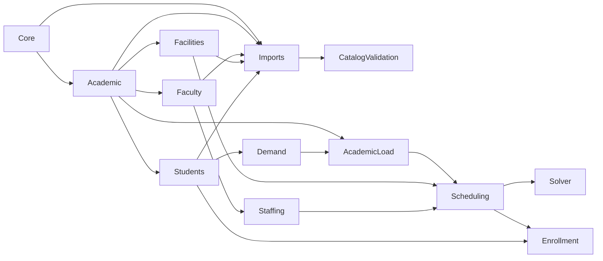
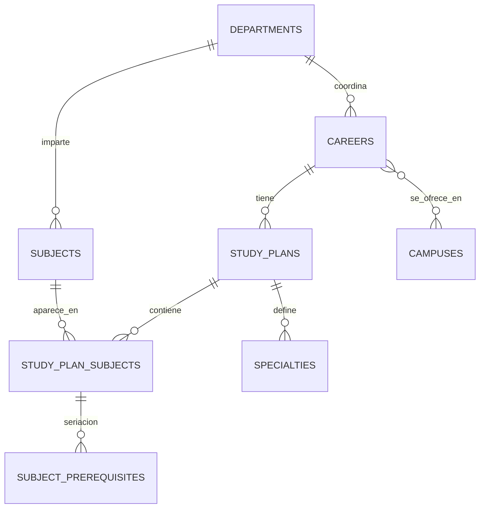
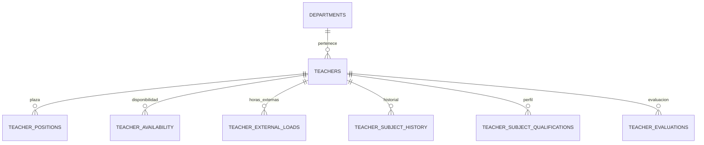
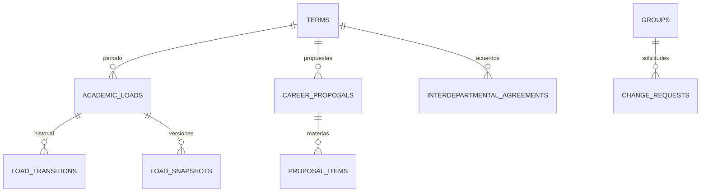
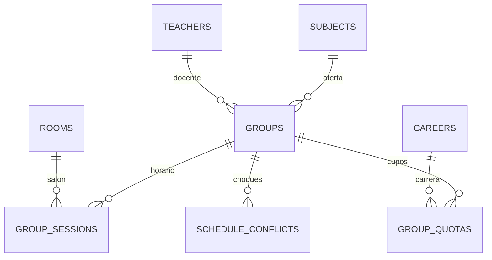

# Modelo de datos

Modelo conceptual por módulo. Describe tablas, campos clave y decisiones; los tipos exactos y los índices se definen en las migraciones de cada módulo (ver `docs/arquitectura/arquitectura.md`). Nombres de tablas y columnas en inglés, `snake_case`, plural. Todos los modelos usan `id` UUIDv7 (`HasUuids` y `default uuidv7()`, [ADR-0014](../decisiones/0014-uuidv7-como-llave-primaria.md)), con llaves foráneas y polimórficas en `uuid`, y `timestamps`; los catálogos usan **soft deletes** nunca borrado físico.

Convenciones transversales:

- Toda tabla de catálogo tiene `is_active` (lo que el SII llama "inactivo" no se borra, se desactiva) y una **clave natural** única (`code`, `control_number`, `employee_number`) que sirve de llave de upsert en importaciones.
- Toda tabla que participe en la carga académica lleva `term_id` y `campus_id` explícitos, aunque sean derivables, para que las consultas por periodo y campus sean directas.
- Los cambios de negocio se registran con `spatie/laravel-activitylog` (tabla `activity_log`, inmutable).
- Los enums de dominio son enums de PHP respaldados por `string` en la base de datos.

## Mapa de dependencias entre módulos

Regla: un módulo solo puede depender de los módulos que están a su izquierda en este mapa. `Core` no depende de nadie.

## Core

Todas las tablas de Core, incluidas las base de Laravel (`users`, `sessions`, `cache`, `jobs`) y las publicadas de spatie, viven en `app/Modules/Core/Database/Migrations`. Las tablas propias usan `timestamptz` en `created_at`, `updated_at` y `deleted_at`.

| Tabla | Campos clave | Notas |
|---|---|---|
| `users` | `username` (único), `name`, `email` (opcional), `password`, `is_active`, `must_change_password`, `last_login_at` (timestamptz) | Login por **username** con Fortify. Un usuario nuevo nace activo y con `must_change_password = true`: cambia la contraseña generada en su primer acceso. Un usuario puede o no estar ligado a un `teachers.user_id`. |
| `roles`, `permissions`, `model_has_roles`, … | (spatie/laravel-permission) | Roles (enum `Role`): `admin`, `subdireccion`, `jefe_departamento`, `jefe_proyecto_docente`, `coordinador`, `docente`; R3 añade `alumno`, `servicios_escolares`. Sin permisos finos: las policies deciden por rol y alcance con `ScopedContext` (`docs/arquitectura/arquitectura.md`, "Autorización y alcance"). |
| `role_scopes` | `user_id`, `role`, `campus_id?`, `department_id?`, `career_id?`, `valid_from`, `valid_to?` | **Alcance** de un rol: un coordinador lo es de una carrera en un campus; un jefe, de un departamento en un campus. Las policies consultan esta tabla. `role` es el valor del enum `Role`; `valid_to` nulo es vigente sin fecha de fin y, si existe, no es anterior a `valid_from` (CHECK). Modelo `RoleScope`: la vigencia se mide en días de Ciudad Juárez (`RoleScope::current()`) y un alcance solo cuenta si su usuario tiene el rol en spatie, su campus está activo y no borrado, y llena lo que el rol exige (`Role::scopeColumns()`: campus para `subdireccion` y `docente`; además departamento para los jefes y carrera para `coordinador`). `admin` no necesita alcance. `department_id` y `career_id` tienen FK a `departments` y `careers`; las agrega Academic en su propia migración, porque Core no depende de Academic. |
| `campuses` | `code` (`C1`, `C2`, `EAD`, `ENL`, `TNMV`, único aun entre borrados), `name`, `modality` (enum `Modality`: `presencial`, `mixta`, `en_linea`, `virtual_tecnm`), `settings` (jsonb), `is_active`, `deleted_at` | `settings` guarda el **perfil de flujo**: `uses_rooms`, `uses_time_blocks`, `staffing_mode` (`department` / `central`), `block_minutes`, `day_start`, `day_end` (`HH:MM`), `days` (1 = lunes a 6 = sábado), `allow_external_teachers`, `requires_subdireccion_approval`. `Campus::profile` lo expone como `CampusProfile` de solo lectura: `block_minutes` debe dividir exacto la jornada de `day_start` a `day_end`; una clave que falta toma el perfil presencial de PROJECT.md (sin externos y sin visto bueno obligatorio de Subdirección, ADR-0008) y un valor inválido lanza error. EAD, ENL y TNMV se siembran inactivos y solo con lo documentado; su perfil se define en la planeación de la fase 10. |
| `terms` | `code` (`20271`, único; el código del SII: `1` Ene-Jun, `2` verano, `3` Ago-Dic, CHECK), `name`, `starts_on`, `ends_on`, `is_current` | Un solo periodo "actual" para capturar carga, garantizado con un índice único parcial; se pueden consultar los anteriores. `ends_on >= starts_on` (CHECK). |
| `term_stages` | `term_id`, `campus_id?`, `stage` (enum `Stage`), `starts_on`, `ends_on` | Calendario del proceso. `campus_id` nulo aplica a todos (`TermStage::appliesTo($campus)`). Única por (`term_id`, `campus_id`, `stage`), con nulos no distintos. `ends_on >= starts_on` (CHECK). `stage`: las etapas 2 a 9 de `docs/proceso/proceso-propuesto.md`: `catalog_validation`, `proposal`, `scheduling`, `staffing`, `rooms`, `closing`, `publication`, `reanalysis`. |
| `settings` | `scope` (enum `SettingScope`: `global` / `campus` / `department`), `scope_id?`, `key`, `value` (jsonb) | Parámetros editables sin despliegue: pesos del ranking docente, tolerancia de horas, cupos por defecto. Una clave es única por alcance (`scope`, `scope_id`, `key`, con nulos no distintos). Solo `global` va sin `scope_id` (CHECK). |
| `activity_log` | (spatie) | Inmutable: un trigger de PostgreSQL rechaza `UPDATE`, `DELETE` y `TRUNCATE` venga de donde venga; por eso no se usa `activitylog:clean`. Eventos con `timestamptz`. |
| `notifications` | (Laravel) | Canal `database`; correo opcional después. |

## Academic

| Tabla | Campos clave | Notas |
|---|---|---|
| `departments` | `code` (único), `name`, `is_active` | Globales a la institución: los del organigrama oficial, compartidos por todos los campus. No hay departamentos propios de Campus II. |
| `department_heads` | `department_id`, `campus_id`, `user_id`, `kind` (`jefe` / `jefe_proyecto_docente`), `valid_from`, `valid_to?` | Quién dirige cada departamento en cada campus y desde cuándo. En Campus II el organigrama oficial tiene un solo departamento: sus jefes por departamento son de hecho y se registran igual. Un solo `jefe` vigente por departamento y campus; de `jefe_proyecto_docente` puede haber varios a la vez, pero la misma persona no repite cargo con fechas que se traslapan. Las dos reglas son `EXCLUDE USING gist` sobre el rango de fechas, sin contar los borrados (extensión `btree_gist`, [ADR-0016](../decisiones/0016-btree-gist-para-exclusiones-por-fecha.md)), y `kind` solo acepta sus dos valores (CHECK). `valid_to` nulo es vigente sin fecha de fin y, si existe, no es anterior a `valid_from` (CHECK). La tarea 1.14 da el rol y el alcance desde aquí (`DepartmentHeadKind::role()`, `DepartmentHead::currentOn()`). |
| `careers` | `code` (único), `name`, `department_id`, `is_active` | Carrera; el departamento es el que la coordina administrativamente. |
| `career_campus` | `career_id`, `campus_id`, `is_active` | En qué campus se ofrece; una vez por carrera y campus. Se deja de ofrecer con `is_active`. El coordinador se asigna por `role_scopes`. |
| `study_plans` | `career_id`, `code` (único), `name`, `version`, `semesters_count?`, `total_credits?`, `is_active`, `valid_from?` | Una retícula por versión; la clave natural es `code`, y `version` no es única por carrera porque el SII puede tener dos planes de la misma reforma. Las inactivas se conservan porque hay alumnos cursándolas. La exportación del SII no trae `semesters_count`, `total_credits` ni `valid_from`: quedan vacíos hasta que se capturen. `semesters_count` > 0 y `total_credits` ≥ 0 (CHECK). |
| `subjects` | `code` (único), `name`, `department_id`, `theory_hours`, `practice_hours`, `credits`, `kind?` (enum), `needs_lab`, `is_active` | Materia global; el tronco común se comparte entre carreras. `kind`: `basica`, `especialidad`, `complementaria`, `residencia`, `servicio_social`, `lengua_extranjera`; la exportación del SII no lo trae, así que queda vacío hasta que se capture; si viene, solo acepta esos valores (CHECK). Horas y créditos ≥ 0 (CHECK). |
| `study_plan_subjects` | `study_plan_id`, `subject_id`, `semester`, `specialty_id?`, `is_required` | Posición de la materia en la retícula. Único por plan y materia, también contra una fila borrada: quitar una materia es borrado lógico y volver a ponerla la restaura. `semester` ≥ 1 (CHECK). La especialidad es del mismo plan: FK compuesta (`study_plan_id`, `specialty_id`) a `specialties` (`study_plan_id`, `id`); quitar una especialidad resuelve antes sus materias (tarea 1.8). |
| `subject_prerequisites` | `study_plan_id`, `subject_id`, `prerequisite_subject_id`, `kind` (`seriacion` / `correquisito`) | Seriación por plan (la misma materia puede seriarse distinto en planes distintos). Única por plan, materia y requisito. La materia y su requisito tienen fila en la retícula de ese plan: dos FK compuestas a `study_plan_subjects` (`study_plan_id`, `subject_id`). Como una FK también acepta una fila borrada, quitar una materia de la retícula quita sus seriaciones en la misma Action (tarea 1.8). Una materia no es requisito de sí misma (CHECK); los ciclos los rechazan la Action de la 1.8 y la plantilla de la 1.9. `kind` solo acepta sus dos valores (CHECK). |
| `specialties` | `study_plan_id`, `code`, `name`, `is_active` | Módulo de especialidad. `code` es único dentro de su plan. |

Nada se borra físicamente en Academic: todas sus tablas llevan soft deletes, también la retícula y la seriación, porque los planes y las materias pasadas siguen haciendo falta para el historial (confirmado el 29 de octubre de 2026). Una clave natural la sigue ocupando un registro borrado; volver a poner una fila quitada la restaura.

## Facilities

| Tabla | Campos clave | Notas |
|---|---|---|
| `buildings` | `campus_id`, `code`, `name`, `is_active` | |
| `rooms` | `building_id`, `code`, `name`, `type` (enum: `aula`, `laboratorio`, `taller`, `sala_computo`, `auditorio`), `capacity`, `department_id?` (dueño), `features` (json), `is_active` | `capacity` es el dato que más cambia y que los jefes validan cada periodo. |
| `room_blocks` | `room_id`, `term_id?`, `day`, `starts_at`, `ends_at`, `reason` | Bloqueos (mantenimiento, reservado). |
| `subject_room_defaults` | `subject_id`, `campus_id`, `room_id`, `priority`, `source` (`manual` / `historial`) | Salón por defecto o sugerido. El historial se alimenta de cargas anteriores. |

## Faculty

| Tabla | Campos clave | Notas |
|---|---|---|
| `teachers` | `employee_number` (único), `user_id?`, `name`, `email?`, `department_id`, `home_campus_id`, `degree` (enum), `is_active`, `hired_on` | Un docente puede dar clase en varios campus; `home_campus_id` es solo administrativo. |
| `teacher_positions` | `teacher_id`, `kind` (enum: `tiempo_completo`, `tres_cuartos`, `medio_tiempo`, `asignatura`, `honorarios`), `base_hours`, `valid_from`, `valid_to` | Las **horas base** vigentes en el periodo definen la prioridad. Máximo 40. |
| `teacher_external_loads` | `teacher_id`, `term_id`, `source` (ej. `TecNM Virtual`), `hours`, `notes` | Se restan de la disponibilidad del docente en ese periodo. |
| `teacher_availability` | `teacher_id`, `term_id`, `day`, `starts_at`, `ends_at`, `kind` (`unavailable` / `preferred`) | Por defecto todo bloque del campus está disponible; aquí solo excepciones y preferencias. |
| `teacher_subject_history` | `teacher_id`, `subject_id`, `term_code`, `campus_id?`, `source` (`import` / `nexus`) | Una fila por vez que impartió la materia. Alimenta el desempate. Se importa del SII y Nexus la sigue llenando al publicar cargas. |
| `teacher_subject_qualifications` | `teacher_id`, `subject_id`, `level` (`apto` / `preferente`), `qualified_by`, `notes` | **Perfil**: el jefe declara qué materias puede dar cada docente. Auditado. |
| `teacher_evaluations` | `teacher_id`, `term_id`, `kind` (`estudiantil` / `departamental`), `score`, `source` | Puntaje usado en el desempate. Importado. |

## Students

| Tabla | Campos clave | Notas |
|---|---|---|
| `students` | `control_number` (único), `name`, `career_id`, `study_plan_id`, `campus_id`, `current_semester?`, `status?` (enum: `activo`, `baja_temporal`, `baja_definitiva`, `egresado`), `admitted_term_id?`, `is_active` | Solo lectura en R1 y R2 (viene de importación). R3 agrega datos de inscripción. El número de control es único en todo el Tec, así que el campus sale del archivo y no forma parte de la clave. El plan es de la carrera del alumno: FK compuesta (`study_plan_id`, `career_id`) a `study_plans` (`id`, `career_id`), que se actualiza en cascada si el plan cambia de carrera. `current_semester` ≥ 1 o vacío (un egresado). `status` queda vacío si el SII trae un estatus que Nexus no conoce; los que se repitan en las exportaciones reales se agregan al enum (confirmado el 29 de octubre de 2026). |
| `kardex_records` | `student_id`, `subject_id`, `term_code`, `grade?`, `result` (enum: `aprobada`, `reprobada`, `cursando`, `baja`), `attempt` | Historial académico. Único por alumno, materia y periodo, también contra una fila borrada; repetir la materia en otro periodo es otra fila. `term_code` lleva el código del SII (año y 1, 2 o 3, CHECK) y no es llave a `terms`, porque el kardex trae periodos de décadas anteriores. La materia puede no estar en el plan del alumno. `grade` de 0 a 100; `attempt` es la oportunidad, de 1 en adelante. |
| `student_progress` | `student_id` (único), `study_plan_id`, `credits_approved`, `subjects_approved`, `subjects_pending` (json), `subjects_available` (json), `computed_at` | Vista materializada (tabla recalculada por job al terminar una importación, en una sola transacción: mientras se recalcula, quien la lee ve el avance anterior completo). `subjects_pending` son las materias del plan que el alumno no ha aprobado (sin las de otras especialidades si ya tomó una); `subjects_available`, las que de esas ya puede cursar: aprobó toda su seriación, están a su alcance (su semestre y dos más) y, si piden un porcentaje de créditos (Servicio Social y Residencia), ya llegó a él (reglas-de-negocio.md, "Elegibilidad y demanda"). Un alumno cuyo plan no tiene retícula no tiene fila, y la de un alumno borrado se borra. Los elegibles de una carrera en un campus se cuentan en una sola consulta que despliega `subjects_available` y agrupa por materia (tarea 1.5); el índice GIN sirve para buscar por contención a los alumnos de una sola materia. Créditos y materias aprobadas cuentan solo las del plan y no son negativos (CHECK). `study_plan_id` es el plan con que se calculó: si el alumno cambió de plan, la fila vale hasta el siguiente recálculo, así que quien la lee la cruza con `students.study_plan_id`. |

## Imports

| Tabla | Campos clave | Notas |
|---|---|---|
| `import_batches` | `template` (string: `departments`, `careers`, `study_plans`, `subjects`, `prerequisites`, `teachers`, `positions`, `rooms`, `students`, `kardex`, `teacher_history`, `evaluations`), `campus_id?`, `mapping_id?`, `file_path`, `original_name`, `status` (enum: `uploaded`, `validating`, `validated`, `failed`, `applying`, `applied`), `total_rows`, `valid_rows`, `error_rows`, `run_id?`, `processed_rows`, `created_rows`, `updated_rows`, `unchanged_rows`, `deactivate_missing`, `deactivated_rows`, `errors_exported_at?`, `failure_reason?`, `uploaded_by`, `applied_by?`, `applied_at` | Un lote por archivo. Aplicar es idempotente (upsert por clave natural). `file_path` es relativo al disco `imports` (`storage/app/imports`, fuera de git). `campus_id` solo en las plantillas de un campus. `valid_rows` cuenta las filas sin error, también las que traen advertencia. `run_id` es la corrida de la cola que lo tomó. `processed_rows` es el avance de la etapa en curso (filas leídas al validar, revisadas al aplicar); `created_rows`, `updated_rows` y `unchanged_rows`, lo que la aplicación ya escribió, también si se interrumpió. `deactivate_missing` dice si el admin eligió "desactivar faltantes" al aplicarlo, y `deactivated_rows` cuántos registros desactivó. `errors_exported_at` dice cuándo quedó listo el CSV de errores; vuelve a null al empezar a aplicar. `failure_reason` dice por qué quedó `failed`. No se borra. |
| `import_rows` | `batch_id`, `row_number`, `raw` (json), `normalized` (json), `errors` (json), `warnings` (json), `status` (`valid` / `warning` / `error` / `applied`), `key_hash?`, `target_type?`, `target_id?` | Permite mostrar errores por fila y re-subir solo el archivo corregido. `row_number` es el del archivo, único en el lote; `errors` y `warnings` van por campo. `raw` es `json` (no `jsonb`) para conservar el orden de las columnas. `key_hash` es el hash de la clave natural normalizada, con el que se encuentran en SQL las filas que repiten clave. Es el detalle por registro de una importación: la bitácora guarda una entrada por lote. |
| `import_deactivations` | `batch_id`, `target_type`, `target_id`, `created_at` | Los registros del catálogo que un lote desactivó por no venir en el archivo, con "desactivar faltantes". Es el detalle por registro de esa desactivación, como `import_rows` lo es de lo que se escribió, y dice qué reactivar a mano si el archivo venía incompleto. Único por lote y registro. Solo se escribe una vez. |
| `import_mappings` | `template`, `name`, `columns` (json: columna origen → campo destino), `created_by`, `is_active` | Cada layout de exportación del SII se mapea una vez y se reutiliza. `name` es único por plantilla. Soft deletes e `is_active`: un mapeo viejo se desactiva, porque los lotes que lo usaron lo citan. |

Las **plantillas** (columnas esperadas, reglas de validación, lógica de aplicación) viven en código, una clase por plantilla.

## CatalogValidation

| Tabla | Campos clave | Notas |
|---|---|---|
| `catalog_reviews` | `term_id`, `campus_id`, `department_id`, `catalog` (enum: `teachers`, `rooms`, `subjects`, `study_plans`, `careers`), `status` (`pending` / `in_review` / `validated`), `validated_by`, `validated_at`, `notes` | Una fila por catálogo, departamento, campus y periodo. La carga académica no puede pasar de borrador hasta que los catálogos del departamento estén `validated`. |
| `catalog_review_flags` | `review_id`, `flaggable_type`, `flaggable_id`, `flag` (enum: `inactive`, `wrong_capacity`, `duplicate`, `missing_data`, `other`), `comment`, `resolved_at`, `resolved_by` | Observaciones sobre registros concretos. Las correcciones se hacen en el catálogo y quedan en bitácora. |

## AcademicLoad (orquestador)

| Tabla | Campos clave | Notas |
|---|---|---|
| `academic_loads` | `term_id`, `campus_id`, `department_id`, `status` (enum: `draft`, `proposed`, `staffing`, `adjusting`, `closed`, `approved`, `published`, `reanalysis`), `closed_by/at`, `approved_by/at`, `published_by/at`, `current_version` | Unidad de cierre: **departamento en un campus**. Único por periodo, campus y departamento. |
| `load_transitions` | `academic_load_id`, `from_status`, `to_status`, `user_id`, `comment`, `created_at` | Máquina de estados auditable. |
| `load_snapshots` | `academic_load_id`, `version`, `payload` (json), `created_by`, `created_at` | Foto completa de grupos, sesiones, docentes y cupos al publicar y en cada re-análisis. Permite diffs. |
| `career_proposals` | `term_id`, `campus_id`, `career_id`, `status` (`draft` / `submitted` / `accepted` / `returned`), `submitted_by/at` | Propuesta del coordinador. |
| `proposal_items` | `career_proposal_id`, `subject_id`, `semester`, `eligible_students`, `expected_students`, `requested_groups`, `notes` | `eligible_students` lo calcula Nexus desde `student_progress`; `expected_students` lo ajusta el coordinador (R2: lo sugiere Demand). |
| `interdepartmental_agreements` | `term_id`, `campus_id`, `kind` (`room_loan` / `shared_group`), `from_department_id`, `to_department_id`, `room_id?`, `group_id?`, `details` (json), `status` (`proposed` / `accepted` / `rejected`), `decided_by/at` | Lo que hoy se acuerda en la junta queda registrado y es verificable por el validador. |
| `change_requests` | `term_id`, `group_id`, `requested_by`, `kind` (`schedule` / `room` / `teacher`), `current` (json), `proposed` (json), `reason`, `status` (`pending` / `approved` / `rejected` / `applied`), `decided_by/at`, `impact` (json, R2) | Solicitudes de cambio de docentes. R1: flujo simple; R2: impacto calculado por el validador. |

## Scheduling

| Tabla | Campos clave | Notas |
|---|---|---|
| `groups` | `term_id`, `campus_id`, `subject_id`, `department_id`, `owner_career_id`, `code`, `teacher_id?`, `capacity`, `semester_label`, `status` (`planned` / `confirmed` / `cancelled`), `notes` | `code` sigue la nomenclatura del SII para que la publicación sea familiar. `department_id` se copia de la materia para consultas por departamento. |
| `group_sessions` | `group_id`, `day` (1 a 6), `starts_at`, `ends_at`, `room_id?`, `kind` (`teoria` / `practica` / `virtual`) | Bloques consecutivos de 1 hora se guardan como una sesión de inicio a fin. En modalidades sin bloques fijos (`uses_time_blocks = false`) la tabla puede quedar vacía para el grupo. |
| `group_quotas` | `group_id`, `career_id`, `max_seats`, `is_owner` | Reemplazo del "paralelo": `SUM(max_seats) <= groups.capacity`, validado por el validador y por una restricción en la base de datos. |
| `schedule_conflicts` | `term_id`, `campus_id`, `kind` (enum), `severity` (`hard` / `soft`), `subject_type/id` (grupo, docente, salón), `related` (json), `message`, `resolved_at` | Se recalculan al guardar cualquier sesión, docente o salón del periodo, y alimentan el tablero de choques. |

En PostgreSQL los empalmes de **salón** y de **docente** se pueden garantizar además con restricciones de exclusión (`EXCLUDE USING gist`) sobre `(room_id, day, timerange)` y `(teacher_id, day, timerange)` por periodo. El validador en PHP sigue siendo la fuente de mensajes para el usuario; la restricción de BD es la red de seguridad.

## Staffing

| Tabla | Campos clave | Notas |
|---|---|---|
| `staffing_rankings` | `group_id`, `teacher_id`, `rank`, `score` (decimal), `breakdown` (json: `base_hours`, `history_count`, `qualification`, `evaluation`, `remaining_hours`), `computed_at` | Ranking **visible** por grupo. Se recalcula cuando cambia cualquiera de sus entradas. |
| `group_teacher_assignments` | `group_id`, `teacher_id`, `assigned_by`, `assigned_at`, `replaced_at?`, `reason`, `ranking_position_at_assignment` | Historial de asignaciones. Si se asigna a alguien que no era el primero del ranking, `reason` es obligatorio. |
| `teacher_term_loads` | `teacher_id`, `term_id`, `base_hours`, `external_hours`, `assigned_hours`, `remaining_hours`, `computed_at` | Tabla derivada para tableros y validación de horas. |

## Demand (R2)

| Tabla | Campos clave | Notas |
|---|---|---|
| `demand_forecasts` | `term_id`, `campus_id`, `career_id`, `subject_id`, `eligible_students`, `historical_pass_rate`, `expected_students`, `suggested_groups`, `method`, `computed_at` | Resultado del análisis automático que precarga `proposal_items`. |

## Solver (R2)

| Tabla | Campos clave | Notas |
|---|---|---|
| `solver_runs` | `term_id`, `campus_id`, `department_id?`, `career_id?`, `engine` (`php_heuristic` / `cpsat`), `status` (`queued` / `running` / `done` / `failed` / `applied`), `input` (json o ruta), `output` (json o ruta), `metrics` (json), `created_by`, `applied_at` | Cada corrida es reproducible. El resultado se aplica a `group_sessions` solo cuando el usuario lo acepta. |

El contrato JSON de entrada y salida se define en `docs/arquitectura/solver.md`.

## Enrollment (R3, vaga)

Tablas previstas, a detallar en su fase: `enrollment_orders`, `enrollment_appointments`, `enrollments` (alumno, grupo, estado), `waitlists`. El modelo de `group_quotas` ya deja listo el control de cupo por carrera.

## Decisiones de modelado

1. **Modalidad vive en `campuses.settings`, no en una tabla aparte.** EAD, EnLínea y TecNM Virtual se registran como campus con su modalidad y perfil de flujo. Cuando se levante su proceso, el perfil decide qué etapas y validaciones aplican sin cambiar el esquema.
2. **Materias globales, seriación por plan.** El tronco común se comparte entre carreras; la posición y la seriación son del plan.
3. **Cupos por carrera en lugar de paralelos.** Es el cambio de modelo que resuelve el sobrecupo y además simplifica la inscripción de R3.
4. **Unidad de cierre = departamento en un campus.** Coincide con quien asigna docentes y salones. La propuesta del coordinador es por carrera y alimenta a varios departamentos.
5. **Tablas derivadas recalculadas por jobs** (`student_progress`, `teacher_term_loads`, `staffing_rankings`, `schedule_conflicts`) en lugar de calcular en cada pantalla. Son la base de tableros rápidos con Octane y Valkey como caché.
6. **Snapshots en JSON** para publicación y re-análisis en lugar de versionar cada tabla.
7. **Sin borrado físico en catálogos** y bitácora inmutable: la transparencia del proceso depende de poder reconstruir quién hizo qué.
