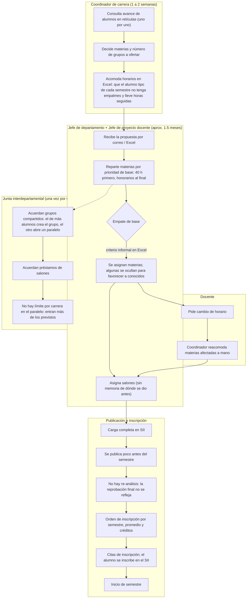
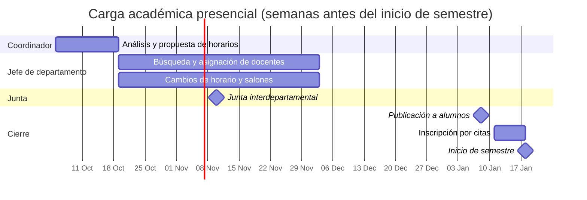

# Proceso actual (SII + Excel) y sus deficiencias

Descripción del proceso de carga académica e inscripción en modalidad presencial (Campus I y II) tal como funciona hoy, levantado el 26 de octubre de 2026 con el equipo. Las modalidades EAD, EnLínea y TecNM Virtual tienen procesos distintos que no se han levantado todavía (ver `docs/plan/fase-10-otras-modalidades.md`).

## Actores

| Actor | Qué hace hoy | Herramienta |
|---|---|---|
| Coordinador de carrera | Revisa el avance de los alumnos en la retícula, decide qué materias y cuántos grupos ofertar, arma horarios tentativos por semestre reticular | Consultas al SII, Excel |
| Jefe de departamento académico | Busca docentes para los grupos de sus materias, asigna salones, cierra su carga, negocia en la junta | Excel, correo, reuniones |
| Jefe de proyecto docente | Junto con el jefe, reparte materias entre docentes según base de horas | Excel |
| Docente | Recibe su carga, pide cambios de horario | Correo, en persona |
| Junta interdepartamental | Un representante por departamento acuerda grupos compartidos, "paralelos" y préstamos de salones | Reunión, acuerdos verbales |
| Servicios Escolares / División | Define orden de inscripción y citas; opera la inscripción en el SII | SII |
| Alumno | Se inscribe en su cita dentro del SII | SII |

## Flujo actual

## Línea de tiempo típica

Las fechas son ilustrativas; lo que importa son las duraciones: dos semanas para la propuesta, mes y medio para docentes, y nada entre la publicación y la inscripción para corregir.

## Deficiencias

| # | Deficiencia | Causa | Impacto | Cómo lo resuelve Nexus |
|---|---|---|---|---|
| D1 | El análisis de demanda es manual, alumno por alumno | El SII no cruza avance reticular con seriación | Grupos de más o de menos; se descubre en la inscripción | R1: conteo automático de alumnos elegibles por materia desde el kardex. R2: proyección con tasas históricas de reprobación y grupos sugeridos |
| D2 | Horarios en Excel sin validación | No hay regla que impida empalmes | Empalmes para el alumno tipo, docentes y salones; retrabajo | R1: validador de restricciones en vivo en el editor de horarios. R2: generación automática |
| D3 | Asignación docente opaca ("mafia" en Excel) | No hay criterio de desempate explícito ni visibilidad de la oferta completa | Materias ocultas, favoritismo, conflictos | Ranking calculado y visible por grupo; toda la oferta del departamento es visible para todos sus docentes; asignar fuera del ranking exige motivo y queda en bitácora |
| D4 | Mes y medio para asignar docentes | Trabajo serial por correo, sin tablero de pendientes | Publicación tardía | Tablero de grupos sin docente, carga por docente en tiempo real, notificaciones |
| D5 | Cambios de horario sin ver impacto | El coordinador reacomoda a ciegas | Nuevos empalmes, cadena de cambios | R1: solicitud de cambio con aprobación y validador. R2: impacto calculado antes de aprobar |
| D6 | "Paralelos" sin límite por carrera | El SII no soporta cupo por carrera | Sobrecupo, alumnos fuera de su carrera desplazan a los de la carrera dueña | Cupos por carrera dentro del grupo; suma de cupos validada contra capacidad |
| D7 | Acuerdos de la junta son verbales | No hay registro | Préstamos de salón olvidados o duplicados | Acuerdos registrados y verificados por el validador de salones |
| D8 | Salones sin memoria ni sugerencia | No existe "salón por defecto" | Laboratorios asignados a materias sin laboratorio y viceversa | Salón por defecto y sugerido por historial, tipo y capacidad |
| D9 | No hay re-análisis después de calificaciones | La carga se cierra antes de que acabe el semestre | Grupos saturados o vacíos al iniciar | Etapa de re-análisis: re-importar kardex, recalcular demanda, sugerir ajustes, versionar la carga |
| D10 | Sin trazabilidad | Excel y correo | Imposible saber quién cambió qué | Bitácora inmutable y máquina de estados con historial |
| D11 | Catálogos desactualizados (docentes inactivos, retículas viejas, capacidades) | Nadie es responsable de validarlos | Errores arrastrados cada semestre | Validación obligatoria de catálogos por jefe de departamento antes de abrir la carga |
| D12 | Un solo sistema con años de datos acumulados | SII monolítico y sin limpieza | Lentitud, campos sin uso, reglas ocultas | Nexus carga solo lo necesario, por importación controlada, y nace como nueva fuente de verdad por etapas |

## Qué se conserva del proceso actual

- La secuencia de responsabilidades (coordinador propone, departamento asigna, junta negocia, se publica, se inscribe) es correcta y la gente la conoce. Nexus la formaliza, no la reinventa.
- La prioridad por base de horas es regla institucional y se mantiene como primer criterio.
- La nomenclatura de grupos y claves de materias del SII se conserva para que la publicación sea familiar a docentes y alumnos.
