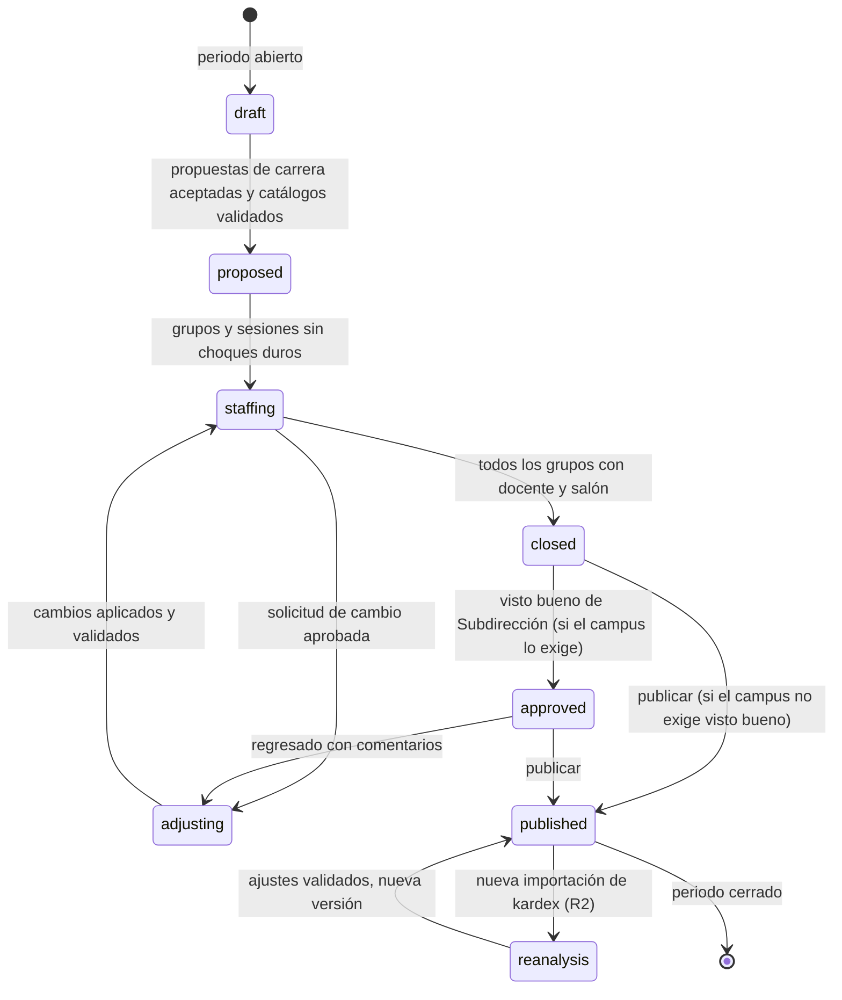
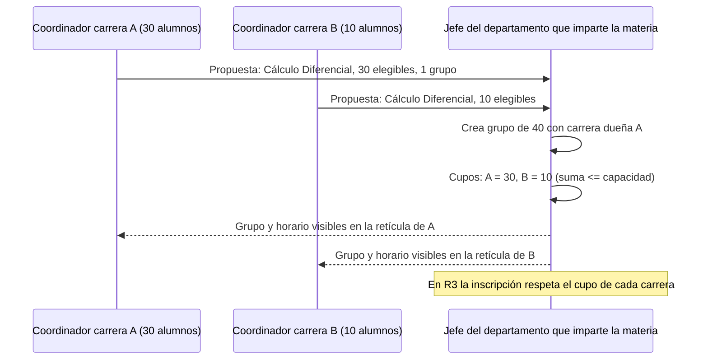

# Proceso propuesto en Nexus

Flujo de carga académica e inscripción para modalidad presencial, tal como lo implementa Nexus. Cada etapa indica quién la ejecuta, qué entra, qué sale y en qué entrega (R1, R2, R3) queda disponible. Las reglas exactas están en `docs/dominio/reglas-de-negocio.md`.

## Vista general

```mermaid
flowchart LR
    S0["0. Preparar periodo"] --> S1["1. Importar catálogos"]
    S1 --> S2["2. Validar catálogos por departamento"]
    S2 --> S3["3. Propuesta por carrera: materias y grupos"]
    S3 --> S4["4. Horarios y cupos por carrera"]
    S4 --> S5["5. Asignación docente con ranking"]
    S5 --> S6["6. Salones y acuerdos interdepartamentales"]
    S6 --> S7["7. Cierre por departamento y aprobación"]
    S7 --> S8["8. Publicación"]
    S8 --> S9["9. Re-análisis con calificaciones"]
    S9 --> S10["10. Orden de inscripción y citas"]
    S10 --> S11["11. Auto-inscripción"]
    S5 -. "solicitudes de cambio" .-> S4
    S9 -. "ajustes" .-> S4
```



| Etapa | Entrega |
|---|---|
| 0 a 8 | R1 (captura con validación, ranking y auditoría; sin motor de sugerencia) |
| 3 con demanda proyectada, 4 con horarios generados, 9 | R2 (motor y re-análisis) |
| 10 y 11 | R3 (inscripción, solo Campus II) |

## Etapas

### 0. Preparar periodo (admin, Subdirección)

- Entrada: fechas del semestre y de cada etapa por campus.
- Acción: crear el periodo (`20271`), su calendario de etapas y revisar el perfil de flujo de cada campus (bloques, horario, si requiere visto bueno de Subdirección).
- Salida: periodo abierto; cada departamento recibe su `academic_load` en estado `draft` y sus `catalog_reviews` en `pending`.

### 1. Importar catálogos (admin)

- Entrada: exportaciones del SII en Excel o CSV (carreras, planes, materias, seriación, docentes y plazas, salones, alumnos, kardex, historial docente, evaluaciones).
- Acción: subir el archivo, elegir o crear el mapeo de columnas, validar fila por fila, corregir y aplicar. Aplicar hace upsert por clave natural; nunca borra.
- Salida: catálogos cargados; `student_progress` recalculado; errores por fila disponibles para corregir en el SII o en el archivo.
- Repetible: cualquier catálogo se puede re-importar en cualquier momento (la etapa 9 depende de ello).

### 2. Validar catálogos (jefe de departamento, por campus)

- Entrada: catálogos importados.
- Acción: el jefe revisa listas de docentes, salones, materias y planes de su departamento con contadores y diferencias respecto al periodo anterior; corrige (desactivar docente, cambiar capacidad, marcar plan inactivo) o deja observaciones; marca cada catálogo como validado.
- Salida: `catalog_reviews` en `validated`. Hasta entonces la carga del departamento no puede salir de `draft`.
- Tablero para Subdirección y admin con el avance de validación por departamento.

### 3. Propuesta por carrera (coordinador)

- Entrada: avance reticular de los alumnos de la carrera en el campus.
- Acción R1: Nexus muestra, por materia de la retícula, cuántos alumnos son **elegibles** (aprobaron la seriación y no han aprobado la materia). El coordinador ajusta el estimado, define cuántos grupos pide y lo envía.
- Acción R2: `Demand` precarga el estimado con tasas históricas de reprobación y grupos sugeridos; el coordinador solo corrige.
- Salida: `career_proposal` en `submitted`; cada departamento ve las materias que le piden las carreras.

### 4. Horarios y cupos por carrera (coordinador, con el jefe)

- Entrada: propuestas aceptadas.
- Acción R1: se crean los grupos y el coordinador acomoda sesiones en un **editor de horarios** por semestre reticular (cuadrícula día x hora). El validador marca en vivo empalmes del alumno tipo, del docente y del salón, horas fuera de ventana y capacidad. Para materias compartidas entre carreras, se definen **cupos por carrera** en el grupo.
- Acción R2: el motor genera una propuesta completa de horarios por carrera y semestre; el coordinador la revisa y edita.
- Salida: grupos con sesiones y cupos, sin choques duros.

### 5. Asignación docente (jefe de departamento y jefe de proyecto docente)

- Entrada: grupos de las materias del departamento, catálogo de docentes validado.
- Acción: para cada grupo Nexus muestra el **ranking** de docentes (base de horas, luego historial y perfil en la materia, luego evaluación docente) con horas restantes y choques. El jefe asigna; si elige a alguien que no es el primero, debe escribir el motivo. Toda la oferta del departamento es visible para todos los docentes del departamento.
- Solicitudes de cambio: el docente ve su carga y pide cambio de horario o salón; el jefe aprueba o rechaza; el coordinador reacomoda con el validador (R2: Nexus calcula el impacto antes de aprobar).
- Salida: grupos con docente; `teacher_term_loads` al día; tablero de grupos sin docente.

### 6. Salones y acuerdos interdepartamentales (jefes)

- Entrada: grupos con sesiones y docentes.
- Acción: Nexus sugiere salón por defecto, historial, tipo y capacidad; el jefe asigna. Un salón de otro departamento solo se puede usar con un **acuerdo de préstamo** registrado, que el jefe dueño acepta desde Nexus. Los grupos compartidos quedan registrados como acuerdos con sus cupos por carrera.
- La junta sigue existiendo, pero llega con los datos en pantalla y sale con los acuerdos capturados.
- Salida: sesiones con salón, acuerdos aceptados, sin choques de salón.

### 7. Cierre y aprobación (jefe de departamento, Subdirección opcional)

- Condiciones para cerrar: cero choques duros, todos los grupos con docente y salón (o justificados), cupos consistentes, catálogos validados.
- Acción: el jefe cierra su carga (`closed`). Si el campus tiene `requires_subdireccion_approval`, Subdirección revisa el tablero del campus y aprueba (`approved`) o regresa con comentarios (`adjusting`).
- Salida: carga aprobada por departamento y campus.

### 8. Publicación (Subdirección o jefe según perfil)

- Acción: se genera un **snapshot** versionado y se publica: vista de consulta por carrera y semestre, por docente y por salón; exportes en PDF y Excel con el formato que hoy conocen los alumnos.
- R1: publicación de solo lectura (la inscripción sigue en el SII). Nexus exporta la carga en el layout que el SII acepte para importarla allá.

### 9. Re-análisis (coordinador y jefe) — R2

- Entrada: nueva importación de kardex y estatus al cerrar calificaciones.
- Acción: Nexus recalcula elegibles y demanda, compara con la carga publicada y propone ajustes (abrir grupo, cerrar grupo, ampliar cupo, cambiar salón por capacidad). Los ajustes pasan por el validador y generan una nueva versión del snapshot con su diff.
- Salida: carga ajustada y republicada antes de las citas.

### 10 y 11. Inscripción (Servicios Escolares, alumno) — R3, solo Campus II

- Orden de inscripción calculado con reglas configurables (semestre, promedio, créditos faltantes), citas por ventana de tiempo, auto-inscripción con validación de seriación, cupos por carrera y empalmes, lista de espera. Se detalla en `docs/plan/fase-9-inscripcion-campus-ii.md`.

## Máquina de estados de la carga académica



Cada transición exige un rol, unas condiciones verificadas por el validador y deja una fila en `load_transitions`.

## Solicitud de cambio de un docente

```mermaid
sequenceDiagram
    participant D as Docente
    participant J as Jefe de departamento
    participant C as Coordinador
    participant V as Validador
    D->>J: Solicita cambio de horario del grupo G con motivo
    J->>V: (R2) Calcular impacto: empalmes y cadena de cambios
    V-->>J: Impacto y alternativas
    J->>D: Aprueba o rechaza con comentario
    J->>C: Si aprueba, la carga pasa a adjusting
    C->>V: Reacomoda sesiones en el editor
    V-->>C: Sin choques duros
    C->>J: Cambios aplicados; la carga vuelve a staffing
```

## Grupos compartidos y cupos por carrera



## Qué cambia para cada persona

| Persona | Antes | Con Nexus |
|---|---|---|
| Coordinador | Consultas manuales y Excel; dos semanas | Elegibles calculados, editor con validador; R2: horarios generados para revisar |
| Jefe de departamento | Excel, correo, criterios informales; mes y medio | Ranking visible, tablero de pendientes, salones sugeridos, acuerdos registrados; obligación de validar catálogos |
| Jefe de proyecto docente | Mismo Excel | Mismas pantallas que el jefe, con su alcance |
| Docente | Se entera por correo, pide cambios en persona | Ve toda la oferta de su departamento y su carga; solicita cambios con seguimiento |
| Subdirección | Sin visibilidad hasta el final | Tablero de avance por campus y departamento; visto bueno opcional |
| Alumno | Horario publicado en el SII | R1: consulta publicada en Nexus; R3: inscripción en Nexus con cupos reales |
